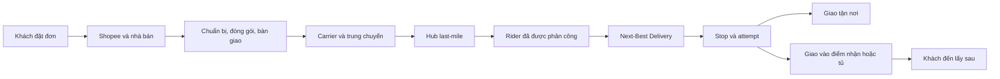

# Thị trường Việt Nam và hệ sinh thái Shopee/SPX

Ngày nghiên cứu: **13/10/2026**. Bổ sung cho [nghiên cứu pipeline và kiến trúc](BC26-BCE001.research.vi.md) và [proposal tiếng Việt](BC26-BCE001.vi.md). Bối cảnh triển khai vẫn là **5 người, 2 tháng**, có/chưa có dữ liệu đối tác.

Các số liệu bên dưới có kỳ đo và phạm vi riêng. Nguồn ưu tiên: Bộ Công Thương, Bộ KH&CN, công bố Sea, Shopee Help Center, SPX, đơn vị trực tiếp nghiên cứu thị trường và tài liệu kỹ thuật của nhà vận chuyển. Bài Metric đăng dưới tài khoản Metric VN trên Brands Vietnam được ghi rõ là bài của đơn vị nghiên cứu. Những đoạn “đề xuất/suy luận” là phân tích cho đồ án, chưa phải kết quả pilot hoặc mô tả hệ thống nội bộ Shopee.

## 1. Những kết luận ảnh hưởng trực tiếp đến proposal

1. **Shopee là thị trường mục tiêu đáng nghiên cứu**, nhưng thị phần doanh số của sàn không cho biết thị phần bưu kiện hoặc năng suất shipper SPX.
2. **COD cần được mô hình hóa theo trạng thái thanh toán**, không chỉ theo việc khách có tiền mặt. Shopee/SPX đã có thanh toán COD bằng mã QR trong những trường hợp đủ điều kiện.
3. **Tách giao tận nơi, điểm nhận và tủ nhận hàng.** Khách vắng nhà không có cùng ý nghĩa trong ba hình thức; nhãn giao thành công của rider cũng khác khách đã lấy hàng.
4. **Điểm vào, địa chỉ cũ/mới và phương tiện là các đặc trưng cần kiểm chứng tại Việt Nam.** Không chuyển nguyên giả định routing xe tải từ benchmark Mỹ sang xe máy ở một khu vực TP.HCM.
5. **API nhà bán và quyền điều phối rider là hai phạm vi khác nhau.** Dữ liệu đơn/tracking có thể hỗ trợ ingestion, nhưng GPS, attempt log và điều chỉnh tuyến cần quyền/dữ liệu đối tác được xác nhận.

Các nguồn cho những nhận định này và giới hạn của từng nhận định nằm ở phần tương ứng bên dưới.

## 2. Quy mô thị trường: dùng đúng mẫu số

### 2.1. Các mốc số liệu đã đối chiếu

| Chỉ số | Kỳ đo/phạm vi | Số liệu | Nguồn |
| --- | --- | --- | --- |
| Quy mô TMĐT Việt Nam | Tổng kết năm 2025 của Bộ Công Thương | Khoảng **31 tỷ USD**, tăng **25,5%**, khoảng **10%** tổng bán lẻ hàng hóa và dịch vụ | [Bộ Công Thương, công bố 24/12/2025](https://moit.gov.vn/tin-tuc/cuc-thuong-mai-dien-tu-va-kinh-te-so-tong-ket-cong-tac-nam-2025-va-trien-khai-nhiem-vu-nam-2026.html) |
| Doanh số trên bốn sàn | Shopee, TikTok Shop, Lazada, Tiki; cả năm 2025 | **429,7 nghìn tỷ đồng**, tăng **34,75%** | [Metric, công bố 28/01/2026](https://metric.vn/insights/cong-bo-bao-cao-thuong-mai-dien-tu-viet-nam-2025/) |
| Doanh số/sản lượng bốn sàn | Sáu tháng đầu 2026 | **291,6 nghìn tỷ đồng**, tăng **44,11%**; **2.186,7 triệu sản phẩm**, tăng **13,67%** | [Bài của Metric VN về H1/2026](https://www.brandsvietnam.com/congdong/topic/metric-bao-cao-thuong-mai-dien-tu-viet-nam-6-thang-dau-nam-2026-duoi-goc-nhin-cac-san) |
| Doanh thu/sản lượng bưu chính | Năm 2025; dữ liệu cập nhật đến 25/12/2025 | **87.000 tỷ đồng**; **4.200 triệu bưu gửi** | [Bộ KH&CN, công bố 06/01/2026](https://mst.gov.vn/so-lieu-noi-bat-linh-vuc-buu-chinh-vien-thong-197260106120829422.htm) |
| Bưu chính, snapshot gần thời điểm nghiên cứu | Tháng 9/2026, số liệu ước tính | **9.260 tỷ đồng**, tăng **22%**; khoảng **440 triệu bưu gửi**, tăng **14%** | [Bộ KH&CN, báo cáo tháng 9](https://mst.gov.vn/doanh-thu-cong-nghiep-cong-nghe-so-dat-hon-770000-ty-dong-trong-thang-9-197260930121611743.htm) |

**Cách diễn giải:** số Bộ Công Thương, số bốn sàn của Metric và số bưu chính không có cùng mẫu số. Sản phẩm bán ra ≠ đơn hàng ≠ kiện ≠ lần thử giao. Một đơn có nhiều sản phẩm/kiện; bưu chính còn có các loại bưu gửi khác. Không cộng các bảng này hoặc dùng một tỷ lệ quy đổi chưa đo để suy lượng giao SPX.

H1/2026 là nửa năm, 2025 là cả năm. Không lấy 291,6/429,7 làm tăng trưởng năm hoặc nhân đôi H1 để báo kết quả cả năm 2026. Số tháng 9 là ước tính công bố, không phải kết quả cả năm đã kiểm toán.

**Suy luận cho kiến trúc:** sự tăng trưởng tạo lý do nghiên cứu năng suất/chi phí, nhưng chỉ dữ liệu hub/ca mới đủ sizing hệ thống. Giữ phép tính 50 hub trong proposal ở trạng thái giả định; không thay bằng quy mô quốc gia.

### 2.2. Vị thế Shopee và cạnh tranh với TikTok Shop

| Nền tảng | Thị phần doanh số năm 2025 trong bốn sàn Metric theo dõi |
| --- | ---: |
| Shopee | **56,04%** |
| TikTok Shop | **41,31%** |
| Lazada + Tiki | **2,65%**, tính bằng phần còn lại của hai tỷ lệ trên |

Nguồn: [bài do Metric VN đăng về thị trường năm 2025](https://www.brandsvietnam.com/congdong/topic/thi-truong-tmdt-viet-nam-nam-2025-nhung-chuyen-dich-dang-chu). Đây là tỷ trọng doanh số, không phải người dùng, số đơn hoặc sản lượng vận chuyển. Phần 2,65% là phép tính của báo cáo này, không tách riêng Lazada/Tiki khi chưa có số đã xác minh.

Bài H1/2026 đã đọc không đưa đầy đủ tỷ lệ tổng thị trường của từng sàn, nên tài liệu giữ mốc thị phần 2025 có nguồn. Kết quả một ngành hàng hoặc một khoảng sale ngắn không đủ để kết luận sàn nào dẫn đầu toàn thị trường năm 2026.

**Suy luận kinh doanh:** khả năng giao đúng hẹn và ít lần thử có thể hỗ trợ trải nghiệm giữ khách trong cạnh tranh, nhưng đồ án cần đo chi phí/attempt và SLA. Thị phần lớn không chứng minh Shopee thiếu tối ưu tuyến; cần baseline vận hành để xác định phần giá trị tăng thêm.

### 2.3. Nhu cầu theo mùa và loại hàng

Metric ghi nhận mùa sale như 6.6, 9.9, 11.11, 12.12 và Q4/2025 là giai đoạn doanh số cao. [Metric 2025](https://metric.vn/insights/cong-bo-bao-cao-thuong-mai-dien-tu-viet-nam-2025/).

**Đề xuất kiểm tra:** dùng `campaign_day`, backlog đầu ca và tuổi đơn làm biến ngữ cảnh; lưu ngày thường/ngày cao điểm để đánh giá riêng. Doanh số tăng không tự đồng nghĩa số bưu kiện tăng cùng tỷ lệ. Các loại hàng kích thước lớn, dễ vỡ hoặc cần giữ nhiệt cần policy riêng; phạm vi đầu tiên nên là kiện thông thường thay vì gom mọi dịch vụ vào một model.

## 3. Đặc thù Việt Nam và tác động lên pipeline

### 3.1. COD, readiness và thời gian thanh toán

TGM công bố **35% người trả lời ưu tiên COD** trong khảo sát mua sắm online năm 2025. Đây là sở thích tự báo cáo, không phải 35% đơn Shopee hay tỷ lệ COD thực tế của SPX. Trang nguồn ghi N=1.142 ở phần kết quả nhưng N=1.120 trong phương pháp; chưa giải quyết được khác biệt này, nên không dùng làm tham số mô phỏng carrier. [TGM Payment Shift 2025, cập nhật 14/07/2026](https://tgmresearch.com/vietnam-ecommerce-payment-shift-2025.html).

Nguồn phù hợp cho tham số mô hình vẫn là log đơn và attempt tại hub: trả trước/COD, khách sẵn sàng, tiền chưa được xác nhận, số lần đổi hẹn và thời gian xử lý thanh toán. Không mặc định COD thất bại nhiều hơn trả trước nếu chưa đo trên dữ liệu tương ứng.

**Điểm mới trên Shopee/SPX:** Help Center mô tả “Quét mã SPX” cho các đơn COD đủ điều kiện, nhận tiền vào hệ thống SPX; nhiều đơn đủ điều kiện có thể gộp thanh toán, trừ đơn giao một phần. Trang cũng nêu đồng bộ trạng thái thanh toán có thể chậm. [Shopee — Quét mã SPX](https://help.shopee.vn/portal/4/article/204700).

**Thiết kế đề xuất:**

| Trường/nhãn | Ý nghĩa |
| --- | --- |
| `payment_mode` | Trả trước, tiền mặt lúc giao, QR lúc giao; unknown khi chưa biết |
| `cod_due_amount` | Khoản cần thu hiện hành, có version/thời điểm đọc |
| `payment_status` | Chưa thanh toán, đang xác minh, đã xác nhận; không suy từ ảnh chụp biên lai đơn lẻ |
| `payment_group_id` | Nhóm đơn cùng phiên thanh toán nếu được hệ thống đối tác cung cấp |
| `payment_confirmation_delay` | Thời gian chờ xác nhận, tách khỏi thời gian di chuyển |
| `handover_completed` | Bàn giao thực tế, khác xác nhận đã trả tiền |

COD readiness không nên chỉ là “khách có đủ tiền mặt”. Readiness của khách cũng không xác nhận tiền đã thu. Gộp stop và gộp thanh toán là hai việc khác nhau: không tự gộp các đơn chỉ vì cùng tọa độ.

### 3.2. Xe máy và phạm vi địa bàn

Nghiên cứu năm 2022 về cargo motorcycle tại Việt Nam khảo sát **726 tài xế ở Hà Nội**, mô tả vai trò của xe máy trong last-mile và các yếu tố liên quan đến rủi ro/áp lực công việc. Không phải dữ liệu SPX và không đo năng suất trong proposal. [Ngoc et al., cargo motorcycle last-mile](https://www.sciencedirect.com/science/article/pii/S2213624X22001377).

**Đề xuất triển khai:** gắn loại phương tiện với routing profile và capacity; xác minh hẻm/cổng/đường cấm trong vùng thử. Đo tuyến thực trước khi dùng tốc độ hoặc service time từ dataset xe tải nước ngoài. Đề xuất phải ổn định khi rider đang di chuyển; gom cập nhật và tránh luồng cần thao tác liên tục. Đưa ca làm/nghỉ và khả năng từ chối đường không phù hợp vào policy.

### 3.3. Địa chỉ, cổng vào và thay đổi hành chính

Quyết định **19/2025/QĐ-TTg** ban hành danh mục/mã đơn vị hành chính, có hiệu lực **01/07/2025**. Đây là nguồn để version danh mục, không phải cơ sở dữ liệu tọa độ cổng nhà. [Văn bản Chính phủ](https://chinhphu.vn/?classid=1&docid=214409&orggroupid=3&pageid=27160).

GHN đã có tài liệu tạo đơn phân biệt địa chỉ mới hai cấp và địa chỉ cũ, với district tùy trường hợp. Điều đó cho thấy adapter carrier cần biết schema địa chỉ của mình; không thể áp một trường district bắt buộc cho mọi nguồn. [GHN Create Order](https://developer.ghn.vn/vi/docs/order/create).

**Đề xuất dữ liệu Việt Nam:** lưu `raw_address`, địa chỉ chuẩn hóa, alias tên cũ, version danh mục hành chính, source và tọa độ điểm dừng đã xác minh. Giữ quận/huyện cũ dưới dạng legacy field nếu có; không xóa địa chỉ gốc hoặc chuyển chuỗi tên bằng replace đơn giản khi ranh giới thay đổi. Mã hành chính, mã bưu chính và tọa độ là ba loại dữ liệu khác nhau.

Cổng chung cư, bảo vệ, thang máy, hẻm và chỗ đỗ là **giả thuyết địa điểm cần khảo sát** cho demo, không được trình bày như bộ dữ liệu sẵn có của Shopee. Điểm giao cần location ID ổn định; địa chỉ được chuẩn hóa không tự xác nhận micro-guide.

### 3.4. Kênh liên hệ và độ tin cậy

Shopee có cảnh báo chính thức về giả mạo shipper và link/OTP. Điều này liên quan trực tiếp đến thiết kế Customer Handshake: một link ngoài gửi bất ngờ có thể làm người mua không tin. [Shopee Help Center — giả mạo shipper](https://help.shopee.vn/portal/4/article/185129).

**Đề xuất:** nếu có đối tác, dùng kênh đã được đối tác chấp thuận và thông báo gắn với đơn trong phạm vi được phép. Demo ghi rõ thông báo thử nghiệm. Form readiness chỉ hỏi khả năng nhận/khung giờ, không hỏi OTP ngân hàng hoặc dùng để thu tiền; hệ thống không có quyền tích hợp payment thì chỉ mô phỏng trạng thái.

## 4. Phân biệt Shopee, SPX và các lớp vận hành

### 4.1. Hệ sinh thái và quy mô công bố

Shopee thuộc mảng TMĐT của Sea; SPX là đối tác vận chuyển được Shopee mô tả và cũng cung cấp dịch vụ cho khách ngoài sàn. [Sea annual-report announcement 2025](https://cdn.sea.com/investor/AR2025/Mwc2O4a367X8yYMIb1VG/2026.04.18%20Sea%20Limited%20Files%20Annual%20Report%20on%20Form%2020-F.pdf), [Shopee Blog về SPX, 14/09/2026](https://shopee.vn/blog/?p=188168), [SPX giới thiệu dịch vụ](https://spx.vn/vi/about-us.html).

Trong Q2/2026, Shopee công bố **4,2 tỷ gross orders** và **38,3 tỷ USD GMV**. Đây là số toàn bộ mảng Shopee theo công bố Sea, không phải Việt Nam, không phải SPX và không phải số giao thành công. [Sea Q2/2026, công bố 11/08/2026 trên SEC](https://www.sec.gov/Archives/edgar/data/1703399/000119312526344596/d120948dex991.htm).

| Lớp | Vai trò | Liên hệ với đồ án |
| --- | --- | --- |
| Marketplace Shopee | Đặt đơn, trạng thái giao dịch, lựa chọn dịch vụ và trải nghiệm mua | Nguồn đơn/đặc tính dịch vụ khi có quyền |
| Seller Center / Kênh Quản Lý Shop | Chuẩn bị đơn, đóng gói, bàn giao, theo dõi trạng thái | Có thể là nguồn xuất dữ liệu; không mặc định điều phối rider |
| Fulfillment/kho | Lưu hàng, pick/pack, bàn giao cho vận chuyển khi dùng dịch vụ phù hợp | Khác bài toán stop tiếp theo sau khi rider đã mang hàng |
| Carrier SPX hoặc carrier khác | Nhận kiện, trung chuyển, phát/giao lại/hoàn | Nơi cần log attempt, stop và dữ liệu vận hành thật |
| Rider/hub last-mile | Thực hiện giao trên địa bàn và ghi outcome | Người dùng trực tiếp của Next-Best Delivery |
| Khách/điểm nhận | Xác nhận readiness, nhận/bàn giao hoặc đến lấy hàng | Phải tách kết quả từng chặng theo service mode |

Shopee hướng dẫn Kênh Quản Lý Shop quản lý đơn, chứng từ và thanh toán; quy trình phía nhà bán không đủ để mô tả event bên trong carrier. [Quản lý đơn hàng Shopee](https://help.shopee.vn/portal/1/article/98754).

### 4.2. Sơ đồ phạm vi đề xuất

Đây là sơ đồ khái niệm để xác định phạm vi nghiên cứu, không phải kiến trúc nội bộ được Shopee/SPX xác nhận. Đồ án tập trung đoạn rider được phân công → stop/attempt → outcome; không cần xây lại toàn bộ checkout, kho hoặc mạng trung chuyển.

### 4.3. Tận nơi, điểm nhận và tủ nhận

Shopee công bố Điểm nhận hàng từ **09/02/2026**, có hỗ trợ ở Hà Nội, TP.HCM và các khu vực khác. FAQ nêu PIN nhận hàng, hạn nhận và khả năng hoàn/chuyển hình thức khi điểm gặp sự cố. [Shopee — FAQ Điểm nhận hàng](https://help.shopee.vn/portal/4/article/196362).

**Thiết kế nhãn đề xuất, cần đối chiếu event carrier khi tích hợp:**

| Hình thức | P(Success) của rider nên dự đoán điều gì? | Điều không nên gộp vào cùng nhãn |
| --- | --- | --- |
| Giao tận nơi | Bàn giao hợp lệ cho người nhận tại ETA, theo quy tắc thanh toán/POD | Delivered cuối cùng sau nhiều lần thử |
| Điểm nhận | Điểm mở cửa, còn khả năng tiếp nhận và nhận đủ các kiện cần bàn giao | Khách đã đến lấy hay chưa |
| Tủ nhận | Có ngăn phù hợp và hoàn thành gửi kiện, theo quyền/hệ thống được cung cấp | Việc khách mở tủ sau đó |

Chỉ triển khai tận nơi ở MVP nếu nguồn dữ liệu chỉ có loại này. Vẫn thêm `service_mode` để không huấn luyện nhầm khi có dữ liệu điểm nhận. Hướng dẫn ở điểm nhận cần giờ mở/cut-off và capacity; hướng dẫn tận nơi cần cổng/contact/readiness. Slot tủ là dữ liệu cần đối tác cấp, chưa có nguồn công khai được xác nhận trong phiên này.

Không tự đổi một đơn tận nơi sang điểm nhận để tăng score. Việc đổi hình thức/địa điểm có policy và quyền riêng; thuật toán phải coi service mode/destination đã hợp lệ là đầu vào.

### 4.4. Giao lại, hàng hoàn và đồng kiểm

SPX công khai dịch vụ yêu cầu giao lại; Shopee có màn hình quản lý đơn giao không thành công/hoàn trả. [SPX giao lại](https://spx.vn/vi/service/yeu-cau-giao-lai.html), [Shopee quản lý đơn giao không thành công](https://help.shopee.vn/portal/1/article/102523).

Chính sách vận chuyển Shopee quy định kiểm tra hàng tùy đơn được đồng kiểm, cùng các ràng buộc đóng gói/kiện. Không suy quyền kiểm tra mọi đơn Shopee từ mô tả chung COD của một carrier. [Chính sách vận chuyển Shopee, phiên bản 11/12/2025](https://help.shopee.vn/portal/4/article/77484).

**Đề xuất:** bổ sung `inspection_allowed`, `partial_delivery_allowed`, `reattempt_eligible`, `return_initiated` khi nguồn cung cấp xác nhận. Bàn giao một phần có thể cần trạng thái parcel/item, không chỉ một Boolean success cho cả order. Thuật toán chỉ đề xuất giao lại khi policy cho phép; số lần tối đa và thời hạn phải là cấu hình theo hợp đồng/service, không tự hardcode “3 lần” cho mọi Shopee/SPX.

SPX trực tiếp và đơn phát sinh trên Shopee có thể áp dụng điều khoản khác nhau. Ví dụ trang COD của SPX trực tiếp nêu trần **20 triệu đồng/đơn**, cùng đối soát định kỳ; không dùng trần đó làm trần mọi đơn Shopee hoặc lượng tiền rider được giữ. [SPX COD](https://spx.vn/vi/service/dich-vu-thu-tien-ho.html).
