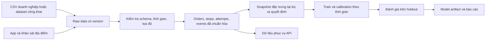
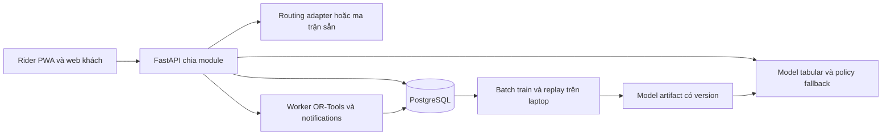
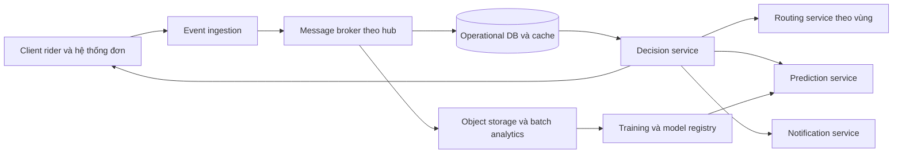

# Nghiên cứu triển khai Next-Best Delivery

Ngày đối chiếu nguồn: **13/10/2026**. Bối cảnh: **nhóm 5 người, thời gian 2 tháng**, xét cả có/chưa có dữ liệu doanh nghiệp và nhiều mức ngân sách.

Tài liệu liên quan: [proposal gốc](BC26-BCE001.pdf), [bản tiếng Anh](BC26-BCE001.md), [bản tiếng Việt và thuật ngữ logistics](BC26-BCE001.vi.md).

Đây là nghiên cứu tài liệu và đề xuất kỹ thuật. Chưa tải bộ dữ liệu, huấn luyện mô hình, chạy benchmark hay đo tải trên hạ tầng. Các cấu hình máy, ngân sách dự trù, thời gian xử lý mục tiêu và mốc nghiệm thu bên dưới là **đề xuất cần kiểm chứng**, không phải năng lực đã được đo. Thông tin từ tài liệu bên ngoài có liên kết ngay tại phần liên quan; các thiết kế và phép tính được đánh dấu là đề xuất hoặc ước tính.

## 1. Định hướng phù hợp cho đồ án

**Khuyến nghị:** làm hệ thống gợi ý đơn tiếp theo, có giải thích, hướng dẫn tại điểm giao, xác nhận của khách và ghi nhận kết quả. Chọn V1 khi chưa có dữ liệu thực tế; chọn V2 khi có log đủ tốt. V0 là baseline và phương án dự phòng của cả hai. V3 trình bày như hướng mở rộng, không cam kết xây xong hệ thống 50 hub trong 8 tuần.

| Điều kiện | Kết quả thực tế nên hướng tới |
| --- | --- |
| Chưa có dữ liệu doanh nghiệp | Demo vận hành đầu cuối; benchmark định tuyến/thời gian bằng dữ liệu công khai; mô phỏng thất bại và handshake có nhãn rõ |
| Chỉ có danh sách đơn và trạng thái cuối | Làm định tuyến và thu thập event; chưa đủ cơ sở suy ra xác suất thành công tại từng khung giờ |
| Có lịch sử từng lần giao, thời gian và kết quả | Có thể thử mô hình P(Success), thời gian phục vụ và đánh giá hồi cứu |
| Có thêm shipper/địa bàn cho thử nghiệm | Chạy shadow mode rồi pilot nhỏ để đo tác động đến hoạt động thực tế |

Ba bài toán phải tách rõ:

1. **Dự đoán:** một lần giao sẽ thành công không, mất bao lâu?
2. **Quyết định:** nên chọn đơn hoặc thứ tự điểm dừng nào dưới ràng buộc hạn giao, ca làm, kiện hàng?
3. **Thực thi:** khách có nhận thông báo và xác nhận không, shipper vào địa điểm được không, dữ liệu có đồng bộ khi mất mạng không?

Mô hình dự đoán tốt không tự chứng minh quyết định giao tốt. Và tuyến ngắn hơn chưa chắc hoàn tất nhanh hơn: nghiên cứu của Reed và cộng sự đưa thời gian tìm chỗ đỗ vào bài toán, cho thấy yếu tố này có thể thay đổi tuyến phù hợp. Đây là cơ sở để nghiên cứu service time, không phải bằng chứng trực tiếp cho các KPI trong proposal. [Bài nghiên cứu về parking](https://arxiv.org/abs/2107.06788).

Hai nguồn liên quan trực tiếp đến P(Success) và khả năng áp dụng:

| Nghiên cứu | Nội dung hỗ trợ | Suy luận cho đồ án |
| --- | --- | --- |
| [Özarık et al. (2023): stochastic availability và multiple visits](https://research.tue.nl/en/publications/an-adaptive-large-neighborhood-search-heuristic-for-last-mile-del/) | Mô hình hóa khả năng khách có mặt thay đổi theo thời gian và thử giao lại trong ngày | Đánh giá trade-off giữa tăng hit rate, travel và reattempt; chưa cần triển khai thuật toán pALNS của bài báo |
| [Ensuring Successful Home Delivery Attempts Using AI — A Reality Check (2026)](https://www.sciencedirect.com/science/article/pii/S2352146526003777) | Tóm tắt nghiên cứu phỏng vấn và khảo sát nêu khó khăn về dữ liệu, tuân theo gợi ý và chi phí của routing phức tạp | Đưa khả năng rider override và tổng chi phí vào tiêu chí đánh giá, thay vì chỉ tối ưu accuracy |

Nguồn thứ hai được đối chiếu ở mức tóm tắt do trang toàn văn không truy cập được trong phiên nghiên cứu; không dùng nó để khẳng định một mức uplift cụ thể.

## 2. Chuẩn bị dữ liệu: lấy từ đâu và dùng được đến đâu?

### 2.1. Nguồn công khai

| Nguồn | Nội dung đã đối chiếu | Cách dùng đề xuất cho nhóm |
| --- | --- | --- |
| [LaDe — dataset card](https://huggingface.co/datasets/Cainiao-AI/LaDe) | CSV giao/lấy hàng, courier, AOI, mốc accept/finish; schema hai loại khác nhau | Chọn một thành phố và một loại tác vụ để thử ETA/thứ tự giao |
| [Amazon Last Mile — AWS Registry](https://registry.opendata.aws/amazon-last-mile-challenges/) | 9,184 tuyến lịch sử; 6,112 train, 3,072 evaluation; giấy phép CC BY-NC 4.0 | Benchmark định tuyến bằng ma trận thời gian có sẵn; ghi công và giới hạn sử dụng phi thương mại |
| [Amazon — mô tả cấu trúc dữ liệu của MIT](https://github.com/MIT-CAVE/rc-cli/blob/main/templates/data_structures.md) | Stop/package, time window, thể tích xe, planned service time, travel-time matrix, scan status | Kiểm tra mô hình ràng buộc và dữ liệu đầu vào; không coi planned time là thời gian thực đo |
| [Geofabrik — Vietnam extract](https://download.geofabrik.de/asia/vietnam.html) | Dữ liệu OpenStreetMap dạng PBF và các định dạng GIS | Dựng bản đồ/tuyến cho khu vực demo tại Việt Nam |
| [Open-Meteo — Historical Weather](https://open-meteo.com/en/docs/historical-weather-api) | Dữ liệu thời tiết tái phân tích, không phải log thời tiết ở từng cổng giao | Bổ sung đặc trưng mưa theo vùng/giờ trong nghiên cứu hồi cứu |
| [Open-Meteo — Historical Forecast](https://open-meteo.com/en/docs/historical-forecast-api) | Dữ liệu dự báo lịch sử | Chọn dữ liệu đúng thời điểm phát hành nếu muốn mô phỏng thông tin có sẵn khi ra quyết định |

**Giới hạn của LaDe:** card không mô tả đầy đủ lịch sử thất bại, COD readiness hay ghi chú cổng/thang máy. LaDe-P có time window; không mặc định LaDe-D có cùng schema. Một số tệp hiển thị tọa độ ngoài miền kinh/vĩ độ thông thường; phải kiểm tra biểu diễn trước khi đưa vào routing API. Card hiển thị Apache-2.0 và hướng dẫn dùng nghiên cứu; lưu phiên bản/điều khoản lúc tải. Không gộp toàn bộ thư mục bằng một schema duy nhất. [LaDe card](https://huggingface.co/datasets/Cainiao-AI/LaDe).

**Giới hạn của Amazon:** `scan_status` có `DELIVERED`, `DELIVERY_ATTEMPTED`, `REJECTED`; có thể có giao lại trong tuyến. Trạng thái này không thay thế log có timestamp của từng attempt. `planned_service_time_seconds` là thời gian dự kiến tại điểm giao, không phải nhãn đo được cho riêng tiếp cận/chờ/bàn giao. [MIT data structures](https://github.com/MIT-CAVE/rc-cli/blob/main/templates/data_structures.md).

**Suy luận khi chọn dữ liệu:** benchmark ở Trung Quốc/Mỹ không xác nhận hiệu quả ở TP.HCM. Tọa độ đã xử lý vì riêng tư cũng không thích hợp để suy ra cổng vào chính xác. LaDe mô tả ID ẩn danh và tọa độ được làm nhiễu; dùng thông tin đó để đặt giới hạn cho thí nghiệm. [LaDe paper](https://arxiv.org/html/2306.10675v2).

### 2.2. Nguồn doanh nghiệp và dữ liệu cần tự thu

Không mặc định có quyền truy cập API nội bộ Shopee/SPX. Nếu có đối tác, xin **bản xuất dữ liệu được phép sử dụng**, kèm tài liệu schema; CSV theo ngày đã đủ cho giai đoạn đầu.

| Nhóm dữ liệu | Lấy từ đâu trong vận hành | Trường tối thiểu đề xuất | Mục đích |
| --- | --- | --- | --- |
| Đơn/kiện | OMS hoặc bản xuất từ bộ phận vận hành | `order_id`, `parcel_id`, trạng thái, hạn giao, khung giờ, COD flag, kích thước/khối lượng nếu có | Ràng buộc và tập đơn ứng viên |
| Phân công | Hệ thống điều phối/TMS | `rider_id`, `hub_id`, đơn đang mang, ca làm, loại phương tiện, version phân công | Không đề xuất đơn ngoài quyền phục vụ |
| Từng lần giao | App shipper và lịch sử quét | `attempt_id`, số lần thử, bắt đầu/kết thúc, outcome, failure reason | Nhãn P(Success) và thời gian attempt |
| Vị trí | App shipper, chỉ trong ca được thu thập | Timestamp, vị trí, độ chính xác GPS, trạng thái di chuyển | Travel time và phát hiện đến điểm |
| Khách phản hồi | App/web xác nhận, log kênh thông báo | Thời gian gửi/nhận/xác nhận, khung giờ sẵn sàng, hết hiệu lực | Customer Handshake và độ mới của tín hiệu |
| Địa điểm | Ghi chú vận hành + khảo sát hiện trường | `location_id`, cổng, parking, bảo vệ, hạn chế giờ, nguồn, thời điểm xác minh | Micro-guide và service time |
| Kinh nghiệm shipper | Hồ sơ hoặc khảo sát được phép | Ngày bắt đầu, kinh nghiệm địa bàn, loại phương tiện | Phân tích nhóm mới/lâu năm |

**Khi chưa có đối tác:** tạo 30–50 điểm demo trong một khu vực nhóm tiếp cận được, ghi tọa độ cổng/điểm dừng bằng khảo sát; tạo 100–300 đơn giả để diễn tập. Các mức này là phạm vi demo đề xuất. Ghi chú thực địa cần sự đồng ý của bên tham gia; không dùng danh tính/số điện thoại khách thật trong dữ liệu demo.

Phỏng vấn shipper có thể giúp thiết kế failure reason và màn hình hướng dẫn. Phỏng vấn không tạo ra nhãn thành công/thất bại cho hàng nghìn đơn. Dữ liệu tổng hợp cần lưu seed, giả định sinh dữ liệu và cột `is_synthetic`; dùng để kiểm tra logic, không báo như kết quả kinh doanh.

### 2.3. Checklist đầu vào trước khi chọn mô hình

- Đối chiếu nghĩa của accept, arrive, delivered, attempted, rejected; thống nhất đơn vị giây/phút và timezone từng nguồn.
- Tách `order`, `parcel`, `stop`, `attempt`. Một stop giao nhiều đơn không tạo ra nhiều lần travel giống nhau.
- Lưu `event_time` và `ingested_at`; event đồng bộ trễ phải vẫn được sắp theo thời điểm thực tế.
- Chuẩn hóa timestamp thành UTC trong kho dữ liệu, chuyển sang `Asia/Ho_Chi_Minh` khi trình bày dữ liệu Việt Nam; không áp timezone Việt Nam cho dataset nước ngoài.
- Kiểm tra trùng ID, event đảo thứ tự, thời lượng âm, vị trí ngoài miền hợp lệ, GPS cũ và nhảy bất thường. Cách xử lý phải có log; không âm thầm xóa các lần giao lâu/thất bại.
- Quarantine bản ghi không đủ tin cậy; phân biệt giá trị không biết với giá trị 0 hoặc nhãn thất bại.
- Với dữ liệu khách thật, tách kho thông tin liên hệ khỏi feature dùng huấn luyện; dùng ID giả danh và quyền truy cập theo rider/hub. Lưu kỳ giữ dữ liệu theo thỏa thuận dự án.

## 3. Từ dữ liệu thô đến dữ liệu huấn luyện

### 3.1. Luồng dữ liệu đề xuất



Các lớp lưu trữ đề xuất: raw CSV giữ nguyên → bảng clean/Parquet → feature snapshot → model artifact. Lưu tên nguồn, version, ngày tải, giấy phép, checksum và định nghĩa label. Dataset lớn đọc theo chunk/partition; chỉ lấy một phần phù hợp để phát triển trên laptop.

### 3.2. Schema tối thiểu cho hệ thống demo/pilot

| Thực thể | Nội dung chính | Điểm cần phân biệt |
| --- | --- | --- |
| `orders` / `parcels` | Hạn giao, khung giờ, thuộc tính kiện, rider được phân công | Trạng thái hiện tại khác lịch sử trạng thái |
| `locations` | Địa chỉ chuẩn hóa, điểm dừng/cổng, vùng phục vụ | Điểm cổng có thể khác tâm tòa nhà |
| `attempts` | Một hàng cho một lần thử, thời gian, kết quả, lý do | Hủy/hoãn trước khi thử không tự gán failure |
| `events` | Event ID, entity ID, event time, ingestion time, payload có version | Dùng Event ID để chống ghi trùng khi retry |
| `location_notes` | Hướng dẫn, nguồn, hiệu lực, xác minh, báo cáo mâu thuẫn | Tách ghi chú tạm thời khỏi kiến thức ổn định |
| `recommendations` | Candidate set, feature snapshot ID, score, lựa chọn, model/policy version | Cần lưu cả đề xuất không được chọn |
| `handshakes` | Thông báo, xác nhận, deadline/expiry, version đề xuất liên quan | “Đã gửi” khác “khách sẵn sàng” |

Đây là schema gợi ý, không phải schema nguyên bản của LaDe/Amazon. Không cần feature store riêng trong V0–V2; bảng snapshot và một hàm tạo feature dùng chung cho train/serve là đủ để bắt đầu.

### 3.3. Label và điểm dễ sai

| Mục tiêu | Định nghĩa đề xuất | Không được suy ra như sau |
| --- | --- | --- |
| Thành công một attempt | Outcome của đúng `attempt_id`, chỉ gán khi attempt kết thúc | Đơn cuối cùng giao được ⇒ mọi attempt trước đó thành công |
| Thành công ngay lần đầu | Outcome của attempt số 1; mẫu số là các đơn có attempt đầu đã kết thúc | Chia theo toàn bộ đơn nhập hub, gồm đơn chưa thử |
| Travel time | Rời stop trước → đến điểm dừng tiếp theo, loại trừ khoảng nghỉ được ghi nhận | Accept → delivered là thời gian chạy xe trực tiếp |
| Access/wait/handover | Các mốc tương ứng, hoặc tổng service time nếu không tách được | GPS dừng ⇒ biết chắc khách đang chờ hoặc đang bàn giao |
| Thời gian attempt | Thời gian đi đến + phục vụ tới kết thúc attempt, kể cả thất bại | Chỉ lấy các đơn thành công để ước lượng mọi lần thử |
| Kinh nghiệm địa bàn | Mốc onboarding/nhật ký địa bàn hoặc khảo sát | Courier ID xuất hiện muộn trong dataset ⇒ người mới |

**Data leakage:** chỉ dùng thông tin có sẵn trước quyết định. Không đưa outcome, thời gian hoàn tất, ghi chú được tạo sau lần giao, hoặc phản hồi handshake chưa đến vào feature của quyết định đó. Scikit-learn mô tả leakage và khuyến nghị fit preprocessing chỉ trên train. [Common pitfalls](https://scikit-learn.org/stable/common_pitfalls.html).

Đề xuất chia theo ngày/tuần và giữ trọn một tuyến/ca trong cùng tập; thêm kiểm tra rider hoặc location chưa từng thấy. Tạo riêng train, calibration/validation và test cuối. Với dữ liệu đến muộn, feature snapshot phải dựa trên thông tin hệ thống thực sự đã nhận tại thời điểm dự đoán.

## 4. Nghiên cứu từng phần trong pipeline

### 4.1. Input: chuẩn hóa vị trí và ngữ cảnh

Đầu vào phục vụ quyết định là snapshot gồm: rider hiện tại, các đơn đã phân công, vị trí và độ mới GPS, thời gian, hạn giao, khách sẵn sàng, ghi chú địa điểm còn hiệu lực. Bắt đầu bằng tọa độ cổng được nhóm xác minh; chỉ geocode khi thực sự có địa chỉ chưa định vị được.

OSM là nguồn bản đồ, không phải nguồn xác nhận khách ở nhà, COD hay tình trạng thang máy. Với dữ liệu OSM, ghi attribution và tuân thủ điều kiện ODbL. [OSM copyright](https://www.openstreetmap.org/copyright).

Đề xuất lưu thời tiết theo ô khu vực/khung giờ và tái sử dụng giữa nhiều đơn. Weather reanalysis có độ phân giải và độ trễ riêng; phù hợp phân tích lịch sử nhưng không thể coi là phép đo mưa trước cửa từng nhà. [Open-Meteo Historical Weather](https://open-meteo.com/en/docs/historical-weather-api).

### 4.2. AI Engine: P(Success)

**Bài toán đề xuất:** xác suất giao thành công nếu chọn đơn này và đến vào thời điểm ETA. Dùng `arrival_time_estimate` thay vì chỉ giờ hiện tại; khách rảnh lúc 14:00 không chứng minh khách vẫn rảnh lúc 14:20.

| Mức triển khai | Mô hình/cách làm đề xuất | Khi áp dụng |
| --- | --- | --- |
| Baseline | Tỷ lệ lịch sử theo vùng × khung giờ, làm trơn về tỷ lệ toàn vùng | Có nhãn nhưng dữ liệu còn ít |
| ML nhỏ | Logistic regression với feature giờ, AOI, attempt number, tín hiệu khách trước ETA | Cần mô hình dễ kiểm tra |
| ML tabular | Histogram gradient boosting hoặc CatBoost; so sánh với baseline | Có nhiều feature tương tác và nhãn đủ đa dạng |
| Nghiên cứu nâng cao | Mô hình theo chuỗi hoặc contextual bandit | Chỉ nghiên cứu sau khi logging/đánh giá cơ bản ổn định |

Nếu không có nhãn attempt thực: hiển thị `unknown` hoặc xác nhận khách; dùng xác suất giả trong simulator và ghi rõ. Không huấn luyện trên dataset toàn đơn delivered rồi báo accuracy cao.

Đề xuất hiệu chỉnh xác suất trên tập tách biệt; xem reliability diagram, Brier score/log loss, PR-AUC và kết quả theo vùng/rider. Scikit-learn hỗ trợ sigmoid/isotonic calibration; isotonic dễ overfit khi ít mẫu. [Probability calibration](https://scikit-learn.org/stable/modules/calibration.html).

Fallback dựa trên **độ hỗ trợ của dữ liệu, missing feature, độ cũ và sai số calibration**, không coi P=0.95 đồng nghĩa mô hình tự tin. Khách/địa điểm mới dùng baseline vùng và hiển thị hạn chế.

### 4.3. AI Engine: True Delivery Time

Thiết kế đề xuất tách hai nhóm:

```text
T_attempt = T_travel + T_service
T_service = T_access + T_wait + T_handover_or_failure_resolution
```

Nếu chưa có mốc tách thành phần, dự đoán tổng service time; đừng tạo nhãn chi tiết giả từ GPS. Chỉ có accept→finish thì phải gọi nhãn đó là elapsed time từ nhận tác vụ, vì có thể bao gồm chờ trong hàng đợi và phục vụ đơn khác.

Travel time bắt đầu bằng routing engine, sau đó kiểm tra/hiệu chỉnh bằng dữ liệu của đúng phương tiện và địa bàn. Service time bắt đầu bằng median theo loại địa điểm/khung giờ; dùng regression khi có log đủ tốt.

Có thể thử dự đoán P50/P90 bằng quantile regression; `HistGradientBoostingRegressor` hỗ trợ loss `quantile`. Đánh giá MAE và pinball loss, cùng tỷ lệ bao phủ thực đo. P90 là phân vị dự đoán, không phải bảo đảm mọi lần giao hoàn tất trước đó. [HistGradientBoostingRegressor](https://scikit-learn.org/stable/modules/generated/sklearn.ensemble.HistGradientBoostingRegressor.html).

Để tính thời gian tiêu tốn kỳ vọng, cần tính cả thất bại:

```text
E[T_attempt] = T_travel
             + p × E[T_service_success]
             + (1 - p) × E[T_service_failed]
```

Công thức là đề xuất khi đủ dữ liệu điều kiện; có thể dùng một mô hình thời gian attempt trực tiếp thay vì tách nhánh. Tránh dùng service time chỉ của các lần thành công cho cả hai nhánh.

### 4.4. AI Engine: Priority

**Ưu tiên nên bắt đầu bằng quy tắc nghiệp vụ**, không cần mô hình riêng:

```text
slack_seconds = deadline - now - estimated_travel - estimated_service
```

Phân biệt khung giờ bắt buộc, hạn SLA và thời gian khách muốn nhận. Tới quá sớm có thể phải chờ; dự đoán theo thời điểm bắt đầu phục vụ sau khi chờ. Một số SLA áp vào hoàn tất, một số time window áp vào bắt đầu phục vụ: phải chốt nghĩa với bên cung cấp dữ liệu.

Đề xuất ưu tiên đơn gần hết slack; báo không khả thi khi không kịp ràng buộc bắt buộc. Dùng số lần hoãn/tuổi đơn để tránh liên tục bỏ qua các đơn khó. Không giảm xác suất nhận hàng để tự hợp thức hóa việc bỏ SLA.

### 4.5. Decide: chọn đơn giao tiếp theo

Luồng đề xuất:

1. Lọc đơn hợp lệ: đã được phân công/đang mang, chưa giao/hủy, đúng vùng và năng lực phục vụ.
2. Giữ các đơn khẩn cấp cùng một tập ứng viên gần; bắt đầu 20–30 stop, không lọc chỉ theo khoảng cách.
3. Lấy thời gian đi từ vị trí hiện tại đến ứng viên; tính service time, ETA, success và slack.
4. Kiểm tra ràng buộc; trả top 3 với lý do, thời điểm snapshot và phương án dự phòng.

Baseline score đề xuất khi giá trị các đơn tương đương:

```text
score_i = 3600 × P(success at ETA_i) / E[T_attempt_i in seconds]
```

Đây là suất hoàn thành kỳ vọng mang tính cục bộ, **không phải chứng minh tối ưu cả ca**. Nếu các đơn có giá trị khác nhau, nhân thêm trọng số nghiệp vụ đã được xác định; không lấy tiền COD làm lợi ích mặc định. Đơn gần hạn phải được xử lý theo policy SLA trước khi so score.

Với nhiều đơn cùng điểm dừng, gộp travel/access dùng chung, cộng thời gian bàn giao theo kiện; tránh đếm một chặng di chuyển nhiều lần. Nếu bỏ qua hoàn toàn tác động tới những stop còn lại, greedy có thể làm trễ một đơn khác; cần thử look-ahead hoặc planner tuyến.

### 4.6. Actions: tối ưu tuyến và đường đi

**Routing engine** tìm đường và cung cấp ma trận thời gian. **Route planner** chọn thứ tự stop/xe dưới các ràng buộc. Không coi hai thành phần là một API duy nhất.

| Phương án | Ưu điểm | Giới hạn cần kiểm tra |
| --- | --- | --- |
| Ma trận sẵn có từ benchmark | Không tốn API trong thử nghiệm | Không đại diện giao thông hiện tại ở Việt Nam |
| OSRM tự host theo khu vực | Chủ động quota, dùng OSM, truy vấn Route/Table | Cần preprocessing và profile phù hợp phương tiện |
| Google Routes | Dịch vụ quản lý, lựa chọn traffic/two-wheeler | Quota, phí theo SKU, điều kiện lưu/hiển thị dữ liệu |

OSRM có các profile mặc định car, bicycle, foot và áp profile khi preprocessing. `bicycle` không mặc định là xe máy. Sửa profile cần dựng lại dữ liệu; tự host không tự cung cấp nguồn traffic sống. [OSRM profiles](https://project-osrm.org/docs/v6.0.0/api/profiles.html).

Google có chế độ `TWO_WHEELER`; Việt Nam nằm trong danh sách hỗ trợ. Tài liệu nêu loại tuyến này ở beta và yêu cầu hiển thị cảnh báo khi dùng. Cần thử trên các tuyến hẻm/đường cấm tại vùng pilot. [Two-wheeler routes](https://developers.google.com/maps/documentation/routes/route_two_wheel), [coverage](https://developers.google.com/maps/documentation/routes/coverage-two-wheeled).

Đề xuất OR-Tools cho planner: travel time + service time, khung giờ, ca làm và capacity khi có dữ liệu. OR-Tools có ví dụ VRPTW; cấu hình phục vụ phải phản ánh đúng nghĩa time window của đồ án. [VRPTW](https://developers.google.com/optimization/routing/vrptw).

Bắt đầu 20–50 stop/route và giới hạn tìm kiếm 1–3 giây trong demo; đó là ngân sách tính toán đề xuất, phải đo. OR-Tools có `time_limit` và trạng thái tìm kiếm; hết thời gian có thể có incumbent hoặc chưa có lời giải. [Routing options](https://developers.google.com/optimization/routing/routing_options).

Nếu cho phép hoãn stop, thêm penalty theo nghiệp vụ và hiển thị danh sách hoãn; không để solver tự loại đơn quan trọng chỉ vì dễ tối ưu. OR-Tools hỗ trợ penalties/dropping visits. [Penalties](https://developers.google.com/optimization/routing/penalties).

### 4.7. Actions: Micro-guide và Collective Delivery Memory

Đề xuất khởi đầu bằng dữ liệu có cấu trúc, truy vấn theo `location_id`:

```text
location_id, entrance, parking, access_rule, temporary_issue,
valid_from, valid_until, source, verified_at, verification_status
```

Ví dụ “thang máy đang bảo trì” cần thời hạn; “cổng giao hàng ở phía B” cần mốc xác minh. Phản hồi chưa xác minh đi vào hàng chờ kiểm tra, không tự thay thế hướng dẫn đang dùng. Cho shipper báo sai, ghi nguồn và xử lý thông tin mâu thuẫn.

Khi không có guide đáng tin: hiển thị chưa có hướng dẫn và cho rider ghi nhận. Tránh tự sinh cổng/lối đi. LLM là tùy chọn để rút gọn/chuyển giọng một ghi chú đã có nguồn; không cần để quyết định đơn, tính ETA hay tạo sự thật về địa điểm.

V1/V2 dùng PostgreSQL full-text và khóa địa điểm là đủ. Chỉ bổ sung embedding/vector retrieval khi thực sự có nhu cầu tìm ngữ nghĩa trong kho ghi chú lớn. Đây là lựa chọn thiết kế để giảm thời gian triển khai, không phải kết luận rằng mọi kho kiến thức đều cần vector database.

### 4.8. Actions: Customer Handshake

Đề xuất demo: web xác nhận khách với ba lựa chọn **sẵn sàng / nhận sau / không thể nhận**, cùng thời gian hết hiệu lực. Khi gửi thông báo, dùng khoảng ETA thay vì cam kết “2 phút” nếu chưa đủ chính xác.

Tách trạng thái: tạo thông báo → provider nhận → thiết bị nhận → khách phản hồi → xác nhận còn hiệu lực. FCM trả message ID chỉ chứng minh đã chấp nhận gửi, không chứng minh đã giao tới thiết bị; TTL giới hạn thời gian tồn tại của thông báo. [FCM message lifespan](https://firebase.google.com/docs/cloud-messaging/customize-messages/setting-message-lifespan).

Đề xuất TTL ngắn theo thời điểm dự kiến đến, chống gửi trùng bằng order/attempt/version, thu hồi thông báo cũ khi đổi tuyến. Không phản hồi thì trạng thái `unknown`; không gán chắc thành công hoặc thất bại. Chỉ áp dụng phản hồi đến trước quyết định kế tiếp, không dùng hồi tố cho snapshot cũ.

FCM dùng được khi khách có app/token phù hợp; không tự gửi đến mọi số điện thoại trong đơn. SMS/Zalo/email là tích hợp khác, cần tài khoản, điều kiện sử dụng và phí riêng; đồ án có thể mô phỏng kênh đó, không cần mua trước khi chứng minh luồng xác nhận.

### 4.9. Rider Executes: ngoại tuyến và override

Cache danh sách đơn/đề xuất cuối và guide còn hiệu lực; ghi event vào outbox trên thiết bị để sync khi có mạng. Luồng đọc từ local storage và đồng bộ với server phù hợp cách tiếp cận offline-first của Android. [Offline-first architecture](https://developer.android.com/topic/architecture/data-layer/offline-first).

Đề xuất event có ID ổn định và server ghi idempotent. Server quyết định trạng thái order hiện hành; một event cũ gửi lên sau không được làm đơn đã giao quay về “đang giao”. Giữ lịch sử event để xử lý mâu thuẫn, không chỉ dùng last-write-wins theo đồng hồ thiết bị.

Cho rider chọn khác với lý do: cổng đóng, khách đổi giờ, đường không vào được, ghi chú sai. Với demo PWA, dùng định vị khi app đang mở và bộ phát GPS mô phỏng cho kiểm thử. Nếu pilot cần tracking khi app nền, ưu tiên client Android được thiết kế đúng cho location; Android giới hạn background location và theo dõi liên tục ảnh hưởng pin. [Background location limits](https://developer.android.com/about/versions/oreo/background-location-limits).

### 4.10. Output và vòng học liên tục

Lưu kết quả cả thành công lẫn thất bại, thời gian thực đo, recommendation đã dùng/override, phiên bản policy/model và candidate set. Dashboard tách năng suất, SLA, thất bại, thời gian tại điểm và chi phí.

Đề xuất refresh thống kê/mô hình theo batch sau khi label đủ và được kiểm tra; không retrain ngay sau mỗi event. Vòng học có thể bắt đầu bằng cập nhật guide và thống kê, chưa cần online learning.

**Selection bias:** chỉ quan sát kết quả của đơn thực sự được chọn. Đơn không chọn không có nhãn phản thực ở thời điểm đó. Shadow mode giúp kiểm tra tính khả thi nhưng không đo được tác động đầy đủ nếu hệ thống chưa thay đổi hành vi. Nếu nghiên cứu bandit/OPE, cần logging policy, propensity và đủ overlap; IPS/DR không tự khắc phục dữ liệu không quan sát. [Off-policy evaluation research](https://arxiv.org/abs/1612.01205).

## 5. Các phiên bản kiến trúc đề xuất

### 5.1. So sánh nhanh

| Version | Dữ liệu | Thành phần chính | Giá trị chứng minh | Giới hạn |
| --- | --- | --- | --- | --- |
| V0 — baseline/demo | Đơn giả hoặc đơn thật tối thiểu | UI + API + DB + quy tắc + ma trận tuyến | Luồng nghiệp vụ, fallback, log, so sánh nearest/deadline | Chưa có mô hình P(Success) học từ vận hành |
| V1 — đồ án có ML | Public benchmark + mô phỏng có nhãn; bổ sung khảo sát địa điểm | V0 + batch training + model thời gian/thứ tự + OR-Tools + replay | Chất lượng trên holdout, hiệu quả trong simulator | Không chứng minh KPI kinh doanh Việt Nam |
| V2 — pilot có dữ liệu thật | Log từng attempt, vị trí, phản hồi và guide | Backend chia module + worker + DB/PostGIS + routing + mobile/PWA | Shadow/pilot nhỏ, tác động đo được nếu đủ thử nghiệm | Chưa mặc định đạt mức sẵn sàng production |
| V3 — nhiều hub | Dòng event liên tục, dữ liệu có quản trị và lịch sử đủ | Ingest riêng, message broker, dịch vụ decision/routing, kho batch, giám sát | Khả năng phục vụ và vận hành ở quy mô lớn | Cần benchmark, SLA, vận hành và nguồn lực vượt đồ án |

### 5.2. V0: chạy ổn định, chi phí thấp

Stack đề xuất: **React PWA + FastAPI + SQLite trên máy local hoặc PostgreSQL nếu deploy + ma trận tuyến có sẵn**. Người điều phối nhập CSV; rider xem top 3, đọc guide, chọn/override và báo kết quả; khách xác nhận trên web demo.

Tách module theo Orders, Locations, Recommendation, Events, Handshake, Reporting trong một backend. Baseline deadline-first và nearest-travel-time; khi chưa biết P(Success), trả gợi ý theo baseline thay vì điền xác suất giả vào màn hình vận hành. Có fixture đầy đủ để demo khi không có mạng.

Mốc thành công: luồng đầu cuối, dữ liệu bền vững, nhập và kiểm tra CSV, ghi event không trùng, không chọn đơn đã giao/hủy, hiển thị guide có nguồn. Đây là nền tảng hoàn thành trước khi tăng độ phức tạp AI.

### 5.3. V1: hướng mặc định khi chưa có dữ liệu doanh nghiệp

Stack đề xuất: **React PWA + FastAPI + PostgreSQL + scikit-learn + OR-Tools + Python batch/replay**. Dataset công khai dùng cho benchmark có đúng nhãn; demo Việt Nam dùng các điểm khảo sát và đơn giả, ghi rõ phần synthetic.



Đề xuất worker là tiến trình riêng cùng repo; dùng bảng job trong PostgreSQL trước, chỉ thêm queue chuyên dụng khi backlog/độ tin cậy đòi hỏi. Cache ma trận/guide của dữ liệu tự thu hoặc OSM có quyền lưu; routing adapter tách backend dùng benchmark, OSRM hoặc API thương mại.

Chỉ thêm OSRM tự host nếu nhóm thực sự cần đường thực và đủ thời gian preprocess khu vực. Mục tiêu cuối đồ án: chứng minh mô hình tốt hơn baseline trên nhãn thật tương ứng; không gán cho public data những nhãn COD/khách ở nhà mà chúng không có.

### 5.4. V2: hướng mặc định khi có dữ liệu đủ tốt

Giữ **backend chia module**; thêm job worker tách CPU, PostgreSQL/PostGIS, object storage cho raw/Parquet/model, cache theo nhu cầu. Model tabular được load theo version; không gọi training trong request rider.

PostGIS dùng spatial index và `ST_DWithin` để lọc ứng viên theo bán kính. Geography đo bằng mét; không nhầm geometry kinh/vĩ độ với đơn vị mét. [PostGIS radius queries](https://postgis.net/documentation/tips/st-dwithin/), [ST_DWithin](https://postgis.net/docs/manual-3.5/en/ST_DWithin.html).

Đề xuất thử logistic/gradient boosting trước. CatBoost có hỗ trợ categorical feature; nếu chọn thì đối chiếu cách mã hóa chính thức và vẫn benchmark với baseline đơn giản. [CatBoost categorical features](https://catboost.ai/docs/en/features/categorical-features).

Pilot đề xuất ban đầu một hub, 5–10 rider, số stop được giới hạn theo lượt gợi ý. Nếu cần tracking nền, chọn Android client; nếu chỉ shadow mode/web demo, giữ PWA để giảm công việc. Tích hợp kênh khách thật chỉ khi có app/token/tài khoản phù hợp và phạm vi thử nghiệm đã được thống nhất.

Định tuyến ngắn hạn theo rider trước; chưa cần tái phân công giữa mọi rider. Mọi đơn đề xuất phải kiểm tra version phân công; nếu hai rider cùng truy cập, server không để một đơn được nhận thực hiện hai lần.

### 5.5. V3: kiến trúc mở rộng nhiều hub



Đề xuất phân vùng theo hub/địa bàn; routing graph được dùng chung theo khu vực, không nhất thiết một máy cho mỗi hub. API ingestion, inference và solver có pool tài nguyên riêng; GPS/event không kích hoạt solver sau mỗi ping. Tính lại khi hoàn tất attempt, khách đổi readiness, đơn mới hợp lệ hoặc thay đổi tuyến đáng kể.

V3 cần quyết định độ sẵn sàng, backup/restore, thời gian phục hồi, retention và khả năng chịu burst; theo dõi queue lag, p95/p99, lỗi external API, cache hit, chất lượng model. Kubernetes/Kafka chỉ là lựa chọn khi tải và đội vận hành chứng minh nhu cầu; không phải điều kiện tiên quyết để hệ thống có kiến trúc tốt.

### 5.6. Giao diện tối thiểu chung cho V0–V2

| Giao diện đề xuất | Nội dung | Tác dụng |
| --- | --- | --- |
| `POST /recommendations` | Rider, decision time; server đọc đơn/GPS/snapshot hợp lệ | Trả candidate đã xếp hạng, ETA, lý do, data/model/policy version, chế độ fallback |
| `POST /events` | Event ID, attempt/order, type, event time, payload | Nhận kết quả, vị trí và override idempotent |
| `GET /locations/{id}/guide` | Location ID | Trả guide có nguồn, thời hạn và trạng thái xác minh |
| `POST /handshakes/{id}/response` | Token giới hạn phạm vi, readiness và khung giờ | Ghi phản hồi và thời điểm hết hiệu lực |
| `POST /route-jobs` và tra trạng thái job | Tập stop hợp lệ, constraints, snapshot/version | Không giữ request lâu trong solver |

Đây là contract khởi đầu, chưa phải API được triển khai. Xác thực rider/dispatcher, kiểm tra quyền order/location và giới hạn dữ liệu trả về. Không đưa số điện thoại khách vào log/feature API nếu request không cần dùng.

## 6. Giới hạn hạ tầng và cách ước tính tải

### 6.1. Cấu hình khởi điểm để benchmark

| Mức | Cấu hình đề xuất | Giới hạn phạm vi ban đầu |
| --- | --- | --- |
| V0 local | CPU 4 core, RAM 8 GB; 16 GB thuận tiện hơn; SSD | Demo nhỏ, không chạy nhiều solver/training cùng lúc |
| V1 phát triển/training | CPU 4–8 core, RAM 16 GB, dự trù 20–50 GB dữ liệu/cache | Một thành phố hoặc sample; batch training; GPU không cần cho baseline tabular |
| V1 deploy demo | VM 2–4 vCPU, RAM 4–8 GB; DB/worker có thể cùng máy | Không kèm graph routing lớn hoặc training đồng thời |
| V2 pilot | App 2–4 vCPU/4–8 GB; worker 2–4 vCPU/4–8 GB; DB khởi điểm 4–8 GB RAM | Tách tài nguyên nếu solver cạnh tranh với API; đo rồi tăng |
| OSRM theo vùng | Máy riêng hoặc tiến trình có RAM/disk được đo lúc preprocess và serve | Bắt đầu vùng nhỏ có biên đệm; không suy RAM từ kích thước PBF nén |
| V3 | Chưa chốt số node từ proposal | Cần kết quả load test, kích thước graph, model và SLO thực tế |

Không coi các mức trên là sizing tối thiểu của nhà cung cấp. Preprocessing graph có thể tốn tài nguyên hơn phục vụ truy vấn; crop khu vực quá sát cũng có thể làm mất đường đi vòng. Public CSV sau giải nén, dataframe, model và nhiều worker đều có thể làm RAM tăng vượt dung lượng tệp.

CPU solver có thể là nút thắt trước ML inference. Ví dụ 10 job, mỗi job dùng 2 giây CPU trong 1 phút, tạo nhu cầu trung bình 20/60 ≈ 0.33 core-second/second, nhưng burst 10 job cùng lúc vẫn phải xếp hàng. Đặt concurrency theo số core và benchmark; tăng số API worker không tự làm solver rẻ hơn.

### 6.2. Quy mô suy ra từ giả định trong proposal

Phép tính sau dùng đúng giả định **50 hub × 100 rider/hub × 15,000 đơn/ngày/hub**, ca 9 giờ. Đây là **ước tính tải**, không phải số liệu vận hành đã xác nhận.

| Đại lượng | Phép tính | Kết quả |
| --- | --- | ---: |
| Số rider | 50 × 100 | 5,000 |
| Số đơn/ngày | 50 × 15,000 | 750,000 |
| Trung bình đơn/rider/ngày | 15,000 / 100 | 150 |
| Trung bình thời gian/đơn nếu toàn ca chỉ phục vụ đơn | 540 / 150 | 3.6 phút |
| Tốc độ đơn trung bình trong ca | 750,000 / 32,400 giây | ≈ 23.15 đơn/giây |
| GPS mỗi 30 giây | 5,000 × 32,400 / 30 | 5.4 triệu event/ngày; ≈ 166.67 event/giây |
| GPS mỗi 5 giây | 5,000 × 32,400 / 5 | 32.4 triệu event/ngày; 1,000 event/giây |
| GPS mỗi 1 giây | 5,000 × 32,400 | 162 triệu event/ngày; 5,000 event/giây |

Giả sử một GPS record thô chiếm 150–300 byte, mức 30 giây tạo **0.81–1.62 GB/ngày**, hoặc **24.3–48.6 GB/30 ngày**. Đây là giả định lưu trữ, chưa gồm index, JSON overhead, WAL, replica, backup. Batch giảm số HTTP request, không giảm số điểm GPS cần lưu nếu vẫn giữ mọi điểm.

Không dùng 23 đơn/giây làm QPS tổng của hệ thống: GPS, status, retry, polling, notification và recommendation là tải khác. Thiết kế load test đề xuất có burst 3–5 lần mức trung bình. Mức 3.6 phút/đơn cho thấy cần xác nhận cách đếm đơn/stop và thời gian nghỉ trước khi dùng giả định để sizing.

### 6.3. Ma trận tuyến là nút thắt cụ thể

Đề xuất dùng **1 × N** từ vị trí rider tới ứng viên khi chỉ chọn đơn tiếp theo; ma trận **N × N** chỉ khi thật sự lập tuyến. OSRM Table có hỗ trợ chọn sources/destinations. [OSRM Table API](https://project-osrm.org/docs/v5.24.0/api/).

| N điểm | Chọn bước kế tiếp: 1 × N | Lập tuyến: N × N | Dung lượng float32 của một ma trận N × N |
| ---: | ---: | ---: | ---: |
| 30 | 30 phần tử | 900 phần tử | 3.6 KB |
| 150 | 150 | 22,500 | 90 KB |
| 15,000 | 15,000 | 225 triệu | 900 MB |

Dung lượng trên là số học cho một mảng liên tục; response JSON, hai ma trận distance/duration và nhiều scenario tăng thêm bộ nhớ. Tính toàn hub 15,000 điểm tại mỗi lần cập nhật sẽ tốn truy vấn/solver lớn hơn rất nhiều so với chia tuyến và lọc ứng viên.

### 6.4. Quota và điều kiện dịch vụ đã kiểm tra

| Dịch vụ | Giới hạn/điều kiện hiện có | Hệ quả thiết kế |
| --- | --- | --- |
| Google Compute Route Matrix | Tối đa 625 phần tử thông thường; 100 với `TRAFFIC_AWARE_OPTIMAL` hoặc transit | Chia lô; một ma trận 30 × 30 không vừa một request |
| Google Routes quota | Tài liệu nêu 3,000 matrix elements/phút; Compute Routes 3,000 queries/phút | Theo dõi element rate khác request rate; kiểm tra quota thực trong project |
| OSRM `osrm-routed` | Tài liệu công cụ nêu `--max-table-size` mặc định 100 locations | Là cấu hình có thể đổi, không phải bảo đảm đủ RAM/CPU khi tăng |
| Nominatim public | Tối đa 1 request/giây cho app, nhận diện app, attribution; cấm autocomplete/systematic queries, không gửi dữ liệu cá nhân | Không chọn làm backend geocoding tổng quát cho app theo dõi/giao hàng; dùng tọa độ có sẵn hoặc dịch vụ/self-host phù hợp |
| OSM public raster tiles | Best effort, không SLA; cấm tải hàng loạt/prefetch cho offline | Cache guide/đơn khác cache bản đồ; offline map cần nguồn cho phép |
| Open-Meteo free | Phi thương mại; 600 calls/phút, 5,000/giờ, 10,000/ngày; không uptime guarantee | Lấy theo vùng/giờ; pilot thương mại chọn gói phù hợp |
| Render free | Ngủ sau 15 phút không traffic; khởi động lại khoảng 1 phút; filesystem tạm; Postgres free hết hạn sau 30 ngày | Không lưu SQLite quan trọng trên disk tạm; đồ án 2 tháng cần chọn phương án DB phù hợp |

Nguồn cho từng hàng: [Google matrix limits](https://developers.google.com/maps/documentation/routes/compute_route_matrix), [Google usage/billing](https://developers.google.com/maps/documentation/routes/usage-and-billing), [OSRM query limits](https://github.com/Project-OSRM/osrm-backend/blob/master/docs/tools.md), [Nominatim Usage Policy](https://operations.osmfoundation.org/policies/nominatim/), [OSM Tile Usage Policy](https://operations.osmfoundation.org/policies/tiles/), [Open-Meteo pricing](https://open-meteo.com/en/pricing), [Render free limitations](https://render.com/docs/free).

Với Google Routes, caching phần lớn nội dung bị hạn chế; place ID là ngoại lệ. Kết quả route hiển thị trên bản đồ cần dùng Google Map theo chính sách hiện hành. Vì vậy không áp dụng mặc định thiết kế “lưu ma trận lâu dài + vẽ tuyến Google lên bản đồ OSM”; routing adapter cần policy lưu/hiển thị riêng theo nhà cung cấp. [Routes API policies](https://developers.google.com/maps/documentation/routes/policies).

### 6.5. Chiến lược giảm tải và fallback đề xuất

- Replan theo event nghiệp vụ, không theo từng GPS ping; debounce các event gần nhau và gắn version snapshot.
- Lọc candidate bằng spatial index + độ khẩn cấp; giữ đơn gần SLA ngay cả khi xa hơn nhóm gần nhất.
- Cache kết quả tự tính/được phép lưu theo cặp điểm, phương tiện, phiên bản map và khung giờ; ghi độ cũ. Dữ liệu API thương mại áp dụng điều kiện riêng.
- Giới hạn solver, hàng đợi và concurrency; hết deadline trả baseline hoặc route cũ còn hợp lệ, không trả “đã tối ưu” nếu chưa có lời giải.
- Router/model/notification timeout phải có circuit breaker/retry có giới hạn; không gửi notification trùng sau retry.
- Ghi metrics về p95, queue lag, GPS age, missing feature, API elements, chi phí và fallback rate trước khi tăng hạ tầng.

## 7. Ngân sách: nhiều khả năng chi trả

### 7.1. Các mức ngân sách đề xuất

Các khoảng USD dưới đây là **phong bì ngân sách để lựa chọn phương án**, không phải báo giá trọn gói. Tổng 2 tháng giả định dùng đều cả hai tháng; chưa gồm công lao động, điện thoại, khảo sát, thuế, domain và phí SMS/Zalo. Dùng USD để không gắn với tỷ giá thanh toán chưa xác định.

| Mức | Dự trù/tháng | Dự trù 2 tháng | Phương án phù hợp |
| --- | ---: | ---: | --- |
| B0 | $0 dịch vụ trả phí | $0 | V0/V1 local; benchmark có ma trận, đơn/GPS mô phỏng; tận dụng laptop và mạng sẵn có |
| B1 | $25–75 | $50–150 | Demo deploy một VM, DB/worker cùng máy; routing benchmark hoặc local; giới hạn API chặt |
| B2 | $75–200 | $150–400 | V1 tốt hoặc V2 shadow nhỏ; worker/backup tách khi cần; OSRM vùng nhỏ nếu đã benchmark |
| B3 | $200–600 | $400–1,200 | V2 pilot nhỏ, DB/worker/routing phân tách hơn; tracking client và API ngoài có trần |
| B4 | Trên $600 | Theo usage/quote | Dịch vụ traffic/two-wheeler dùng nhiều hoặc yêu cầu vận hành cao; không tự suy ra đủ cho 50 hub |

Đối chiếu giá compute minh họa: DigitalOcean Basic Regular niêm yết **2 vCPU/4 GiB = $24/tháng**, **4 vCPU/8 GiB = $48/tháng**, **8 vCPU/16 GiB = $96/tháng**. Đó là giá VM, chưa gồm mọi dịch vụ trong stack; shared CPU cần đo khả năng chịu burst. [DigitalOcean Droplet pricing](https://www.digitalocean.com/pricing/droplets).

FCM được niêm yết no-cost, nhưng database, backend và các kênh SMS khác có chi phí riêng. Miễn phí gửi push không có nghĩa toàn bộ pipeline miễn phí. [Firebase pricing](https://firebase.google.com/pricing).

### 7.2. Ví dụ chi phí Google matrix

Giá niêm yết toàn cầu được đối chiếu ngày 13/10/2026, đơn vị **USD/1,000 billable elements**, theo từng SKU. [Google Maps pricing](https://developers.google.com/maps/billing-and-pricing/pricing).

| Compute Route Matrix SKU | Free cap/tháng | Bậc đến 100,000 | Bậc 100,001–500,000 |
| --- | ---: | ---: | ---: |
| Essentials | 10,000 | $5 | $4 |
| Pro | 5,000 | $10 | $8 |
| Enterprise | 1,000 | $15 | $12 |

Traffic-aware có thể kích hoạt Pro; two-wheeler kích hoạt Enterprise. Matrix tính phí theo origin × destination, không theo số HTTP request. [Usage and Billing](https://developers.google.com/maps/documentation/routes/usage-and-billing).

**Ví dụ tính toán từ bảng giá**, không phải báo giá cho dự án:

| Tổng matrix elements/tháng | Essentials | Pro | Enterprise |
| ---: | ---: | ---: | ---: |
| 10,000 | $0 | $50 | $135 |
| 156,000 | $674 | $1,398 | $2,157 |

Kịch bản 156,000: **10 rider × 30 lượt gợi ý/ngày × 20 điểm ứng viên × 26 ngày**, mỗi lượt một matrix 1 × 20, không cache. Đây là giả định minh họa; đã bỏ qua geocoding, map loads, retry và các request route chi tiết. Essentials không có cùng tính năng traffic/two-wheeler nên không được dùng giá Essentials để dự trù tính năng Enterprise.

Ví dụ kiểm tra bậc Essentials: `(100,000 - 10,000) / 1,000 × $5 + 56,000 / 1,000 × $4 = $674`. Batching giúp phù hợp request limits nhưng không giảm tổng phần tử tính phí. Pilot API-heavy này đã vượt B3 chỉ ở matrix, nên lựa chọn router là quyết định ngân sách lớn.

### 7.3. Chọn phương án theo dữ liệu và tiền

| Tình huống | Ngân sách thấp | Ngân sách vừa/cao |
| --- | --- | --- |
| Chưa có dữ liệu thật | V1 benchmark + simulator + tọa độ khảo sát; ưu tiên chi cho trải nghiệm và kiểm thử | V1 deploy ổn định, khảo sát/thu thập thêm; mua API không tạo ra nhãn khách sẵn sàng |
| Có dữ liệu thật nhưng log thiếu | V0/V2 ingest + bổ sung event; benchmark tuyến và thời gian theo nhãn có | Đầu tư logging/client và làm sạch; chưa cần model lớn |
| Có log attempt đủ tốt | V2 shadow trên máy/VM nhỏ; model CPU + router local/OSRM đã đo | V2 pilot nhỏ với DB/backup/monitoring tốt hơn; dùng traffic API có quota trần |
| Muốn 50 hub | Làm capacity study và load test mô phỏng | Thiết kế V3, sizing thực đo và dự trù dịch vụ; tách khỏi cam kết 8 tuần |

Khuyến nghị cho nhóm: chốt một ngân sách trần, phân bổ compute/DB/backup/routing riêng; có giới hạn cứng số matrix elements/ngày, ngoài cảnh báo chi phí. Không coi cảnh báo billing là cơ chế tự chặn chi tiêu.

## 8. Đánh giá, kiểm thử và những điều có thể kết luận

### 8.1. Baseline và thí nghiệm

So sánh cùng dữ liệu, cùng candidate set và cùng ràng buộc:

1. Nearest-travel-time.
2. Deadline-first.
3. Travel + service time.
4. Travel + service + P(Success) khi có nhãn phù hợp.
5. Thêm guide/handshake: ablation tách từng tác động.

| Thành phần | Chỉ số đề xuất | Điều kiện đọc kết quả |
| --- | --- | --- |
| P(Success) | Brier/log loss, calibration, PR-AUC; phân nhóm | Có cả outcome success/failure; mẫu số và tỷ lệ lớp rõ |
| Time | MAE, P50/P90 pinball loss, coverage, lỗi theo AOI | Đúng nhãn travel/service/elapsed; không trộn tên chỉ số |
| Policy | Đơn thành công/giờ, missed SLA, thời gian/km, attempts/order | Replay/simulator không tự chứng minh causal uplift |
| Guide | Coverage, tỷ lệ được xác minh, báo sai, access time | So sánh cùng loại địa điểm; ghi độ mới |
| Handshake | Gửi/nhận/phản hồi, delay, waiting time | Phân biệt readiness với push delivered |
| Hạ tầng | p50/p95, queue lag, error/fallback rate, RAM/CPU, API cost | Ghi cấu hình, concurrency, số stop và thời điểm đo |

**Giai đoạn đo tác động đề xuất:** offline/replay → shadow → pilot đối chứng nếu có đối tác. Tuyến/ca/rider có tương tác, nên tránh chia A/B từng đơn khiến hai policy tác động chéo; có thể phân theo rider-day hoặc hub-day tùy vận hành. Báo khoảng bất định theo cụm và các khác biệt về địa bàn/khối lượng đơn. Quy mô pilot 5–10 rider không mặc định đủ để kết luận uplift; cần dữ liệu nền và phân tích power trước khi hứa mức tăng cụ thể.

### 8.2. Kịch bản phải kiểm thử

- Không có đơn hợp lệ; tất cả khách chưa sẵn sàng; mọi khung giờ đã hết; đơn gần deadline nhưng xa hơn các ứng viên khác.
- Đơn đã delivered/cancelled, phân công thay đổi, hai rider truy cập cùng đơn; nhiều parcel cùng stop.
- GPS cũ/sai; vị trí không tìm được đường; một matrix element lỗi/null, API 429/timeout; hết quota ngân sách.
- Solver hết thời gian có/không có incumbent; route infeasible; đơn bị planner hoãn phải hiện rõ.
- Khách phản hồi sau khi đổi tuyến; không phản hồi; TTL hết; retry gửi thông báo không tạo bản trùng.
- Guide hết hiệu lực hoặc mâu thuẫn; không có guide; rider override rồi tiếp tục đồng bộ.
- Mất mạng giữa attempt; restart thiết bị; outbox sync trùng/đảo thứ tự; DB/worker restart.
- Train/test chia đúng thời gian; feature bị thiếu hoặc tương lai; địa điểm/rider mới; nhóm failure hiếm.

Mục tiêu kỹ thuật đề xuất cho demo: gợi ý p95 ≤ 2 giây với 30 candidate trên cấu hình đã ghi, nếu routing backend hoạt động bình thường; route job có ngân sách solver và UI trạng thái rõ; event gửi lại không nhân đôi outcome. Nếu chưa đạt p95, báo kết quả thực tế và nút thắt, không thay bằng con số mục tiêu.

### 8.3. KPI trong proposal chưa phải bằng chứng

**73.4%, tăng 13.4 pp, 110 đơn/ngày, giảm 20% failure, CO2 và lợi ích tiền** phải được coi là con số trong proposal đến khi có phương pháp tính, kỳ đo, baseline và dữ liệu kiểm chứng.

Đề xuất kiểm toán:

- Chốt FTD nghĩa là gì; phân biệt số đơn xử lý, số lần thử, số stop và số đơn giao thành công.
- Xác nhận cặp 45/270 và 37 pp đo cùng nhóm/thời kỳ; không tự dùng để suy hiệu quả giải pháp.
- Đo CO2 bằng km thực sự giảm × emission factor đã xác minh cho phương tiện/phạm vi đo; 45 g/km trong proposal chỉ là giả định hiện có.
- Xác định 380,000 VNĐ là loại tiết kiệm nào, ai được hưởng và kỳ đo; kiểm tra mũi tên tăng của Driver churn rate với tác giả.
- Không quy đổi CO2 ra “cây/ngày” nếu chưa có nguồn và kỳ hấp thụ; không đổi 20% tương đối thành 20 điểm phần trăm.

Trích dẫn Mo/Lim/Voigt trong PDF chỉ có tác giả–năm và QR chưa giải mã ở lần nghiên cứu này; chưa xác nhận chính xác từng tài liệu. Những nguồn bổ sung trong báo cáo được dùng cho các nhận định có liên kết, không tự coi là danh mục gốc của proposal.

## 9. Kế hoạch 8 tuần cho 5 người

### 9.1. Phân công đề xuất

| Thành viên | Trách nhiệm chính | Phối hợp |
| --- | --- | --- |
| 1 | Data ingestion, schema, quality report, labels | 2 để tạo feature và split đúng thời gian |
| 2 | Baseline/ML, calibration, replay và đánh giá | 3 để chốt policy/API inference |
| 3 | Backend, recommendation, OR-Tools, events/idempotency | 1 và 4 để kiểm tra luồng dữ liệu |
| 4 | Rider UI, web khách, guide, offline outbox | 3 để xử lý trạng thái/handshake |
| 5 | Deploy, monitoring, integration/load test, tổng hợp báo cáo | Cả nhóm để kiểm thử đầu cuối và demo |

Mỗi phần cần người review thứ hai; kiểm thử/tài liệu không chỉ dồn cho thành viên 5.

### 9.2. Tiến độ và cổng quyết định

| Tuần | Kết quả chung | Khi chưa có dữ liệu thật | Khi có dữ liệu thật |
| --- | --- | --- | --- |
| 1 | Chốt user flow, KPI/label, schema, candidate scope, stack và trần tiền | Chọn dataset công khai + điểm khảo sát; giữ dữ liệu synthetic riêng | Audit một sample, xin định nghĩa event, đánh giá quyền truy cập |
| 2 | V0 đầu cuối: nhập đơn → gợi ý → báo kết quả; fixtures và event log | Simulator có seed; baseline routing/time | Clean dữ liệu, quality report, baseline hồi cứu |
| 3 | Model baseline và holdout; màn hình guide/handshake | Model chỉ cho tác vụ có nhãn public phù hợp | P/time model nếu đủ nhãn; nếu không thì giữ baseline |
| 4 | Ghép prediction + policy + planner; top 3 có giải thích | So sánh trong replay/simulator | So sánh hồi cứu, bắt đầu shadow nếu đối tác sẵn sàng |
| 5 | Offline/override, expiry, event retry; freeze scope bắt buộc | Demo mất mạng và các failure scenario | Kiểm tra trên thiết bị pilot; dữ liệu phản hồi thật nếu có |
| 6 | Load test, đánh giá ablation, chi phí, lỗi tích hợp | Báo giới hạn domain/synthetic; triển khai demo | Pilot nhỏ nếu shadow đạt tiêu chí; chưa đạt thì tiếp tục shadow |
| 7 | Sửa lỗi và đánh giá cuối; khóa test set, hoàn thiện tài liệu | Báo benchmark có thể tái lập | Báo outcome/power/khác biệt nhóm; không hứa uplift nếu chưa đủ |
| 8 | Demo ổn định, backup/restore, báo cáo và video dự phòng | V1 hoàn chỉnh + V3 capacity study | V2 hoàn chỉnh + giới hạn pilot + hướng V3 |

**Cuối tuần 1:** chọn nhánh dữ liệu và ngân sách. **Cuối tuần 2:** nếu dữ liệu attempt không đủ, khóa P(Success) ở baseline/unknown/simulator; đồ án vẫn tiếp tục. **Cuối tuần 4:** nếu planner/ML không cải thiện hoặc quá chậm, giữ baseline phục vụ và trình bày kết quả nghiên cứu. **Cuối tuần 5:** dừng thêm tính năng; ưu tiên kiểm thử và demo.

Phạm vi nên hoãn sau đồ án: tối ưu toàn mạng nhiều hub, RL, tự host toàn bộ geocoding Việt Nam, xây navigation riêng, chatbot/LLM tạo hướng dẫn, triển khai nhiều platform native cùng lúc. Duy trì một luồng đầu cuối tốt và kết quả đánh giá có thể kiểm tra là mục tiêu 8 tuần.

## 10. Chú giải thuật ngữ kỹ thuật bổ sung

Thuật ngữ logistics xem [bản tiếng Việt, phần 12](BC26-BCE001.vi.md). Những thuật ngữ phục vụ nghiên cứu:

| Thuật ngữ | Giải nghĩa ngắn |
| --- | --- |
| OMS / TMS | Hệ thống quản lý đơn / quản lý vận tải và điều phối |
| AOI — Area of Interest | Vùng/nhóm địa điểm quan tâm; trong dataset cần đọc định nghĩa của tác giả |
| Feature / label | Thông tin mô hình được dùng để dự đoán / kết quả mục tiêu cần học |
| Snapshot / point-in-time correctness | Bản chụp dữ liệu và đặc trưng đúng những gì biết tại thời điểm quyết định |
| Data leakage | Dùng thông tin không có tại lúc dự đoán, làm đánh giá quá lạc quan |
| Calibration | Hiệu chỉnh để xác suất dự đoán phù hợp tần suất outcome thực tế |
| P50 / P90 | Phân vị 50% / 90% của thời gian theo điều kiện đang xét |
| VRP / VRPTW | Bài toán định tuyến nhiều xe / có ràng buộc khung giờ |
| Greedy / look-ahead | Chọn tốt nhất ở bước hiện tại / xét ảnh hưởng của một số bước tương lai |
| Incumbent | Lời giải hợp lệ tốt nhất solver đã tìm được tại thời điểm dừng |
| Shadow mode | Tạo và ghi đề xuất, trong khi hoạt động thực vẫn theo policy đang dùng |
| Ablation | Thử bỏ/tách từng thành phần để đánh giá đóng góp riêng |
| Selection bias / counterfactual | Sai lệch do chỉ quan sát lựa chọn đã thực hiện / kết quả của lựa chọn chưa thực hiện |
| Idempotency / outbox | Gửi lại không gây tác động trùng / hàng đợi ghi local để đồng bộ |
| TTL / stale data | Thời gian còn hiệu lực / dữ liệu đã cũ so với ngữ cảnh quyết định |
| SLO / p95 / queue lag | Mục tiêu chất lượng dịch vụ / phân vị độ trễ 95% / độ trễ hàng đợi |

## 11. Nguồn chính và cách đọc tiếp

Danh mục này là nguồn bổ sung đã kiểm tra cho nghiên cứu, không thay thế QR References trong proposal.

| Chủ đề | Nguồn đọc chính |
| --- | --- |
| Dataset giao hàng và bảo vệ vị trí | [LaDe card](https://huggingface.co/datasets/Cainiao-AI/LaDe), [LaDe paper](https://arxiv.org/html/2306.10675v2) |
| Benchmark tuyến/ma trận và license | [Amazon AWS Registry](https://registry.opendata.aws/amazon-last-mile-challenges/), [MIT data structures](https://github.com/MIT-CAVE/rc-cli/blob/main/templates/data_structures.md) |
| Thời gian đỗ xe trong tối ưu giao hàng | [Reed et al. — parking paper](https://arxiv.org/abs/2107.06788) |
| Khách có mặt và khả năng triển khai | [Özarık et al. (2023)](https://research.tue.nl/en/publications/an-adaptive-large-neighborhood-search-heuristic-for-last-mile-del/), [AI Reality Check (2026), tóm tắt](https://www.sciencedirect.com/science/article/pii/S2352146526003777) |
| ML tabular và xác suất | [Scikit-learn calibration](https://scikit-learn.org/stable/modules/calibration.html), [quantile regressor](https://scikit-learn.org/stable/modules/generated/sklearn.ensemble.HistGradientBoostingRegressor.html), [CatBoost](https://catboost.ai/docs/en/features/categorical-features) |
| Định tuyến | [OR-Tools VRPTW](https://developers.google.com/optimization/routing/vrptw), [routing options](https://developers.google.com/optimization/routing/routing_options), [OSRM profiles](https://project-osrm.org/docs/v6.0.0/api/profiles.html) |
| Dữ liệu nền tại Việt Nam | [Geofabrik Vietnam](https://download.geofabrik.de/asia/vietnam.html), [Open-Meteo](https://open-meteo.com/en/docs/historical-weather-api) |
| Quota và chi phí API tuyến | [Google matrix](https://developers.google.com/maps/documentation/routes/compute_route_matrix), [billing](https://developers.google.com/maps/documentation/routes/usage-and-billing), [global prices](https://developers.google.com/maps/billing-and-pricing/pricing) |
| Hạ tầng, thông báo và client | [DigitalOcean pricing](https://www.digitalocean.com/pricing/droplets), [Render free](https://render.com/docs/free), [Android offline-first](https://developer.android.com/topic/architecture/data-layer/offline-first), [FCM TTL](https://firebase.google.com/docs/cloud-messaging/customize-messages/setting-message-lifespan) |
| Giới hạn đánh giá policy | [Off-policy evaluation](https://arxiv.org/abs/1612.01205) |
