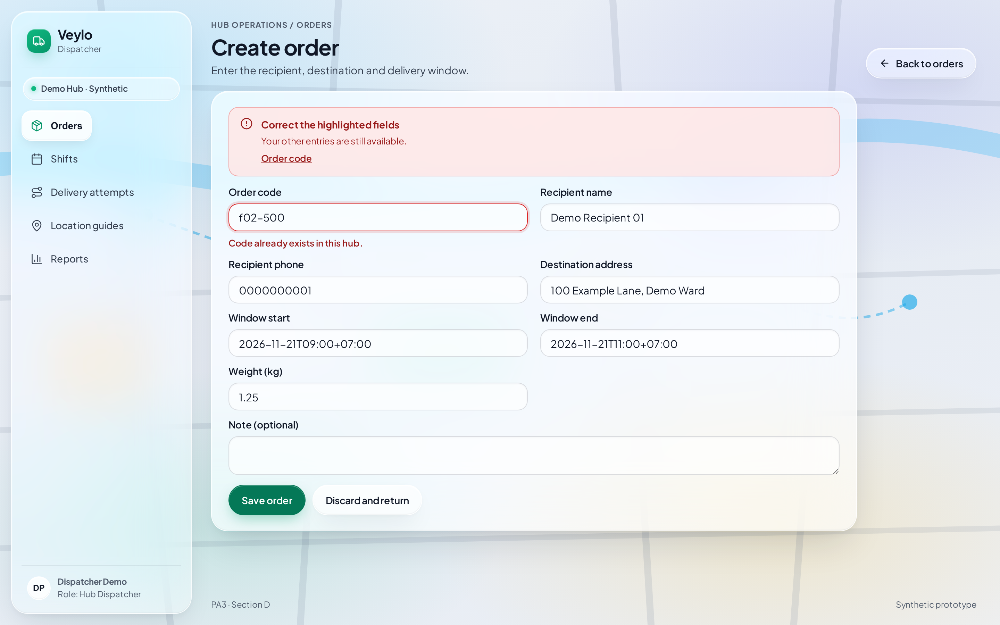
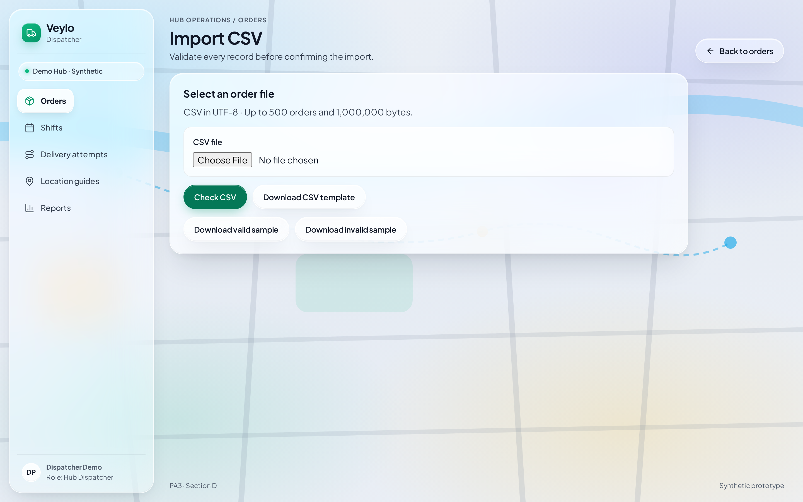
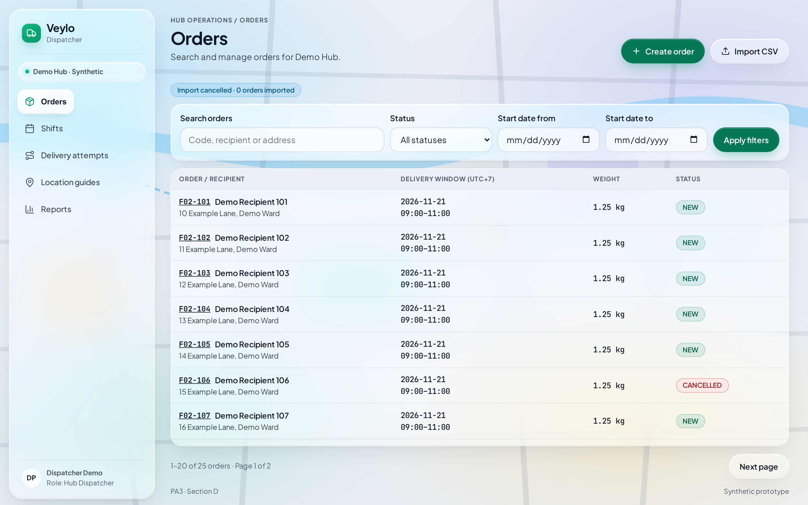
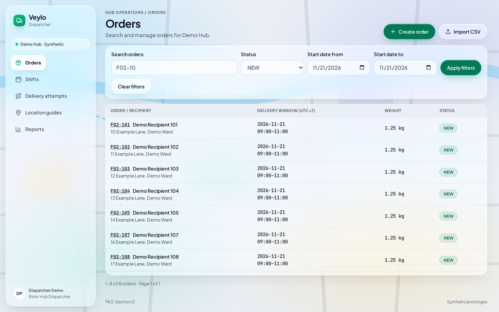
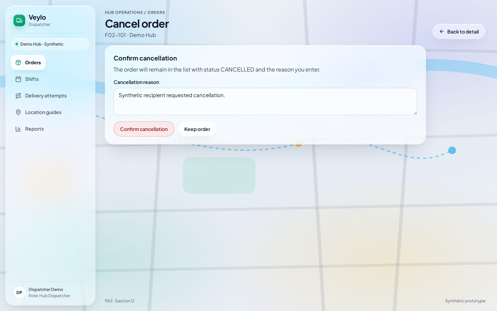
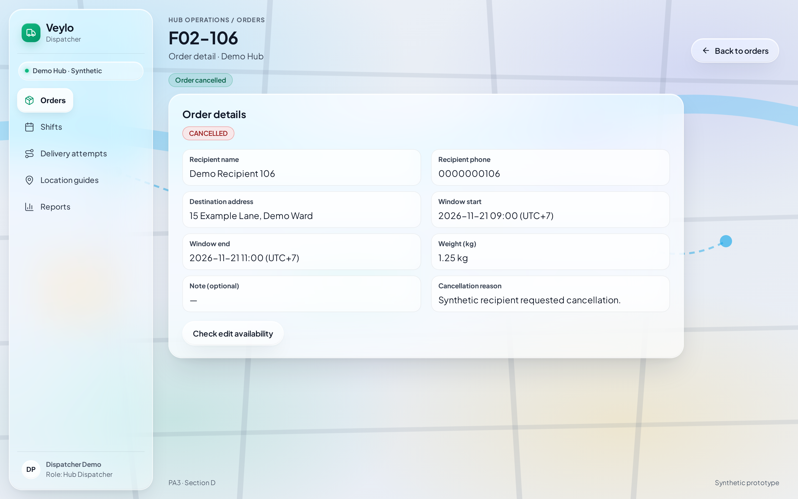
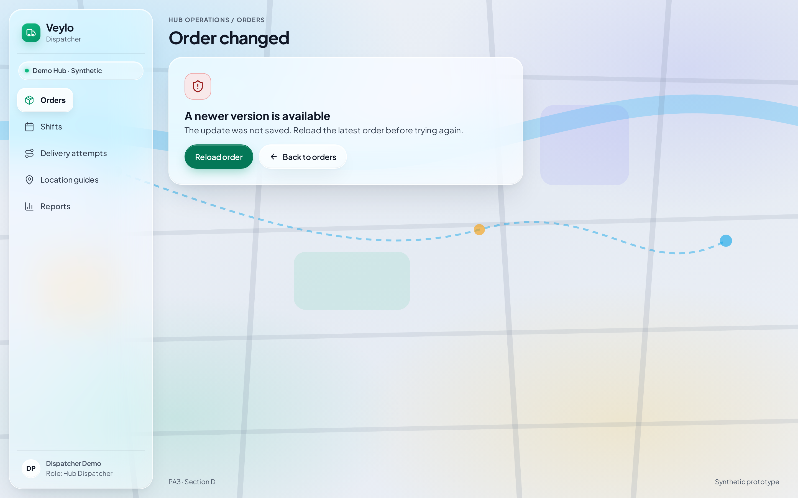
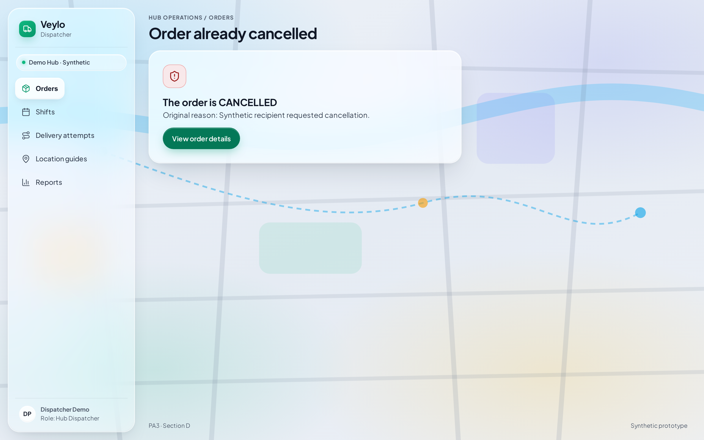

# Veylo · F02 Order Intake
Performed by: Codex for task owner Trần Lê Hải. Reviewed by: Pending (Phạm Công Khánh). Edited by: Codex.

**Group 09 · PA3 Section D · BOOYAH-20 · Review draft · 20 November 2026**

This specification covers the Hub Dispatcher goals in Use Case Model view D2, UC05 through UC08. `Dispatcher` is the short name used in the model. An Order is a delivery request that can have several DeliveryAttempts. Each DeliveryAttempt has its own start, arrival and outcome. An unsuccessful attempt alone does not make an Order terminal.

Sources are [BOOYAH-20](https://thaikiet291006.atlassian.net/browse/BOOYAH-20) and the PA3 rubric pp. 2–4, Kiệt's BOOYAH-24 `UseCaseModel.md` sections 2, 4.2 and 5–7, and BOOYAH-26 `VisionDocument.md`/`Changes.md` sections 3.2–3.3, 5.1, 5.3 and 6. Screens use Công Khánh's original PrototypeKit with fresh synthetic states. The [prototype guide](prototypes/order-intake/README.md) describes the working copy and evidence commands.

## UC05 — Create Order Manually
Performed by: Codex for task owner Trần Lê Hải. Reviewed by: Pending (Phạm Công Khánh). Edited by: Codex.

**Actor.** Hub Dispatcher. There is no secondary actor.

**Description and trigger.** A Dispatcher opens Create order to enter one delivery request for the current hub. FR-02-1 and FR-02-3 govern intake and validation. FR-01-2 applies to access.

**Preconditions.** The Dispatcher has an active session and is authorized in the current hub. The order code is available in that hub for a successful submission.

**Basic flow**

1. **05.1** From Orders, the Dispatcher chooses **Create order**. The system opens the form (`S07-01` → `S05-01`).
2. **05.2** The Dispatcher enters order code, recipient name and phone, destination, window start and end, parcel weight and any note (`S05-01`).
3. **05.3** The Dispatcher chooses **Save order**. The system checks role and hub, validates the fields and checks the normalized code in that hub (D-F02-1, -2 and -7, `S05-01`).
4. **05.4** The system creates one `NEW` Order and shows its detail and success confirmation (`S07-02-created`). **Back to orders** returns to `S07-01`.

**Alternative and exception flows**

| Branch | From | Condition and visible outcome | Resume or end |
| --- | --- | --- | --- |
| 05.A1 | 05.3 | A required field is blank, the phone is malformed, the date/time is invalid, the window end is at or before the start, or the weight is nonpositive. Other proposed field limits use the same feedback. `S05-01-error` focuses an error summary with links to invalid fields and keeps the entered values. | Correct at 05.2 and resubmit. |
| 05.A2 | 05.3 | The hub already has the normalized order code, for example ` f02-500 ` matches `F02-500`. `S05-01-duplicate` links to the code and preserves input. | Change the code at 05.2. |
| 05.A3 | 05.2 | The Dispatcher leaves through **Discard and return** or **Back to orders**. | End at `S07-01` with no created order. |
| 05.A4 | 05.1 or 05.3 | Role or hub authorization fails, or the session is absent/expired. | Follow [shared access recovery](#shared-access-recovery), then restart at 05.1 when authorized. No write occurs. |

**Postconditions.** Success creates one Order in the authorized hub with proposed status `NEW` (D-F02-6), visible in Orders. Validation, denial and dismissal perform no write. Corrections from 05.A1 and 05.A2 retain the form values.

**Special requirements.** N05 authorization boundary, N06 synthetic information and N16 keyboard access, labeled fields and summary-to-field focus. Valid data is checked before it becomes available for planning.

**Screen evidence.** The entry list is embedded under [UC07](#uc07--search-and-view-orders). See shared access frames under [Shared access recovery](#shared-access-recovery).

## UC06 — Import Orders from CSV
Performed by: Codex for task owner Trần Lê Hải. Reviewed by: Pending (Phạm Công Khánh). Edited by: Codex.

**Actor.** Hub Dispatcher. There is no secondary actor.

**Description and trigger.** A Dispatcher opens **Import CSV** to check and then confirm a batch of orders for the current hub. FR-02-2 and FR-02-3 govern import and validation. FR-01-2 applies to access.

**Preconditions.** The Dispatcher has an active session and access to the hub. The size, format, fields and per-hub code checks apply on input. The valid fixture should be exercised in a fresh demo whose seed has no codes `F02-001`–`F02-020`.

**Basic flow**

1. **06.1** From `S07-01` the Dispatcher selects **Import CSV**. `S06-01` offers the file picker and **Download CSV template**. Opening the template is optional and returns to the picker.
2. **06.2** The Dispatcher selects a file and chooses **Check CSV**. The system verifies authorization and the file contract, then validates all data records and both duplicate cases (D-F02-1 to -4 and -7). A clean file advances to `S06-02`.
3. **06.3** The Dispatcher reviews the preview and the valid count. The Dispatcher selects **Import 20 orders** for the sample (`S06-02`).
4. **06.4** The system rechecks authorization and the batch against current codes at confirmation, commits a valid batch together, and shows the number created (`S06-03`). **View orders** returns to `S07-01` with the new `NEW` Orders.

**Alternative and exception flows**

| Branch | From | Condition and visible outcome | Resume or end |
| --- | --- | --- | --- |
| 06.A1 | 06.2 | Unsupported type such as `orders.xlsx`. `S06-01-file-type` prompts for a `.csv` file. If no file was selected, the picker prompts for a file selection (`S06-01`). | Replace or select the file and retry 06.2. |
| 06.A2 | 06.2 | A zero-byte/blank file gives `S06-01-file-empty`. A header with no data gives `S06-01-file-empty-header`. | Add order records and retry 06.2. |
| 06.A3 | 06.2 | Missing, unknown, duplicated or out-of-order header names give `S06-01-file-header`. | Download the template and retry 06.2. |
| 06.A4 | 06.2 | 501 data records exceed the record cap (`S06-01-file-limit`). 1,000,001 bytes exceed the byte cap (`S06-01-file-limit-bytes`). | Reduce the CSV and retry 06.2. |
| 06.A5 | 06.2 | Invalid quote/record syntax gives `S06-01-file-format`. Invalid UTF-8 gives `S06-01-file-format-encoding`. A row with the wrong width gives `S06-01-file-format-width` and identifies the offending record. | Correct the file and retry 06.2. |
| 06.A6 | 06.2 | The mixed sample has invalid fields, an in-file duplicate and a same-hub duplicate. `S06-02-row-errors` shows record number, column and reason, with zero orders imported. | Choose a replacement file and retry 06.2. |
| 06.A7 | 06.3 | The Dispatcher chooses **Cancel import** at confirmation. `S07-01-import-cancelled` shows that zero orders were imported. | End. |
| 06.A8 | 06.4 | A code is claimed after preview. `S06-02-conflict` shows which record and column conflict, with zero orders imported from the batch. | Replace the file and start at 06.2, then confirm a fresh preview. |
| 06.A9 | 06.1, 06.2 or 06.4 | Access fails or the session is absent/expired before upload validation or confirmation. | Follow [shared access recovery](#shared-access-recovery), then restart at 06.1. No batch commit occurs. |

**Postconditions.** The proposed atomic policy creates all input records with status `NEW` only after successful confirmation. Any failed check or cancellation creates zero records from that batch. Viewing validation results changes no orders.

**Special requirements.** Apply the same validation as manual intake, with record numbering starting at 2 for the first data record. Follow N05, N06 and N16. File and row feedback must make correction and retry discoverable.

**Screen evidence.** The entry list and shared recovery frames appear in [UC07](#uc07--search-and-view-orders) and [Shared access recovery](#shared-access-recovery).

## UC07 — Search and View Orders
Performed by: Codex for task owner Trần Lê Hải. Reviewed by: Pending (Phạm Công Khánh). Edited by: Codex.

**Actor.** Hub Dispatcher. There is no secondary actor.

**Description and trigger.** A Dispatcher opens Orders to locate and inspect a permitted order. FR-02-4 governs list and detail. FR-01-2 applies to both.

**Preconditions.** The Dispatcher has an active session authorized for the current hub. Listing is available even for a hub with no orders.

**Basic flow**

1. **07.1** Open Orders. The system scopes the list to the current hub and displays page 1 of the ordered list (`S07-01`).
2. **07.2** Apply keyword, status or inclusive start-date filters, or use pagination. The system combines filters, resets the page on filter changes and retains filters when paging (`S07-01-filtered`, `S07-01-page-2`).
3. **07.3** Select an order code. The system verifies resource access and shows recipient, destination, delivery window, weight, note and current status, plus the cancellation reason when present (`S07-02` or `S08-03`).

**Alternative and exception flows**

| Branch | From | Condition and visible outcome | Resume or end |
| --- | --- | --- | --- |
| 07.A1 | 07.1 | There are no Orders in the hub. `S07-01-empty` offers **Create order** and **Import CSV**. | End, or start UC05/UC06. |
| 07.A2 | 07.2 | A valid filter set matches no Orders. `S07-01-no-results` offers **Clear filters** and retains the query for editing. | Clear or revise at 07.2. |
| 07.A3 | 07.2 | The date range is inverted. `S07-01-filter-error` preserves the values and links the summary to the end-date field. | Correct at 07.2. |
| 07.A4 | 07.3 | A direct URL refers to another hub, or there is no permitted resource for the requested code. `S07-01-denied` provides generic feedback and a safe exit without order details. | Exit to the staff workspace. |
| 07.A5 | 07.1, 07.2 or 07.3 | An unauthorized role or expired session attempts a list, filter or detail action. | Follow [shared access recovery](#shared-access-recovery) and restart at 07.1 when authorized. |

**Postconditions.** Listing, navigation and detail have no mutation. The Dispatcher sees only the authorized hub's data. An unavailable resource discloses no recipient or order detail.

**Special requirements.** D-F02-7 and -8 specify resource authorization and deterministic pagination. N01 covers list/detail runtime performance and N17 covers desktop browser compatibility. This package verifies Chromium layout and interaction, with N05, N06 and N16 represented at prototype level.

## UC08 — Update or Cancel Order
Performed by: Codex for task owner Trần Lê Hải. Reviewed by: Pending (Phạm Công Khánh). Edited by: Codex.

**Actor.** Hub Dispatcher. There is no secondary actor.

**Description and trigger.** From a permitted detail, the Dispatcher corrects a `NEW` Order or cancels it with a reason. FR-02-3 governs field validation, FR-02-5 governs conditional changes and FR-01-2 governs access.

**Preconditions.** The Dispatcher is signed in, authorized in the hub and can open the Order. For a successful mutation, the Order must still be current and `NEW` at submit time.

**Basic flow**

1. **08.1** Open the permitted Order detail (`S07-02`). The system displays its current state.
2. **08.2** Select **Edit order** to change editable fields (`S08-01`), or select **Cancel order** and enter a reason in the confirmation (`S08-02`).
3. **08.3** Choose **Save changes** or **Confirm cancellation**. The system rechecks scope, state and whether the record changed concurrently. It validates editable fields or the cancellation reason (D-F02-1, -5, -6 and -7).
4. **08.4** A successful edit retains code and hub and shows the saved `NEW` detail (`S07-02-updated`). A successful cancellation retains the Order and shows `CANCELLED` with its reason (`S08-03`).

**Alternative and exception flows**

| Branch | From | Condition and visible outcome | Resume or end |
| --- | --- | --- | --- |
| 08.A1 | 08.1, 08.2 or 08.3 | The edit is unavailable for the current state, for example `CANCELLED`. `S08-01-blocked` explains the state rule. | Return to detail. |
| 08.A2 | 08.3 | One or more edited fields fail the shared rules. `S08-01-error` preserves entries and links to each invalid field. | Correct at 08.2. |
| 08.A3 | 08.2 | The Dispatcher selects **Keep order** or **Back to detail** from the cancellation confirmation, or discards an edit. | Return to `S07-02` with no change from the attempted action. |
| 08.A4 | 08.3 | The reason is blank after trim or longer than 250 characters. `S08-02-error` keeps the text and identifies the reason field. | Correct at 08.2. No state change yet. |
| 08.A5 | 08.3 | The record was edited since opening the form. `S08-01-conflict` reports a stale update, and `S08-01-conflict-cancel` reports a stale cancellation. | **Reload order** opens the latest `S07-02`. Review it and restart at 08.1. |
| 08.A6 | 08.3 | The requested order is already `CANCELLED`, for example a concurrent cancellation completed first. `S08-03-already-cancelled` shows the original reason. | Return to the retained detail. The original reason is preserved. |
| 08.A7 | 08.1, 08.2 or 08.3 | Scope check fails or the session is absent/expired. | Follow [shared access recovery](#shared-access-recovery). No edit or cancellation from the failed request is recorded. |

**Postconditions.** A valid edit updates the same Order. A valid cancellation keeps it available to review with state `CANCELLED` and a reason. Failed, stale and dismissed actions preserve the current stored state. These F02 actions leave DeliveryAttempt vocabulary and behavior to the owning use cases.

**Special requirements.** Provide explicit confirmation, keyboard-operable controls and focused error feedback (N16). Enforce session and hub authorization on entry and submit (N05), and use synthetic examples (N06).

**Screen evidence.** The starting detail is embedded under [UC07](#uc07--search-and-view-orders). The stale edit and stale cancellation share the conflict layout and reload path; the explanatory text specifies which action failed.

## Shared access recovery
Performed by: Codex for task owner Trần Lê Hải. Reviewed by: Pending (Phạm Công Khánh). Edited by: Codex.

- **AUTH.1** FR-01-2 / SRC-01-02. A disallowed signed-in role or cross-hub resource is denied (N05, `403`). `S07-01-denied` reveals no account, hub or Order details and offers a return to the staff workspace. It ends the attempted access.
- **AUTH.2** FR-01-2 / SRC-01-02. An absent or expired session is treated as unauthenticated (N05, `401`). `S07-01-session-expired` offers Sign In. After signing in, the Dispatcher starts again from Orders. The attempted operation is not replayed.
- Administrator administers staff, hub configuration and audit. Delivery Rider has separate assigned-work access. These roles do not inherit F02 Dispatcher permissions. The standalone prototype illustrates the responses with local state. Production role/resource enforcement and actual HTTP responses are Section E evidence.

## Decision Log
Performed by: Codex for task owner Trần Lê Hải. Reviewed by: Pending (Phạm Công Khánh). Edited by: Codex.

Kiệt's BOOYAH-26 Changes records approval of FR numbering/source alignment and leaves the detailed F02 policies open. Each row below distinguishes the proposed value from the cited requirement or Jira starting point. Product confirmation and corresponding reviewer/date are pending for each row.

| Rule | Proposed behavior and example | Source and review authority | Status |
| --- | --- | --- | --- |
| **D-F02-1** | Trim field boundaries. Require `order_code`, `recipient_name`, `recipient_phone`, `destination_address`, `window_start`, `window_end` and `weight_kg`. Code uses 1–32 ASCII letters/digits/hyphens and starts alphanumeric (`F02-001`). Name 1–100 and address 1–250 characters. Phone uses `0` or `+84` followed by nine digits, e.g. demo `0000000001`. Use real dates and `YYYY-MM-DDTHH:mm+07:00`, with end strictly after start. Weight is a finite positive decimal in kg, e.g. `1.25`. Optional `note` is at most 500 characters. Priority and coordinates are outside the proposed demo fields. | Vision FR-02-3, Jira D-F02-1, and clean exploration for concrete limits. Kiệt and the Section E contract owner. | **Proposed / Pending PR Review** |
| **D-F02-2** | Trim/compare code case-insensitively within the authorized hub. `F02-001` and ` f02-001 ` conflict within one file and against the same hub's existing codes. A code in another hub does not conflict. Recheck at confirmation. | Jira D-F02-2 and BOOYAH-24 Hub glossary. Kiệt and Section E contract owner. | **Proposed / Pending PR Review** |
| **D-F02-3** | Validate the whole batch and recheck at confirmation. Atomic outcome: a valid 20-record input creates 20, while one error anywhere creates zero. Give record, column and reason. Exiting confirmation creates zero. | Jira D-F02-3, BOOYAH-19 AC2–AC3. Kiệt and Section E contract owner. | **Proposed / Pending PR Review** |
| **D-F02-4** | Accept `.csv`, comma-delimited UTF-8 (with/without BOM), LF/CRLF, quoted commas and escaped quotes. Require canonical header order, with optional trailing `note`. Reject malformed quoting, extra/missing/duplicate/misordered columns, wrong row widths, empty/header-only files, over 500 data records and over 1,000,000 raw bytes. Header is record 1; count actual CSV records, including quoted multiline records as one each. | Jira D-F02-4 and clean exploration/apply plan for parser details. Kiệt and Section E contract owner. | **Proposed / Pending PR Review** |
| **D-F02-5** | Only current `NEW` can be edited or cancelled. Code and hub stay fixed. A trimmed 1–250 character reason is required to cancel. Keep the row and mark it `CANCELLED`. Reject a stale update/cancel, reload the latest detail and preserve an earlier cancellation reason. | Vision FR-02-5, Jira D-F02-5, BOOYAH-19 AC3. Kiệt and Section E contract owner. | **Proposed / Pending PR Review** |
| **D-F02-6** | Create/import yield `NEW`. Edit stays `NEW`. A confirmed cancel changes `NEW → CANCELLED`. Keep Order lifecycle distinct from each DeliveryAttempt and leave later labels for their owning use cases. | BOOYAH-24 section 6 state register, Jira D-F02-6, BOOYAH-26 Changes. Kiệt and Section E contract owner. | **Proposed / Pending PR Review** |
| **D-F02-7** | F02 is Dispatcher-only in the session's hub. Administrator and Rider have distinct goals. Other-hub URL and role denial use generic feedback without data; expired session uses Sign In without replay. See AUTH.1/AUTH.2. | BOOYAH-24 section 2 and Vision FR-01-2, N05 for the role/session boundary. Jira D-F02-7 for specific hub enforcement. Kiệt and F01/Section E owners. | **Proposed / Pending PR Review** |
| **D-F02-8** | Combine status `NEW`/`CANCELLED`, inclusive hub-local window-start date range and case-insensitive substring in code, recipient or address. Sort window start then normalized code ascending. Use 20 per page and reset to page 1 when filters change. An inverted date range gets a field error. | Vision FR-02-4, Jira D-F02-8 and clean exploration/apply plan. Kiệt and Section E contract owner. | **Proposed / Pending PR Review** |

## FR, step and screen traceability
Performed by: Codex for task owner Trần Lê Hải. Reviewed by: Pending (Phạm Công Khánh). Edited by: Codex.

| FR and source | UC and steps/branches | Screen evidence |
| --- | --- | --- |
| FR-02-1 / SRC-02-01 · baseline | UC05 05.1–05.4, 05.A2–A3 | `S07-01`, `S05-01`, `S05-01-duplicate`, `S07-02-created` |
| FR-02-2 / SRC-02-02 · baseline | UC06 06.1–06.4, 06.A1–A8 | `S07-01`, `S06-01`, `S06-02`, `S06-03`, `S07-01-import-cancelled`, `S06-01-file-type`, `S06-01-file-empty`, `S06-01-file-empty-header`, `S06-01-file-header`, `S06-01-file-limit`, `S06-01-file-limit-bytes`, `S06-01-file-format`, `S06-01-file-format-encoding`, `S06-01-file-format-width`, `S06-02-row-errors`, `S06-02-conflict` |
| FR-02-3 / SRC-02-03 · baseline, details pending | UC05 05.2–05.3/05.A1–A2, UC06 06.2–06.4/06.A1–A6/06.A8, UC08 08.2–08.3/08.A2/08.A4 | `S05-01-error` and `S05-01-duplicate`; UC06 file, record and conflict screens in the row above; `S08-01-error` and `S08-02-error` |
| FR-02-4 / SRC-02-04 · T07 refinement | UC07 07.1–07.3, 07.A1–A4 | `S07-01`, `S07-01-filtered`, `S07-01-page-2`, `S07-02`, `S07-01-empty`, `S07-01-no-results`, `S07-01-filter-error`, `S07-01-denied` |
| FR-02-5 / SRC-02-05 · T07 refinement | UC08 08.1–08.4, 08.A1–A6 | `S07-02`, `S08-01`, `S08-02`, `S07-02-updated`, `S08-03`, `S08-01-blocked`, `S08-01-error`, `S08-02-error`, `S08-01-conflict`, `S08-01-conflict-cancel`, `S08-03-already-cancelled` |
| FR-01-2 / SRC-01-02 · cross-cutting | UC05 05.A4, UC06 06.A9, UC07 07.A4–A5, UC08 08.A7 | `S07-01-denied`, `S07-01-session-expired` (AUTH.1–AUTH.2) |

## CSV contract and Section E comparison
Performed by: Codex for task owner Trần Lê Hải. Reviewed by: Pending (Phạm Công Khánh). Edited by: Codex.

- [Template](fixtures/order-intake/orders-template.csv) contains the canonical header, also available from the import screen. [Valid fixture](fixtures/order-intake/orders-valid.csv) has 20 synthetic data records with leading-zero phone strings and quoted addresses containing a comma. Expected outcome after confirmation is 20 `NEW` Orders.
- [Invalid fixture](fixtures/order-intake/orders-invalid.csv) contains three data records. Record 2 passes; record 3 reports `recipient_phone`, `destination_address`, `window_end`, `weight_kg` and duplicate `order_code` in the file; record 4 reports `order_code` already present in the hub seed (`F02-500`). Expected outcome is zero records from the batch under the proposed atomic policy.
- Contract sources are the live [BOOYAH-13](https://thaikiet291006.atlassian.net/browse/BOOYAH-13) (PA3-T12, issue updated 19 November 2026) and [BOOYAH-19](https://thaikiet291006.atlassian.net/browse/BOOYAH-19) (PA3-T14, issue updated 16 November 2026) descriptions read via Atlassian MCP on 20 November 2026. These descriptions support contract-level comparison. The detailed spec/code comparison remains open for authorized Section E evidence.

| Dimension | Disposition | Evidence and remaining check |
| --- | --- | --- |
| Rule and scenario coverage | Aligned at Jira contract level | BOOYAH-13 AC1 expects a `WHEN/THEN` scenario for D-F02-1–8. Compare exact rule values with the approved Section E spec when available. |
| Canonical header, column order, required fields, note, format and limits | Unverified downstream | Jira calls for shared validation and provides an invalid-phone example in BOOYAH-19 AC1. Check the exact header, optionality, phone/time/weight representations, supported encoding, 500 records and byte-limit numbers in the Section E evidence. |
| Row number, column and reason | Aligned at Jira contract level | BOOYAH-19 AC1–AC2 describes field-level feedback and a row-level report. Exact keys, record numbering and row width classification remain unverified. |
| Per-hub and in-file duplicates | Unverified downstream | BOOYAH-19 AC3 requires in-file and database duplicate rejection. Confirm the exact hub and normalization behavior and commit-time conflict result in actual Section E checks. |
| 20 valid and 0 mixed input | Aligned at Jira contract level, conditional on atomic decision | BOOYAH-19 AC2 calls for 20 valid records visible after reload and behavior per the agreed atomic/partial decision on mixed errors. Prototype checks simulate 20/0. Real persistence and policy agreement remain unverified. |
| Editable state, cancellation and reason | Unverified downstream | BOOYAH-19 AC3 calls for edit restrictions and retained `CANCELLED` Order with reason. Confirm the precise `NEW` eligibility, reason rules and concurrent-write behavior. |
| Role, hub and expired session | Unverified downstream | BOOYAH-13 includes the F01 access slice and BOOYAH-19 AC4 requires the F01 guard. Verify actual per-role/per-hub rules and HTTP outcomes separately. |
| Filter fields, order, pagination | Unverified downstream | BOOYAH-19 covers list filters and pagination in scope. Confirm date/keyword/status matching, 20 rows, tie-break and reset. |

## Verification and reviewer handoff
Performed by: Codex for task owner Trần Lê Hải. Reviewed by: Pending (Phạm Công Khánh). Edited by: Codex.

| Jira AC | Local evidence | Reviewer action |
| --- | --- | --- |
| **AC1** | Four named UCs document actors, goals, triggers, preconditions, numbered basic flows, branch points, postconditions and special requirements. | Confirm branch coverage and usability of the specification as a handoff. |
| **AC2** | The step/branch maps link to 38 actual screens and corresponding embedded light PNGs. Dark variants are supplied alongside the light exports. | Phạm Công Khánh walks every main and alternative flow, including 06.A4 and 06.A5 variants and shared access. Record the date, states checked and findings. |
| **AC3** | Eight rule rows have concrete values, examples and source attribution. | Obtain actual confirmation with Kiệt and record review evidence before marking accepted. |
| **AC4** | Shared prototype validator and synthetic CSV checks with expected output, plus comparison with the two Jira descriptions. | Recheck the approved BOOYAH-13 spec and BOOYAH-19 implementation with the same fixtures, including reload and guards. |
| **AC5** | Navigable standalone prototype with success, validation, conflicts, denial and recovery. | Phạm Công Khánh confirms implementability or records required changes. |

Local verification covered 152 layout combinations, four Chromium walkthroughs, 76 distinct nonempty PNGs at 2880×1800, and 38 images, headings and link destinations in the A4 export. CSV checks covered 20 valid records, six mixed-file diagnostics, simulated 20/0 outcomes and both limit boundaries. The [reproduction guide](prototypes/order-intake/README.md#reproduce-the-evidence) gives tool versions and commands. Runtime performance, browser coverage beyond Chromium, persistence and production authorization remain Section E evidence.

BOOYAH-20 displayed `Done` on 20 November 2026. This remake's reviewer, Phạm Công Khánh, still needs to record the walkthrough and outcome. Include the issue, exact revision, required outputs, checks, open rule and parity decisions, and [AI log for PA3-T18](../../ai-log/PA3/thepenguinguy123.md) in the future PR.
