# Veylo — F02 Order Intake and Management: Use-Case Specifications (UC05–UC08)
Performed by: Pending for the original document-level attribution. Reviewed by: Pending. Edited by: Codex (AI-assisted prototype evidence/path update, 2026-11-19); human editor pending.

**PDF navigation:** HTTPS/Figma links remain clickable. Local references are clickable in Markdown and rendered as plain labels in PDF; screenshots remain embedded.

## 1. Scope, traceability, and notation
Performed by: Pending for the original section attribution. Reviewed by: Pending. Edited by: Codex (AI-assisted prototype evidence/path update, 2026-11-19); human editor pending.

**Actors and boundary.** The primary actor of UC05–UC08 is the **Hub Dispatcher**. Authentication is supplied by UC01 (Sign In), but UC01 is a precondition rather than an `«include»` relationship. Administrator and Rider are distinct roles; neither automatically inherits Dispatcher order-management permissions. The application, validation layer, order database, and CSV parser are **internal system components, not secondary actors**. The hub is the staff member's authorized operational context; one operating hub is the current product scope.

| Use case | Goal | Vision v2 requirement IDs | Primary proposed business rules |
| --- | --- | --- | --- |
| **UC05** | Create Order Manually | FR-02-1, FR-02-3 | D-F02-1, D-F02-2, D-F02-6, D-F02-7 |
| **UC06** | Import Orders from CSV | FR-02-2, FR-02-3 | D-F02-1, D-F02-2, D-F02-3, D-F02-4, D-F02-6, D-F02-7 |
| **UC07** | Search and View Orders | FR-02-4 | D-F02-7, D-F02-8 |
| **UC08** | Update or Cancel Order | FR-02-3, FR-02-5 | D-F02-1, D-F02-5, D-F02-6, D-F02-7; D-F02-2 preserves the immutable order code |

**Prototype evidence status (2026-11-19).** Editable designs are in the user's [separate Figma kit copy](https://www.figma.com/design/RBd5qiERPNz1yXRgkYVcwP/?node-id=4189-80), page **F02 · UC05–UC08 · BOOYAH-20**. The [review index](https://www.figma.com/design/RBd5qiERPNz1yXRgkYVcwP/?node-id=4198-2211) links every state. Exported PNGs, a stable screen manifest, validation evidence and the [prototype handoff](prototypes/F02/F02-Prototype-Handoff.md) are classified under `docs/analysis-and-design/use-cases/prototypes/` and `docs/test/f02-order-intake/`. This draft covers the 40 original screen IDs and adds 14 presentation variants for already specified flows. Original kit examples remain unchanged on their original page; follow the frame-specific links here to avoid duplicate IDs across pages.

**Decision boundary.** D-F02-1 through D-F02-8 remain pending team confirmation. Prototype examples do not approve validation limits, role permissions, atomic import, status names or transitions. No new Order statuses are introduced. This is static prototype evidence, not implemented validation, authorization or persistence. Typed values and scenario outcomes are simulated through selected links. UC01 sign-in and actual template/report downloads are external handoffs with no destination supplied; their controls are visual only. Figures such as file sizes, row counts and order totals are synthetic illustrations, not measured imports.

## 2. UC05 — Create Order Manually
Performed by: Trần Lê Hải (AI-assisted draft). Reviewed by: Pending — Phạm Công Khánh. Edited by: Codex (AI-assisted prototype and Screen Map update, 2026-11-19); human editor pending.

| Field | Specification |
| --- | --- |
| **ID / Name** | **UC05 — Create Order Manually** |
| **Primary actor** | Hub Dispatcher |
| **Secondary actors** | None (database and authorization/validation services are internal) |
| **Description / goal** | Allow an authorized Dispatcher to enter one delivery order, validate it, and persist a `NEW` order in the current hub so it can be used in subsequent shift planning. |
| **Requirements** | FR-02-1 (manual creation); FR-02-3 (mandatory input validation) |
| **Business rules** | D-F02-1, D-F02-2, D-F02-6, D-F02-7 |
| **Trigger** | Dispatcher selects **Create Order** on the Orders page. |
| **Preconditions** | Dispatcher has a valid session, is authorized for the active hub, and can access the F02 Orders page. The application and persistence layer are available. No existing order with the new normalized code may already exist in the same hub on successful creation. |

**Basic flow**

1. **B1 — Dispatcher:** Opens **Orders** from the navigation. **System:** Lists authorized hub orders and shows **Create Order**. `[S07-01]`
2. **B2 — Dispatcher:** Selects **Create Order**. **System:** Opens an empty creation form with marked required/optional fields and save/cancel actions. `[S05-01]`
3. **B3 — Dispatcher:** Enters `order_code`, `recipient_name`, `recipient_phone`, `delivery_address`, delivery-window start/end and `weight_kg`; optionally enters `priority`, `note`, and coordinate pair. `[S05-01]`
4. **B4 — Dispatcher:** Selects **Create/Save Order**. **System:** Shows a saving state; blocks accidental repeated clicks while the request is pending. `[S05-01-saving]`
5. **B5 — System:** Normalizes/trims inputs, validates required fields, formats, time ordering, positive weight, optional coordinate pair and optional priority under D-F02-1; authorizes hub context under D-F02-7. `[S05-01-saving]`
6. **B6 — System:** Checks that normalized `order_code` is unique in the authorized hub, without case sensitivity, at the persistence boundary under D-F02-2. `[S05-01-saving]`
7. **B7 — System:** Persists one Order in the authenticated Dispatcher’s hub, with the accepted fields and initial status `NEW`; it does **not** create a DeliveryAttempt or a Shift. `[S05-01-saving]`
8. **B8 — System:** Confirms successful creation and exposes the saved order code/status; offers **View Order** or **Back to Orders**. Dispatcher may inspect the stored result. `[S05-02-success]`

**Alternative flows**

| Flow | Branch from | Condition and user-visible behavior | Result / continuation |
| --- | --- | --- | --- |
| **A1 — Required field missing / invalid** | B5 | Any required text is blank; phone fails the proposed 10-digit rule; `window_end ≤ window_start`; `weight_kg` is 0, negative, nonnumeric or nonfinite; invalid optional coordinates/priority; or any proposed length constraint fails. Show precise inline messages next to each affected field; retain the entered values; clearly indicate which fields need correction. `[S05-01-error]` | **No order saved.** Dispatcher corrects values and resumes at **B3/B4**. |
| **A2 — Duplicate order code** | B6 | A same-hub order already has the same trimmed, case-insensitive code (e.g., existing `ord-001`, submitted `ORD-001`). Show duplicate-code feedback on the field. `[S05-01-duplicate]` | **No new order; existing order unchanged.** Resume at **B3/B4** after entering a different code. |
| **A3 — Session expired / not signed in** | B1, B4, or B5 | The session is absent or expired. Stop the protected action, show an authentication-required state and direct the user to UC01 sign-in. `[S05-01-auth]` | **No order saved.** Sign in, then reopen UC05; do not silently replay a possibly stale submission. |
| **A4 — Insufficient role or wrong hub** | B1, B5, or B7 | Rider, unapproved Administrator, or unauthorized hub context attempts to create. Enforce permission server-side and show an access-denied state; do not trust client-submitted `hub_id`. `[S05-01-denied]` | **No order saved.** Terminate UC05. |
| **A5 — User abandons creation** | B2–B4 | Dispatcher selects **Cancel/Back** before successful submission. Form closes; unsaved changes may be discarded with a confirmation if present. `[S05-01]` | **No order saved.** Return to `[S07-01]`. The discard prompt is a UI-design detail to confirm, not a new business restriction. |
| **A6 — Concurrent create / uniqueness race** | B6–B7 | Another request commits the same normalized order code after the initial check. Database uniqueness enforcement rejects this transaction. Show the same duplicate-code feedback as A2. `[S05-01-duplicate]` | **No extra order inserted.** Resume **B3/B4**. |
| **A7 — Server/network/persistence failure** | B4 or B7 | Request cannot complete, or server cannot confirm persistence. Show a recoverable error; do **not** claim success. If connectivity is uncertain, let the user check the Orders list before retrying to avoid duplicates. `[S05-01-failure]` | The system must **not claim a new order exists without persisted confirmation**. Resume **B4** only after checking outcome; database uniqueness protects against a repeated code. |
| **A8 — Double-submit** | B4 | Dispatcher double-clicks or retries during an outstanding submission. UI prevents parallel submits; server enforces the same-hub uniqueness invariant even if duplicate requests reach it. `[S05-01-saving]` | At most one new order with the code; once confirmed, finish at **B8**; a second conflicting request takes A2/A6. |

**Postconditions**
- **Success:** Exactly one new order is persisted with submitted validated values, server-derived `hub_id`, and status `NEW`; it is visible through UC07 to an authorized Dispatcher. No shift, rider assignment, or attempt is created by UC05.
- **Failure/minimum guarantee:** Invalid/forbidden/conflicting input does not create an order, overwrite an existing order, or leak other-hub data. No success is displayed for an unconfirmed save; entered form values can be corrected after validation errors.

**Special requirements**
- Server-side RBAC and hub-scope checks are mandatory (D-F02-7; Vision N05). UI hiding alone is insufficient.
- Use synthetic contact/address examples only; no secrets/real customer data (N06). No paid integrations (N14).
- Clear inline validation and keyboard-accessible fields, error summaries, and focus management (N16). Desktop compatibility/checkpoints as applicable (N17); N01 applies to Orders list/detail views, not a fabricated measured target for submission.
- Order status `NEW` and input limits remain proposed until documented approval; protect uniqueness in the database and at API boundary (D-F02-2).

**Relationships / extension points:** Standalone Dispatcher goal in D2; UC01 (Sign In) is a precondition, and UC07 may be used before/after creation as ordinary navigation. No `«include»` or `«extend»` relationship is introduced.

**Decision Log**

| Rule / decision | Basis, rationale and example | Confirmation status |
| --- | --- | --- |
| D-F02-1 | Required inputs and proposed validation; `0912345678`, `2026-11-20 09:00`–`11:00`, `2.5 kg` accepted; reversed window/zero weight rejected. | **Pending** — confirm exact lengths/phone/time/priority conventions with Kiệt and affected F02 implementers. |
| D-F02-2 | Case-insensitive per-hub code uniqueness; `ord-001` conflicts with `ORD-001` in the same hub. | **Pending** — proposed Jira rule; no sign-off recorded here. |
| D-F02-6 | Successful creation sets `NEW`; Order status distinct from DeliveryAttempt. | **Pending** — team must reconcile lifecycle vocabulary. |
| D-F02-7 | Only authorized hub Dispatcher may create; `hub_id` server-derived. | **Pending** — Admin/role-matrix and cross-hub response treatment require confirmation. |

**Screen map — editable draft and exported PNG evidence (2026-11-19)**

| Flow / step | Screen/state ID | Prototype evidence |
| --- | --- | --- |
| B1 | `S07-01` | S07-01: [Figma](https://www.figma.com/design/RBd5qiERPNz1yXRgkYVcwP/?node-id=4193-937) · [PNG](prototypes/UC07/S07-01.png) |
| B2–B3, A5 | `S05-01` | S05-01: [Figma](https://www.figma.com/design/RBd5qiERPNz1yXRgkYVcwP/?node-id=4191-80) · [PNG](prototypes/UC05/S05-01.png) |
| B4–B7, A8 | `S05-01-saving` | S05-01-saving: [Figma](https://www.figma.com/design/RBd5qiERPNz1yXRgkYVcwP/?node-id=4191-278) · [PNG](prototypes/UC05/S05-01-saving.png) |
| A1 | `S05-01-error` | S05-01-error: [Figma](https://www.figma.com/design/RBd5qiERPNz1yXRgkYVcwP/?node-id=4191-415) · [PNG](prototypes/UC05/S05-01-error.png) |
| A2, A6 | `S05-01-duplicate` | S05-01-duplicate: [Figma](https://www.figma.com/design/RBd5qiERPNz1yXRgkYVcwP/?node-id=4191-515) · [PNG](prototypes/UC05/S05-01-duplicate.png) |
| A3, A4 | `S05-01-auth`, `S05-01-denied` | S05-01-auth: [Figma](https://www.figma.com/design/RBd5qiERPNz1yXRgkYVcwP/?node-id=4191-615) · [PNG](prototypes/UC05/S05-01-auth.png) S05-01-denied: [Figma](https://www.figma.com/design/RBd5qiERPNz1yXRgkYVcwP/?node-id=4191-642) · [PNG](prototypes/UC05/S05-01-denied.png) |
| A7 | `S05-01-failure` | S05-01-failure: [Figma](https://www.figma.com/design/RBd5qiERPNz1yXRgkYVcwP/?node-id=4191-669) · [PNG](prototypes/UC05/S05-01-failure.png) |
| B8 | `S05-02-success` | S05-02-success: [Figma](https://www.figma.com/design/RBd5qiERPNz1yXRgkYVcwP/?node-id=4191-376) · [PNG](prototypes/UC05/S05-02-success.png) |
| B3 (entered-value example) | `S05-01-filled` | S05-01-filled: [Figma](https://www.figma.com/design/RBd5qiERPNz1yXRgkYVcwP/?node-id=4191-179) · [PNG](prototypes/UC05/S05-01-filled.png) |

**Prototype screenshots**

**S07-01 — Orders** · [Editable Figma frame](https://www.figma.com/design/RBd5qiERPNz1yXRgkYVcwP/?node-id=4193-937)

**S05-01 — Create order** · [Editable Figma frame](https://www.figma.com/design/RBd5qiERPNz1yXRgkYVcwP/?node-id=4191-80)

**S05-01-saving — Saving order** · [Editable Figma frame](https://www.figma.com/design/RBd5qiERPNz1yXRgkYVcwP/?node-id=4191-278)

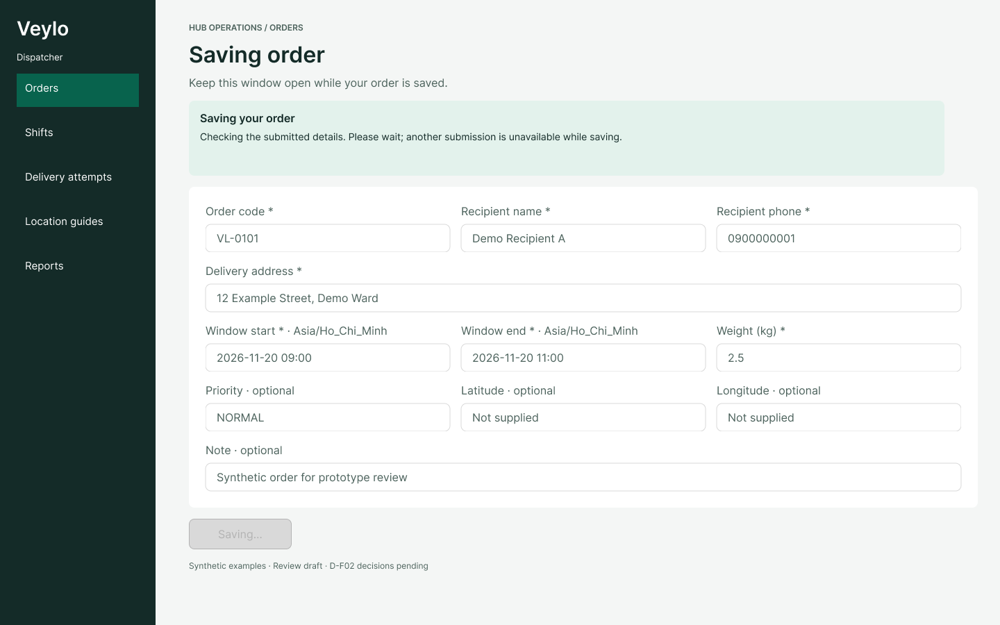

**S05-01-error — Create order** · [Editable Figma frame](https://www.figma.com/design/RBd5qiERPNz1yXRgkYVcwP/?node-id=4191-415)

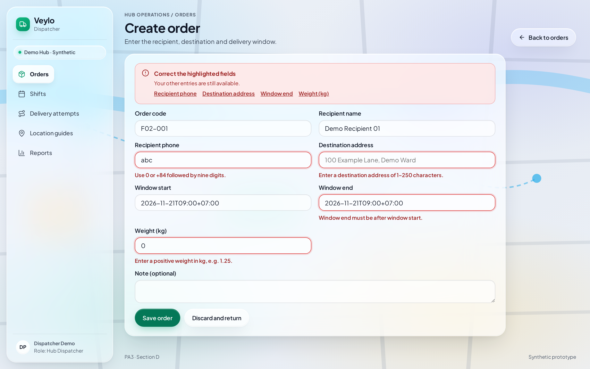

**S05-01-duplicate — Create order** · [Editable Figma frame](https://www.figma.com/design/RBd5qiERPNz1yXRgkYVcwP/?node-id=4191-515)

**S05-01-auth — Sign in required** · [Editable Figma frame](https://www.figma.com/design/RBd5qiERPNz1yXRgkYVcwP/?node-id=4191-615)

**S05-01-denied — Access restricted** · [Editable Figma frame](https://www.figma.com/design/RBd5qiERPNz1yXRgkYVcwP/?node-id=4191-642)

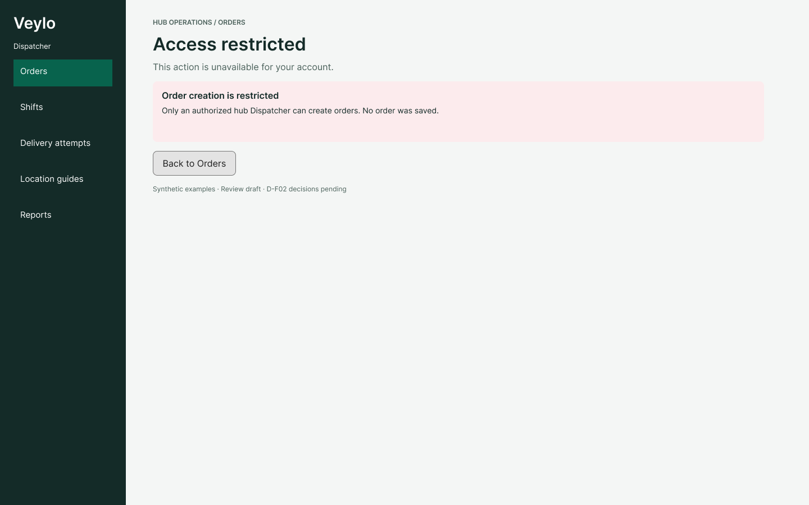

**S05-01-failure — Could not confirm creation** · [Editable Figma frame](https://www.figma.com/design/RBd5qiERPNz1yXRgkYVcwP/?node-id=4191-669)

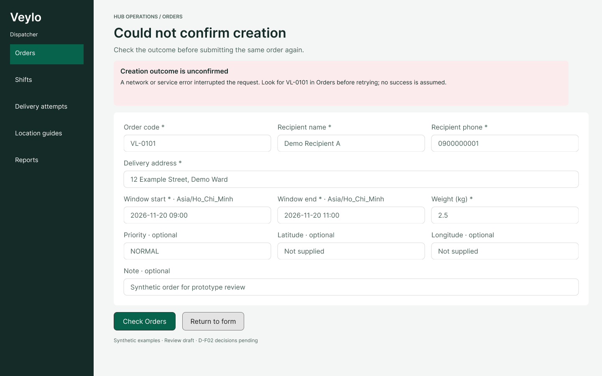

**S05-02-success — Order created** · [Editable Figma frame](https://www.figma.com/design/RBd5qiERPNz1yXRgkYVcwP/?node-id=4191-376)

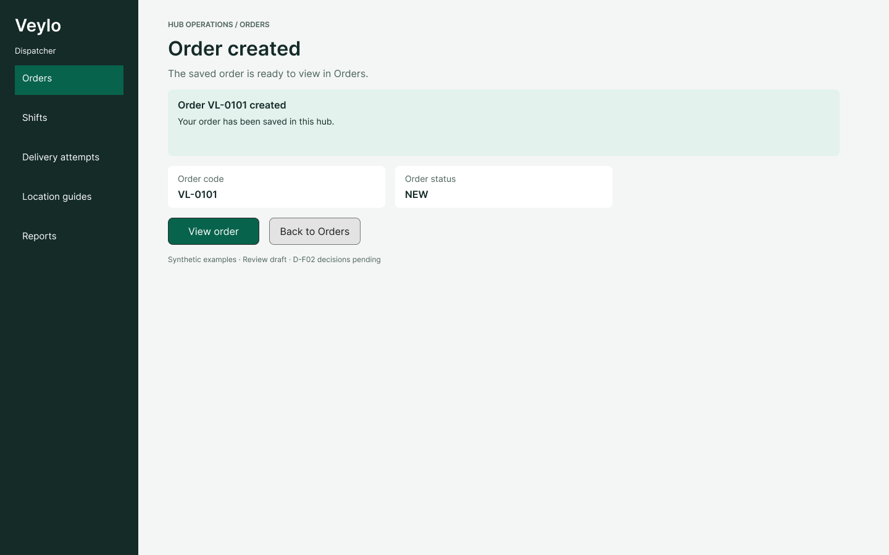

**S05-01-filled — Create order** · [Editable Figma frame](https://www.figma.com/design/RBd5qiERPNz1yXRgkYVcwP/?node-id=4191-179)

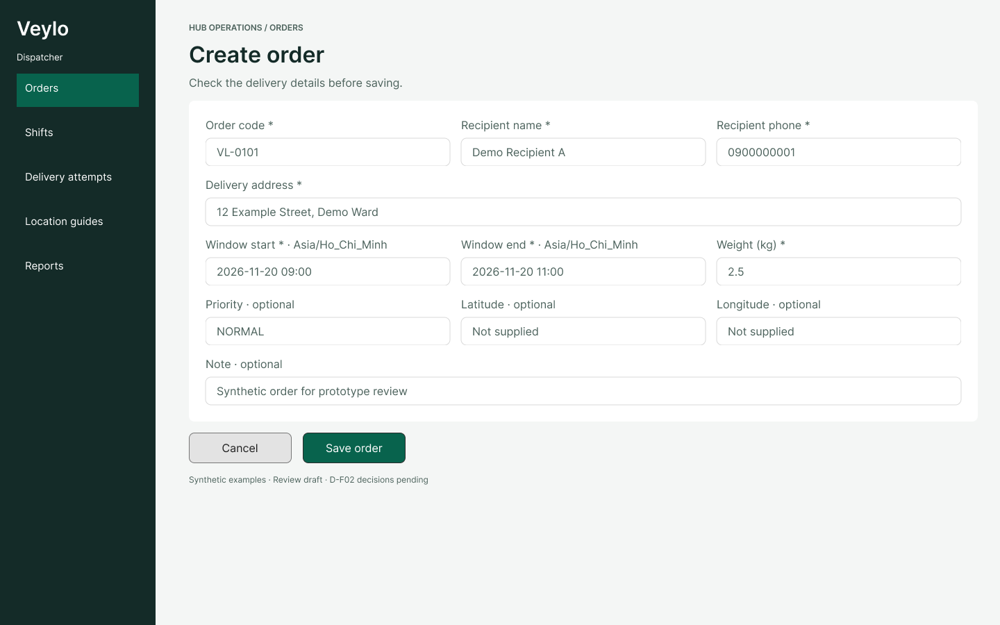

**Review record:** Assigned reviewer **Phạm Công Khánh**. Actual review date: **Pending**. Flow walkthrough, prototype review, changes requested and acceptance result: **Pending**. No review is asserted by this draft.

## 3. UC06 — Import Orders from CSV
Performed by: Trần Lê Hải (AI-assisted draft). Reviewed by: Pending — Phạm Công Khánh. Edited by: Codex (AI-assisted prototype, CSV evidence and Screen Map update, 2026-11-19); human editor pending.

| Field | Specification |
| --- | --- |
| **ID / Name** | **UC06 — Import Orders from CSV** |
| **Primary actor** | Hub Dispatcher |
| **Secondary actors** | None (file parser, validator, persistence layer are internal) |
| **Description / goal** | Import a validated batch of delivery orders from a CSV file in a single atomic operation, or show an actionable error report while inserting zero orders. |
| **Requirements** | FR-02-2 (CSV import); FR-02-3 (validation/error feedback) |
| **Business rules** | D-F02-1, D-F02-2, D-F02-3, D-F02-4, D-F02-6, D-F02-7 |
| **Trigger** | Dispatcher selects **Import CSV** from Orders. |
| **Preconditions** | Valid Dispatcher session and current-hub authorization; Orders page accessible. File to import is locally available. Existing database codes and hub authorization are evaluated at commit time. |

**Basic flow**

1. **B1 — Dispatcher:** Opens Orders and selects **Import CSV**. `[S07-01]`
2. **B2 — System:** Displays an upload panel with CSV format/column instructions, a sample template download, maximum size/row guidance, file picker and **Import/Validate** action. `[S06-01]`
3. **B3 — Dispatcher:** Selects a non-empty `.csv` file with the required header and one or more data rows; confirms import. `[S06-01]`
4. **B4 — System:** Shows an upload/processing state. It verifies extension/content can be parsed as CSV, UTF-8 with optional BOM, size `≤ 1,000,000 bytes`, `≤ 500` data rows, valid header names and consistent row structure. `[S06-01-processing]`
5. **B5 — System:** Parses each data row, preserving proper CSV quoting; maps required/optional columns to the shared Order fields; applies D-F02-1 validations to each row, with hub-local time parsing. `[S06-01-processing]`
6. **B6 — System:** Checks case-insensitive order-code duplicates **within the uploaded file** and **against current orders in the authorized hub**, and confirms authorization. `[S06-01-processing]`
7. **B7 — System:** Because **all rows are valid**, performs one atomic database transaction creating all orders with server-derived `hub_id` and status `NEW`. Database uniqueness still protects against races. `[S06-01-processing]`
8. **B8 — System:** Displays import success with the number of inserted orders and a way to view imported orders in UC07. `[S06-02-success]`

**Alternative flows**

| Flow | Branch from | Condition and user-visible behavior | Result / continuation |
| --- | --- | --- | --- |
| **A1 — Wrong file type / invalid encoding** | B3–B4 | Extension/content is not an accepted `.csv`, bytes are not valid UTF-8, or CSV quoting cannot be parsed. Show a file-level error explaining accepted format. `[S06-01-file-error]` | **Zero rows inserted.** Choose a corrected file; resume at **B3**. |
| **A2 — Empty file / header-only file** | B4 | File is zero bytes or contains a header without data rows. Show an empty-file/no-data error. `[S06-01-file-error]` | **Zero rows inserted.** Resume **B3**. |
| **A3 — Oversize / too many rows** | B4 | File exceeds `1,000,000` bytes or has over 500 data rows (header excluded). Display the specific exceeded limit. `[S06-01-file-error]` | **Zero rows inserted.** Resume **B3** with a smaller file. |
| **A4 — Missing, duplicate, unknown or malformed header** | B4 | Any required column (`order_code`, `recipient_name`, `recipient_phone`, `delivery_address`, `window_start`, `window_end`, `weight_kg`) is missing, any header is duplicated or outside the required/optional field list, or header/row structure is malformed. Display offending column names and a link to the expected template. `[S06-01-file-error]` | **Zero rows inserted.** Resume **B3**. Optional columns may be omitted under D-F02-4. |
| **A5 — Invalid row values** | B5 | One or more rows contain blank required values, invalid proposed phone format, reversed/equal delivery window, nonpositive weight, invalid coordinate pair or invalid optional priority. Collect report entries with CSV row (header = row 1), column, reason and safe rejected value; present errors and download option. `[S06-03-errors]` | **Zero rows inserted (atomic).** All rows remain unimported; fix CSV and retry at **B3**. Example: bad phone on row 27 in a 100-row batch → `0 imported`. |
| **A6 — Duplicate inside CSV** | B6 | Two rows contain the same trimmed, case-insensitive code. Flag **both source rows** in the error report, with their original row numbers. `[S06-03-errors]` | **Zero rows inserted.** Fix duplicates; resume **B3**. |
| **A7 — Duplicate against database** | B6 | A normalized code already exists in the same hub. Identify its CSV row and affected `order_code` without exposing other-hub orders. `[S06-03-errors]` | **Zero rows inserted; no overwrite.** Fix file; resume **B3**. |
| **A8 — Commit-time conflict / transaction failure** | B7 | Another import/create transaction wins a competing order code after checks, or database commit fails. Roll back the **entire batch** and show a transaction-level or code-level error, where available. `[S06-04-failure]` | **Zero orders from this batch inserted.** Check outcome and revalidate before retry; no partial success. |
| **A9 — Expired session / forbidden role / hub** | B1, B4 or B7 | Missing/expired session prompts sign-in; Rider/unapproved Administrator or unauthorized hub triggers access denied. `[S06-01-auth]` / `[S06-01-denied]` | **Zero rows inserted.** Authentication may resume by reopening UC06 after sign-in; forbidden role terminates. |
| **A10 — Cancel upload before commit** | B2–B6 | Dispatcher closes upload dialogue or selects Cancel before committing; system drops the temporary selection/preview. `[S06-01]` | **Zero orders inserted by the cancelled action.** Return to `[S07-01]`. A UI Cancel must not claim to roll back a batch whose commit has already succeeded. |
| **A11 — Network timeout / double-click** | B3–B8 | Submission appears stuck, user repeats action, or response is lost. Disable duplicate submits while processing; on uncertainty, request the user verify codes in the Orders list before retry. `[S06-01-processing]` / `[S06-04-failure]` | No unsupported success claim. Repeat submission cannot create duplicate same-hub codes; existing orders are not overwritten. |

**Postconditions**
- **Success:** All validated file data rows are persisted in a **single committed batch**, each with status `NEW` and server-owned hub context; UC07 shows the imported orders to authorized users. No shift or attempt is created.
- **Failure/minimum guarantee:** If any validation/duplicate/commit error occurs, **zero orders from that CSV batch are inserted**; existing orders remain unchanged. A report identifies row and column for actionable issues when parsing permits. The file itself is not a customer-data archive in the scope of this UC.

**Special requirements**
- **Exact shared field contract:** CSV required header = `order_code,recipient_name,recipient_phone,delivery_address,window_start,window_end,weight_kg`; optional = `priority,note,latitude,longitude`. Reject all other headers. Order codes allow only 1–40 ASCII letters, ASCII digits, underscores or hyphens. See BOOYAH-13 for the local handoff contract.
- **Exact proposed serialization:** UTF-8 (BOM optional); comma-separated valid CSV with proper quoting, LF/CRLF accepted; date-time `YYYY-MM-DD HH:mm` in `Asia/Ho_Chi_Minh`; max 500 data rows; max 1,000,000 bytes. Optional omitted columns follow defaults from D-F02-1.
- Atomicity requires a database transaction and server/database uniqueness; validate on the server even if UI previews errors (D-F02-2/3).
- Keep contact details synthetic (N06); restrict operations to authorized Dispatcher/hub (N05); comply with zero-budget tooling (N14). Provide keyboard-accessible upload, error table and downloadable error report (N16).
- **Test/sample handoff:** create **one valid CSV** with the above header and several well-formed rows, and **one invalid CSV** containing representative row-level failures. Also manually test wrong type, missing headers and file-size breach (a single invalid sample need not demonstrate each possible file-level failure).

**CSV sample evidence (2026-11-19).** [Valid sample](../../test/f02-order-intake/csv/valid-orders.csv): five synthetic orders. [Invalid sample](../../test/f02-order-intake/csv/invalid-orders.csv): eight rows covering phone, weight, delivery-window, required-value and within-file duplicate errors, including one otherwise valid control row. The [validation checker](../../test/f02-order-intake/csv/validate_samples.py) and [program output](../../test/f02-order-intake/csv/validation-results.json) demonstrate 5 accepted / 0 rejected for the valid file and 0 accepted / 8 rejected for the invalid file in an isolated in-memory model. This is not a backend/database transaction test; the exact code and header rules now follow the local BOOYAH-13 OpenSpec handoff. Proposed rules and review decisions remain pending.

**Relationships / extension points:** Standalone Dispatcher goal in D2; sign-in is a precondition, not `«include»`. After successful import, viewing orders through UC07 is optional navigation, not `«extend»`.

**Decision Log**

| Rule / decision | Basis, rationale and example | Confirmation status |
| --- | --- | --- |
| D-F02-1 | Same seven required and four optional fields/validators as UC05. Invalid phone in row 27 yields an error report entry. | **Pending** — field constraints/priority/time conventions. |
| D-F02-2 | Same-hub case-insensitive duplicates in file and DB rejected. | **Pending** — team sign-off. |
| D-F02-3 | Atomic batch. Example: one invalid row among 100 means **0 imported**. | **Pending** — confirm atomic versus partial. |
| D-F02-4 | UTF-8 `.csv`, 500 data rows / 1,000,000 bytes, fixed header and `YYYY-MM-DD HH:mm` local time. | **Pending** — exact schema/limits/encoding format. |
| D-F02-6 / D-F02-7 | Imported orders start as `NEW`, bound to authenticated hub; Rider forbidden. | **Pending** — statuses and permission matrix. |

**Screen map — editable draft and exported PNG evidence (2026-11-19)**

| Flow / step | Screen/state ID | Prototype evidence |
| --- | --- | --- |
| B1 | `S07-01` | S07-01: [Figma](https://www.figma.com/design/RBd5qiERPNz1yXRgkYVcwP/?node-id=4193-937) · [PNG](prototypes/UC07/S07-01.png) |
| B2–B3, A10 | `S06-01` | S06-01: [Figma](https://www.figma.com/design/RBd5qiERPNz1yXRgkYVcwP/?node-id=4192-577) · [PNG](prototypes/UC06/S06-01.png) |
| B4–B7, A11 | `S06-01-processing` | S06-01-processing: [Figma](https://www.figma.com/design/RBd5qiERPNz1yXRgkYVcwP/?node-id=4192-667) · [PNG](prototypes/UC06/S06-01-processing.png) |
| A1–A4 | `S06-01-file-error` | S06-01-file-error: [Figma](https://www.figma.com/design/RBd5qiERPNz1yXRgkYVcwP/?node-id=4192-700) · [PNG](prototypes/UC06/S06-01-file-error.png) |
| A5–A7 | `S06-03-errors` | S06-03-errors: [Figma](https://www.figma.com/design/RBd5qiERPNz1yXRgkYVcwP/?node-id=4192-987) · [PNG](prototypes/UC06/S06-03-errors.png) |
| A8, A11 | `S06-04-failure` | S06-04-failure: [Figma](https://www.figma.com/design/RBd5qiERPNz1yXRgkYVcwP/?node-id=4192-1054) · [PNG](prototypes/UC06/S06-04-failure.png) |
| A9 | `S06-01-auth`, `S06-01-denied` | S06-01-auth: [Figma](https://www.figma.com/design/RBd5qiERPNz1yXRgkYVcwP/?node-id=4192-1090) · [PNG](prototypes/UC06/S06-01-auth.png) S06-01-denied: [Figma](https://www.figma.com/design/RBd5qiERPNz1yXRgkYVcwP/?node-id=4192-1117) · [PNG](prototypes/UC06/S06-01-denied.png) |
| B8 | `S06-02-success` | S06-02-success: [Figma](https://www.figma.com/design/RBd5qiERPNz1yXRgkYVcwP/?node-id=4192-1144) · [PNG](prototypes/UC06/S06-02-success.png) |
| B3 (selected file) | `S06-01-selected` | S06-01-selected: [Figma](https://www.figma.com/design/RBd5qiERPNz1yXRgkYVcwP/?node-id=4192-622) · [PNG](prototypes/UC06/S06-01-selected.png) |
| A1–A4 (specific file failures) | `S06-01-file-error-type`, `S06-01-file-error-empty`, `S06-01-file-error-limits`, `S06-01-file-error-header`, `S06-01-file-error-encoding`, `S06-01-file-error-rows` | S06-01-file-error-type: [Figma](https://www.figma.com/design/RBd5qiERPNz1yXRgkYVcwP/?node-id=4192-741) · [PNG](prototypes/UC06/S06-01-file-error-type.png) S06-01-file-error-empty: [Figma](https://www.figma.com/design/RBd5qiERPNz1yXRgkYVcwP/?node-id=4192-782) · [PNG](prototypes/UC06/S06-01-file-error-empty.png) S06-01-file-error-limits: [Figma](https://www.figma.com/design/RBd5qiERPNz1yXRgkYVcwP/?node-id=4192-823) · [PNG](prototypes/UC06/S06-01-file-error-limits.png) S06-01-file-error-header: [Figma](https://www.figma.com/design/RBd5qiERPNz1yXRgkYVcwP/?node-id=4192-864) · [PNG](prototypes/UC06/S06-01-file-error-header.png) S06-01-file-error-encoding: [Figma](https://www.figma.com/design/RBd5qiERPNz1yXRgkYVcwP/?node-id=4192-905) · [PNG](prototypes/UC06/S06-01-file-error-encoding.png) S06-01-file-error-rows: [Figma](https://www.figma.com/design/RBd5qiERPNz1yXRgkYVcwP/?node-id=4192-946) · [PNG](prototypes/UC06/S06-01-file-error-rows.png) |

**Prototype screenshots**

**S07-01 — Orders** · [Editable Figma frame](https://www.figma.com/design/RBd5qiERPNz1yXRgkYVcwP/?node-id=4193-937)

**S06-01 — Import orders from CSV** · [Editable Figma frame](https://www.figma.com/design/RBd5qiERPNz1yXRgkYVcwP/?node-id=4192-577)

**S06-01-processing — Validating and importing** · [Editable Figma frame](https://www.figma.com/design/RBd5qiERPNz1yXRgkYVcwP/?node-id=4192-667)

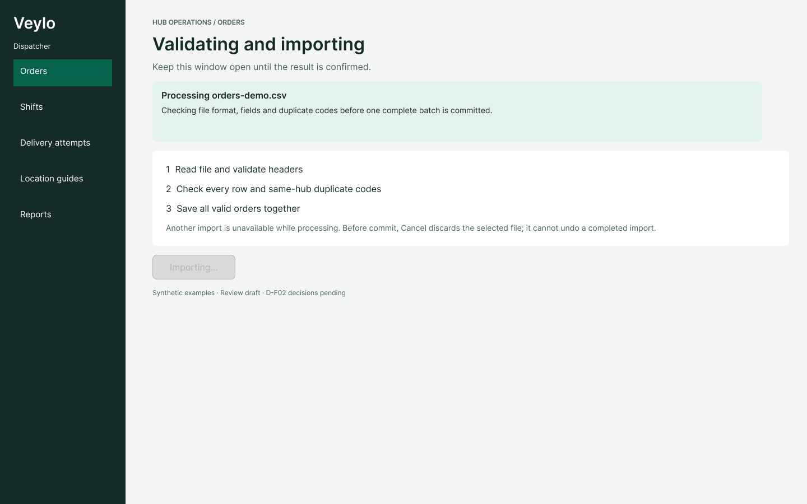

**S06-01-file-error — CSV file needs correction** · [Editable Figma frame](https://www.figma.com/design/RBd5qiERPNz1yXRgkYVcwP/?node-id=4192-700)

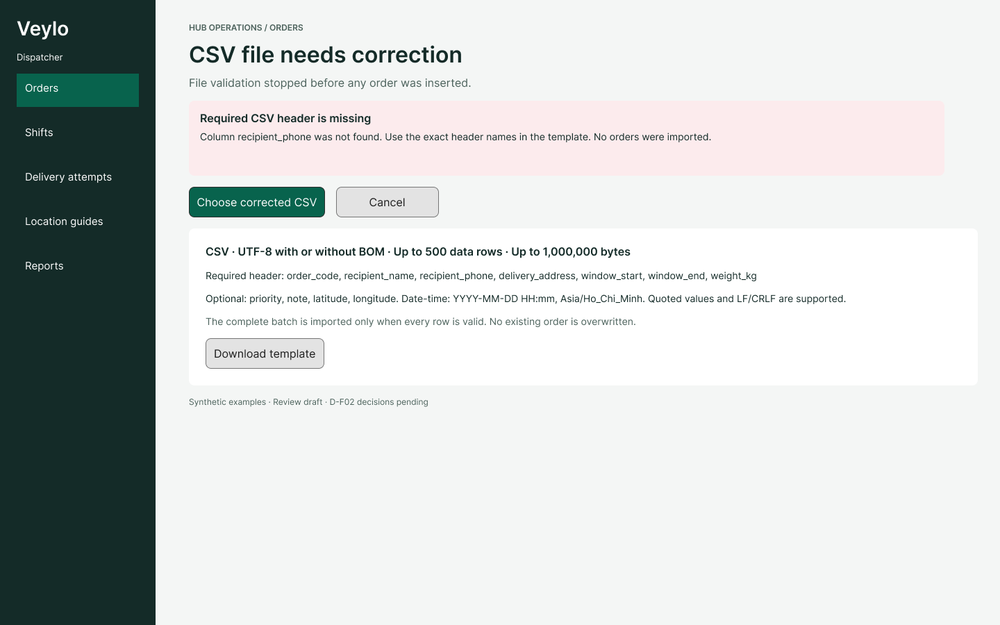

**S06-03-errors — CSV validation errors** · [Editable Figma frame](https://www.figma.com/design/RBd5qiERPNz1yXRgkYVcwP/?node-id=4192-987)

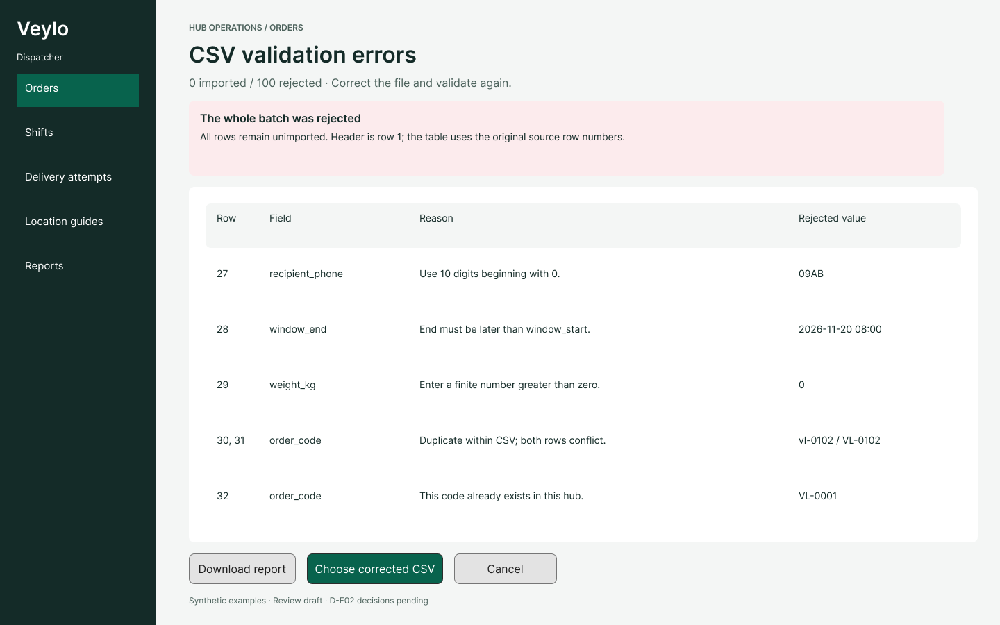

**S06-04-failure — Import could not complete** · [Editable Figma frame](https://www.figma.com/design/RBd5qiERPNz1yXRgkYVcwP/?node-id=4192-1054)

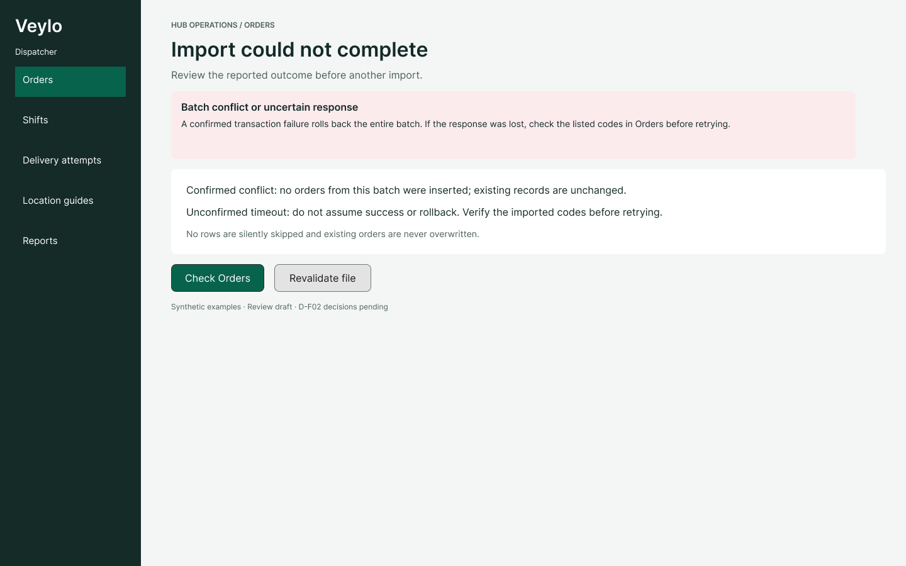

**S06-01-auth — Sign in required** · [Editable Figma frame](https://www.figma.com/design/RBd5qiERPNz1yXRgkYVcwP/?node-id=4192-1090)

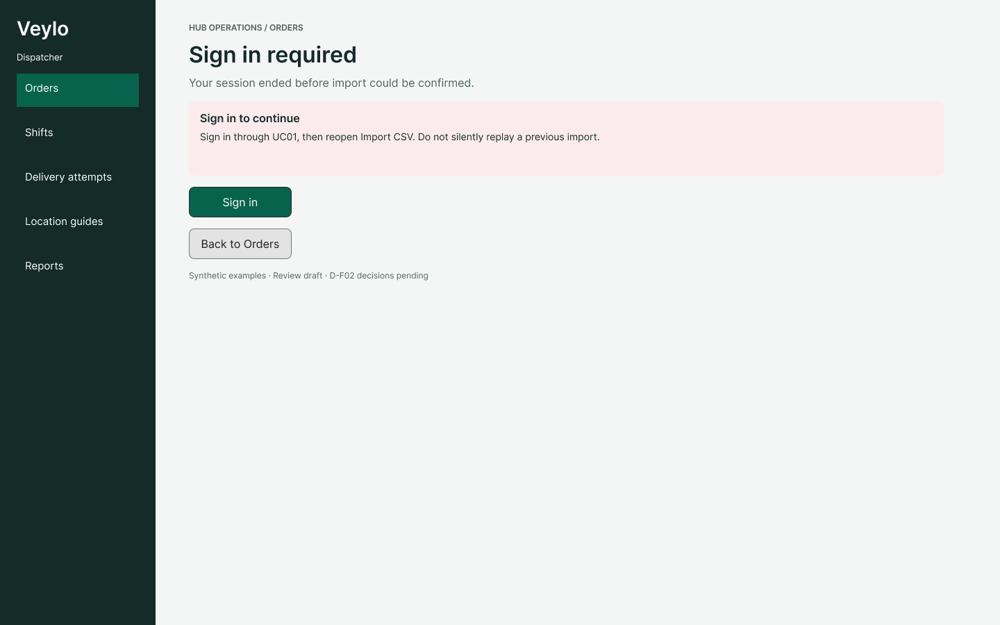

**S06-01-denied — Access restricted** · [Editable Figma frame](https://www.figma.com/design/RBd5qiERPNz1yXRgkYVcwP/?node-id=4192-1117)

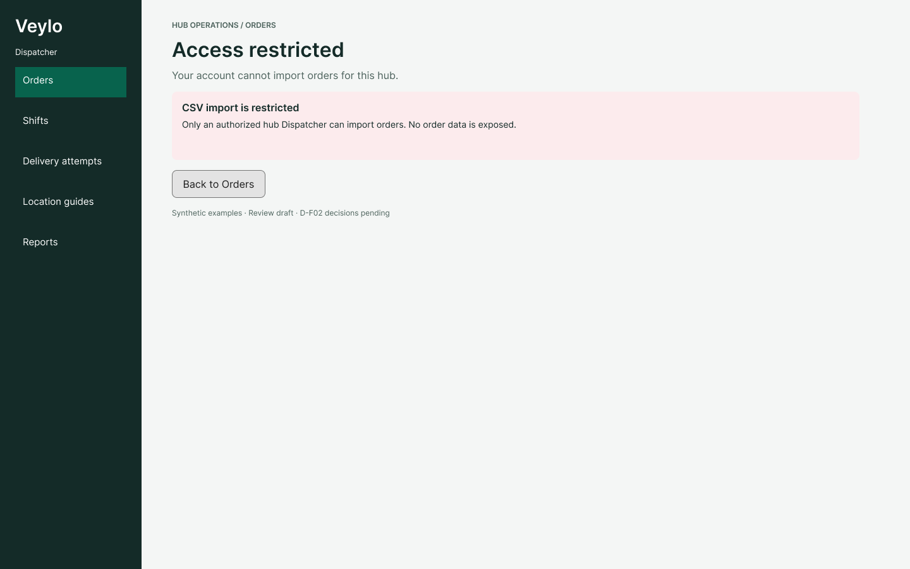

**S06-02-success — CSV import completed** · [Editable Figma frame](https://www.figma.com/design/RBd5qiERPNz1yXRgkYVcwP/?node-id=4192-1144)

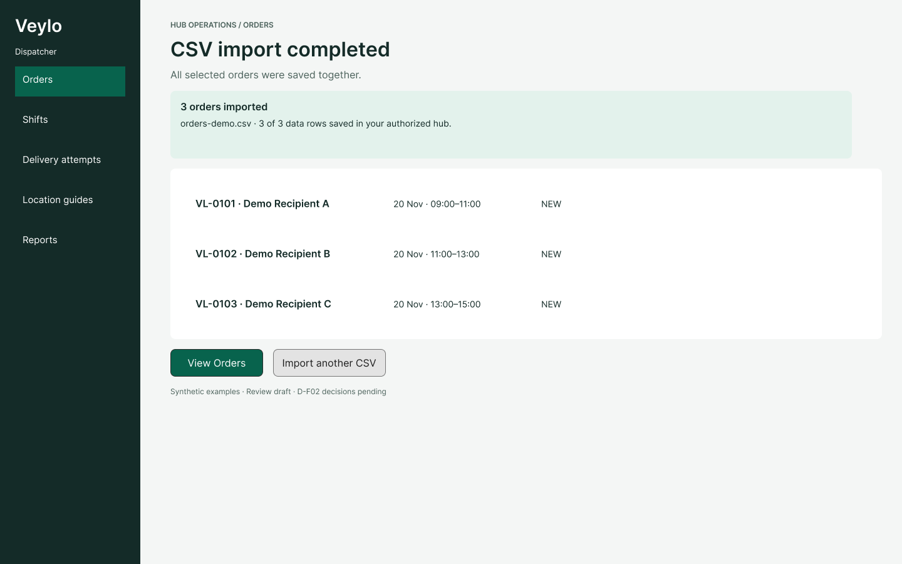

**S06-01-selected — Import orders from CSV** · [Editable Figma frame](https://www.figma.com/design/RBd5qiERPNz1yXRgkYVcwP/?node-id=4192-622)

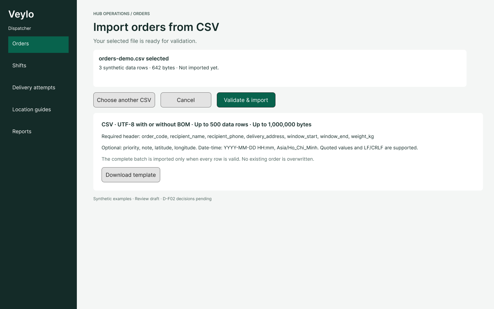

**S06-01-file-error-type — CSV file needs correction** · [Editable Figma frame](https://www.figma.com/design/RBd5qiERPNz1yXRgkYVcwP/?node-id=4192-741)

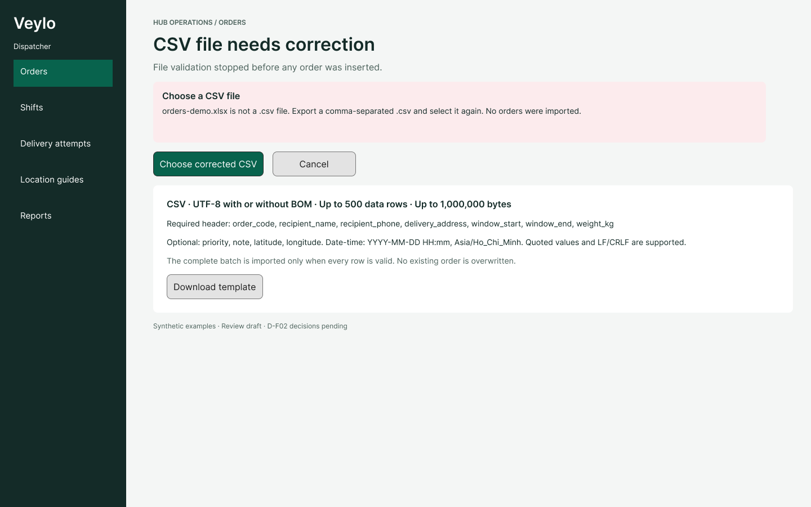

**S06-01-file-error-empty — CSV file needs correction** · [Editable Figma frame](https://www.figma.com/design/RBd5qiERPNz1yXRgkYVcwP/?node-id=4192-782)

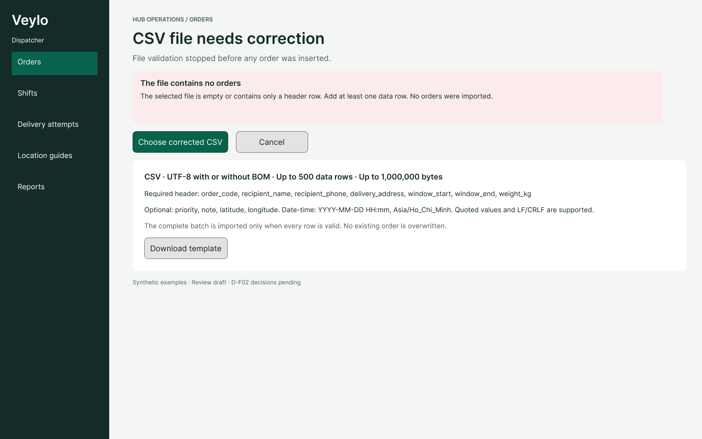

**S06-01-file-error-limits — CSV file needs correction** · [Editable Figma frame](https://www.figma.com/design/RBd5qiERPNz1yXRgkYVcwP/?node-id=4192-823)

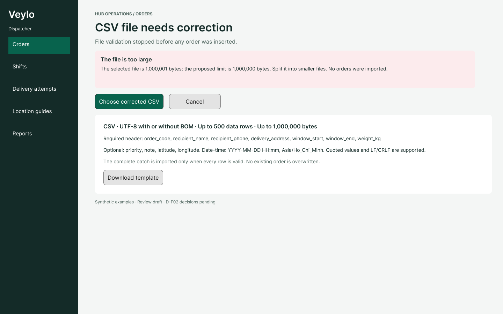

**S06-01-file-error-header — CSV file needs correction** · [Editable Figma frame](https://www.figma.com/design/RBd5qiERPNz1yXRgkYVcwP/?node-id=4192-864)

**S06-01-file-error-encoding — CSV file needs correction** · [Editable Figma frame](https://www.figma.com/design/RBd5qiERPNz1yXRgkYVcwP/?node-id=4192-905)

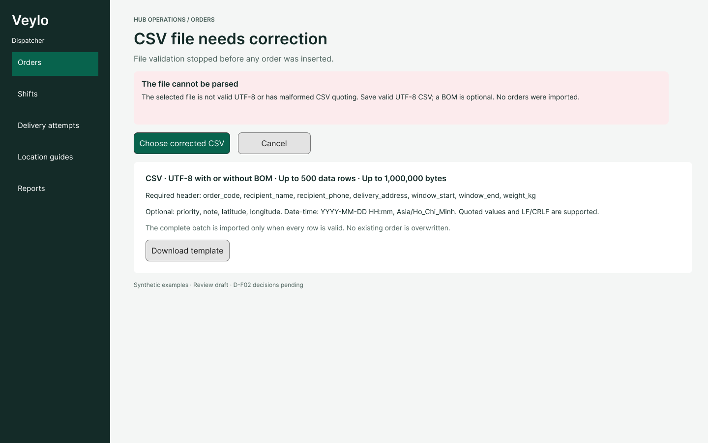

**S06-01-file-error-rows — CSV file needs correction** · [Editable Figma frame](https://www.figma.com/design/RBd5qiERPNz1yXRgkYVcwP/?node-id=4192-946)

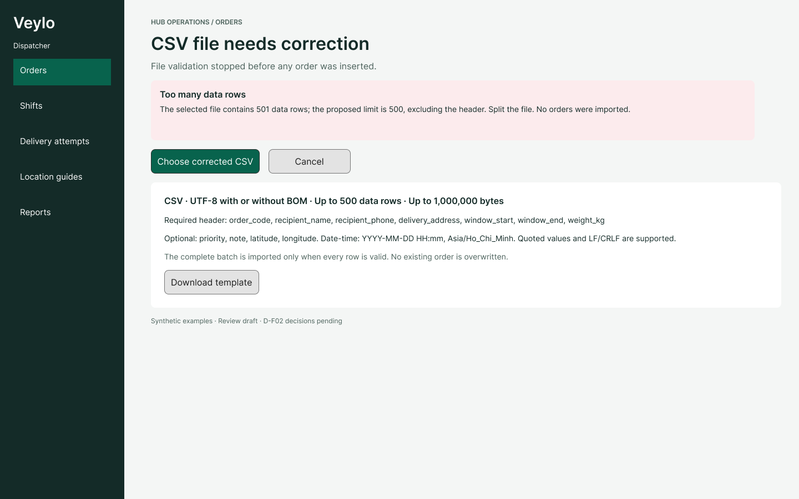

**Review record:** Assigned reviewer **Phạm Công Khánh**. Actual review date: **Pending**. Flow walkthrough, CSV sample verification, OpenSpec/schema synchronization and acceptance: **Pending**.

## 4. UC07 — Search and View Orders
Performed by: Trần Lê Hải (AI-assisted draft). Reviewed by: Pending — Phạm Công Khánh. Edited by: Codex (AI-assisted prototype and Screen Map update, 2026-11-19); human editor pending.

| Field | Specification |
| --- | --- |
| **ID / Name** | **UC07 — Search and View Orders** |
| **Primary actor** | Hub Dispatcher |
| **Secondary actors** | None |
| **Description / goal** | Let an authorized Dispatcher locate, filter, page through and inspect only the Orders visible within their hub. |
| **Requirements** | FR-02-4 (search/list/detail of permitted orders) |
| **Business rules** | D-F02-7, D-F02-8; Order state vocabulary references D-F02-6 |
| **Trigger** | Dispatcher opens **Orders** or returns to the list after creating/importing/updating an order. |
| **Preconditions** | Active authorized Dispatcher session and hub context; no minimum number of orders required. |

**Basic flow**

1. **B1 — Dispatcher:** Chooses **Orders** from navigation. `[S07-01]`
2. **B2 — System:** Loads the **first page** of authorized hub orders only, displaying relevant summary information and current statuses, with result count and previous/next navigation. Default sorting is `window_start` ascending, tie-break `order_code` ascending. `[S07-01]`
3. **B3 — Dispatcher:** Enters an optional keyword (order code, recipient name or phone) and/or chooses status and inclusive delivery-date range. `[S07-01-filtered]`
4. **B4 — System:** Validates the chosen range, applies keyword/status/date filters together (**AND**), always constrains data to the authenticated hub, and returns page 1 of matching results with total count. `[S07-01-filtered]`
5. **B5 — Dispatcher:** Navigates to a next or previous available page, if desired. **System:** Returns the corresponding 20-row page with stable ordering while preserving filter selections. `[S07-01-filtered]`
6. **B6 — Dispatcher:** Selects an order from the visible list. `[S07-01-filtered]`
7. **B7 — System:** Rechecks authorization for the selected identifier on the server and displays the order's saved fields, `hub` context where appropriate, status and allowed order-management actions, without including another hub's data. `[S07-02-detail]`
8. **B8 — Dispatcher:** Reviews details and returns to the filtered list. **System:** Preserves a coherent search/list state (filters and page where feasible). `[S07-01-filtered]`

**Alternative flows**

| Flow | Branch from | Condition and user-visible behavior | Result / continuation |
| --- | --- | --- | --- |
| **A1 — No orders exist** | B2 | Hub contains zero orders. Display a blank/empty list state with guidance to create or import; do not fabricate results. `[S07-01-empty]` | No data changed. Dispatcher may go to UC05/UC06 or end UC07. |
| **A2 — No results match filters** | B4 | Search/filters yield no matches. Show an **empty search-result state** and a clear action to clear filters. `[S07-01-no-results]` | No data changed. Dispatcher edits filters at **B3**. |
| **A3 — Invalid date range / invalid filter** | B4 | Start date is later than end date or filter values are invalid. Explain the field error and retain the last valid result state. `[S07-01-filter-error]` | No query/result update until corrected. Resume **B3/B4**. |
| **A4 — Requested page no longer exists** | B5 | Another user edits/cancels data or filters change so the requested page lies beyond the new result set. Reset to a valid page (default page 1) and display current total. `[S07-01-filtered]` | No data changed. Continue **B5/B6**. |
| **A5 — Order removed from visible scope / missing** | B7 | Order ID no longer resolves or is not accessible after a concurrent change. Return a neutral not-found state, with a link back to authorized Orders; do not leak existence. `[S07-02-not-found]` | No data changed. Return to **B2/B4**. |
| **A6 — Other hub order accessed by URL** | B7 | Dispatcher directly requests an ID belonging to another hub. Server returns a not-found result as proposed by D-F02-7, without revealing its fields or existence. `[S07-02-not-found]` | No data disclosed. Terminate detail view or return to authorized list. |
| **A7 — Session expired / unauthorized role** | B1, B2, B4 or B7 | Missing/expired session → authentication prompt; Rider/unapproved Administrator → access denied. Checks apply to both list and direct detail URL. `[S07-01-auth]` / `[S07-01-denied]` | No order data exposed. Sign in and retry or terminate. |
| **A8 — Server/network error** | B2, B4, B5 or B7 | Backend request fails. Show loading/error state with retry; never replace last verified data with invented content or display another hub's data. `[S07-01-load-error]` / `[S07-02-load-error]` | No data changed. Retry failing step or return to list. |
| **A9 — Order status changed while viewing** | B7–B8 | Another operation changes status while detail is open. On refresh the latest persisted status is displayed; an attempted stale mutation belongs to UC08's conflict flow. `[S07-02-detail]` | No data changed by UC07; optional refresh of **B7**. |

**Postconditions**
- **Success:** User sees an accurate, paginated set of authorized hub orders and/or the details of a selected order. Search and viewing do **not** mutate order data or create a delivery attempt.
- **Failure/minimum guarantee:** Zero unauthorized/order data is revealed by search or direct URL; failed queries do not change persisted orders, and empty/error states are explicit.

**Special requirements**
- Server-side hub and role filtering on **both** list and detail reads; avoid count-based leaks of other-hub orders (D-F02-7; N05).
- Proposed keyword search is case-insensitive across `order_code`, `recipient_name`, `recipient_phone`; filters are ANDed; inclusive date filtering refers to the `window_start` calendar date in hub-local timezone; 20 rows/page, default ascending `window_start` with `order_code` tie-break (D-F02-8). Date/time interpretation must match D-F02-1 and CSV D-F02-4.
- Order list/detail should be reviewed against Vision N01 page-load performance requirement and N16 keyboard/contrast accessibility; no passing measurements are claimed. Use synthetic data only (N06).
- `CANCELLED` orders remain visible (unless removed by a user-selected status filter); no hard delete is available through UC07/UC08.

**Relationships / extension points:** Standalone D2 goal. UC05/UC06/UC08 may navigate to/from Orders and details, but these are shared screens, **not** UML `«include»` or `«extend»` relationships.

**Decision Log**

| Rule / decision | Basis, rationale and example | Confirmation status |
| --- | --- | --- |
| D-F02-7 | Hub-scoped results; Rider denied; other-hub direct URL treated as not found. | **Pending** — final Admin and 401/403/404 response policy. |
| D-F02-8 | Keyword/status/date filters, AND; 20/page; `window_start` ascending plus tie-break. Example: keyword `ord-`, `NEW`, 20 Nov 2026. | **Pending** — exact searchable fields, order, date semantics. |
| D-F02-6 | List/detail labels use the team-approved Order status vocabulary; F02 demo proposes `NEW`/`CANCELLED`. | **Pending** — lifecycle status reconciliation with BOOYAH-13/14. |

**Screen map — editable draft and exported PNG evidence (2026-11-19)**

| Flow / step | Screen/state ID | Prototype evidence |
| --- | --- | --- |
| B1–B2 | `S07-01` | S07-01: [Figma](https://www.figma.com/design/RBd5qiERPNz1yXRgkYVcwP/?node-id=4193-937) · [PNG](prototypes/UC07/S07-01.png) |
| B3–B6, A4 | `S07-01-filtered` | S07-01-filtered: [Figma](https://www.figma.com/design/RBd5qiERPNz1yXRgkYVcwP/?node-id=4193-1097) · [PNG](prototypes/UC07/S07-01-filtered.png) |
| A1 | `S07-01-empty` | S07-01-empty: [Figma](https://www.figma.com/design/RBd5qiERPNz1yXRgkYVcwP/?node-id=4193-1341) · [PNG](prototypes/UC07/S07-01-empty.png) |
| A2 | `S07-01-no-results` | S07-01-no-results: [Figma](https://www.figma.com/design/RBd5qiERPNz1yXRgkYVcwP/?node-id=4193-1373) · [PNG](prototypes/UC07/S07-01-no-results.png) |
| A3 | `S07-01-filter-error` | S07-01-filter-error: [Figma](https://www.figma.com/design/RBd5qiERPNz1yXRgkYVcwP/?node-id=4193-1430) · [PNG](prototypes/UC07/S07-01-filter-error.png) |
| B7–B8, A9 | `S07-02-detail` | S07-02-detail: [Figma](https://www.figma.com/design/RBd5qiERPNz1yXRgkYVcwP/?node-id=4193-1581) · [PNG](prototypes/UC07/S07-02-detail.png) |
| A5–A6 | `S07-02-not-found` | S07-02-not-found: [Figma](https://www.figma.com/design/RBd5qiERPNz1yXRgkYVcwP/?node-id=4193-1662) · [PNG](prototypes/UC07/S07-02-not-found.png) |
| A7 | `S07-01-auth`, `S07-01-denied` | S07-01-auth: [Figma](https://www.figma.com/design/RBd5qiERPNz1yXRgkYVcwP/?node-id=4193-1689) · [PNG](prototypes/UC07/S07-01-auth.png) S07-01-denied: [Figma](https://www.figma.com/design/RBd5qiERPNz1yXRgkYVcwP/?node-id=4193-1720) · [PNG](prototypes/UC07/S07-01-denied.png) |
| A8 | `S07-01-load-error`, `S07-02-load-error` | S07-01-load-error: [Figma](https://www.figma.com/design/RBd5qiERPNz1yXRgkYVcwP/?node-id=4193-1801) · [PNG](prototypes/UC07/S07-01-load-error.png) S07-02-load-error: [Figma](https://www.figma.com/design/RBd5qiERPNz1yXRgkYVcwP/?node-id=4193-1833) · [PNG](prototypes/UC07/S07-02-load-error.png) |
| B2 / B7 (loading) | `S07-01-loading`, `S07-02-loading` | S07-01-loading: [Figma](https://www.figma.com/design/RBd5qiERPNz1yXRgkYVcwP/?node-id=4193-1747) · [PNG](prototypes/UC07/S07-01-loading.png) S07-02-loading: [Figma](https://www.figma.com/design/RBd5qiERPNz1yXRgkYVcwP/?node-id=4193-1774) · [PNG](prototypes/UC07/S07-02-loading.png) |
| B5 (next page) | `S07-01-page-2` | S07-01-page-2: [Figma](https://www.figma.com/design/RBd5qiERPNz1yXRgkYVcwP/?node-id=4193-1257) · [PNG](prototypes/UC07/S07-01-page-2.png) |

**Prototype screenshots**

**S07-01 — Orders** · [Editable Figma frame](https://www.figma.com/design/RBd5qiERPNz1yXRgkYVcwP/?node-id=4193-937)

**S07-01-filtered — Orders** · [Editable Figma frame](https://www.figma.com/design/RBd5qiERPNz1yXRgkYVcwP/?node-id=4193-1097)

**S07-01-empty — Orders** · [Editable Figma frame](https://www.figma.com/design/RBd5qiERPNz1yXRgkYVcwP/?node-id=4193-1341)

**S07-01-no-results — Orders** · [Editable Figma frame](https://www.figma.com/design/RBd5qiERPNz1yXRgkYVcwP/?node-id=4193-1373)

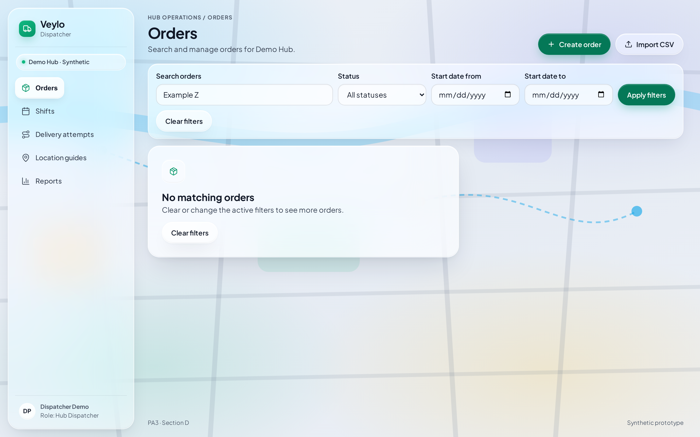

**S07-01-filter-error — Orders** · [Editable Figma frame](https://www.figma.com/design/RBd5qiERPNz1yXRgkYVcwP/?node-id=4193-1430)

**S07-02-detail — Order VL-0101** · [Editable Figma frame](https://www.figma.com/design/RBd5qiERPNz1yXRgkYVcwP/?node-id=4193-1581)

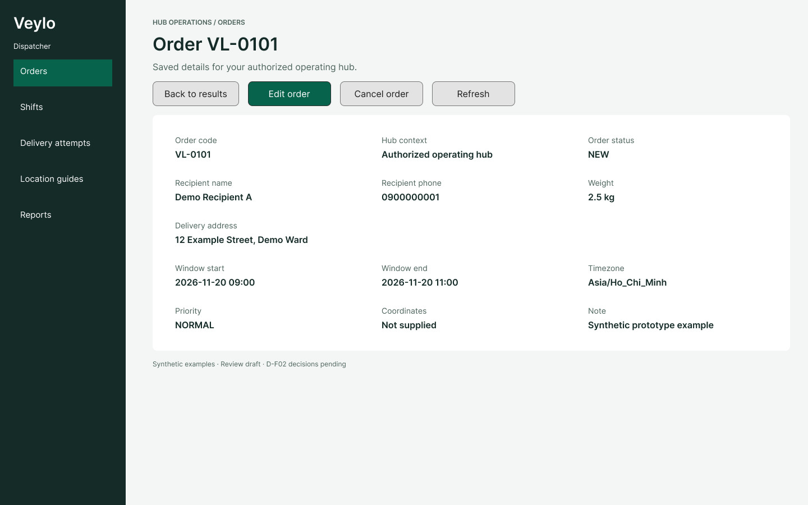

**S07-02-not-found — Order not found** · [Editable Figma frame](https://www.figma.com/design/RBd5qiERPNz1yXRgkYVcwP/?node-id=4193-1662)

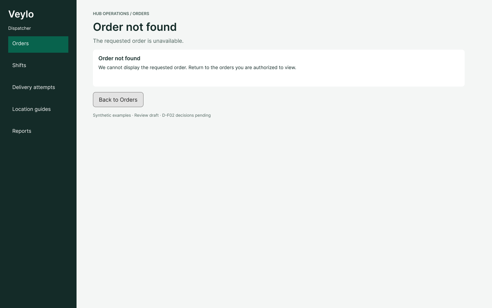

**S07-01-auth — Sign in required** · [Editable Figma frame](https://www.figma.com/design/RBd5qiERPNz1yXRgkYVcwP/?node-id=4193-1689)

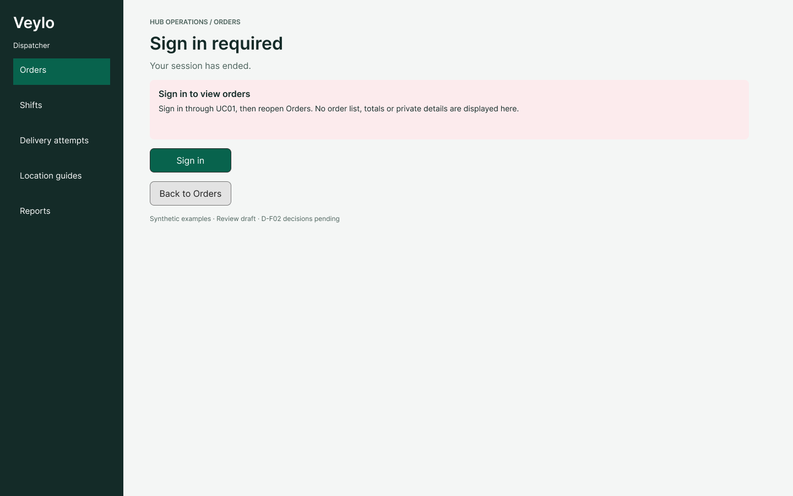

**S07-01-denied — Access restricted** · [Editable Figma frame](https://www.figma.com/design/RBd5qiERPNz1yXRgkYVcwP/?node-id=4193-1720)

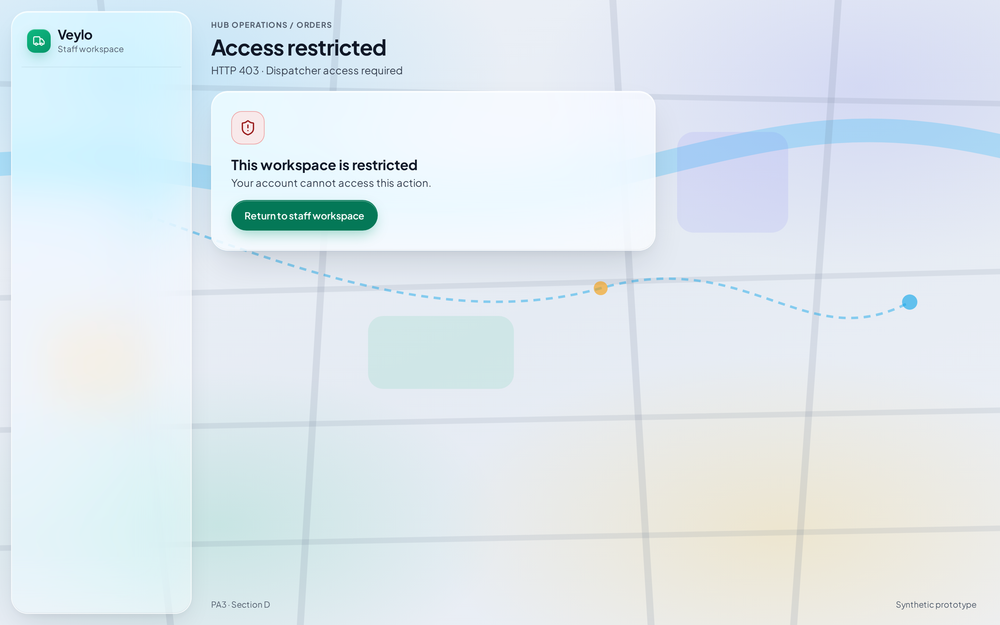

**S07-01-load-error — Orders could not load** · [Editable Figma frame](https://www.figma.com/design/RBd5qiERPNz1yXRgkYVcwP/?node-id=4193-1801)

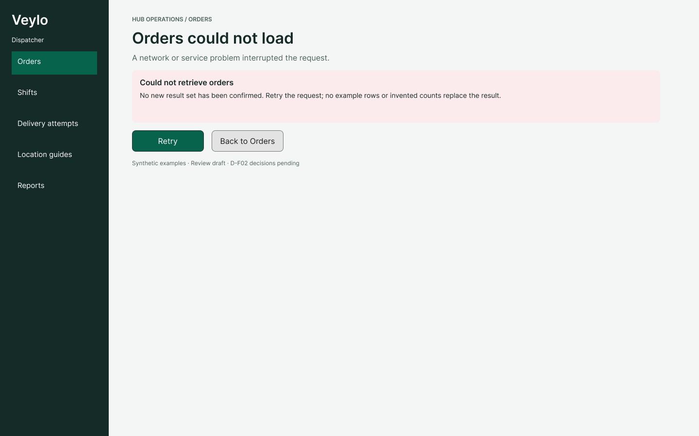

**S07-02-load-error — Order details could not load** · [Editable Figma frame](https://www.figma.com/design/RBd5qiERPNz1yXRgkYVcwP/?node-id=4193-1833)

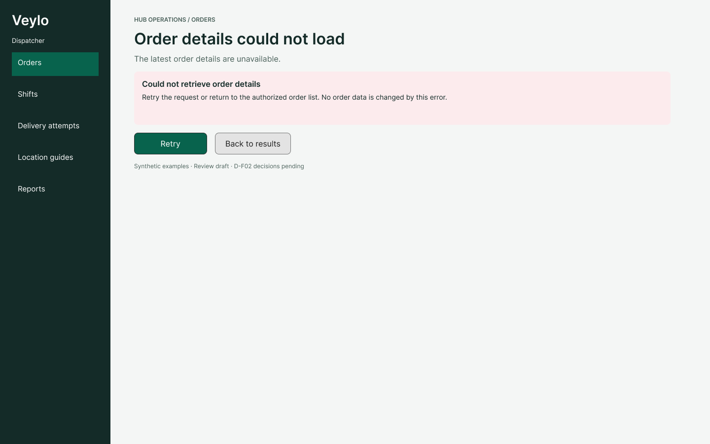

**S07-01-loading — Loading orders** · [Editable Figma frame](https://www.figma.com/design/RBd5qiERPNz1yXRgkYVcwP/?node-id=4193-1747)

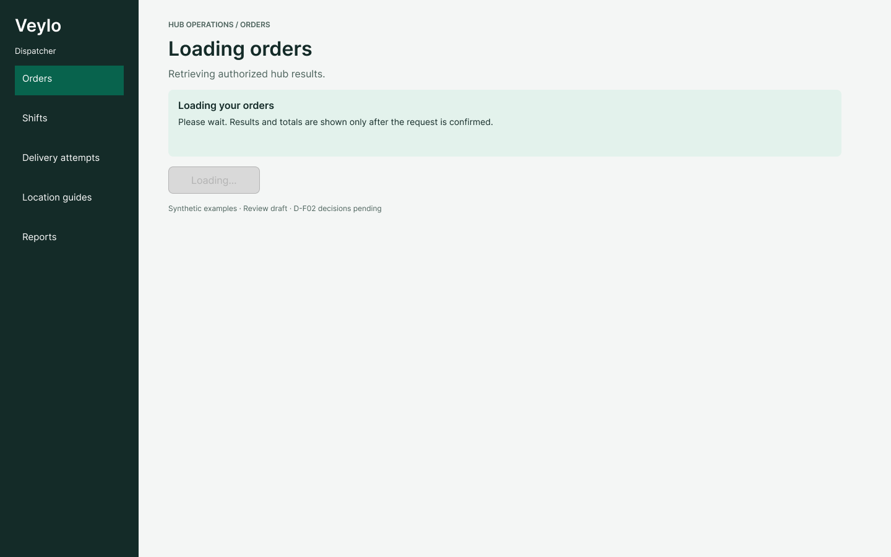

**S07-02-loading — Loading order details** · [Editable Figma frame](https://www.figma.com/design/RBd5qiERPNz1yXRgkYVcwP/?node-id=4193-1774)

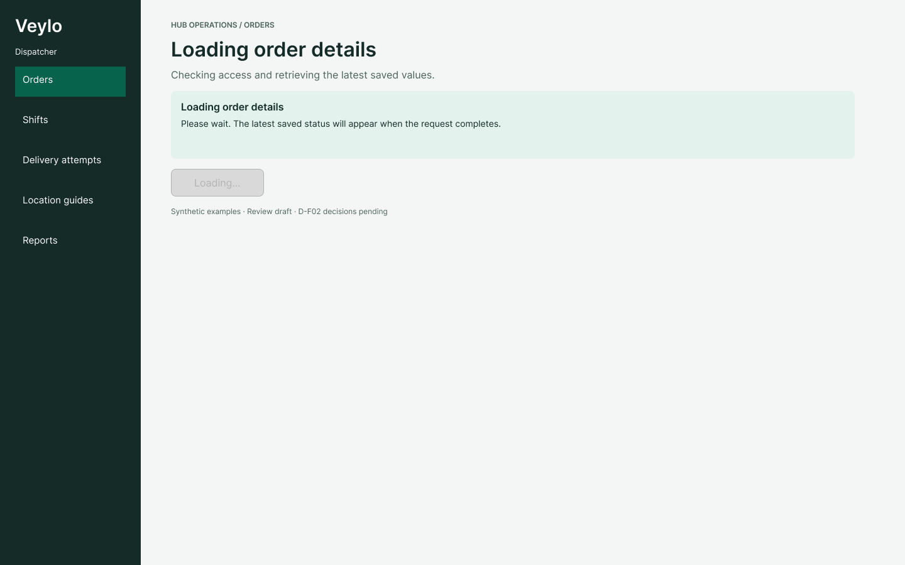

**S07-01-page-2 — Orders** · [Editable Figma frame](https://www.figma.com/design/RBd5qiERPNz1yXRgkYVcwP/?node-id=4193-1257)

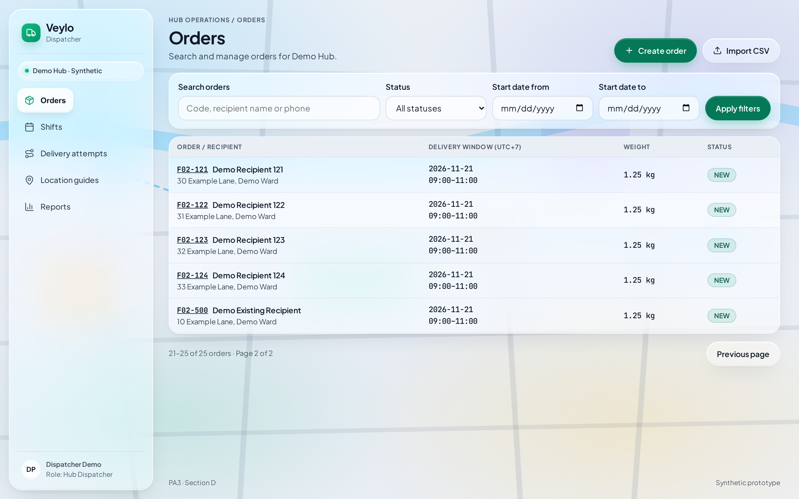

**Review record:** Assigned reviewer **Phạm Công Khánh**. Actual review date: **Pending**. Screen/state coverage and role/hub isolation walkthrough: **Pending**.

## 5. UC08 — Update or Cancel Order
Performed by: Trần Lê Hải (AI-assisted draft). Reviewed by: Pending — Phạm Công Khánh. Edited by: Codex (AI-assisted prototype and Screen Map update, 2026-11-19); human editor pending.

| Field | Specification |
| --- | --- |
| **ID / Name** | **UC08 — Update or Cancel Order** |
| **Primary actor** | Hub Dispatcher |
| **Secondary actors** | None |
| **Description / goal** | Allow an authorized Dispatcher to edit eligible delivery-order information or cancel an eligible order with a reason, while preserving data integrity and restricting changes by current Order status. |
| **Requirements** | FR-02-5 (conditional update/cancel); FR-02-3 (validation of changed fields) |
| **Business rules** | D-F02-1, D-F02-5, D-F02-6, D-F02-7; D-F02-2 for immutable code identity |
| **Trigger** | Dispatcher chooses **Edit** or **Cancel Order** on an Order Details screen (UC07). |
| **Preconditions** | Active authorized Dispatcher session in the order's hub; the target Order exists, is readable, and has an eligible current status at the time the operation is *committed*. Under the proposed **PA3 F02** policy, only `NEW` is eligible for edit or cancellation. |

**Basic flow — Edit branch**

1. **B1 — Dispatcher:** Finds/opens an Order Details view via UC07. `[S07-02-detail]`
2. **B2 — System:** Revalidates permission to access the selected Order, loads the current version/status, and shows available actions. An eligible `NEW` order displays **Edit** and **Cancel**. `[S07-02-detail]`
3. **B3 — Dispatcher:** Selects **Edit**. **System:** Opens an edit form with current editable fields; `order_code`, `hub_id`, audit fields and status are read-only/not editable in this form. `[S08-01-edit]`
4. **B4 — Dispatcher:** Changes one or more eligible fields (recipient name/phone, address, window, weight, optional fields) and selects **Save Changes**. `[S08-01-edit]`
5. **B5 — System:** Rechecks authentication, hub rights and **current** eligible status, validates changed values under D-F02-1, and checks the concurrency token/version against current persisted data. `[S08-01-saving]`
6. **B6 — System:** Atomically saves updated fields without changing `order_code`, `hub_id` or Order status; records the new version/update time under the implementation's approved concurrency approach. `[S08-01-saving]`
7. **B7 — System:** Confirms the edit and shows the refreshed Order Details. `[S08-02-updated]`

**Alternative flows**

| Flow | Branch from | Condition and user-visible behavior | Result / continuation |
| --- | --- | --- | --- |
| **A1 — Cancel Order (successful alternative goal)** | B2 | **A1.1** Dispatcher selects **Cancel Order** while current status is `NEW`. `[S08-03-cancel-confirm]` **A1.2** System asks for confirmation and a nonblank cancellation reason (proposed 5–300 characters). **A1.3** Dispatcher enters a valid reason and confirms. **A1.4** System rechecks session, hub, current status and version; atomically stores `CANCELLED` status and reason, retaining the Order record. **A1.5** System shows cancelled status/reason and removes/disabled eligible edit/cancel actions. `[S08-04-cancelled]` | **Success via cancellation:** Order persists in `CANCELLED` state; no hard delete. Terminate UC08. |
| **A2 — Invalid edit fields** | B5 | Missing/incorrect contact/address fields, invalid window (`end ≤ start`), invalid weight, invalid optional coordinate pair or priority; show field-specific messages without discarding the user's edits. `[S08-01-error]` | **No change persisted.** Resume **B4**. |
| **A3 — Invalid cancellation reason** | A1.3–A1.4 | Missing/blank or out-of-range reason. Show inline error in the confirmation dialog; require correction. `[S08-03-reason-error]` | **No change persisted.** Resume **A1.3**. |
| **A4 — User dismisses edit/cancel** | B3–B4, A1.2–A1.3 | Dispatcher selects Cancel/Back on edit or closes/declines cancellation confirmation. Return to unchanged Order Details; unsaved edits are discarded only after any necessary UI confirmation. `[S07-02-detail]` | **No change persisted.** Terminate UC08. |
| **A5 — Edit or cancel blocked by Order status** | B2, B5 or A1.4 | Target Order is `CANCELLED` or otherwise no longer in proposed eligible `NEW` status; server rejects mutation even if a stale UI still displays the button. Show current status and why operation is unavailable. `[S08-05-status-blocked]` | **No change persisted.** Return to refreshed Order Details **B2** or terminate. |
| **A6 — Concurrent edit / stale version** | B5–B6 or A1.4 | Another Dispatcher/session updates or cancels the Order after it was loaded. Server detects a version mismatch and rejects stale save/cancel; show conflict and prompt reload; do not overwrite blindly. `[S08-06-conflict]` | **No stale mutation persisted.** Refresh Order at **B2**; user may re-enter changes only if still eligible. |
| **A7 — Already cancelled / repeated cancel** | B2 or A1.4 | User repeats cancellation for an already `CANCELLED` Order. Return informative non-success feedback and show existing status; never append another cancellation transition or erase the existing reason. `[S08-05-status-blocked]` | **Order unchanged.** Terminate or return **B2**. |
| **A8 — Other-hub URL / missing order** | B1–B2, B5 or A1.4 | Order not found or belongs to a hub outside Dispatcher scope. Do not reveal private details; show neutral not-found state (proposed HTTP 404). `[S08-07-not-found]` | **No change; no disclosure.** Return to authorized Orders. |
| **A9 — Expired session / unauthorized role** | B1–B2, B5 or A1.4 | Expired/missing session prompts sign-in; Rider or unapproved Administrator receives permission denial. `[S08-01-auth]` / `[S08-01-denied]` | **No change persisted.** Sign in and re-open the Order or terminate. |
| **A10 — Persistence/network failure** | B6 or A1.4 | Database mutation fails or response is lost. Show a failure or uncertain-outcome message; do not claim success, and advise reloading details to check final persisted state before resubmission. `[S08-08-failure]` | **No unverified success claim.** Refresh at **B2**; if server reports rolled back, old values remain. |
| **A11 — Unsupported attempt to edit identity** | B3–B5 | Client attempts to change `order_code`, `hub_id`, system timestamps or status through ordinary Edit action (including crafted requests). UI has no editable controls for these and server rejects unauthorized fields. `[S08-01-error]` | **Identity/status unchanged.** Resume edit **B3/B4** or terminate. |

**Postconditions**
- **Success (edit):** Only allowed fields of the same persisted Order are updated; order identity, hub, current Order state and linked delivery history are preserved. Latest details reflect the saved values.
- **Success (cancel):** Eligible Order transitions `NEW → CANCELLED`; reason is saved; order remains available in history and UC07, rather than being hard-deleted. No DeliveryAttempt is automatically marked failed by this action.
- **Failure/minimum guarantee:** No unauthorized, stale, invalid or ineligible update/cancel is applied. Dismissed confirmation produces no mutation. Any failure screen states whether persistence is confirmed or must be rechecked.

**Special requirements**
- Apply server-side authorization and hub scoping for each read and mutation; enforce state eligibility at **commit time**, not only when rendering buttons (D-F02-5/7; N05).
- Use a version/updated-at concurrency check to prevent stale overwrites; exact technical implementation belongs to OpenSpec design, but observable conflict behavior is required by the proposed BR.
- Validate changed fields using D-F02-1; keep `order_code` immutable in normal edit and preserve D-F02-2 uniqueness. Capture reason in cancellation, use **soft state transition**, never physical delete.
- Use synthetic data/no secrets (N06); keyboard-focus and accessible confirmation/error states (N16); no paid dependencies (N14).
- `NEW`-only cancellation and 5–300-character reason are **proposals** requiring explicit agreement; do not infer future F03/F04 policy from PA3 F02.

**Relationships / extension points:** Standalone D2 goal. Entry from Order Details (UC07) is navigation; it does not establish a UML `«include»` relation. UC13 handles failed-attempt resolution separately and is not invoked by cancelling an F02 order.

**Decision Log**

| Rule / decision | Basis, rationale and example | Confirmation status |
| --- | --- | --- |
| D-F02-1 | Revalidate changed recipient, address, window, weight, optional metadata as in UC05. | **Pending** — exact field rules. |
| D-F02-5 | Proposed edit **only `NEW`**; cancel **only `NEW`**, reason 5–300 chars; no hard delete; reject stale writes. | **Pending** — cancellation eligibility and reason constraints with team. |
| D-F02-6 | Proposed `NEW → CANCELLED` within F02 PA3 slice; do not define other lifecycle transitions here. | **Pending** — shared Order state vocabulary and transitions. |
| D-F02-7 | Only authorized hub Dispatcher; cross-hub direct URL not found; no implicit Admin grant. | **Pending** — final matrix and response behavior. |
| D-F02-2 | Immutable `order_code` preserves case-insensitive per-hub uniqueness on edit. | **Pending** — final uniqueness contract. |

**Screen map — editable draft and exported PNG evidence (2026-11-19)**

| Flow / step | Screen/state ID | Prototype evidence |
| --- | --- | --- |
| B1–B2, A4 | `S07-02-detail` | S07-02-detail: [Figma](https://www.figma.com/design/RBd5qiERPNz1yXRgkYVcwP/?node-id=4193-1581) · [PNG](prototypes/UC07/S07-02-detail.png) |
| B3–B4 | `S08-01-edit` | S08-01-edit: [Figma](https://www.figma.com/design/RBd5qiERPNz1yXRgkYVcwP/?node-id=4196-1575) · [PNG](prototypes/UC08/S08-01-edit.png) |
| B5–B6 | `S08-01-saving` | S08-01-saving: [Figma](https://www.figma.com/design/RBd5qiERPNz1yXRgkYVcwP/?node-id=4196-1674) · [PNG](prototypes/UC08/S08-01-saving.png) |
| B7 | `S08-02-updated` | S08-02-updated: [Figma](https://www.figma.com/design/RBd5qiERPNz1yXRgkYVcwP/?node-id=4196-1771) · [PNG](prototypes/UC08/S08-02-updated.png) |
| A1.1–A1.3 | `S08-03-cancel-confirm` | S08-03-cancel-confirm: [Figma](https://www.figma.com/design/RBd5qiERPNz1yXRgkYVcwP/?node-id=4196-1851) · [PNG](prototypes/UC08/S08-03-cancel-confirm.png) |
| A1.5 | `S08-04-cancelled` | S08-04-cancelled: [Figma](https://www.figma.com/design/RBd5qiERPNz1yXRgkYVcwP/?node-id=4196-1931) · [PNG](prototypes/UC08/S08-04-cancelled.png) |
| A2, A11 | `S08-01-error` | S08-01-error: [Figma](https://www.figma.com/design/RBd5qiERPNz1yXRgkYVcwP/?node-id=4196-2014) · [PNG](prototypes/UC08/S08-01-error.png) |
| A3 | `S08-03-reason-error` | S08-03-reason-error: [Figma](https://www.figma.com/design/RBd5qiERPNz1yXRgkYVcwP/?node-id=4196-2164) · [PNG](prototypes/UC08/S08-03-reason-error.png) |
| A5, A7 | `S08-05-status-blocked` | S08-05-status-blocked: [Figma](https://www.figma.com/design/RBd5qiERPNz1yXRgkYVcwP/?node-id=4196-2204) · [PNG](prototypes/UC08/S08-05-status-blocked.png) |
| A6 | `S08-06-conflict` | S08-06-conflict: [Figma](https://www.figma.com/design/RBd5qiERPNz1yXRgkYVcwP/?node-id=4196-2250) · [PNG](prototypes/UC08/S08-06-conflict.png) |
| A8 | `S08-07-not-found` | S08-07-not-found: [Figma](https://www.figma.com/design/RBd5qiERPNz1yXRgkYVcwP/?node-id=4196-2285) · [PNG](prototypes/UC08/S08-07-not-found.png) |
| A9 | `S08-01-auth`, `S08-01-denied` | S08-01-auth: [Figma](https://www.figma.com/design/RBd5qiERPNz1yXRgkYVcwP/?node-id=4196-2312) · [PNG](prototypes/UC08/S08-01-auth.png) S08-01-denied: [Figma](https://www.figma.com/design/RBd5qiERPNz1yXRgkYVcwP/?node-id=4196-2343) · [PNG](prototypes/UC08/S08-01-denied.png) |
| A10 | `S08-08-failure` | S08-08-failure: [Figma](https://www.figma.com/design/RBd5qiERPNz1yXRgkYVcwP/?node-id=4196-2370) · [PNG](prototypes/UC08/S08-08-failure.png) |
| B4 (changed values before save) | `S08-01-edit-changed` | S08-01-edit-changed: [Figma](https://www.figma.com/design/RBd5qiERPNz1yXRgkYVcwP/?node-id=4197-2132) · [PNG](prototypes/UC08/S08-01-edit-changed.png) |
| A1.3 (entered reason) | `S08-03-cancel-confirm-filled` | S08-03-cancel-confirm-filled: [Figma](https://www.figma.com/design/RBd5qiERPNz1yXRgkYVcwP/?node-id=4196-1891) · [PNG](prototypes/UC08/S08-03-cancel-confirm-filled.png) |
| A11 (protected-field rejection) | `S08-01-identity-error` | S08-01-identity-error: [Figma](https://www.figma.com/design/RBd5qiERPNz1yXRgkYVcwP/?node-id=4196-2122) · [PNG](prototypes/UC08/S08-01-identity-error.png) |

**Prototype screenshots**

**S07-02-detail — Order VL-0101** · [Editable Figma frame](https://www.figma.com/design/RBd5qiERPNz1yXRgkYVcwP/?node-id=4193-1581)

**S08-01-edit — Edit order VL-0101** · [Editable Figma frame](https://www.figma.com/design/RBd5qiERPNz1yXRgkYVcwP/?node-id=4196-1575)

**S08-01-saving — Saving changes** · [Editable Figma frame](https://www.figma.com/design/RBd5qiERPNz1yXRgkYVcwP/?node-id=4196-1674)

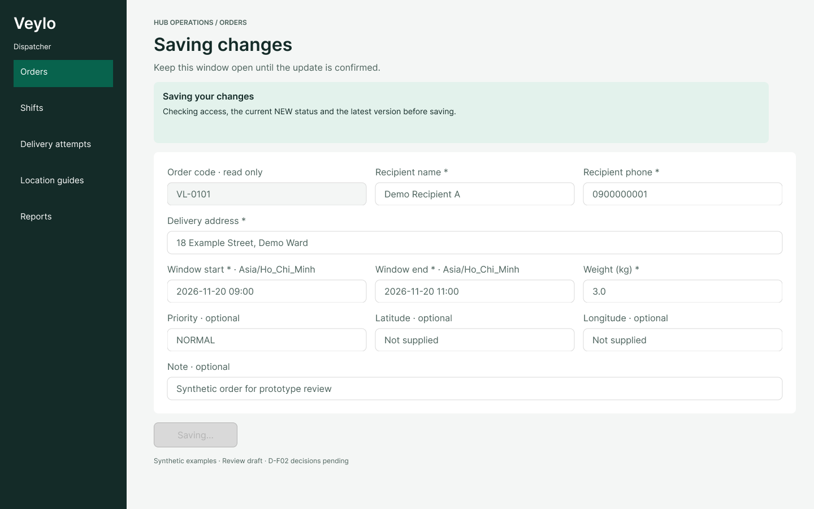

**S08-02-updated — Order updated** · [Editable Figma frame](https://www.figma.com/design/RBd5qiERPNz1yXRgkYVcwP/?node-id=4196-1771)

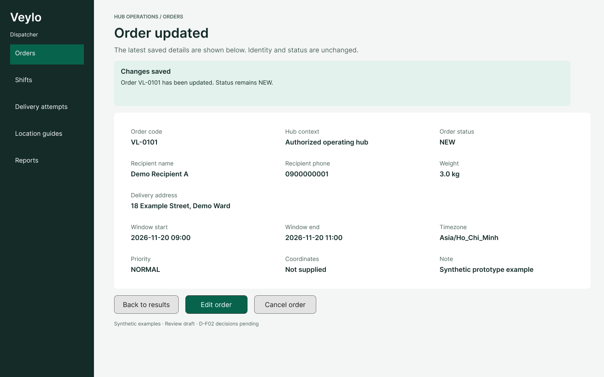

**S08-03-cancel-confirm — Cancel order VL-0101** · [Editable Figma frame](https://www.figma.com/design/RBd5qiERPNz1yXRgkYVcwP/?node-id=4196-1851)

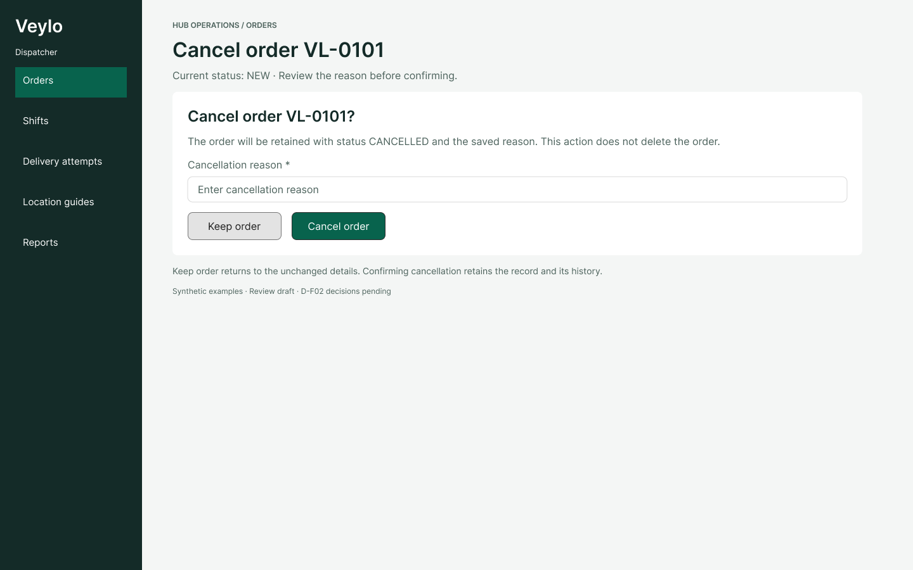

**S08-04-cancelled — Order cancelled** · [Editable Figma frame](https://www.figma.com/design/RBd5qiERPNz1yXRgkYVcwP/?node-id=4196-1931)

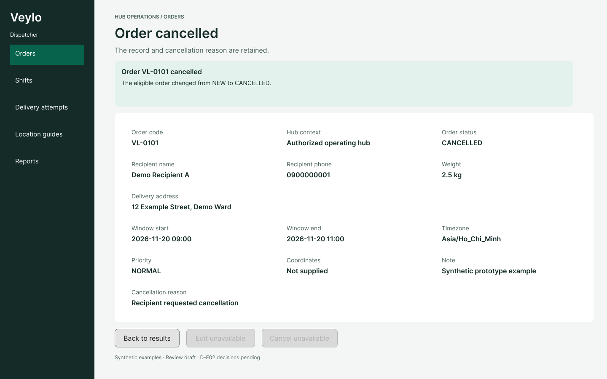

**S08-01-error — Edit order VL-0101** · [Editable Figma frame](https://www.figma.com/design/RBd5qiERPNz1yXRgkYVcwP/?node-id=4196-2014)

**S08-03-reason-error — Cancel order VL-0101** · [Editable Figma frame](https://www.figma.com/design/RBd5qiERPNz1yXRgkYVcwP/?node-id=4196-2164)

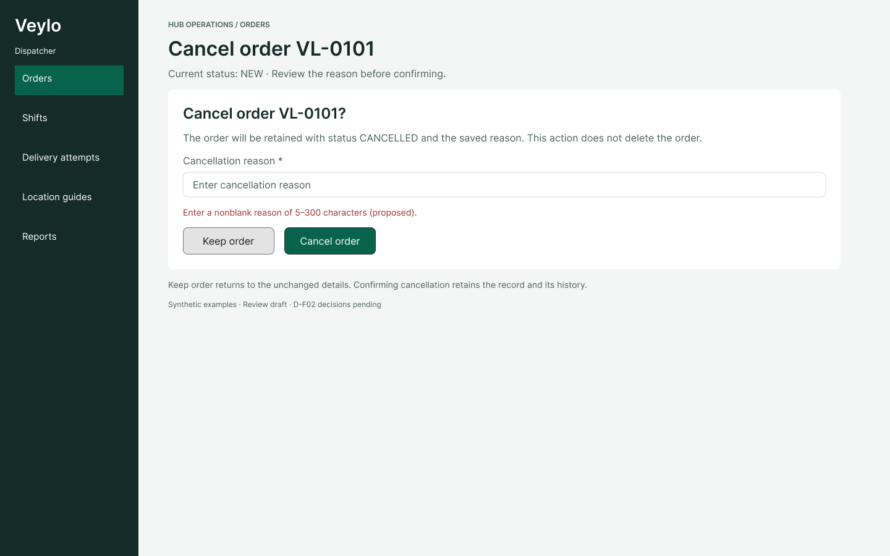

**S08-05-status-blocked — This action is unavailable** · [Editable Figma frame](https://www.figma.com/design/RBd5qiERPNz1yXRgkYVcwP/?node-id=4196-2204)

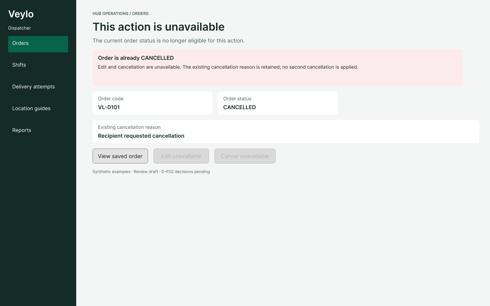

**S08-06-conflict — The order changed** · [Editable Figma frame](https://www.figma.com/design/RBd5qiERPNz1yXRgkYVcwP/?node-id=4196-2250)

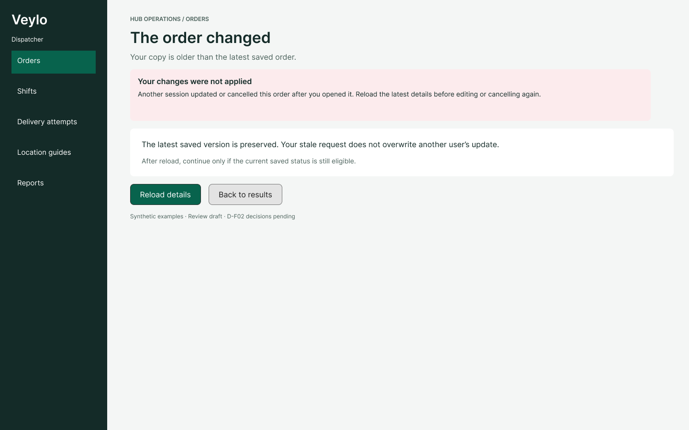

**S08-07-not-found — Order not found** · [Editable Figma frame](https://www.figma.com/design/RBd5qiERPNz1yXRgkYVcwP/?node-id=4196-2285)

**S08-01-auth — Sign in required** · [Editable Figma frame](https://www.figma.com/design/RBd5qiERPNz1yXRgkYVcwP/?node-id=4196-2312)

**S08-01-denied — Access restricted** · [Editable Figma frame](https://www.figma.com/design/RBd5qiERPNz1yXRgkYVcwP/?node-id=4196-2343)

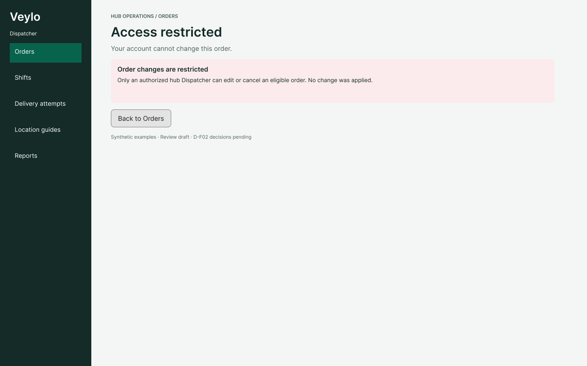

**S08-08-failure — Could not confirm the change** · [Editable Figma frame](https://www.figma.com/design/RBd5qiERPNz1yXRgkYVcwP/?node-id=4196-2370)

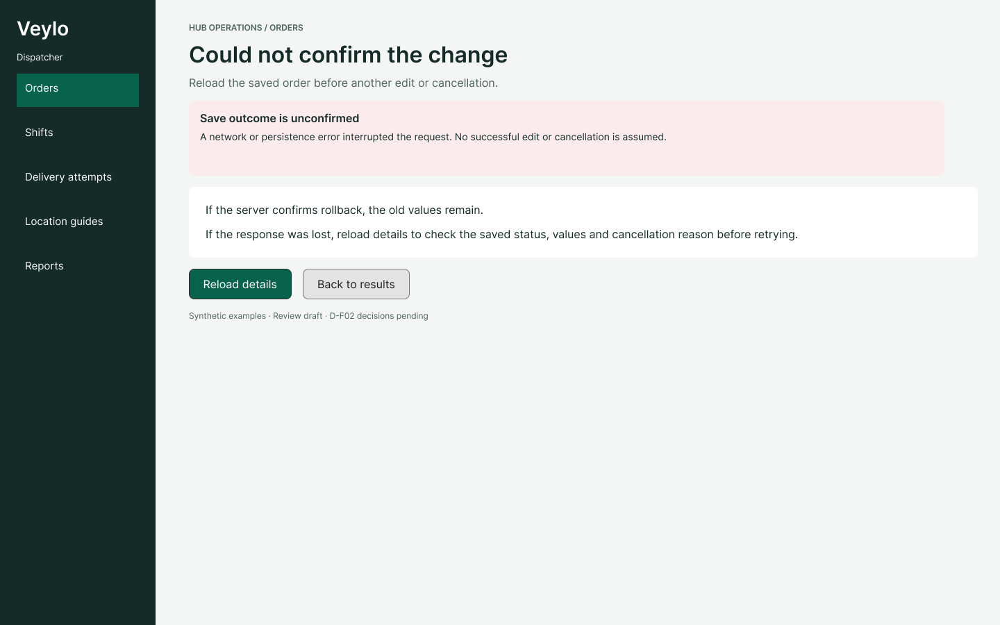

**S08-01-edit-changed — Edit order VL-0101** · [Editable Figma frame](https://www.figma.com/design/RBd5qiERPNz1yXRgkYVcwP/?node-id=4197-2132)

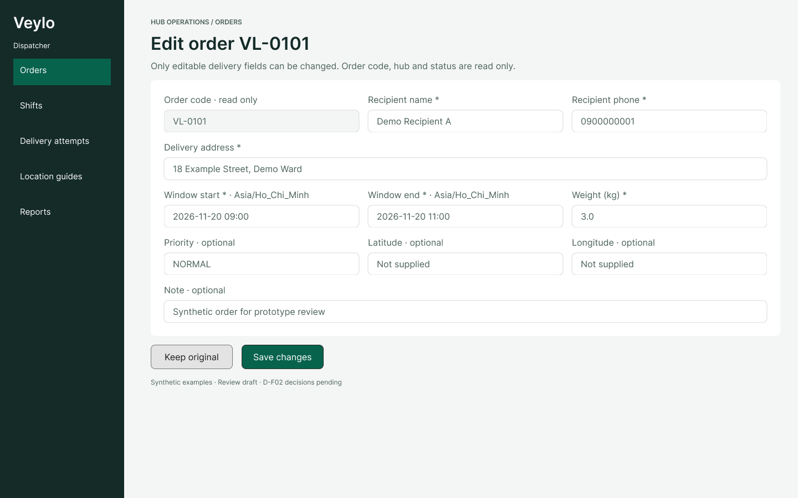

**S08-03-cancel-confirm-filled — Cancel order VL-0101** · [Editable Figma frame](https://www.figma.com/design/RBd5qiERPNz1yXRgkYVcwP/?node-id=4196-1891)

**S08-01-identity-error — Edit request rejected** · [Editable Figma frame](https://www.figma.com/design/RBd5qiERPNz1yXRgkYVcwP/?node-id=4196-2122)

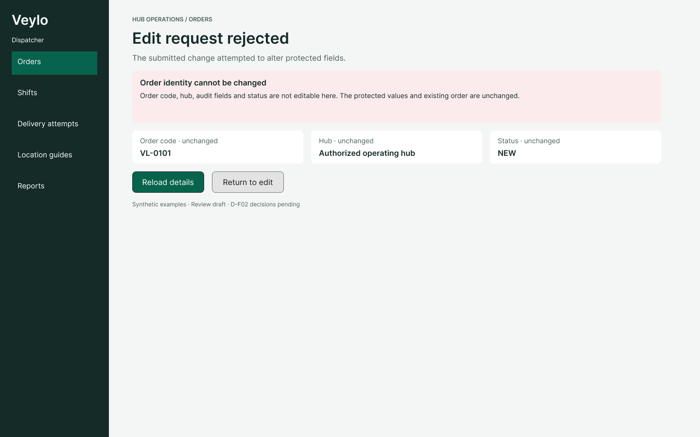

**Review record:** Assigned reviewer **Phạm Công Khánh**. Actual review date: **Pending**. Decisions on cancel eligibility, conflict responses and prototype implementation feasibility: **Pending**.
