# Veylo · F02 Order Intake
Performed by: Codex for task owner Trần Lê Hải. Reviewed by: Phạm Công Khánh (Cee-Ka; PR #16 corrected revision approved on 20 November 2026 at f7f296a). Edited by: Codex.

**Group 09 · PA3 Section D · BOOYAH-20 · Review corrections · 20 November 2026**

This specification covers the Hub Dispatcher goals in Use Case Model view D2, UC05 through UC08. `Dispatcher` is the short name used in the model. An Order is a delivery request that can have several DeliveryAttempts. Each DeliveryAttempt has its own start, arrival and outcome. An unsuccessful attempt alone does not make an Order terminal.

Sources are [BOOYAH-20](https://thaikiet291006.atlassian.net/browse/BOOYAH-20) and the PA3 rubric pp. 2–4, Kiệt's BOOYAH-24 `UseCaseModel.md` sections 2, 4.2 and 5–7, and BOOYAH-26 `VisionDocument.md`/`Changes.md` sections 3.2–3.3, 5.1, 5.3 and 6. Screens use Công Khánh's original PrototypeKit with fresh synthetic states. The [prototype guide](prototypes/order-intake/README.md) describes the working copy and evidence commands.

## UC05 — Create Order Manually
Performed by: Codex for task owner Trần Lê Hải. Reviewed by: Phạm Công Khánh (Cee-Ka; PR #16 corrected revision approved on 20 November 2026 at f7f296a). Edited by: Codex.

**Actor.** Hub Dispatcher. There is no secondary actor.

**Description and trigger.** A Dispatcher opens Create order to enter one delivery request for the current hub. FR-02-1 and FR-02-3 govern intake and validation. FR-01-2 applies to access.

**Preconditions.** The Dispatcher has an active session and is authorized in the current hub. The order code is available in that hub for a successful submission.

**Basic flow**

1. **05.1** From Orders, the Dispatcher chooses **Create order**. The system opens the form (`S07-01` → `S05-01`).
2. **05.2** The Dispatcher enters order code, recipient name and phone, delivery address, hub-local window start and end, parcel weight and optional priority, note or paired coordinates (`S05-01`).
3. **05.3** The Dispatcher chooses **Save order**. The system checks role and hub, validates the fields and checks the normalized code in that hub (D-F02-1, -2 and -7, `S05-01`).
4. **05.4** The system creates one `NEW` Order and shows its detail and success confirmation (`S07-02-created`). **Back to orders** returns to `S07-01`.

**Alternative and exception flows**

| Branch | From | Condition and visible outcome | Resume or end |
| --- | --- | --- | --- |
| 05.A1 | 05.3 | A required field is blank, the phone is malformed, the date/time is invalid, the window end is at or before the start, or the weight is nonpositive. The same feedback covers the remaining D-F02-1 field limits. `S05-01-error` focuses an error summary with links to invalid fields and keeps the entered values. | Correct at 05.2 and resubmit. |
| 05.A2 | 05.3 | The hub already has the normalized order code, for example ` f02-500 ` matches `F02-500`. `S05-01-duplicate` links to the code and preserves input. | Change the code at 05.2. |
| 05.A3 | 05.2 | The Dispatcher leaves through **Discard and return** or **Back to orders**. | End at `S07-01` with no created order. |
| 05.A4 | 05.1 or 05.3 | Role or hub authorization fails, or the session is absent/expired. | Follow [shared access recovery](#shared-access-recovery), then restart at 05.1 when authorized. No write occurs. |

**Postconditions.** Success creates one Order in the authorized hub with status `NEW` (D-F02-6), visible in Orders. Validation, denial and dismissal perform no write. Corrections from 05.A1 and 05.A2 retain the form values.

**Special requirements.** N05 authorization boundary, N06 synthetic information and N16 keyboard access, labeled fields and summary-to-field focus. Valid data is checked before it becomes available for planning.

**Screen evidence.** The entry list is embedded under [UC07](#uc07--search-and-view-orders). See shared access frames under [Shared access recovery](#shared-access-recovery).

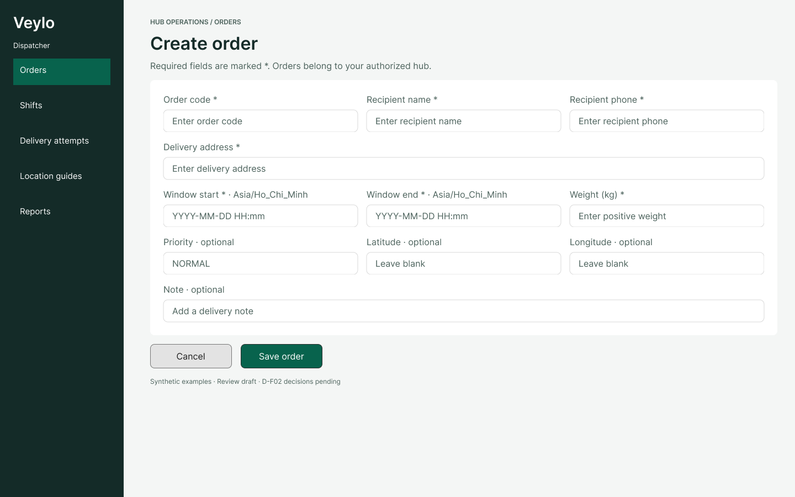

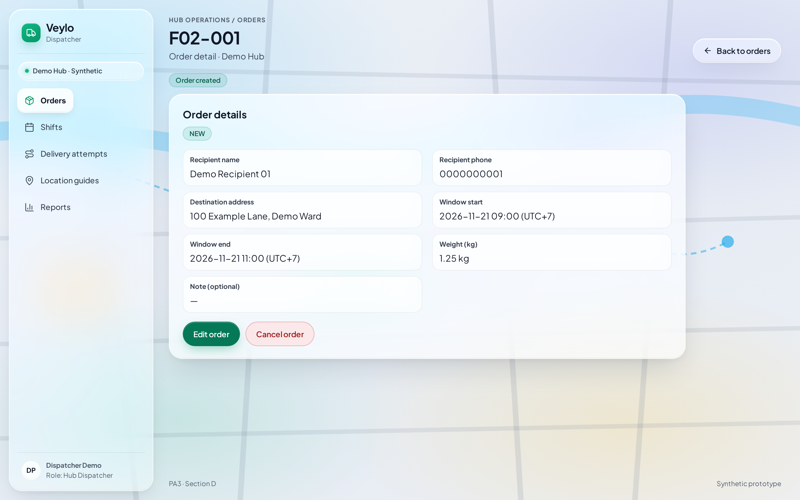

## UC06 — Import Orders from CSV
Performed by: Codex for task owner Trần Lê Hải. Reviewed by: Phạm Công Khánh (Cee-Ka; PR #16 corrected revision approved on 20 November 2026 at f7f296a). Edited by: Codex.

**Actor.** Hub Dispatcher. There is no secondary actor.

**Description and trigger.** A Dispatcher opens **Import CSV** to check and then confirm a batch of orders for the current hub. FR-02-2 and FR-02-3 govern import and validation. FR-01-2 applies to access.

**Preconditions.** The Dispatcher has an active session and access to the hub. The size, format, fields and per-hub code checks apply on input. The valid fixture should be exercised in a fresh demo whose seed has no codes `F02-001`–`F02-020`.

**Basic flow**

1. **06.1** From `S07-01` the Dispatcher selects **Import CSV**. `S06-01` offers the file picker and **Download CSV template**. Opening the template is optional and returns to the picker.
2. **06.2** The Dispatcher selects a file and chooses **Check CSV**. The system verifies authorization and the file contract, then validates all data records and both duplicate cases (D-F02-1 to -4 and -7). A clean file advances to `S06-02`.
3. **06.3** The Dispatcher reviews the preview and the valid count. The preview validates only and displays **0 orders saved**. The Dispatcher explicitly selects **Import 20 orders** for the sample (`S06-02`).
4. **06.4** Only confirmation calls the Section E import endpoint. The system rechecks authorization and current codes, commits a valid batch atomically and shows the number created (`S06-03`). **View orders** returns to `S07-01` with the new `NEW` Orders.

**Alternative and exception flows**

| Branch | From | Condition and visible outcome | Resume or end |
| --- | --- | --- | --- |
| 06.A1 | 06.2 | Unsupported type such as `orders.xlsx`. `S06-01-file-type` prompts for a `.csv` file. If no file was selected, the picker prompts for a file selection (`S06-01`). | Replace or select the file and retry 06.2. |
| 06.A2 | 06.2 | A zero-byte/blank file gives `S06-01-file-empty`. A header with no data gives `S06-01-file-empty-header`. | Add order records and retry 06.2. |
| 06.A3 | 06.2 | Missing required, unknown or duplicated header names give `S06-01-file-header`. | Download the template and retry 06.2. |
| 06.A4 | 06.2 | 501 data records exceed the record cap (`S06-01-file-limit`). 1,000,001 bytes exceed the byte cap (`S06-01-file-limit-bytes`). | Reduce the CSV and retry 06.2. |
| 06.A5 | 06.2 | Invalid quote/record syntax gives `S06-01-file-format`. Invalid UTF-8 gives `S06-01-file-format-encoding`. A row with the wrong width gives `S06-01-file-format-width` and identifies the offending record. | Correct the file and retry 06.2. |
| 06.A6 | 06.2 | The mixed sample has invalid fields, an in-file duplicate and a same-hub duplicate. `S06-02-row-errors` flags records 2 and 3 for the duplicate and reports record, column, reason and totals. No orders are imported. | Choose a replacement file and retry 06.2. |
| 06.A7 | 06.3 | The Dispatcher chooses **Cancel import** at confirmation. `S07-01-import-cancelled` shows that zero orders were imported. | End. |
| 06.A8 | 06.4 | A code is claimed after preview. `S06-02-conflict` shows which record and column conflict, with zero orders imported from the batch. | Replace the file and start at 06.2, then confirm a fresh preview. |
| 06.A9 | 06.1, 06.2 or 06.4 | Access fails or the session is absent/expired before upload validation or confirmation. | Follow [shared access recovery](#shared-access-recovery), then restart at 06.1. No batch commit occurs. |

**Postconditions.** The atomic policy creates all input records with status `NEW` only after successful confirmation. Any failed check or cancellation creates zero records from that batch. Viewing validation results changes no orders.

**Special requirements.** Apply the same validation as manual intake, with record numbering starting at 2 for the first data record. Follow N05, N06 and N16. File and row feedback must make correction and retry discoverable.

**Screen evidence.** The entry list and shared recovery frames appear in [UC07](#uc07--search-and-view-orders) and [Shared access recovery](#shared-access-recovery).

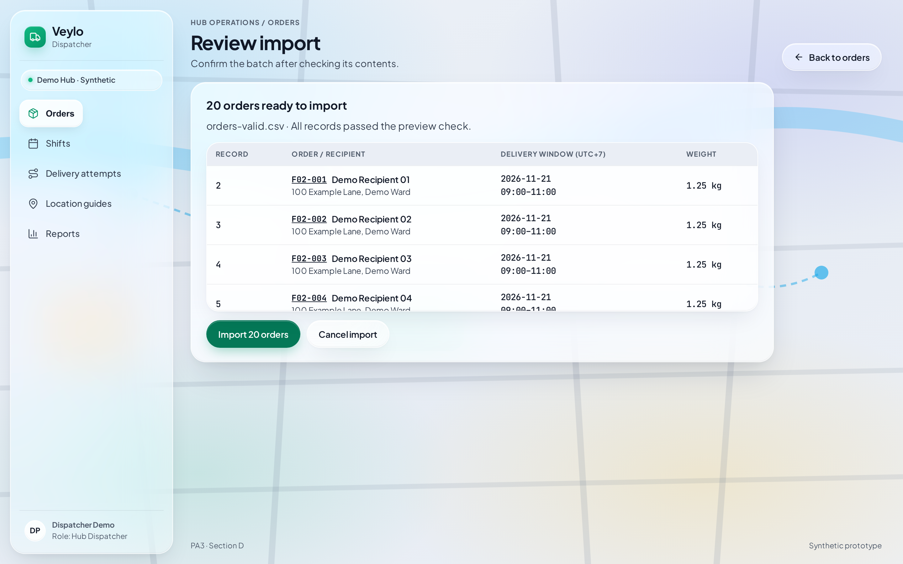

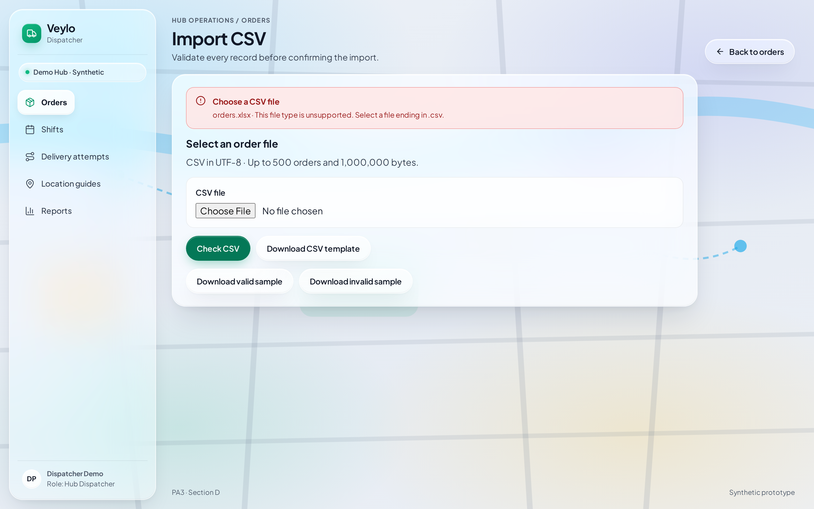

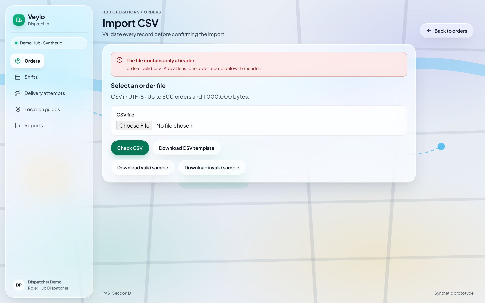

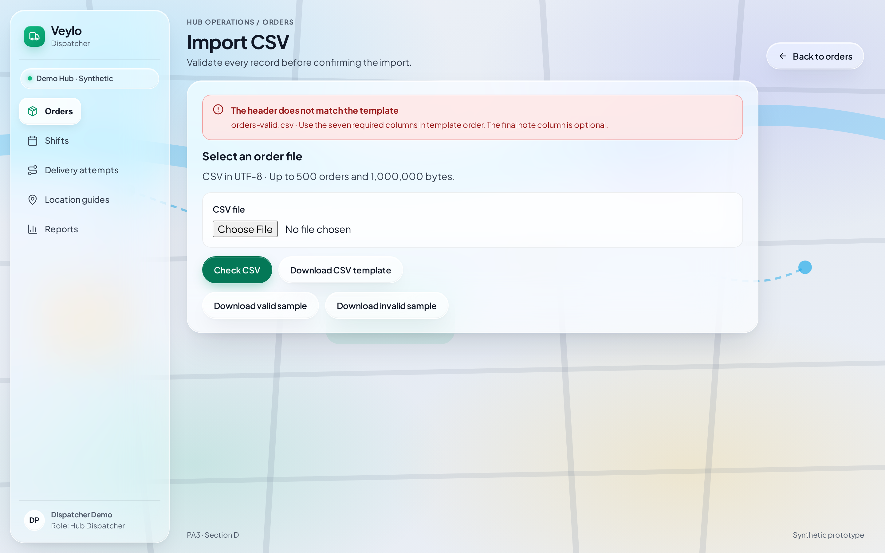

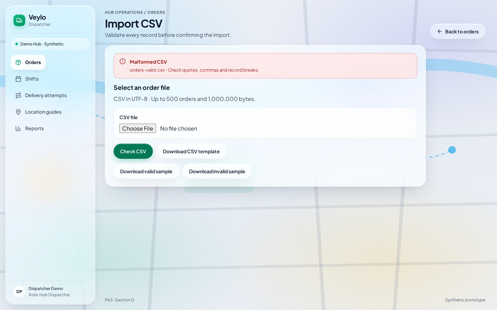

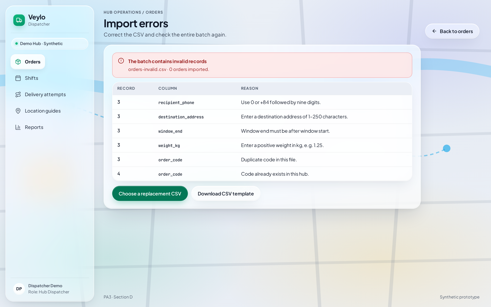

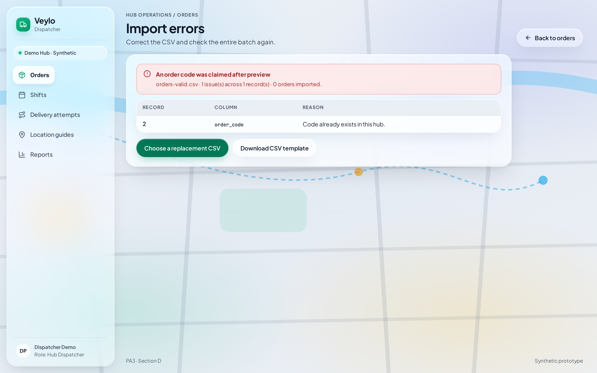

## UC07 — Search and View Orders
Performed by: Codex for task owner Trần Lê Hải. Reviewed by: Phạm Công Khánh (Cee-Ka; PR #16 corrected revision approved on 20 November 2026 at f7f296a). Edited by: Codex.

**Actor.** Hub Dispatcher. There is no secondary actor.

**Description and trigger.** A Dispatcher opens Orders to locate and inspect a permitted order. FR-02-4 governs list and detail. FR-01-2 applies to both.

**Preconditions.** The Dispatcher has an active session authorized for the current hub. Listing is available even for a hub with no orders.

**Basic flow**

1. **07.1** Open Orders. The system scopes the list to the current hub and displays page 1 of the ordered list (`S07-01`).
2. **07.2** Search by order code, recipient name or phone. Apply optional status or inclusive hub-local start-date filters, or paginate. The system combines filters, sorts by window start then displayed code ascending, and returns page 1 when filters change or the requested page exceeds the range (`S07-01-filtered`, `S07-01-page-2`).
3. **07.3** Select an order code. The system verifies resource access and shows recipient, delivery address, delivery window, weight, optional metadata and current status, plus the cancellation reason when present (`S07-02` or `S08-03`).

**Alternative and exception flows**

| Branch | From | Condition and visible outcome | Resume or end |
| --- | --- | --- | --- |
| 07.A1 | 07.1 | There are no Orders in the hub. `S07-01-empty` offers **Create order** and **Import CSV**. | End, or start UC05/UC06. |
| 07.A2 | 07.2 | A valid filter set matches no Orders. `S07-01-no-results` offers **Clear filters** and retains the query for editing. | Clear or revise at 07.2. |
| 07.A3 | 07.2 | The date range is inverted. `S07-01-filter-error` preserves the values and links the summary to the end-date field. | Correct at 07.2. |
| 07.A4 | 07.3 | A direct URL refers to another hub, or there is no permitted resource for the requested code. `S07-01-not-found` shows HTTP 404 without Order or hub details. | Return to the permitted order list. |
| 07.A5 | 07.1, 07.2 or 07.3 | An unauthorized role or expired session attempts a list, filter or detail action. | Follow [shared access recovery](#shared-access-recovery) and restart at 07.1 when authorized. |

**Postconditions.** Listing, navigation and detail have no mutation. The Dispatcher sees only the authorized hub's data. An unavailable resource discloses no recipient or order detail.

**Special requirements.** D-F02-7 and -8 specify resource authorization and deterministic pagination. N01 covers list/detail runtime performance and N17 covers desktop browser compatibility. This package verifies Chromium layout and interaction, with N05, N06 and N16 represented at prototype level.

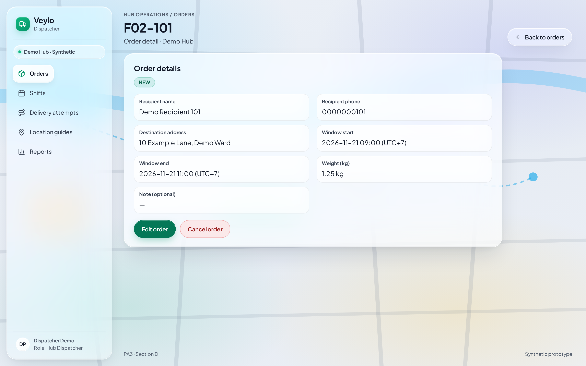

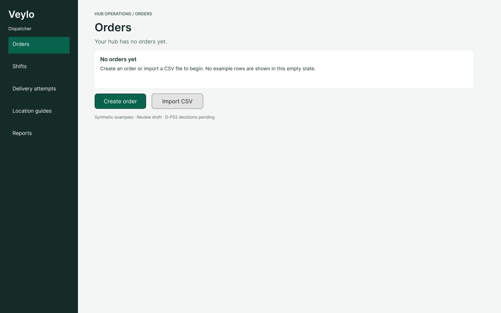

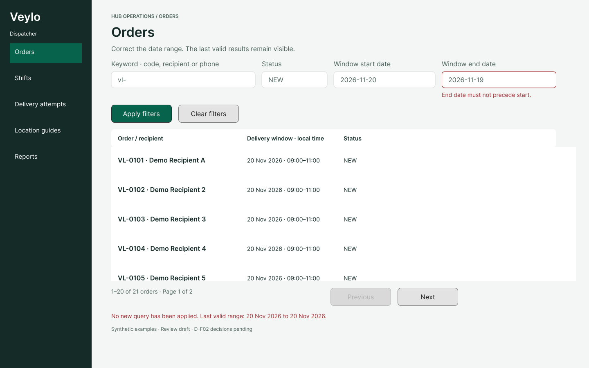

## UC08 — Update or Cancel Order
Performed by: Codex for task owner Trần Lê Hải. Reviewed by: Phạm Công Khánh (Cee-Ka; PR #16 corrected revision approved on 20 November 2026 at f7f296a). Edited by: Codex.

**Actor.** Hub Dispatcher. There is no secondary actor.

**Description and trigger.** From a permitted detail, the Dispatcher corrects a `NEW` Order or cancels it with a reason. FR-02-3 governs field validation, FR-02-5 governs conditional changes and FR-01-2 governs access.

**Preconditions.** The Dispatcher is signed in, authorized in the hub and can open the Order. For a successful mutation, the Order must still be current and `NEW` at submit time.

**Basic flow**

1. **08.1** Open the permitted Order detail (`S07-02`). The system displays its current state.
2. **08.2** Select **Edit order** to change editable fields (`S08-01`). The order code is read-only and omitted from the update payload. Alternatively, select **Cancel order** and enter a reason in the confirmation (`S08-02`).
3. **08.3** Choose **Save changes** or **Confirm cancellation**. The system rechecks scope, state and whether the record changed concurrently. It validates editable fields or the cancellation reason (D-F02-1, -5, -6 and -7).
4. **08.4** A successful edit retains code and hub and shows the saved `NEW` detail (`S07-02-updated`). A successful cancellation retains the Order and shows the same order as `CANCELLED` with the saved trimmed reason (`S08-03`). The two evidence frames follow one cancellation of `F02-101` with reason “Synthetic recipient requested cancellation.”

**Alternative and exception flows**

| Branch | From | Condition and visible outcome | Resume or end |
| --- | --- | --- | --- |
| 08.A1 | 08.1, 08.2 or 08.3 | The edit is unavailable for the current state, for example `CANCELLED`. `S08-01-blocked` explains the state rule. | Return to detail. |
| 08.A2 | 08.3 | One or more edited fields fail the shared rules. `S08-01-error` preserves entries and links to each invalid field. | Correct at 08.2. |
| 08.A3 | 08.2 | The Dispatcher selects **Keep order** or **Back to detail** from the cancellation confirmation, or discards an edit. | Return to `S07-02` with no change from the attempted action. |
| 08.A4 | 08.3 | The trimmed reason has fewer than 5 or more than 300 characters, or contains NUL. `S08-02-error` keeps the text and identifies the reason field. | Correct at 08.2. No state change yet. |
| 08.A5 | 08.3 | The record was edited since opening the form. `S08-01-conflict` reports a stale update, and `S08-01-conflict-cancel` reports a stale cancellation. | **Reload order** opens the latest `S07-02`. Review it and restart at 08.1. |
| 08.A6 | 08.3 | The requested order is already `CANCELLED`, for example a concurrent cancellation completed first. `S08-03-already-cancelled` shows the original reason. | Return to the retained detail. The original reason is preserved. |
| 08.A7 | 08.1, 08.2 or 08.3 | Scope check fails or the session is absent/expired. | Follow [shared access recovery](#shared-access-recovery). No edit or cancellation from the failed request is recorded. |

**Postconditions.** A valid edit updates the same Order. A valid cancellation keeps it available to review with state `CANCELLED` and a reason. Failed, stale and dismissed actions preserve the current stored state. These F02 actions leave DeliveryAttempt vocabulary and behavior to the owning use cases.

**Special requirements.** Provide explicit confirmation, keyboard-operable controls and focused error feedback (N16). Enforce session and hub authorization on entry and submit (N05), and use synthetic examples (N06).

**Screen evidence.** The starting detail is embedded under [UC07](#uc07--search-and-view-orders). The stale edit and stale cancellation share the conflict layout and reload path; the explanatory text specifies which action failed.

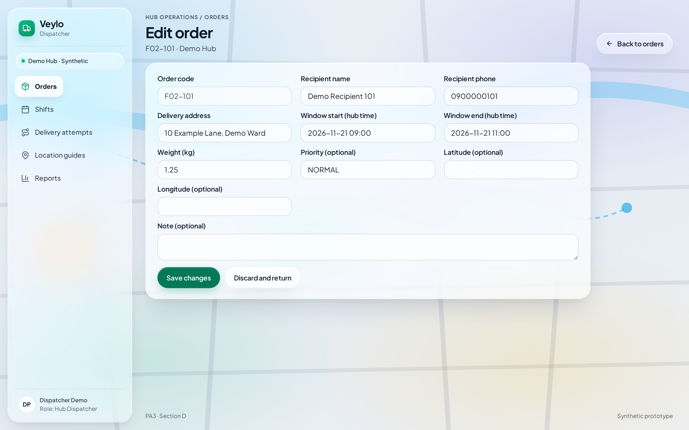

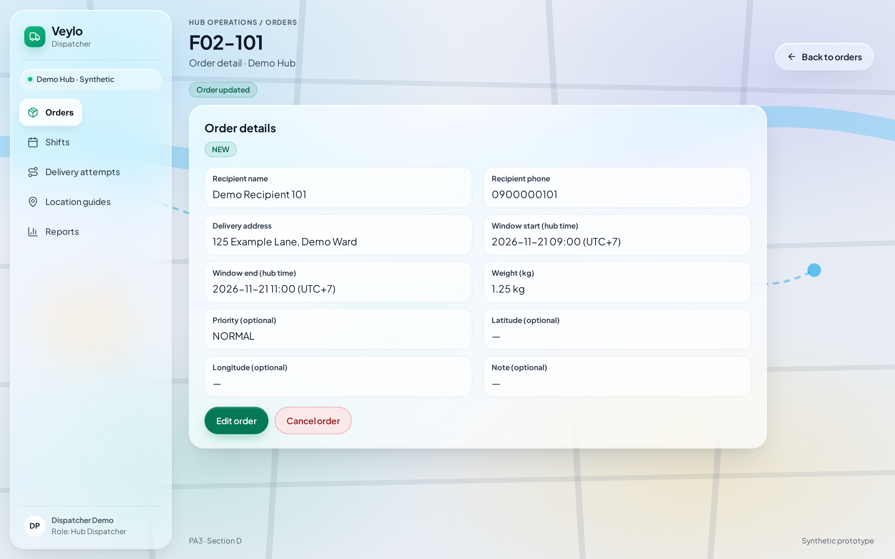

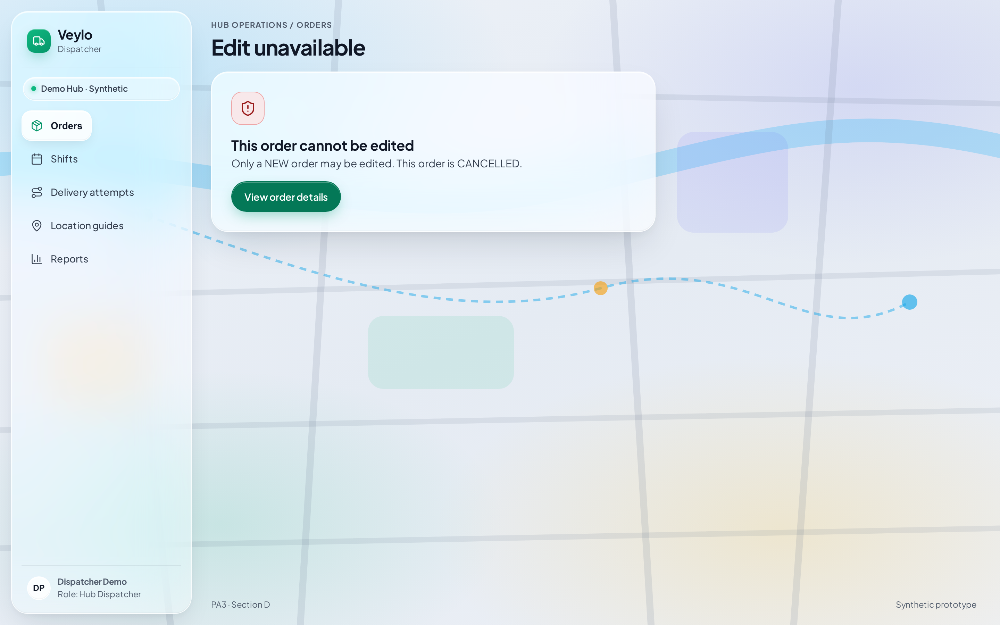

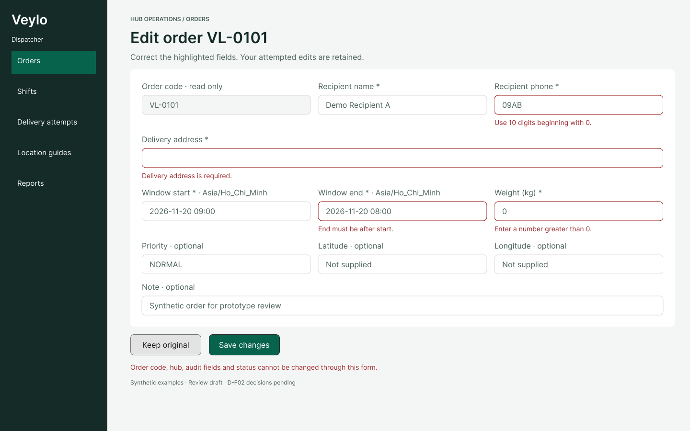

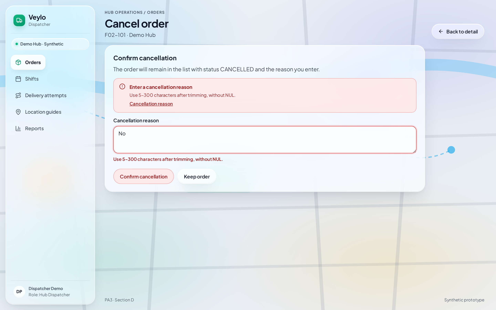

## Shared access recovery
Performed by: Codex for task owner Trần Lê Hải. Reviewed by: Phạm Công Khánh (Cee-Ka; PR #16 corrected revision approved on 20 November 2026 at f7f296a). Edited by: Codex.

- **AUTH.1** FR-01-2 / SRC-01-02. A signed-in user with the wrong role or without an authorized Dispatcher hub receives HTTP `403` (N05). `S07-01-denied` reveals no account, hub or Order details and offers a return to the staff workspace. It ends the attempted access.
- **AUTH.2** FR-01-2 / SRC-01-02. An absent or expired session is treated as unauthenticated (N05, `401`). `S07-01-session-expired` offers Sign In. After signing in, the Dispatcher starts again from Orders. The attempted operation is not replayed.
- **AUTH.3** FR-01-2 / SRC-01-02. A nonexistent or out-of-hub order returns HTTP `404`. `S07-01-not-found` gives identical generic feedback in both cases and offers a return to Orders.
- Administrator administers staff, hub configuration and audit. Delivery Rider has separate assigned-work access. These roles do not inherit F02 Dispatcher permissions. The standalone prototype illustrates the responses with local state. Production role/resource enforcement and actual HTTP responses are Section E evidence.

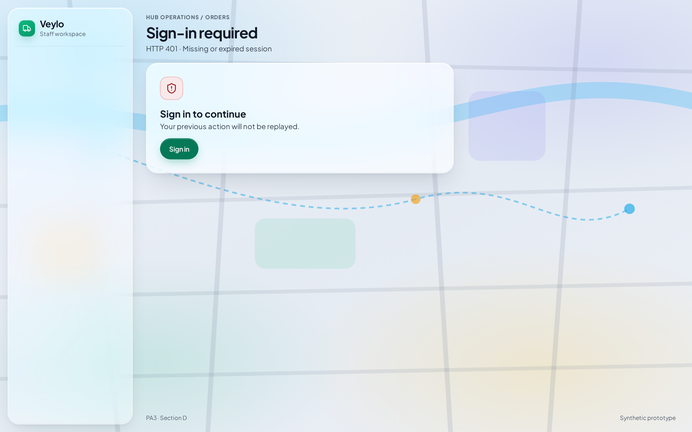

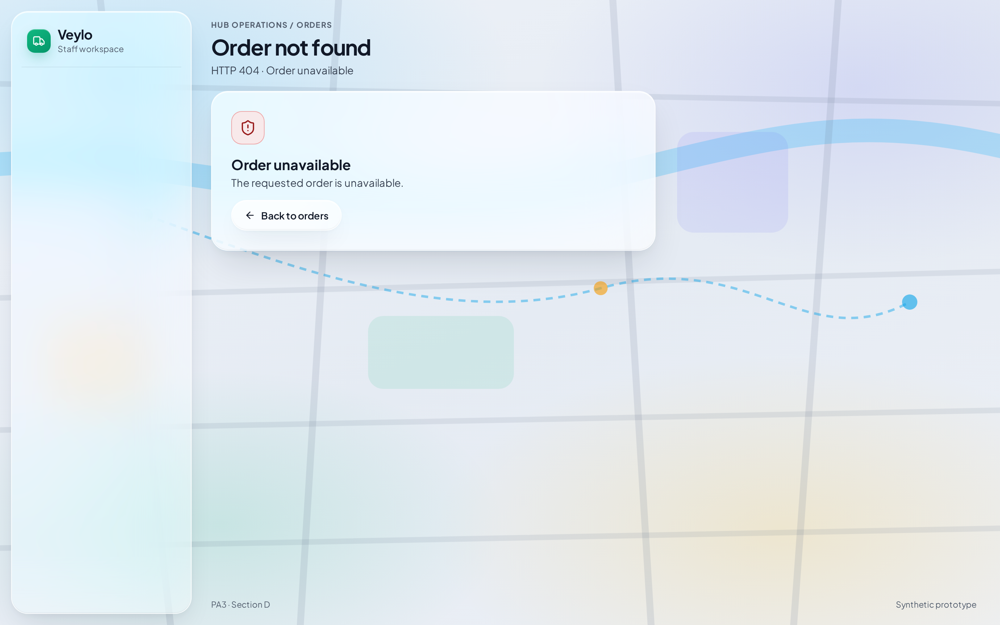

## Decision Log
Performed by: Codex for task owner Trần Lê Hải. Reviewed by: Phạm Công Khánh (Cee-Ka; PR #16 corrected revision approved on 20 November 2026 at f7f296a). Edited by: Codex.

The BOOYAH-13 design records Phạm Công Khánh’s local confirmation of D-F02-1–8 on 19 November 2026. His changes-requested review on [PR #16](https://github.com/DankDaPancake/Veylo/pull/16) on 20 November supplies the specific corrections below. PR #16 was subsequently approved by Cee-Ka at `f7f296a` on 20 November 2026 and merged. The approval body does not enumerate separate Kiệt/team confirmations or all AC3–AC5 walkthrough details; those details remain unavailable.

| Rule | Section E baseline and reviewer correction | Evidence | Corrected PR |
| --- | --- | --- | --- |
| **D-F02-1** | Require `order_code`, `recipient_name`, `recipient_phone`, `delivery_address`, `window_start`, `window_end` and `weight_kg`. Trim code, name and address. Code uses 1–40 ASCII letters, digits, underscores or hyphens, e.g. `_A-01`. Name uses 1–100 Unicode characters and delivery address 5–255. Phone is exactly 10 digits starting with 0, e.g. `0900000001`. Use valid `YYYY-MM-DD HH:mm` in `Asia/Ho_Chi_Minh`, end after start and positive finite weight. Optional priority is `NORMAL` by default or `HIGH`. Note is optional. Coordinates are both absent or both within latitude [−90, 90] and longitude [−180, 180]. | BOOYAH-13 and BOOYAH-19 validator. PR #16 finding 1. | PR #16 approved; separate confirmation not evidenced |
| **D-F02-2** | Keep the trimmed display code and compare lowercase keys within the authorized hub. `F02-001` and ` f02-001 ` conflict in a file and against records in that hub. A code used in another hub remains available. | BOOYAH-13 and BOOYAH-19 parser and service. PR #16 finding 3. | PR #16 approved; separate confirmation not evidenced |
| **D-F02-3** | Preview is read-only. Explicit confirmation starts the atomic import and rechecks the batch. Report record, column and reason, including every duplicate occurrence. Twenty valid records create 20. Mixed errors, a confirmation-time conflict and dismissal create zero. The prototype simulates both preview and commit. | BOOYAH-13 and BOOYAH-19 import route and service. PR #16 finding 3. | PR #16 approved; separate confirmation not evidenced |
| **D-F02-4** | Accept `.csv`, UTF-8 with optional BOM, LF or CRLF, quoted commas and line breaks and escaped quotes. Require all seven required columns in any order. Optional columns are `priority`, `note`, `latitude` and `longitude`. Reject missing, duplicate and unknown names and wrong-width records. Accept 1–500 data records and at most 1,000,000 bytes. Header is record 1. | BOOYAH-13 and BOOYAH-19 parser and template. PR #16 finding 2. | PR #16 approved; separate confirmation not evidenced |
| **D-F02-5** | Edit or cancel a current `NEW` order with a matching version. Code is read-only and omitted from edit submission. Hub, status and audit fields are protected. Cancel with 5–300 characters after trim, retain the same order as `CANCELLED` and show the saved reason. A stale or repeat request preserves the current record and saved reason. | BOOYAH-13 and BOOYAH-19 service. PR #16 findings 1, 5 and 6. | PR #16 approved; separate confirmation not evidenced |
| **D-F02-6** | Create/import yield `NEW`. Edits retain `NEW`. Confirmed cancellation transitions `NEW → CANCELLED` with no reversal. Order and DeliveryAttempt lifecycles are separate. | BOOYAH-13 and BOOYAH-24 state reconciliation. | PR #16 approved; separate confirmation not evidenced |
| **D-F02-7** | Only Dispatchers with a trusted hub assignment can access F02. Respond `401` for missing or expired session, `403` for denied role or missing hub authorization and `404` for a missing or different-hub Order. The last two cases show no Order details. Signing in does not replay the request. | BOOYAH-13 and BOOYAH-19 access wrapper and service. PR #16 finding 4. | PR #16 approved; separate confirmation not evidenced |
| **D-F02-8** | Combine status, inclusive hub-local window-start dates and a case-insensitive literal keyword in displayed code, recipient name or phone. Sort by window start then displayed code ascending. Page size is 20. Reset an out-of-range page to page 1 and retain current filters. | BOOYAH-13 and BOOYAH-19 list service. PR #16 finding 4. | PR #16 approved; separate confirmation not evidenced |

## FR, step and screen traceability
Performed by: Codex for task owner Trần Lê Hải. Reviewed by: Phạm Công Khánh (Cee-Ka; PR #16 corrected revision approved on 20 November 2026 at f7f296a). Edited by: Codex.

| FR and source | UC and steps/branches | Screen evidence |
| --- | --- | --- |
| FR-02-1 / SRC-02-01 · baseline | UC05 05.1–05.4, 05.A2–A3 | `S07-01`, `S05-01`, `S05-01-duplicate`, `S07-02-created` |
| FR-02-2 / SRC-02-02 · baseline | UC06 06.1–06.4, 06.A1–A8 | `S07-01`, `S06-01`, `S06-02`, `S06-03`, `S07-01-import-cancelled`, `S06-01-file-type`, `S06-01-file-empty`, `S06-01-file-empty-header`, `S06-01-file-header`, `S06-01-file-limit`, `S06-01-file-limit-bytes`, `S06-01-file-format`, `S06-01-file-format-encoding`, `S06-01-file-format-width`, `S06-02-row-errors`, `S06-02-conflict` |
| FR-02-3 / SRC-02-03 · baseline, details pending | UC05 05.2–05.3/05.A1–A2, UC06 06.2–06.4/06.A1–A6/06.A8, UC08 08.2–08.3/08.A2/08.A4 | `S05-01-error` and `S05-01-duplicate`; UC06 file, record and conflict screens in the row above; `S08-01-error` and `S08-02-error` |
| FR-02-4 / SRC-02-04 · T07 refinement | UC07 07.1–07.3, 07.A1–A4 | `S07-01`, `S07-01-filtered`, `S07-01-page-2`, `S07-02`, `S07-01-empty`, `S07-01-no-results`, `S07-01-filter-error`, `S07-01-not-found` |
| FR-02-5 / SRC-02-05 · T07 refinement | UC08 08.1–08.4, 08.A1–A6 | `S07-02`, `S08-01`, `S08-02`, `S07-02-updated`, `S08-03`, `S08-01-blocked`, `S08-01-error`, `S08-02-error`, `S08-01-conflict`, `S08-01-conflict-cancel`, `S08-03-already-cancelled` |
| FR-01-2 / SRC-01-02 · cross-cutting | UC05 05.A4, UC06 06.A9, UC07 07.A4–A5, UC08 08.A7 | `S07-01-denied`, `S07-01-session-expired`, `S07-01-not-found` (AUTH.1–AUTH.3) |

## CSV contract and Section E comparison
Performed by: Codex for task owner Trần Lê Hải. Reviewed by: Phạm Công Khánh (Cee-Ka; PR #16 corrected revision approved on 20 November 2026 at f7f296a). Edited by: Codex.

- The [downloadable template](fixtures/order-intake/orders-template.csv) matches BOOYAH-19’s template byte for byte, including its synthetic example. The [valid fixture](fixtures/order-intake/orders-valid.csv) contains 20 records. The [missing](fixtures/order-intake/orders-header-missing.csv), [duplicate](fixtures/order-intake/orders-header-duplicate.csv) and [unknown](fixtures/order-intake/orders-header-unknown.csv) header fixtures each isolate one failure.
- The [invalid fixture](fixtures/order-intake/orders-invalid.csv) reports duplicate `order_code` on records 2 and 3. Record 3 also has an invalid phone, address, end time and weight. Record 4 repeats seeded code `F02-500`. The prototype preview reports seven diagnostics across three records and imports zero. The BOOYAH-19 parser returns six diagnostics before database lookup. The prototype separately simulates the same-hub lookup and the confirmation-time race. Neither simulation writes to PostgreSQL.
- Source comparison used the [BOOYAH-13 contract on dev](https://github.com/DankDaPancake/Veylo/blob/84bc0d813605706329d44d1ed72f24956960d5b2/openspec/changes/f02-order-intake/design.md) and the [BOOYAH-19 order modules at c0906d0](https://github.com/DankDaPancake/Veylo/tree/c0906d06704653456ec8b592e338f6abcf952e22/src/lib/orders), plus the import, detail and cancel routes at the same revision. Source inspection confirms the access codes, edit-version checks, displayed-code ordering and page fallback. The prototype displays simulated HTTP statuses. Runtime guard, transaction and reload evidence remain pending for AC4.

## Verification and reviewer handoff
Performed by: Codex for task owner Trần Lê Hải. Reviewed by: Phạm Công Khánh (Cee-Ka; PR #16 corrected revision approved on 20 November 2026 at f7f296a). Edited by: Codex.

| Jira AC | Local evidence | Reviewer action |
| --- | --- | --- |
| **AC1** | Four named UCs document actors, goals, triggers, preconditions, numbered basic flows, branch points, postconditions and special requirements. | Confirm branch coverage and usability of the specification as a handoff. |
| **AC2** | The step/branch maps link to 39 states and corresponding embedded light PNGs. | Phạm Công Khánh walks every main and alternative flow, including 06.A4 and 06.A5 variants and shared access. Record the date, states checked and findings. |
| **AC3** | Eight rule rows have concrete values, examples and source attribution. | Obtain actual confirmation with Kiệt and record review evidence before marking accepted. |
| **AC4** | BOOYAH-13 and BOOYAH-19 source comparison, isolated CSV parser checks and a synthetic browser walkthrough. | Recheck the approved BOOYAH-13 spec and BOOYAH-19 implementation with the same fixtures, including reload and guards. |
| **AC5** | Navigable standalone prototype with success, validation, conflicts, denial and recovery. | Phạm Công Khánh confirms implementability or records required changes. |

Local checks exercise 39 light states at each of 1440×900 and 1280×720, fixture import and cancellation, independent 401/403/404 views, and form boundary cases. The exporter captures the UC06 header/preview/error outcomes through real file selection and captures the two UC08 cancellation images in the same browser flow. The [reproduction guide](prototypes/order-intake/README.md#reproduce-the-evidence) records how to run these checks.

Reviewer findings 1–6 are addressed in D-F02-1, D-F02-4, D-F02-2/3, D-F02-7/8 and D-F02-5, respectively. Phạm Công Khánh approved the corrected PR revision on 20 November 2026. The table above retains the detailed acceptance evidence to record; PR approval alone is not a scenario-by-scenario attestation. Later current-application verification is recorded separately in the [F02 acceptance report](../../test/PA3-F02-verification.md). See [PR #16](https://github.com/DankDaPancake/Veylo/pull/16) and the [PA3 AI log](../../ai-log/PA3/thepenguinguy123.md).

## Archive verification — 21 November 2026
Performed by: Codex (AI). Reviewed by: Pending for this archive-status update. Edited by: Codex.

The requester authorized syncing after code checks and archiving with 21/21 tasks marked complete. [PR #16](https://github.com/DankDaPancake/Veylo/pull/16) was approved by Cee-Ka at `f7f296a4ea510660c15a83be27be3d8adf84785d` on 20 November 2026 at 09:18:55 UTC and merged at 09:19:14 UTC. This establishes PR approval, without inventing a detailed walkthrough transcript or separate team confirmation. See the [archive code-check evidence](../../test/booyah20-archive/README.md), [synced main spec](../../../openspec/specs/order-intake-prototype/spec.md) and [archived tasks](../../../openspec/changes/archive/2026-11-21-booyah-20-f02-order-intake-uc05-uc08/tasks.md).
