# Shift planning and next-order recommendation
Performed by: Phạm Công Khánh / Codex. Reviewed by: Trần Lê Hải and Group 09 (21 November 2026). Edited by: Codex.

BOOYAH-21 review draft. Traceability follows Vision v2 and BOOYAH-24. Khánh confirmed the planning and ranking rules on 19 November 2026. All 29 screens in the Light-theme BOOYAH-25 kit (`prototypes/kit/`) use synthetic data and were regenerated after the Jira feedback revision. Team acceptance of the kit and Trần Lê Hải’s review remain pending. The [decision log](#decision-log) records the rules and remaining review evidence.

## UC09 — Plan Delivery Shift
Performed by: Phạm Công Khánh / Codex. Reviewed by: Trần Lê Hải and Group 09 (21 November 2026). Edited by: Codex.

**Actor** · Hub Dispatcher. **Requirements** · FR-03-1 to FR-03-3.

**Description and preconditions** · The dispatcher plans a shift for the signed-in hub. The planning view loads validated, unassigned NEW orders in the dispatcher’s hub and active riders with capacity and service-area context.

| Step | Basic flow | Screen |
| --- | --- | --- |
| 1 | Open Shifts, choose New shift and enter the start and end times. When the interval is valid, the system lists active riders in the same hub with no overlapping shift. | S09-01 |
| 2 | Select eligible orders and an available rider. Compare the total selected parcel weight with the selected rider’s configured capacity. | S09-01 |
| 3 | Change stop order with Move up/Move down and inspect the resulting route overview. | S09-02 |
| 4 | Confirm publication. The system rechecks eligibility, rider availability, capacity policy and draft version. | S09-02 |
| 5 | The system publishes the shift and displays its rider and assigned work. The assigned rider can now open the shift through UC11. | S09-03 |

| Branch | Alternative flow | Screen |
| --- | --- | --- |
| 1a | A time is missing or the interval is invalid. Ask the dispatcher to correct the start and end times before selecting a rider. | S09-08 |
| 2a | No eligible orders. Show the empty list and offer Return to shifts. | S09-04 |
| 2b | Rider inactive or already assigned during the chosen window. Keep the selected orders and ask the dispatcher to choose another rider. | S09-05 |
| 3a | Selected workload exceeds the rider’s configured weight capacity. Show the difference and keep editing available. Block publication until the dispatcher reduces the workload or selects an eligible rider with enough capacity. | S09-05 |
| 4a | No orders selected. Reject publication and keep the draft editable. | S09-07 |
| 4b | Another dispatcher changed the draft, rider availability or order assignment. Reject stale publication, then reload the latest state for review. | S09-06 |

**Postconditions** · Success publishes a single current version with an assigned rider and ordered stops. A rejected publication leaves the previously saved shift unchanged and exposes no new rider work.

**Special requirements** · Recheck hub scope on the server. Offer keyboard controls for changing stop order. The route overview may show missing coordinates as unavailable while leaving the ordered list usable.

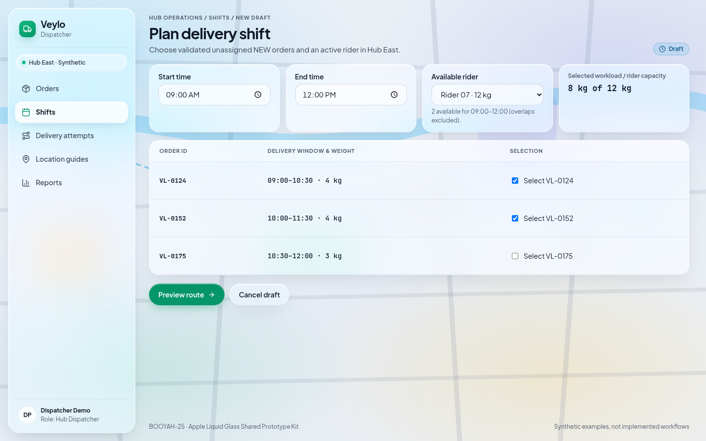
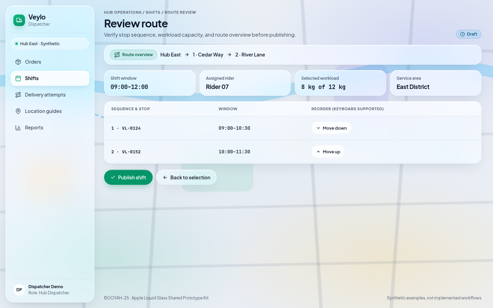
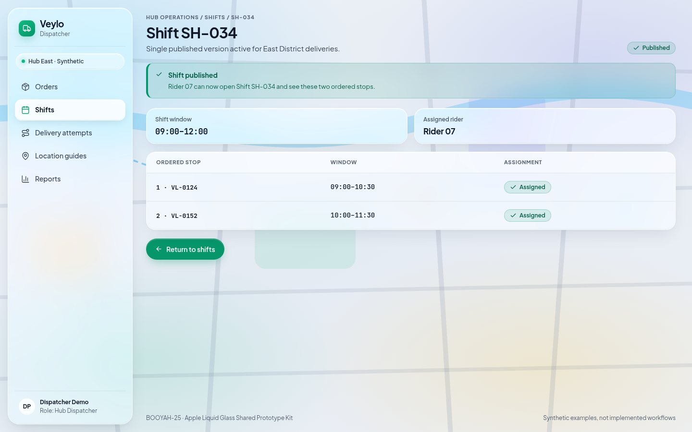

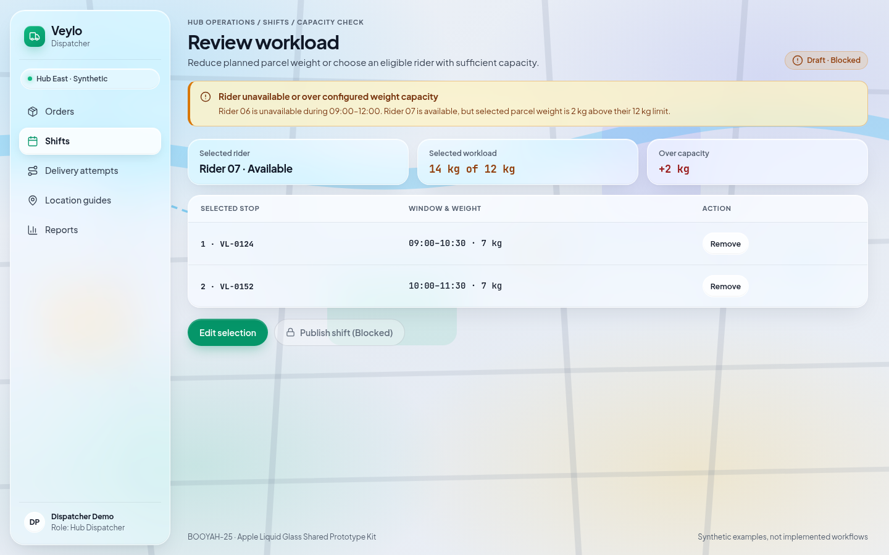

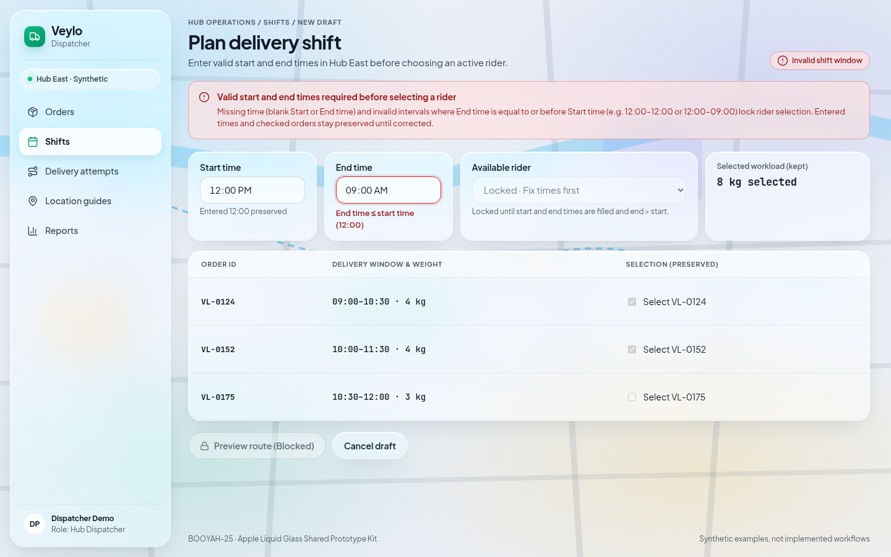

## UC10 — Adjust Shift Assignment
Performed by: Phạm Công Khánh / Codex. Reviewed by: Trần Lê Hải and Group 09 (21 November 2026). Edited by: Codex.

**Actor** · Hub Dispatcher. **Requirement** · FR-03-4.

**Description and preconditions** · The dispatcher opens a published shift in the signed-in hub and has permission to revise it under the agreed shift and attempt rules.

| Step | Basic flow | Screen |
| --- | --- | --- |
| 1 | Open the published shift and inspect the current rider, stop assignments and locks. | S10-01 |
| 2 | Select a replacement rider to preview a rider change. To transfer an order, select an eligible destination shift and choose Move to another shift. Preview the affected assignments before saving. Remove from shift follows branch 2c. | S10-01 |
| 3 | Confirm the change. The system checks both shift versions for a move, validates the rider and rechecks active attempts and capacity. | S10-02, S10-10 |
| 4 | The system applies the revision in one operation and shows the updated published assignment. The previous rider loses access to transferred work. The current assignee sees the revision on refresh. | S10-03, S10-11 |

| Branch | Alternative flow | Screen |
| --- | --- | --- |
| 1a | Completed shift. Display it in read-only mode. | S10-04 |
| 2a | A stop has an active attempt. Disable moving or removing that stop. If rider replacement would affect it, show the reason and block replacement. | S10-05 |
| 2b | The replacement rider or destination shift fails eligibility or capacity checks. Preserve the current assignment and let the dispatcher revise the selection. | S10-05, S10-07 |
| 2c | Choose Remove from shift for an eligible stop and confirm its removal without selecting a destination. Recheck the shift version and attempt lock before saving. VL-0124 leaves SH-034 and VL-0152 remains assigned to Rider 07. The order record and attempt history are retained. | S10-08, S10-09 |
| 3a | A concurrent update or an attempt started after preview. Reject the change and reload latest data before a retry. | S10-06 |
| 3b | Dispatcher dismisses transfer, rider change or removal confirmation. Return to the adjustment view with no committed changes. | S10-02, S10-10, S10-08, S10-01 |

**Postconditions** · Success updates eligible assignments and preserves existing attempt history. Rejection and dismissal leave both shifts and their attempts unchanged.

**Special requirements** · A move between shifts commits both sides together. No double ownership is visible after refresh. A started attempt holds the assignment lock until it reaches a terminal outcome. A failed terminal attempt remains subject to the UC13 dispatcher resolution policy in BOOYAH-14. It does not reopen an order by itself.

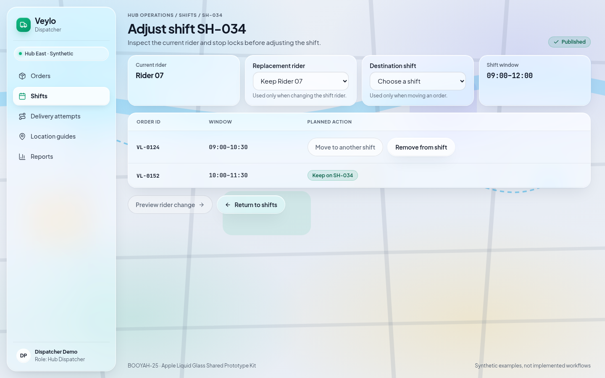
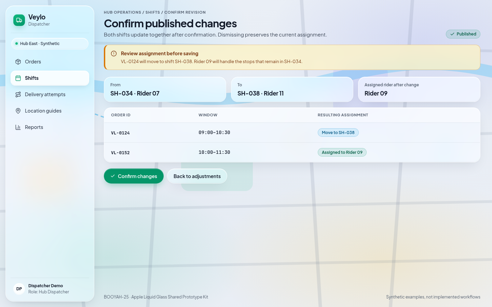

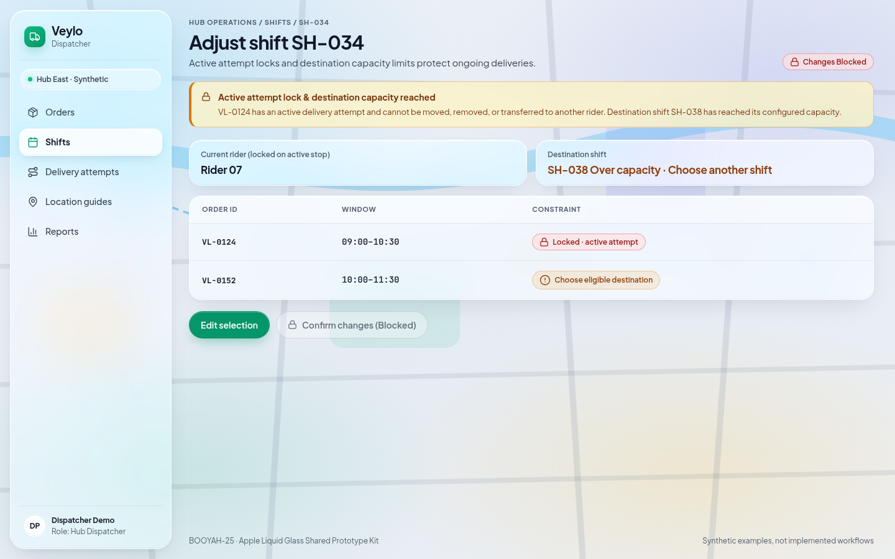
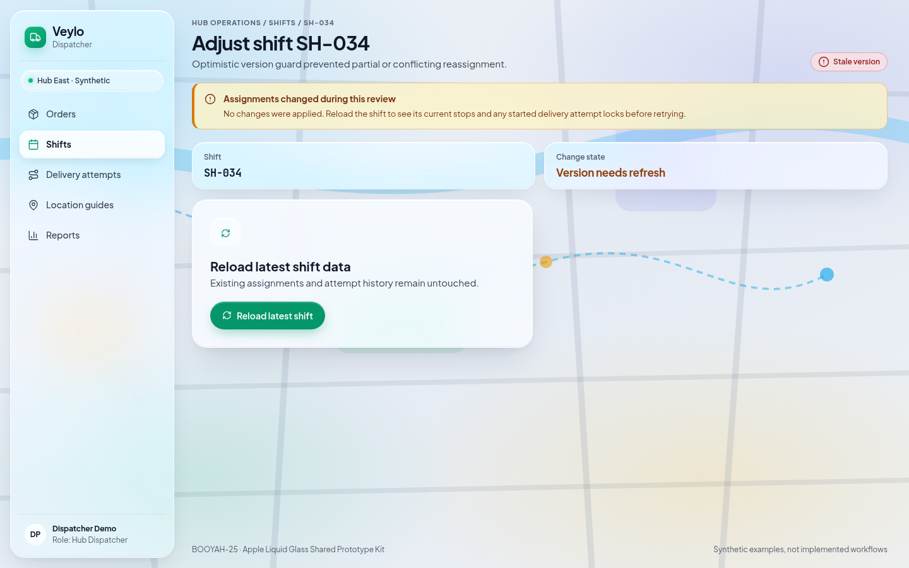

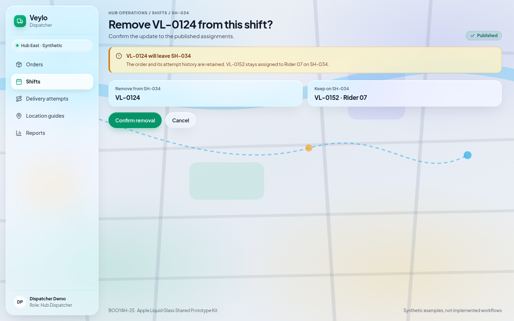
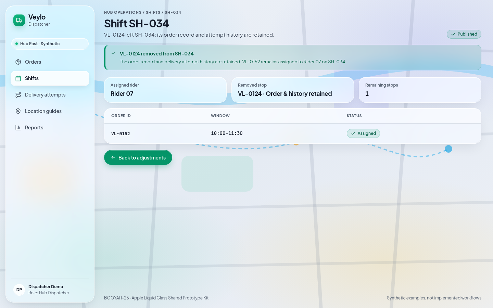
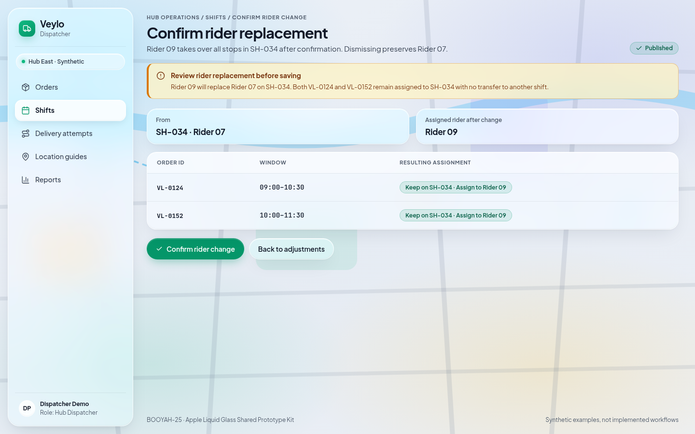
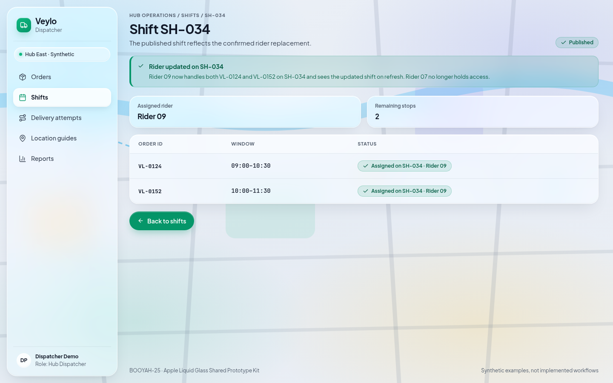

## UC14 — View Next-Order Recommendation
Performed by: Phạm Công Khánh / Codex. Reviewed by: Trần Lê Hải and Group 09 (21 November 2026). Edited by: Codex.

**Actor** · Rider. **Requirements** · FR-05-1 and FR-05-2. **Extension point** · UC11 EP11-A after assigned work loads.

**Description and preconditions** · The signed-in rider opens their current published shift in UC11. If a recommendation is available, UC11 automatically marks the suggested stop in the published sequence. UC14 opens only when the rider selects **View reason** at EP11-A. The rider can open any assigned stop directly from UC11.

| UC11 context before the extension | Screen |
| --- | --- |
| A recommendation is available. Mark the suggested stop without reordering the list. View reason opens UC14. Selecting another assigned stop directly leaves the published sequence intact. | S14-01, S14-07 |
| Assigned stops remain but there is no recommendation. Keep the list and its stop actions available. The View reason action is unavailable. | S14-10 |
| No eligible stops remain. Show the no-eligible-work state. | S14-03 |

| Step | Basic flow | Screen |
| --- | --- | --- |
| 1 | From the automatically marked suggestion in UC11, select View reason to enter UC14 at EP11-A. | S14-01 |
| 2 | The system shows the suggested stop and the deciding reason from the existing ranking. | S14-02, S14-08, S14-09 |
| 3 | Open the suggested stop or return to the UC11 list to choose another eligible stop. | S14-02, S14-01 |

| Branch | Alternative flow | Screen |
| --- | --- | --- |
| 2b | The existing suggestion used the agreed fallback because a window or coordinates were missing. Explain which data was unavailable. | S14-04 |
| 2c | At least one eligible window is known and all known windows have passed. Show an overdue suggestion and its deciding reason. | S14-05 |
| 2d | The compared signals tie. Use the agreed stable tie-break and show it. | S14-06 |
| 3a | The rider chooses a different eligible stop from the list. Open that stop without changing the shift sequence. | S14-07 |

**Postconditions** · Viewing a suggestion leaves assignment, sequence and attempt state unchanged. Opening a stop leaves attempt creation to the delivery workflow.

**Special requirements** · Use the current hub clock. Rank known windows whose closing time has not passed first, then known overdue windows, then unknown windows. Inside each known group use ascending closing time. For the same closing time or two unknown times, compare priority, then straight-line distance from the last stop with a recorded completion and coordinates. With no such stop, use configured hub coordinates when available. If the reference point or stop coordinates are missing, mark distance unavailable. Comparable known distances rank before unknown distances. Break remaining ties by published stop sequence, then stable stop ID. Display the deciding signal and any missing inputs.

| Deciding signal | Example reason shown | Screen |
| --- | --- | --- |
| Delivery-window urgency | Earliest closing window at 10:30. | S14-02 |
| Priority | Higher priority among stops with the same closing time. | S14-08 |
| Distance | Closest of the tied stops with known distance. | S14-09 |
| Missing fields | No delivery window or distance available. Ranked by the remaining known signals and planned order. | S14-04 |
| All windows passed | Earliest missed window closed at 09:15. | S14-05 |
| Stable final tie | Equal urgency, priority and distance. This stop comes first in the planned order. | S14-06 |

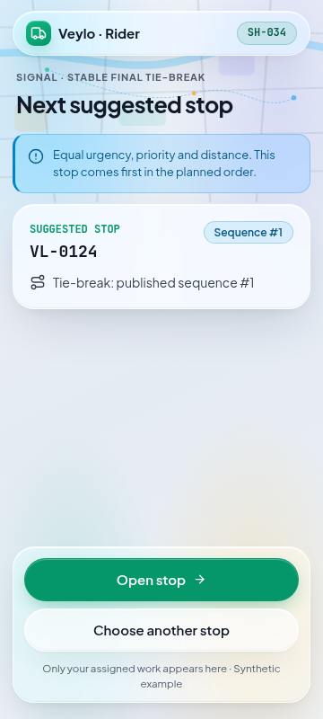

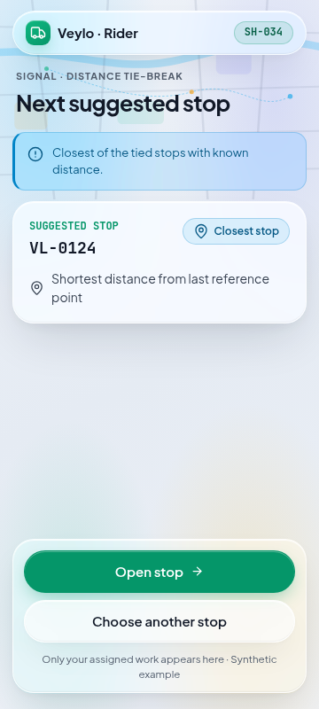
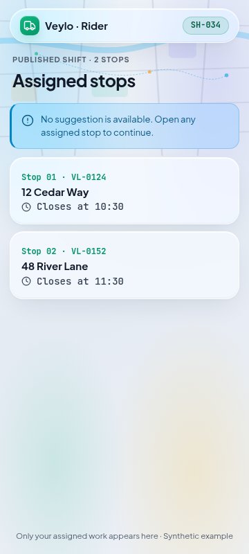

## Decision log
Performed by: Phạm Công Khánh / Codex. Reviewed by: Trần Lê Hải and Group 09 (21 November 2026). Edited by: Codex.

| Decision | Rule and rationale | Confirmation |
| --- | --- | --- |
| Rider count and overlap | One active rider per shift. Reject time-window overlap for that rider in the same hub to prevent conflicting work. Adjacent non-overlapping shifts are allowed. | Khánh · 19 November 2026 |
| Capacity | Sum the planned stops’ parcel weights in kilograms. Require a configured positive rider capacity, warn during selection and block publication or a published change above capacity. This keeps an editable draft useful without assigning an overloaded shift. | Khánh delegation · 19 November 2026 |
| Eligible orders | Select same-hub validated NEW orders that are not already assigned to another shift. Exclude CANCELLED orders. Keep shift assignment and DeliveryAttempt state separate from Order status. Reconcile future post-attempt eligibility with UC13. | Khánh delegation and BOOYAH-20 · 19 November 2026 |
| Publication | Show the assigned rider only their own published shift, ordered assigned stops and the details needed for delivery under the role policy. Draft work stays in the dispatcher view. | Khánh · 19 November 2026 |
| Post-publication edits | Lock any change that would move an active attempt. Recheck both shifts on a move and commit the transfer together. Completed shifts are read-only. A terminal failed attempt awaits BOOYAH-14/UC13 resolution before it can become eligible for new work. | Khánh delegation · 19 November 2026 |
| Ranking and ties | Compare delivery-window group and closing time, then priority and distance. Missing values fall through to the remaining signals. Use published sequence, then stable stop ID for a repeatable tie-break. Preserve the rider’s choice of another eligible stop. | Khánh delegation · 19 November 2026 |

Reviewed and approved by Trần Lê Hải and Group 09 on 21 November 2026. All 29 revised Light-mode screens (19 Dispatcher frames at `1440×900` and 10 Rider frames at `360×800`) are generated from `prototypes/kit/` and embedded in `UC-F03-F05-Shifts.pdf`. The retained recovery and split-flow frames cover missing or invalid shift times (`S09-08`), an empty order pool (`S09-04`), eligible orders with zero selected (`S09-07`), active-attempt locks or destination capacity (`S10-05`), an unavailable replacement rider (`S10-07`), and separate rider replacement (`S10-10`, `S10-11`).
