# Veylo — Delivery Execution and Reporting: UC11, UC12, UC13 and UC19
Performed by: Trần Lê Hải. Reviewed by: Nguyễn Thành Trung (pending actual review). Edited by: Codex (AI-assisted drafting and documentation correction); human editor pending.

**PDF navigation:** HTTPS links remain clickable. Relative file links work in this Markdown source and appear as plain reference labels in the PDF; all screenshots remain embedded.

## 1. Use Case Overview
Performed by: Trần Lê Hải. Reviewed by: Nguyễn Thành Trung (pending actual review). Edited by: Codex (AI-assisted drafting and documentation correction); human editor pending.

| Use Case | Primary Actor | Traceability |
| --- | --- | --- |
| UC11 — View Assigned Shift and Deliveries | Delivery Rider | FR-01-2, FR-03-3, FR-04-1, FR-05-1, FR-06-4 |
| UC12 — Record Delivery Attempt | Delivery Rider | FR-01-2, FR-04-2, FR-04-3, FR-04-4, FR-04-5 |
| UC13 — Monitor Attempts and Resolve Failed Orders | Hub Dispatcher | FR-01-2, FR-04-5, FR-04-6, FR-08-1 |
| UC19 — View Shift and Rider Reports | Hub Dispatcher | FR-01-2, FR-04-5, FR-08-1, FR-08-2, FR-08-3 |

## 2. Shared domain and interaction contract

Performed by: Trần Lê Hải. Reviewed by: Nguyễn Thành Trung (pending actual review). Edited by: Codex (AI-assisted drafting); human editor pending.

**Separate lifecycles.** An Order is the overall request. An Assignment binds work to a Shift/Rider. A DeliveryAttempt records one execution. A photo upload is evidence, not an outcome. Conceptual terms **started**, **arrived**, **successful**, **failed**, **delivered**, **terminal unsuccessful**, **awaiting dispatcher resolution** and **awaiting planning** describe the proposed behavior; they do not add persisted enum values to F02's `NEW`/`CANCELLED` contract. The two “awaiting” labels are derived queue/eligibility states, not automatic terminal outcomes. A retry creates a later attempt only when the Rider starts a newly authorized, published opportunity.

**Proposed eligibility.** An eligible executable stop belongs to the active Rider's current published assignment in a non-completed Shift, is not cancelled/delivered/terminal unsuccessful, has no active attempt and has no unresolved latest failure. For a retry, it must belong to the single UC13-authorized published opportunity and have no attempt yet in that opportunity. Publication consumes that authorization for one assignment; it does not prohibit the authorized assignment's first start. Future published work is viewable but Start remains disabled until the Shift's planned start, using the trusted server clock. After the planned end, unfinished published work stays eligible with an overdue warning. A stop with a current active attempt exposes Resume instead of Start. One Rider and one Order each have at most one active attempt. Past delivery windows remain visible as overdue; they do not silently cancel work. A completed attempt stops being executable in its old assignment. Failed work requires UC13 and a new authorized assignment before another start.

**Execution and resolution sequence.** UC09 publishes → UC11 lists work and previews → UC12 records an attempt → UC11 refreshes and continues remaining executable work. Repeat until no executable stops and no active attempt remain. UC13 can monitor throughout, but resolves failures only after this condition holds in the originating shift. Successful Orders bypass failed-order resolution. A list with only pending failures says “No executable stops; dispatcher resolution pending”; it does not assert that every Order succeeded or that the Shift is completed. A re-dispatch opportunity is planned/published through UC09/UC10 and re-enters UC11/UC12. Final shift completion remains owned by F03 and requires reconciliation.

**Commit and recovery.** Proposed mutations validate session, hub, assignment ownership, current versions and lifecycle eligibility at commit. Stable operation IDs prevent replayed starts, arrival events, outcomes or resolutions from duplicating records. A terminal outcome is immutable; a mismatched replay is a conflict. After a timeout with an unknown result, reload/query that operation and current state before retry. Do not advance the Rider or display success without authoritative acknowledgement. Unsent values may be retained only in the current authorized view; do not promise offline persistence. Sign-out/access loss clears protected views and unsaved private values.

**Authorization and guides.** Rider access to deliveries remains assignment-bound. Dispatcher access to monitoring, resolutions, reports and private POD is hub-bound. Administrator receives no inherited Dispatcher privileges. UC11's preview and UC15's full guide/search share publication/hub checks, including direct links. Only an active same-hub Rider can read published guides, including off shift. Shared guides contain reusable building information and exclude raw notes, AI/manual drafts, recipient details, access codes, Order records and POD photos. An absent guide is not an empty replacement draft and does not prevent delivery.

**Common presentation.** Label Order outcome separately from attempt outcome, show timestamps with the hub timezone, preserve raw comments and uncertainty, and expose Retry/Refresh/Resume with clear pending/error text. Use synthetic examples only. No GPS telemetry, paid service, learned ranking or fleet optimization is required. Proposed report views are read-only and require explicit refresh with an “as of” timestamp; they do not promise an unimplemented live stream.

## 3. UC11 — View Assigned Shift and Deliveries

Performed by: Trần Lê Hải. Reviewed by: Nguyễn Thành Trung (pending actual review). Edited by: Codex (AI-assisted drafting); human editor pending.

| Field              | Specification                                                                                                                                                                                                    |
| ------------------ | ---------------------------------------------------------------------------------------------------------------------------------------------------------------------------------------------------------------- |
| ID / Name          | UC11 — View Assigned Shift and Deliveries                                                                                                                                                                       |
| Primary actor      | Delivery Rider                                                                                                                                                                                                   |
| Secondary actors   | None                                                                                                                                                                                                             |
| Description / goal | Inspect one's published work and stop details, see available next-stop/guide previews immediately, and select or resume delivery work.                                                                           |
| Requirements       | FR-01-2, FR-03-3, FR-04-1, FR-05-1, FR-06-4; see [Use Case Overview](#1-use-case-overview).                                                                                                                                                            |
| Business rules     | D-F04-1, D-F04-2, D-F04-3, D-F04-8, D-F04-12.                                                                                                                                                                    |
| Trigger            | Rider opens My Shift, follows an authorized shift link, or returns after UC12/UC14/UC15.                                                                                                                         |
| Preconditions      | Normal entry: authenticated active Rider with hub membership; their published work exists. Absence, draft-only work, session expiry and lost access are handled below rather than fabricated as successful data. |

**Basic flow**

1. **B1 — Rider:** Opens My Shift. **System:** Shows a loading state and validates the trusted session/role/hub. `[S11-01-loading]`
2. **B2 — System:** Loads only the Rider's published assignments and current versions; selects the ongoing shift, or lets the Rider select among their visible published shifts. Future published work is labelled with its window; it is not another Rider's work. `[S11-01]`
3. **B3 — System:** Shows assigned stops in published order, distinguishing executable work, an active attempt, completed attempts and failures awaiting resolution. Automatically shows the eligible next-stop suggestion when available and the published guide preview for the default selected stop. Preview requests do not block usable assignments. Default selection follows D-F04-2. `[S11-01, S11-01-preview-loading]`
4. **B4 — Rider:** Selects any eligible stop or their active stop. **System:** Shows permitted recipient/contact, destination, delivery window, weight, priority and assignment/attempt context; updates that stop's published-guide preview. The Rider may inspect EP11-A or EP11-B, or continue directly. `[S11-02]`
5. **B5 — Rider:** Selects Start or Resume. **System:** Hands the current assignment/stop context to UC12, which rechecks authority/eligibility. Selecting or inspecting a stop alone creates no attempt. `[S11-02]`
6. **B6 — System:** On return from an acknowledged UC12 outcome, refreshes assignments and previews. If executable work remains, resumes B3; the Rider selects the next stop. A failed stop stays excluded until UC13 authorizes another opportunity. `[S11-01]`
7. **B7 — System:** When no executable stops remain, shows Resume for an active attempt, pending dispatcher resolution for failed work, read-only scheduled work before its planned start, or a finished-work view. Processed stop details remain read-only. Ends the current view; it does not autonomously resolve Orders or complete the Shift. `[S11-01-active, S11-01-scheduled, S11-03-pending, S11-03-finished]`

**Alternative flows**

| ID / branch                                            | Steps, retained data and exit                                                                                                                                                                                                                                                                                                                                                                                   | Screen/state IDs                                                       |
| ------------------------------------------------------ | --------------------------------------------------------------------------------------------------------------------------------------------------------------------------------------------------------------------------------------------------------------------------------------------------------------------------------------------------------------------------------------------------------------- | ---------------------------------------------------------------------- |
| A1 — No shift, from B2                                | **A1.1** No published assignment exists. **A1.2** Show No published shift available and Refresh; do not invent work. **A1.3** End, or retry B1.                                                                                                                                                                                                                                                                 | S11-01-empty                                                           |
| A2 — Not published, from B2                           | **A2.1** A requested assignment is still draft. **A2.2** Show unavailable/not published without draft stop or recipient data. **A2.3** Return to B2 or end; only publication through UC09 can make it available.                                                                                                                                                                                                | S11-01-unavailable                                                     |
| A3 — Missing/unavailable previews, from B3/B4         | **A3.1** Suggestion, guide, or both are absent/fail to load. **A3.2** Keep the list and eligible manual selection usable; distinguish No suggestion / No published guide from Preview unavailable. **A3.3** Continue B4/B5, or retry only the preview.                                                                                                                                                          | S11-01-no-suggestion, S11-02-no-guide, S11-01-previews-unavailable     |
| A4 — Recommendation explanation, from B3/B4 at EP11-A | **A4.1** Rider chooses Why this stop? for an available suggestion. **A4.2** Open UC14 with the current assignment/version; it explains deterministic ranking, fallback and choice. **A4.3** Return to B4 with the chosen eligible stop, or B3 unchanged.                                                                                                                                                        | S11-01; external UC14 S14-02/S14-04/S14-05/S14-06/S14-07/S14-08/S14-09 |
| A5 — Full guide, from B4 at EP11-B                    | **A5.1** Rider opens an available published-guide preview. **A5.2** UC15 rechecks publication/hub access; a withdrawn/superseded guide shows its own safe latest/unavailable state. **A5.3** Return to B4 without changing assignment or attempt. UC15 search also remains independently available off shift.                                                                                                   | S11-02; UC15 destination ID pending owner alignment                    |
| A6 — Assignment changed/removed, from B2–B6          | **A6.1** Version/ownership changed or the stop is no longer accessible. **A6.2** Remove stale actionable/private details and show Work changed; preserve server attempt history. **A6.3** Refresh B2; do not start from the stale screen.                                                                                                                                                                       | S11-02-stale                                                           |
| A7 — Authentication/authorization, from B1–B6        | **A7.1** Session expires, account becomes inactive, role is wrong, or a link targets another Rider/hub. **A7.2** Clear protected data; show sign-in for 401, forbidden for role/inactive account, or not found for inaccessible resources. **A7.3** End; after authorized sign-in re-enter B1 and recheck scope.                                                                                                | S11-01-auth, S11-01-forbidden, S11-01-unavailable                      |
| A8 — Network/server failure, from B1–B6              | **A8.1** Work cannot load or refresh. **A8.2** Show error; if already visible, label retained authorized data stale and disable Start until refreshed. No offline start is queued. **A8.3** Retry B1/B2 when online or end. An uncertain UC12 mutation follows UC12 A7 first.                                                                                                                                   | S11-01-error, S11-01-offline                                           |
| A9 — Active or no executable work, from B3/B7         | **A9.1** Only an active attempt, future scheduled work or processed/pending stops remain. **A9.2** Offer Resume for the active attempt; otherwise show scheduled time, pending resolution or finished-work read-only content. **A9.3** Resume UC12, refresh B2 at the scheduled start/after a new publication, or end.                                                                                          | S11-01-active, S11-01-scheduled, S11-03-pending, S11-03-finished       |
| A10 — Overlap anomaly, from B2                        | **A10.1** More than one ongoing published shift overlaps for this Rider despite F03's proposed exclusion. **A10.2** Show the conflicting shift references without mixing stops; block new starts and advise contacting the Dispatcher. A known active attempt can still resume under its original assignment. **A10.3** Refresh after correction or resume UC12; do not choose a new ownership policy silently. | S11-01-conflict, S11-01-active                                         |

**Postconditions**

- **Success:** Current authorized work, selected stop and available previews are shown. Read actions change no assignment, sequence, Order or attempt. UC12 owns any later mutation; UC14/UC15 are optional details.
- **Failure/minimum guarantee:** No inaccessible data is exposed and no attempt is invented. Unavailable previews do not remove the list. Stale assignment data cannot authorize a start.

**Special requirements:** N04 (360 CSS-pixel Rider viewport, no horizontal scrolling, touch targets ≥44×44 CSS pixels); N05/N06 (server authorization, synthetic/private data handling); N13 (published-guide boundary); N16/N17 (keyboard, contrast and browser/device coverage). Recommendation latency N02 belongs to F05; do not block assignment rendering on it. These are inherited targets, not measured passes.

**Relationships / extension points:** UC14 `«extend»` UC11 only at **EP11-A**, explanation selected after automatic suggestion display. UC15 `«extend»` UC11 at **EP11-B**, full guide selected from its preview. UC15 also has an independent Rider entry point. No minimum of two stops and no mandatory include/sign-in/AI dependency are added. UC12 is a workflow handoff, not a new UML include.

**Decision Log**

| ID / decision                                            | Basis and rationale                                                                                                                                                                                      | Confirmation / actual date                                                                                    |
| -------------------------------------------------------- | -------------------------------------------------------------------------------------------------------------------------------------------------------------------------------------------------------- | ------------------------------------------------------------------------------------------------------------- |
| DL11-1 — Automatic previews, optional details           | [BOOYAH-14](https://thaikiet291006.atlassian.net/browse/BOOYAH-14), [Vision 2.2-review](https://drive.google.com/file/d/1vC5KwBkyKqXwPbQVq8lEtUQZlhlkWkXU/view) and [UseCaseModel 0.4](https://drive.google.com/file/d/1G-GlRLTj7ZsOw_g9o-bYTu_MLQ4AYEfi/view) distinguish immediate previews from EP11-A/B; use the newer model instead of local UCM 0.2's request wording.                                                                                     | Source clarification dated 19 November; owner walkthrough/review and alignment of older UC14 B1/S14-01 request wording with automatic previews remain pending.                     |
| DL11-2 — Default selection, scheduled starts and Resume | D-F04-2/3/8 prioritize active work, then suggestion, then published order. Block starting future scheduled work until planned start, allow overdue unfinished work, and prevent a second active attempt. | Proposed; Kiệt/F03/F05 coordination and reviewer confirmation pending; actual confirmation date unavailable. |
| DL11-3 — Guide privacy and no-preview fallback          | FR-06-4 and BOOYAH-15 preserve same-hub published access, independent guide search and usable assignments. The constitution's legacy access-code extraction wording still needs reconciliation with FR-06-4's exclusion of access codes from published guides.                                                                                               | Baseline clarification retained; guide-privacy reconciliation, detailed UC15 destination IDs and joint walkthrough pending.                 |
| DL11-4 — Prototype kit and review evidence | The user-supplied official BOOYAH-25 kit was used for the editable prototypes and actual PNGs. Paired PDFs are exported from the Markdown sources. Local F02/F03 confirmations do not approve F04/F08 proposals or replace independent review. | Artifact creation and recorded AI checks completed; independent prototype walkthrough and Nguyễn Thành Trung's actual review/date pending. |

**Screen Map — editable Figma frames and actual PNG evidence**

The [prototype handoff](prototypes/F04-F08/F04-F08-Prototype-Handoff.md), [screen/fixture/flow mapping](prototypes/F04-F08/screen-fixture-flow-map.json) and [verification report](../../test/f04-f08-delivery-reporting/Verification-Report.md) record the local evidence. Screen IDs and functional rules are unchanged; extra IDs below are presentation/context variants of the same flows. Native Figma is the editable design source.

S11-02 uses [PROPOSED-BOOYAH14-GUIDE-001](../../test/f04-f08-delivery-reporting/fixtures/proposed-location-guide.json), clearly labelled synthetic with a simulated published test state. EP11-B opens the local `S11-02-guide-handoff` panel. See the [UC11–UC15 handoff](prototypes/F04-F08/UC11-UC15-Handoff.md); the actual shared fixture, Full Guide destination and cross-UC walkthrough are **not verified**. UC14 explanation is represented locally without editing its owner’s material.

| Flow/step | Screen-state ID(s) | Purpose | Evidence |
| --- | --- | --- | --- |
| B1, B3 | S11-01-loading, S11-01-preview-loading | Work loading; independent preview loading. Actual PNG available. | `S11-01-loading`: [Figma](https://www.figma.com/design/LBEaZQ3zEjnjBLhLoPb5pD/Veylo-%E2%80%93-BOOYAH-14-Prototypes?node-id=4-367) · [PNG](prototypes/UC11/S11-01-loading.png) `S11-01-preview-loading`: [Figma](https://www.figma.com/design/LBEaZQ3zEjnjBLhLoPb5pD/Veylo-%E2%80%93-BOOYAH-14-Prototypes?node-id=4-390) · [PNG](prototypes/UC11/S11-01-preview-loading.png) |
| B2/B3/B6, A4 | S11-01 | Published assignment list, automatic suggestion, EP11-A. Actual PNG available. | `S11-01`: [Figma](https://www.figma.com/design/LBEaZQ3zEjnjBLhLoPb5pD/Veylo-%E2%80%93-BOOYAH-14-Prototypes?node-id=4-2) · [PNG](prototypes/UC11/S11-01.png) |
| B4/B5, A5 | S11-02 | Stop details, guide preview, Start/Resume, EP11-B. Actual PNG available. | `S11-02`: [Figma](https://www.figma.com/design/LBEaZQ3zEjnjBLhLoPb5pD/Veylo-%E2%80%93-BOOYAH-14-Prototypes?node-id=4-39) · [PNG](prototypes/UC11/S11-02.png) |
| B7, A9 | S11-01-active, S11-01-scheduled, S11-03-pending, S11-03-finished | Resume; scheduled read-only work; dispatcher pending; finished view. Actual PNG available. | `S11-01-active`: [Figma](https://www.figma.com/design/LBEaZQ3zEjnjBLhLoPb5pD/Veylo-%E2%80%93-BOOYAH-14-Prototypes?node-id=4-175) · [PNG](prototypes/UC11/S11-01-active.png) `S11-01-scheduled`: [Figma](https://www.figma.com/design/LBEaZQ3zEjnjBLhLoPb5pD/Veylo-%E2%80%93-BOOYAH-14-Prototypes?node-id=4-210) · [PNG](prototypes/UC11/S11-01-scheduled.png) `S11-03-finished`: [Figma](https://www.figma.com/design/LBEaZQ3zEjnjBLhLoPb5pD/Veylo-%E2%80%93-BOOYAH-14-Prototypes?node-id=4-272) · [PNG](prototypes/UC11/S11-03-finished.png) `S11-03-pending`: [Figma](https://www.figma.com/design/LBEaZQ3zEjnjBLhLoPb5pD/Veylo-%E2%80%93-BOOYAH-14-Prototypes?node-id=4-239) · [PNG](prototypes/UC11/S11-03-pending.png) |
| A1/A2 | S11-01-empty, S11-01-unavailable | No shift; unpublished/inaccessible request. Actual PNG available. | `S11-01-empty`: [Figma](https://www.figma.com/design/LBEaZQ3zEjnjBLhLoPb5pD/Veylo-%E2%80%93-BOOYAH-14-Prototypes?node-id=4-423) · [PNG](prototypes/UC11/S11-01-empty.png) `S11-01-unavailable`: [Figma](https://www.figma.com/design/LBEaZQ3zEjnjBLhLoPb5pD/Veylo-%E2%80%93-BOOYAH-14-Prototypes?node-id=4-446) · [PNG](prototypes/UC11/S11-01-unavailable.png) |
| A3 | S11-01-no-suggestion, S11-02-no-guide, S11-01-previews-unavailable | Missing one/both previews; list remains usable. Actual PNG available. | `S11-01-no-suggestion`: [Figma](https://www.figma.com/design/LBEaZQ3zEjnjBLhLoPb5pD/Veylo-%E2%80%93-BOOYAH-14-Prototypes?node-id=4-621) · [PNG](prototypes/UC11/S11-01-no-suggestion.png) `S11-01-previews-unavailable`: [Figma](https://www.figma.com/design/LBEaZQ3zEjnjBLhLoPb5pD/Veylo-%E2%80%93-BOOYAH-14-Prototypes?node-id=4-687) · [PNG](prototypes/UC11/S11-01-previews-unavailable.png) `S11-02-no-guide`: [Figma](https://www.figma.com/design/LBEaZQ3zEjnjBLhLoPb5pD/Veylo-%E2%80%93-BOOYAH-14-Prototypes?node-id=4-654) · [PNG](prototypes/UC11/S11-02-no-guide.png) |
| A6 | S11-02-stale | Assignment changed/removed; refresh required. Actual PNG available. | `S11-02-stale`: [Figma](https://www.figma.com/design/LBEaZQ3zEjnjBLhLoPb5pD/Veylo-%E2%80%93-BOOYAH-14-Prototypes?node-id=4-569) · [PNG](prototypes/UC11/S11-02-stale.png) |
| A7 | S11-01-auth, S11-01-forbidden | Shared Rider sign-in/access states, reused by UC12. Actual PNG available. | `S11-01-auth`: [Figma](https://www.figma.com/design/LBEaZQ3zEjnjBLhLoPb5pD/Veylo-%E2%80%93-BOOYAH-14-Prototypes?node-id=4-469) · [PNG](prototypes/UC11/S11-01-auth.png) `S11-01-forbidden`: [Figma](https://www.figma.com/design/LBEaZQ3zEjnjBLhLoPb5pD/Veylo-%E2%80%93-BOOYAH-14-Prototypes?node-id=4-494) · [PNG](prototypes/UC11/S11-01-forbidden.png) |
| A8 | S11-01-error, S11-01-offline | Initial error or stale/offline list. Actual PNG available. | `S11-01-error`: [Figma](https://www.figma.com/design/LBEaZQ3zEjnjBLhLoPb5pD/Veylo-%E2%80%93-BOOYAH-14-Prototypes?node-id=4-519) · [PNG](prototypes/UC11/S11-01-error.png) `S11-01-offline`: [Figma](https://www.figma.com/design/LBEaZQ3zEjnjBLhLoPb5pD/Veylo-%E2%80%93-BOOYAH-14-Prototypes?node-id=4-544) · [PNG](prototypes/UC11/S11-01-offline.png) |
| A10 | S11-01-conflict | Overlapping-shift anomaly with no automatic reassignment. Actual PNG available. | `S11-01-conflict`: [Figma](https://www.figma.com/design/LBEaZQ3zEjnjBLhLoPb5pD/Veylo-%E2%80%93-BOOYAH-14-Prototypes?node-id=4-594) · [PNG](prototypes/UC11/S11-01-conflict.png) |
| A4 handoff | External S14-02, S14-04–S14-09 | Existing UC14 IDs in the cached [BOOYAH-21 specification](https://github.com/DankDaPancake/Veylo/blob/851f324b67bedb6b23f094aa5faebad6c73f197d/docs/analysis-and-design/use-cases/UC-F03-F05-Shifts.md); external owner screenshots, not new UC11 evidence. | Local explanation/planning representation below; original owner file unchanged. |
| A5 handoff | UC15 full-guide/latest/unavailable IDs pending | Behavioral contract specified above; reserve final IDs with BOOYAH-15 rather than invent its existing screen names. | External owner material; local handoff representation below. Actual UC15 connection remains pending. |

**Additional context/presentation states**

| Screen-state ID | Purpose | Evidence |
| --- | --- | --- |
| `S11-01-explanation` | Why this stop? | [Figma](https://www.figma.com/design/LBEaZQ3zEjnjBLhLoPb5pD/Veylo-%E2%80%93-BOOYAH-14-Prototypes?node-id=4-76) · [PNG](prototypes/UC11/S11-01-explanation.png) |
| `S11-02-other` | Another eligible stop | [Figma](https://www.figma.com/design/LBEaZQ3zEjnjBLhLoPb5pD/Veylo-%E2%80%93-BOOYAH-14-Prototypes?node-id=4-109) · [PNG](prototypes/UC11/S11-02-other.png) |
| `S11-02-guide-handoff` | Full guide unavailable | [Figma](https://www.figma.com/design/LBEaZQ3zEjnjBLhLoPb5pD/Veylo-%E2%80%93-BOOYAH-14-Prototypes?node-id=4-142) · [PNG](prototypes/UC11/S11-02-guide-handoff.png) |
| `S11-01-next` | Next assigned stop | [Figma](https://www.figma.com/design/LBEaZQ3zEjnjBLhLoPb5pD/Veylo-%E2%80%93-BOOYAH-14-Prototypes?node-id=4-301) · [PNG](prototypes/UC11/S11-01-next.png) |
| `S11-01-after-failure` | Continue assigned work | [Figma](https://www.figma.com/design/LBEaZQ3zEjnjBLhLoPb5pD/Veylo-%E2%80%93-BOOYAH-14-Prototypes?node-id=4-332) · [PNG](prototypes/UC11/S11-01-after-failure.png) |
| `S11-01-refresh` | Refreshing confirmed work | [Figma](https://www.figma.com/design/LBEaZQ3zEjnjBLhLoPb5pD/Veylo-%E2%80%93-BOOYAH-14-Prototypes?node-id=8-2818) · [PNG](prototypes/UC11/S11-01-refresh.png) |
| `S11-03-pending-two` | No executable stops | [Figma](https://www.figma.com/design/LBEaZQ3zEjnjBLhLoPb5pD/Veylo-%E2%80%93-BOOYAH-14-Prototypes?node-id=10-2773) · [PNG](prototypes/UC11/S11-03-pending-two.png) |
| `S11-01-selected-next` | Continue remaining work | [Figma](https://www.figma.com/design/LBEaZQ3zEjnjBLhLoPb5pD/Veylo-%E2%80%93-BOOYAH-14-Prototypes?node-id=16-2818) · [PNG](prototypes/UC11/S11-01-selected-next.png) |

**Actual prototype screenshots**

**S11-01 — Today’s deliveries**

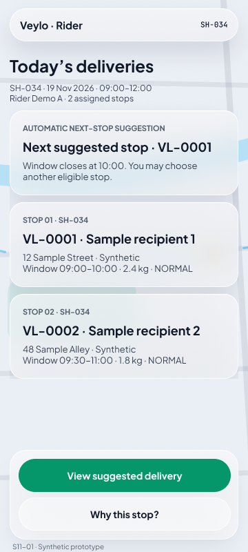

**S11-02 — Delivery details**

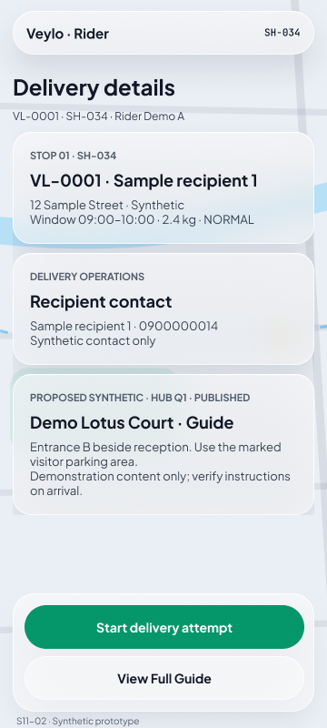

**S11-01-explanation — Why this stop?**

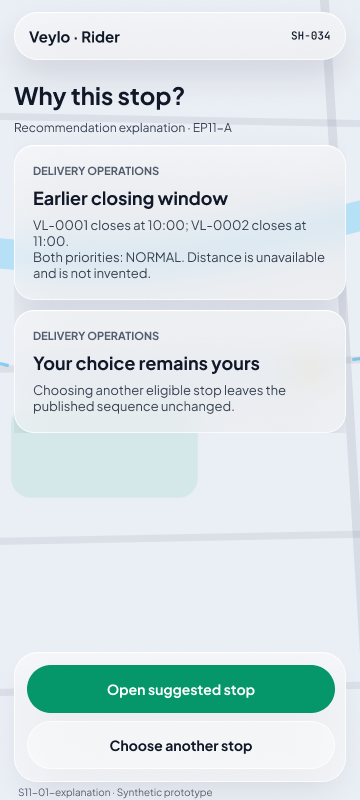

**S11-02-other — Another eligible stop**

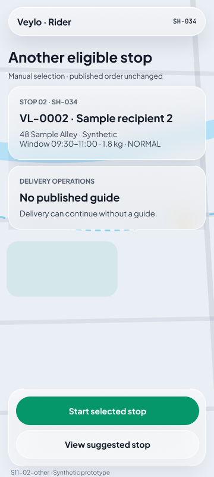

**S11-02-guide-handoff — Full guide unavailable**

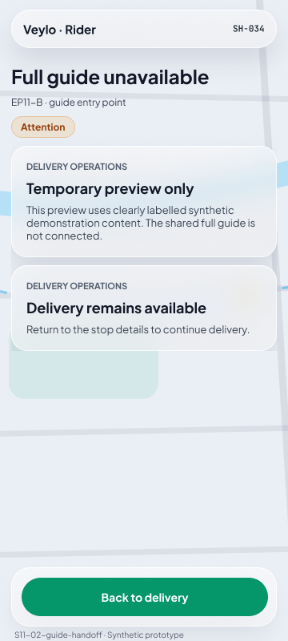

**S11-01-active — Resume current attempt**

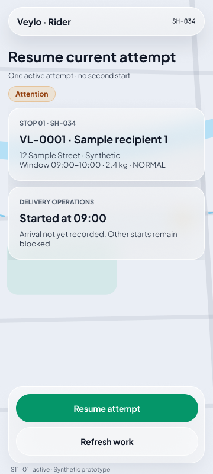

**S11-01-scheduled — Scheduled work**

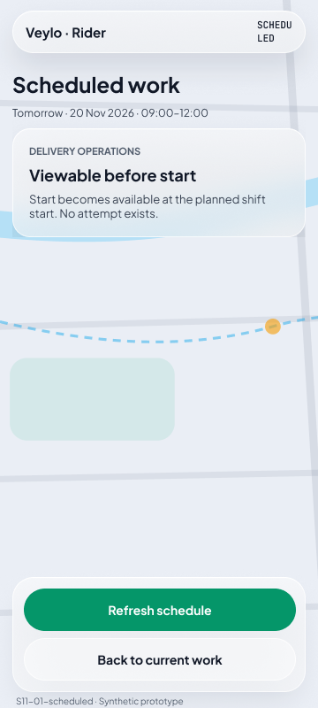

**S11-03-pending — No executable stops**

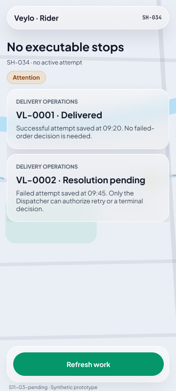

**S11-03-finished — Work completed**

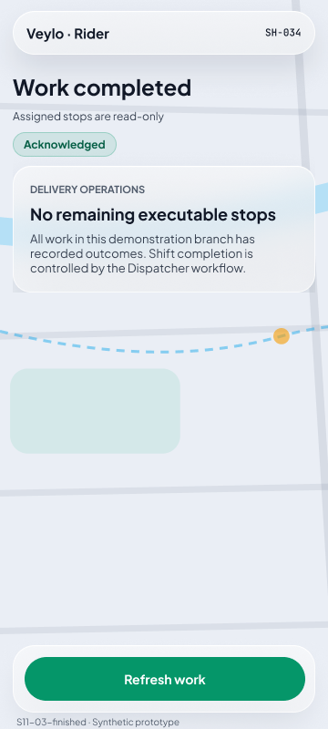

**S11-01-next — Next assigned stop**

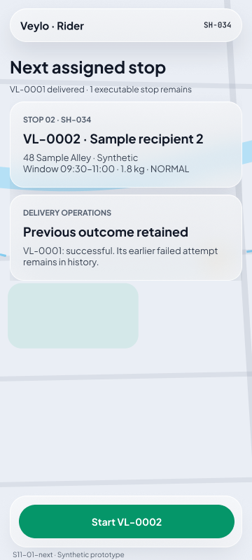

**S11-01-after-failure — Continue assigned work**

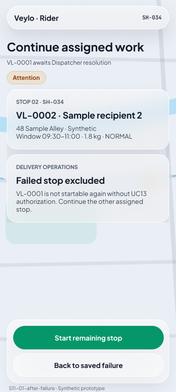

**S11-01-loading — Loading assigned work**

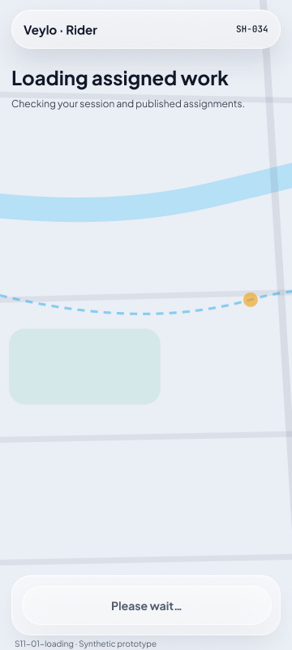

**S11-01-preview-loading — Today’s deliveries**

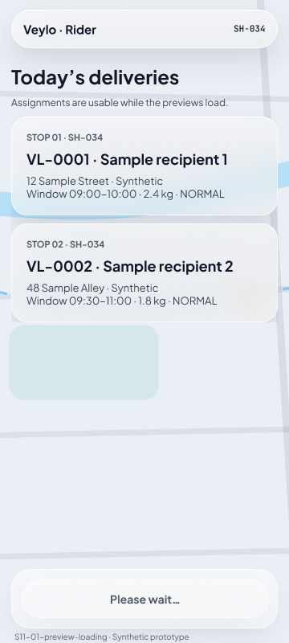

**S11-01-empty — No published shift**

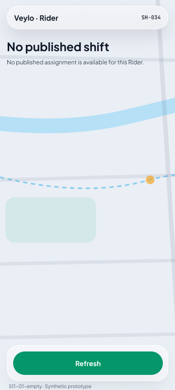

**S11-01-unavailable — Work unavailable**

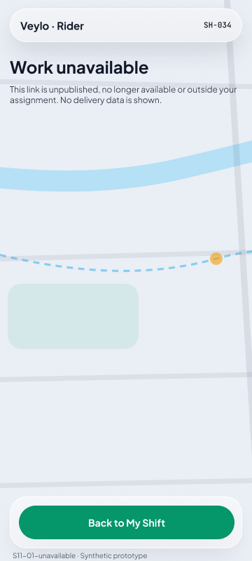

**S11-01-auth — Sign in to continue**

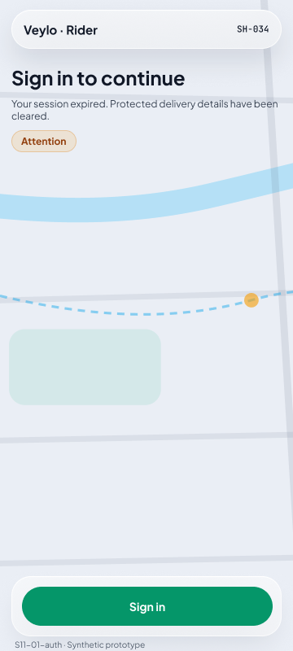

**S11-01-forbidden — Access restricted**

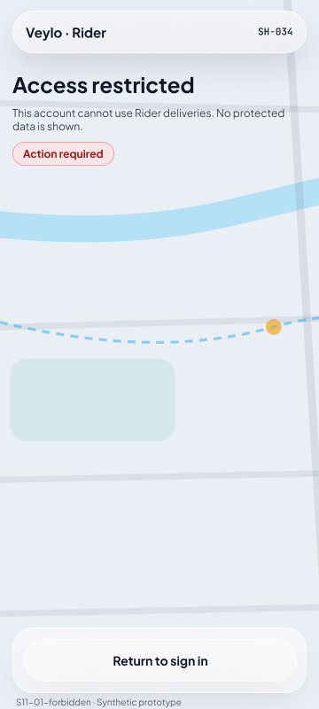

**S11-01-error — Could not load work**

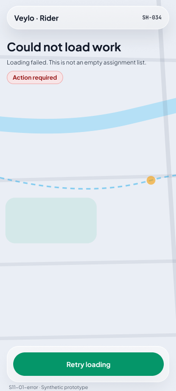

**S11-01-offline — Connection lost**

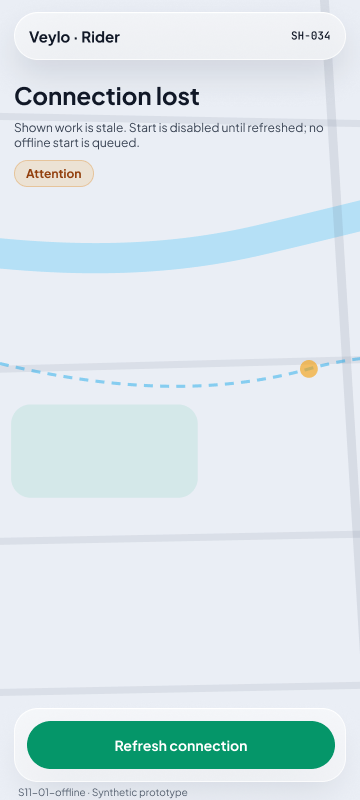

**S11-02-stale — Work changed**

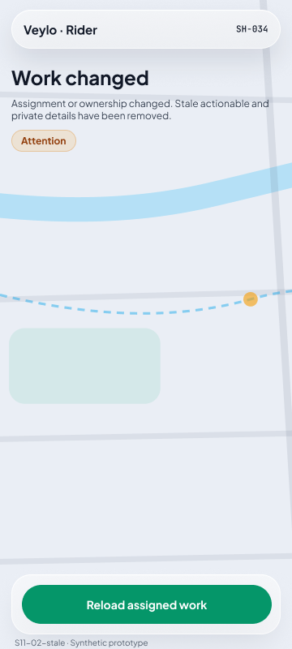

**S11-01-conflict — Overlapping shifts**

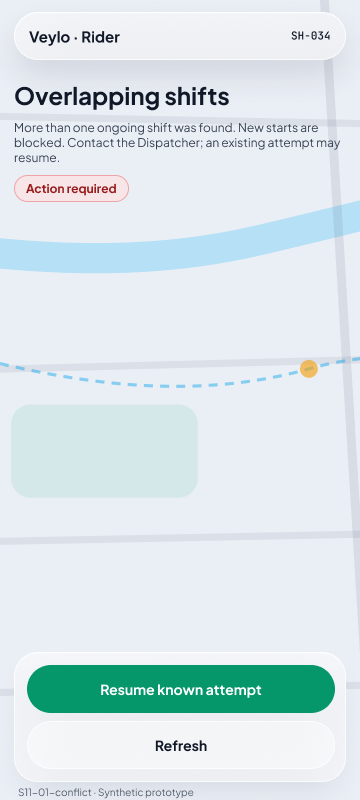

**S11-01-no-suggestion — Choose your next stop**

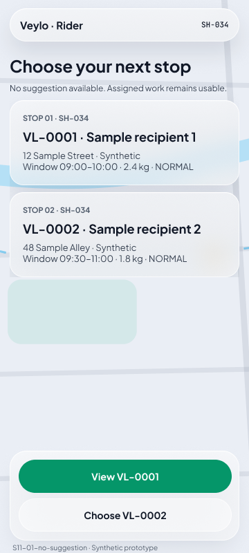

**S11-02-no-guide — Delivery details**

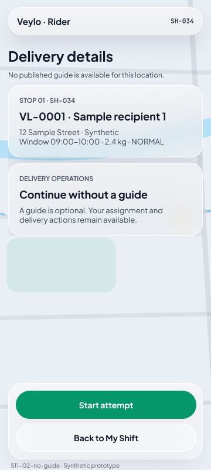

**S11-01-previews-unavailable — Today’s deliveries**

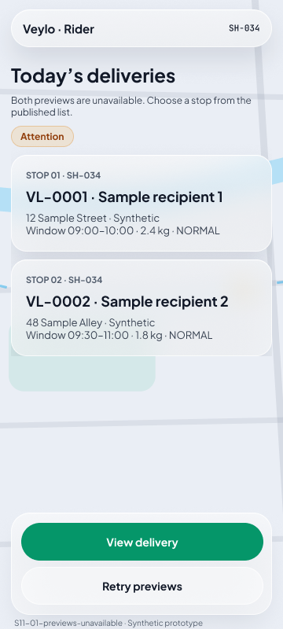

**S11-01-refresh — Refreshing confirmed work**

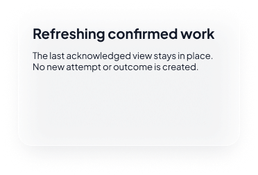

**S11-03-pending-two — No executable stops**

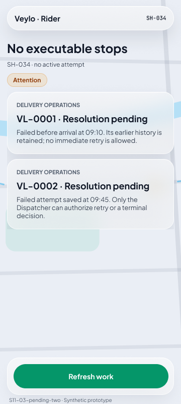

**S11-01-selected-next — Continue remaining work**

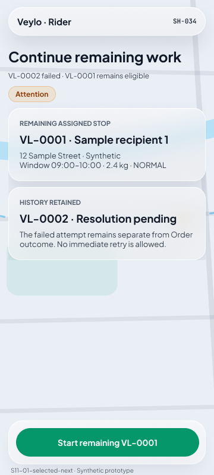

**Review record:** Editable frames, actual PNGs and recorded AI artifact/graph checks are complete. Assigned reviewer Nguyễn Thành Trung; actual review/date and independent flow walkthrough **pending**. Actual UC15 integration remains pending and unverified. AI checks are not independent human review.

## 4. UC12 — Record Delivery Attempt

Performed by: Trần Lê Hải. Reviewed by: Nguyễn Thành Trung (pending actual review). Edited by: Codex (AI-assisted drafting); human editor pending.

| Field              | Specification                                                                                                                                                                                                                                                                                                                              |
| ------------------ | ------------------------------------------------------------------------------------------------------------------------------------------------------------------------------------------------------------------------------------------------------------------------------------------------------------------------------------------ |
| ID / Name          | UC12 — Record Delivery Attempt                                                                                                                                                                                                                                                                                                            |
| Primary actor      | Delivery Rider                                                                                                                                                                                                                                                                                                                             |
| Secondary actors   | None; photo storage and persistence are internal system responsibilities.                                                                                                                                                                                                                                                                  |
| Description / goal | Record start, arrival and one truthful success/failure outcome for the assigned stop, retaining separate attempt history and successful-delivery evidence.                                                                                                                                                                                 |
| Requirements       | FR-01-2; FR-04-2, FR-04-3, FR-04-4, FR-04-5.                                                                                                                                                                                                                                                                                               |
| Business rules     | D-F04-1, D-F04-3–D-F04-8, D-F04-12.                                                                                                                                                                                                                                                                                                       |
| Trigger            | Rider selects Start or Resume from UC11.                                                                                                                                                                                                                                                                                                   |
| Preconditions      | Active authorized Rider, currently published owned assignment, eligible unresolved Order, no conflicting active attempt. Resume requires the Rider's existing active attempt. The normal success path can reach the destination and select a valid synthetic POD image. Failure, early failure and data/upload errors are specified below. |

**Basic flow — successful attempt**

1. **B1 — Rider/System:** Open the selected stop; show destination, contact, window and current assignment. Revalidate eligibility before exposing Start. `[S12-01]`
2. **B2 — Rider:** Selects Start. **System:** Atomically validates current ownership/versions and absence of active work, records the attempt's Rider/Order/Shift and start instant, then acknowledges the active attempt. Pending is not started-until-confirmed. `[S12-01-starting, S12-02-started]`
3. **B3 — Rider:** Selects Arrived. **System:** Records one arrival instant for the same active attempt after its start and acknowledges it. `[S12-02-arriving, S12-03-arrived]`
4. **B4 — Rider:** Chooses Successful, selects/captures one photo and reviews it. Success is not yet saved. `[S12-04-success]`
5. **B5 — System:** Validates image format/decoded content/size, uploads privately and binds staged evidence to this attempt. Shows progress and Ready to confirm only on acknowledgement. `[S12-04-uploading, S12-04-ready]`
6. **B6 — Rider:** Confirms outcome. **System:** Rechecks session, ownership, active attempt, versions, arrival and valid POD; atomically links the retained evidence, records the immutable successful outcome and server finish instant, and records the Order's delivered business outcome. Replay protection prevents a second completion. `[S12-04-saving]`
7. **B7 — System:** Displays the saved attempt receipt, event times and successful outcome. The Order bypasses UC13's failed-order decision. `[S12-05-success]`
8. **B8 — Rider/System:** Return to UC11 and refresh; continue the next eligible stop, or show no executable work. `[S11-01, S11-03-pending, S11-03-finished]`

**Alternative flows**

| ID / branch                                                            | Steps, retained data and exit                                                                                                                                                                                                                                                                                                                                                                                                                                                                                                         | Screen/state IDs                                                                  |
| ---------------------------------------------------------------------- | ------------------------------------------------------------------------------------------------------------------------------------------------------------------------------------------------------------------------------------------------------------------------------------------------------------------------------------------------------------------------------------------------------------------------------------------------------------------------------------------------------------------------------------- | --------------------------------------------------------------------------------- |
| A1 — Resume, from B1/B2                                               | **A1.1** An active attempt already exists for this Rider/stop. **A1.2** Load that attempt and recorded events; offer Arrived if absent, otherwise the outcome form. A different active stop blocks this start. **A1.3** Resume B3/B4, or return to the active stop through UC11; do not create another attempt.                                                                                                                                                                                                                       | S12-01-resume, S11-01-active                                                      |
| A2 — Failed delivery, from B3/B4                                      | **A2.1** Delivery cannot succeed. **A2.2** Rider selects Failed, one structured reason and a trimmed 1–500-character truthful comment. Arrival may be absent for a pre-arrival failure; show “Arrival not recorded” rather than fabricate a timestamp. **A2.3** Confirm using B6's atomic/replay checks without requiring POD or arrival; save failed attempt only, show pending Dispatcher resolution, then B8 to continue other stops.                                                                                           | S12-06-failure, S12-06-saving, S12-07-failed                                      |
| A3 — Missing/invalid outcome data, from B4–B6 or A2                  | **A3.1** Photo/arrival is missing for success, or reason/comment is missing/too long for failure. **A3.2** Show field-specific errors, retain authorized entered values and leave the attempt active; do not save a partial outcome. **A3.3** Correct at B3/B4 or A2, then confirm again.                                                                                                                                                                                                                                             | S12-04-invalid, S12-06-invalid                                                    |
| A4 — Invalid/oversized photo, from B5                                 | **A4.1** File is empty, corrupt, unsupported or >5,000,000 bytes. **A4.2** Reject it with format/size guidance; allow JPEG/PNG replacement. No attempt/Order outcome is saved. **A4.3** Return to B4.                                                                                                                                                                                                                                                                                                                                 | S12-04-photo-invalid                                                              |
| A5 — Photo upload failure, from B5                                    | **A5.1** Upload fails or its result is unknown. **A5.2** Keep the attempt active; show retry/reselect and reconcile staged-upload status before retransmitting. Never call this a failed delivery automatically. **A5.3** Retry B5, reselect B4, or leave through A8.                                                                                                                                                                                                                                                                 | S12-04-upload-error                                                               |
| A6 — Double tap/replay/conflicting replay, from B2/B3/B6 or A2        | **A6.1** One logical action is submitted repeatedly. **A6.2** Disable duplicate taps and replay the same operation ID; identical requests return the original acknowledgement/receipt. Different payload or an already-finished attempt yields conflict and its current saved result. **A6.3** Resume at the acknowledged milestone/B7; no second attempt/outcome.                                                                                                                                                                    | S12-01-starting, S12-02-arriving, S12-04-saving, S12-05-replayed, S12-08-conflict |
| A7 — Network/server failure or unknown commit, from B2/B3/B5/B6 or A2 | **A7.1** Acknowledgement is lost or server save fails. **A7.2** Show Not confirmed; retain current authorized inputs/operation ID in the open view. Query/reload authoritative state: if saved, show that result; if definitely not saved and still eligible, offer retry with the same operation ID. **A7.3** Resume the confirmed milestone or B7/B8; while unknown, block another start and final outcome changes. No offline queue or success toast.                                                                              | S12-08-unconfirmed, S12-08-error                                                  |
| A8 — Cancel/leave before outcome, from B1–B6 or A2                   | **A8.1** Rider dismisses/leaves. **A8.2** Before any acknowledged start, reconcile uncertainty then exit with no new attempt if none exists. After start, warn that the attempt remains active and unsaved values may be lost on reload. Leaving does not cancel the Order, mark failure or unlock another stop. **A8.3** Stay in the current form or return to UC11 with Resume; later resume A1.                                                                                                                                    | S12-01-leave, S12-01-resume, S11-01-active                                        |
| A9 — Assignment/time eligibility changed, from B1/B2/B6               | **A9.1** Stop is removed/reassigned/cancelled/already delivered, Shift is completed, or Start precedes its planned start. **A9.2** Reject the invalid mutation; show scheduled read-only work for an early start, otherwise conflict, hiding newly inaccessible details and preserving committed events. Before start, no attempt is created. After start, UC10 should have prevented reassignment; refresh rather than transfer the attempt. **A9.3** Return to UC11 A6/A9 or resume only if ownership and eligibility remain valid. | S12-08-conflict, S11-02-stale, S11-01-scheduled                                   |
| A10 — Authentication/authorization failure, from B1–B6               | **A10.1** Session/role/assignment scope fails. **A10.2** Clear protected local content and show shared auth/forbidden/not-found state; preserve already committed history. **A10.3** End, or sign in and re-enter B1 after revalidation. No private draft is restored across users.                                                                                                                                                                                                                                                   | S11-01-auth, S11-01-forbidden, S11-01-unavailable                                 |
| A11 — Out-of-order event or finished attempt, from B3/B6              | **A11.1** Arrival precedes acknowledged start, success lacks arrival, or a different outcome is already final. **A11.2** Reject the invalid event; reload recorded milestones/result without rewriting times/history. **A11.3** Resume the valid B3/B4 or show B7/current failed receipt; immutable final outcomes cannot be edited here.                                                                                                                                                                                             | S12-08-conflict, S12-04-invalid, S12-05-success, S12-07-failed                    |
| A12 — Failure cap/decision pending, from B1/B2                        | **A12.1** Latest failed attempt has no UC13 authorization, or three failed attempts already exist. **A12.2** Block Start and show Awaiting dispatcher resolution / Retry limit reached; do not create an attempt or terminal Order status. **A12.3** Return to UC11 and other eligible work; only UC13 resolves the failed Order.                                                                                                                                                                                                     | S12-01-retry-blocked, S11-03-pending                                              |
| A13 — Replace photo/change unsaved outcome, from B4/B5                | **A13.1** Rider replaces the photo or changes Success to Failed before final submission. **A13.2** Detach staged evidence from the unsaved choice; confirm the current choice only. Uploaded-but-unlinked objects never become public or count as delivery; cleanup policy is a storage implementation review item. **A13.3** Resume B4/B5 or A2. If final save is already pending, reconcile through A7 first.                                                                                                                       | S12-04-success, S12-06-failure, S12-08-unconfirmed                                |

**Postconditions**

- **Success:** One immutable successful attempt with start/arrival/finish instants and protected POD is retained; its Order has the proposed delivered business outcome. UC11 refreshes and continues remaining work.
- **Completed failure:** One failed attempt with reason/comment and available genuine event times is retained. Its Order awaits UC13, is not automatically terminal unsuccessful, and cannot be retried immediately. The Rider continues other eligible stops.
- **Failure/minimum guarantee:** Invalid/upload/authorization/concurrency errors do not create a false outcome or duplicate. A known started attempt remains active until a valid outcome; leaving the form is not Order cancellation. Unknown results require reconciliation before another action.

**Special requirements:** N04/N16/N17 Rider usability/accessibility; N05/N06 assignment authorization/private synthetic POD; N07 duplicate-completion integrity and stable parent linkage; N18 immutable actor/time/action audit. Validate images server-side and restrict POD reads; shared guides/reports contain no POD image. Do not require GPS, recipient signature or paid storage. UTC instants/hub-time display and staged-evidence cleanup require later approved implementation design. The prescribed N07 concurrency tests have not run in this drafting task.

**Relationships / extension points:** Entry/return through UC11; failure leads eventually to UC13 after remaining stops. UC16 is an independent note goal if later linked, not mandatory to record an outcome; no include/extend is invented. AI/map availability cannot be a prerequisite for saving a truthful attempt.

**Decision Log**

| ID / decision                                                              | Basis and rationale                                                                                                                                  | Confirmation / actual date                                                               |
| -------------------------------------------------------------------------- | ---------------------------------------------------------------------------------------------------------------------------------------------------- | ---------------------------------------------------------------------------------------- |
| DL12-1 — Separate attempt and Order outcome                               | FR-04-5, [BOOYAH-14](https://thaikiet291006.atlassian.net/browse/BOOYAH-14) and [Vision 2.2-review](https://drive.google.com/file/d/1vC5KwBkyKqXwPbQVq8lEtUQZlhlkWkXU/view) require independent attempts and no automatic terminal Order failure. Successful outcome bypasses failure resolution.              | Baseline retained; final Order representation and joint lifecycle review pending.        |
| DL12-2 — One active attempt; success after arrival; early failure allowed | D-F04-3/4 avoid concurrent stop execution and fabricated arrival when contact/address prevents travel.                                               | Proposed; confirmer/date pending.                                                        |
| DL12-3 — One JPEG/PNG ≤5,000,000 bytes                                   | D-F04-5 gives a bounded, actionable photo policy while preserving required photo POD.                                                                | Proposed; Kiệt/team and reviewer confirmation pending; no photo-limit approval claimed. |
| DL12-4 — Five reasons and 1–500-character comment                        | D-F04-6 combines baseline examples with a small synthetic reason set and an explicit OTHER escape. Preserve uncertainty without auto-classification. | Proposed; reason taxonomy/comment limit pending confirmation.                            |
| DL12-5 — Replay, uncertain result and leave/resume                        | D-F04-7/8 satisfy duplicate safety without inventing offline synchronization, ABORTED status or automatic failure.                                   | Proposed; operational abandoned-attempt recovery and API design pending.                 |

**Screen Map — editable Figma frames and actual PNG evidence**

The [prototype handoff](prototypes/F04-F08/F04-F08-Prototype-Handoff.md), [screen/fixture/flow mapping](prototypes/F04-F08/screen-fixture-flow-map.json) and [verification report](../../test/f04-f08-delivery-reporting/Verification-Report.md) record the local evidence. Screen IDs and functional rules are unchanged; extra IDs below are presentation/context variants of the same flows. Native Figma is the editable design source.

| Flow/step | Screen-state ID(s) | Purpose | Evidence |
| --- | --- | --- | --- |
| B1 | S12-01 | Eligible stop before Start. Actual PNG available. | `S12-01`: [Figma](https://www.figma.com/design/LBEaZQ3zEjnjBLhLoPb5pD/Veylo-%E2%80%93-BOOYAH-14-Prototypes?node-id=5-452) · [PNG](prototypes/UC12/S12-01.png) |
| B2, A6 | S12-01-starting, S12-02-started | Starting and acknowledged active attempt. Actual PNG available. | `S12-01-starting`: [Figma](https://www.figma.com/design/LBEaZQ3zEjnjBLhLoPb5pD/Veylo-%E2%80%93-BOOYAH-14-Prototypes?node-id=5-485) · [PNG](prototypes/UC12/S12-01-starting.png) `S12-02-started`: [Figma](https://www.figma.com/design/LBEaZQ3zEjnjBLhLoPb5pD/Veylo-%E2%80%93-BOOYAH-14-Prototypes?node-id=5-512) · [PNG](prototypes/UC12/S12-02-started.png) |
| B3, A6 | S12-02-arriving, S12-03-arrived | Arrival pending/acknowledged. Actual PNG available. | `S12-02-arriving`: [Figma](https://www.figma.com/design/LBEaZQ3zEjnjBLhLoPb5pD/Veylo-%E2%80%93-BOOYAH-14-Prototypes?node-id=5-541) · [PNG](prototypes/UC12/S12-02-arriving.png) `S12-03-arrived`: [Figma](https://www.figma.com/design/LBEaZQ3zEjnjBLhLoPb5pD/Veylo-%E2%80%93-BOOYAH-14-Prototypes?node-id=5-568) · [PNG](prototypes/UC12/S12-03-arrived.png) |
| B4/B5, A13 | S12-04-success, S12-04-uploading, S12-04-ready | Photo choice, upload and ready review. Actual PNG available. | `S12-04-ready`: [Figma](https://www.figma.com/design/LBEaZQ3zEjnjBLhLoPb5pD/Veylo-%E2%80%93-BOOYAH-14-Prototypes?node-id=5-653) · [PNG](prototypes/UC12/S12-04-ready.png) `S12-04-success`: [Figma](https://www.figma.com/design/LBEaZQ3zEjnjBLhLoPb5pD/Veylo-%E2%80%93-BOOYAH-14-Prototypes?node-id=5-597) · [PNG](prototypes/UC12/S12-04-success.png) `S12-04-uploading`: [Figma](https://www.figma.com/design/LBEaZQ3zEjnjBLhLoPb5pD/Veylo-%E2%80%93-BOOYAH-14-Prototypes?node-id=5-626) · [PNG](prototypes/UC12/S12-04-uploading.png) |
| B6/B7, A6/A11 | S12-04-saving, S12-05-success, S12-05-replayed | Atomic save and original/replayed success receipt. Actual PNG available. | `S12-04-saving`: [Figma](https://www.figma.com/design/LBEaZQ3zEjnjBLhLoPb5pD/Veylo-%E2%80%93-BOOYAH-14-Prototypes?node-id=5-693) · [PNG](prototypes/UC12/S12-04-saving.png) `S12-05-replayed`: [Figma](https://www.figma.com/design/LBEaZQ3zEjnjBLhLoPb5pD/Veylo-%E2%80%93-BOOYAH-14-Prototypes?node-id=5-755) · [PNG](prototypes/UC12/S12-05-replayed.png) `S12-05-success`: [Figma](https://www.figma.com/design/LBEaZQ3zEjnjBLhLoPb5pD/Veylo-%E2%80%93-BOOYAH-14-Prototypes?node-id=5-720) · [PNG](prototypes/UC12/S12-05-success.png) |
| A2/A13 | S12-06-failure, S12-06-saving, S12-07-failed | Failed form including pre-arrival variant, saving and receipt; no terminal Order failure. Actual PNG available. | `S12-06-failure`: [Figma](https://www.figma.com/design/LBEaZQ3zEjnjBLhLoPb5pD/Veylo-%E2%80%93-BOOYAH-14-Prototypes?node-id=5-784) · [PNG](prototypes/UC12/S12-06-failure.png) `S12-06-saving`: [Figma](https://www.figma.com/design/LBEaZQ3zEjnjBLhLoPb5pD/Veylo-%E2%80%93-BOOYAH-14-Prototypes?node-id=5-895) · [PNG](prototypes/UC12/S12-06-saving.png) `S12-07-failed`: [Figma](https://www.figma.com/design/LBEaZQ3zEjnjBLhLoPb5pD/Veylo-%E2%80%93-BOOYAH-14-Prototypes?node-id=5-922) · [PNG](prototypes/UC12/S12-07-failed.png) |
| A3/A11 | S12-04-invalid, S12-06-invalid | Success/arrival and failure-field validation. Actual PNG available. | `S12-04-invalid`: [Figma](https://www.figma.com/design/LBEaZQ3zEjnjBLhLoPb5pD/Veylo-%E2%80%93-BOOYAH-14-Prototypes?node-id=5-858) · [PNG](prototypes/UC12/S12-04-invalid.png) `S12-06-invalid`: [Figma](https://www.figma.com/design/LBEaZQ3zEjnjBLhLoPb5pD/Veylo-%E2%80%93-BOOYAH-14-Prototypes?node-id=5-821) · [PNG](prototypes/UC12/S12-06-invalid.png) |
| A4/A5 | S12-04-photo-invalid, S12-04-upload-error | Corrupt/unsupported/too-large image and upload recovery. Actual PNG available. | `S12-04-photo-invalid`: [Figma](https://www.figma.com/design/LBEaZQ3zEjnjBLhLoPb5pD/Veylo-%E2%80%93-BOOYAH-14-Prototypes?node-id=5-955) · [PNG](prototypes/UC12/S12-04-photo-invalid.png) `S12-04-upload-error`: [Figma](https://www.figma.com/design/LBEaZQ3zEjnjBLhLoPb5pD/Veylo-%E2%80%93-BOOYAH-14-Prototypes?node-id=5-980) · [PNG](prototypes/UC12/S12-04-upload-error.png) |
| A1/A8 | S12-01-resume, S12-01-leave | Existing active attempt and leave warning. Actual PNG available. | `S12-01-leave`: [Figma](https://www.figma.com/design/LBEaZQ3zEjnjBLhLoPb5pD/Veylo-%E2%80%93-BOOYAH-14-Prototypes?node-id=5-1034) · [PNG](prototypes/UC12/S12-01-leave.png) `S12-01-resume`: [Figma](https://www.figma.com/design/LBEaZQ3zEjnjBLhLoPb5pD/Veylo-%E2%80%93-BOOYAH-14-Prototypes?node-id=5-1007) · [PNG](prototypes/UC12/S12-01-resume.png) |
| A6/A9/A11 | S12-08-conflict | Stale ownership, event order or incompatible completion. Actual PNG available. | `S12-08-conflict`: [Figma](https://www.figma.com/design/LBEaZQ3zEjnjBLhLoPb5pD/Veylo-%E2%80%93-BOOYAH-14-Prototypes?node-id=5-1061) · [PNG](prototypes/UC12/S12-08-conflict.png) |
| A7/A13 | S12-08-unconfirmed, S12-08-error | Unknown result versus definitely failed operation. Actual PNG available. | `S12-08-error`: [Figma](https://www.figma.com/design/LBEaZQ3zEjnjBLhLoPb5pD/Veylo-%E2%80%93-BOOYAH-14-Prototypes?node-id=5-1115) · [PNG](prototypes/UC12/S12-08-error.png) `S12-08-unconfirmed`: [Figma](https://www.figma.com/design/LBEaZQ3zEjnjBLhLoPb5pD/Veylo-%E2%80%93-BOOYAH-14-Prototypes?node-id=5-1088) · [PNG](prototypes/UC12/S12-08-unconfirmed.png) |
| A12 | S12-01-retry-blocked | Awaiting UC13 or retry cap; no new start. Actual PNG available. | `S12-01-retry-blocked`: [Figma](https://www.figma.com/design/LBEaZQ3zEjnjBLhLoPb5pD/Veylo-%E2%80%93-BOOYAH-14-Prototypes?node-id=5-1142) · [PNG](prototypes/UC12/S12-01-retry-blocked.png) |
| B8, A1/A8/A9/A12 | Shared S11-01, S11-01-active, S11-01-scheduled, S11-02-stale, S11-03-pending, S11-03-finished | Next stop, Resume, scheduled/stale work or no executable stops; reuse UC11 frames. Actual PNG available. | `S11-01`: [Figma](https://www.figma.com/design/LBEaZQ3zEjnjBLhLoPb5pD/Veylo-%E2%80%93-BOOYAH-14-Prototypes?node-id=4-2) · [PNG](prototypes/UC11/S11-01.png) `S11-01-active`: [Figma](https://www.figma.com/design/LBEaZQ3zEjnjBLhLoPb5pD/Veylo-%E2%80%93-BOOYAH-14-Prototypes?node-id=4-175) · [PNG](prototypes/UC11/S11-01-active.png) `S11-01-scheduled`: [Figma](https://www.figma.com/design/LBEaZQ3zEjnjBLhLoPb5pD/Veylo-%E2%80%93-BOOYAH-14-Prototypes?node-id=4-210) · [PNG](prototypes/UC11/S11-01-scheduled.png) `S11-02-stale`: [Figma](https://www.figma.com/design/LBEaZQ3zEjnjBLhLoPb5pD/Veylo-%E2%80%93-BOOYAH-14-Prototypes?node-id=4-569) · [PNG](prototypes/UC11/S11-02-stale.png) `S11-03-finished`: [Figma](https://www.figma.com/design/LBEaZQ3zEjnjBLhLoPb5pD/Veylo-%E2%80%93-BOOYAH-14-Prototypes?node-id=4-272) · [PNG](prototypes/UC11/S11-03-finished.png) `S11-03-pending`: [Figma](https://www.figma.com/design/LBEaZQ3zEjnjBLhLoPb5pD/Veylo-%E2%80%93-BOOYAH-14-Prototypes?node-id=4-239) · [PNG](prototypes/UC11/S11-03-pending.png) |
| A10 | Shared S11-01-auth, S11-01-forbidden, S11-01-unavailable | Reuse Rider access states; no duplicate sign-in UC. Actual PNG available. | `S11-01-auth`: [Figma](https://www.figma.com/design/LBEaZQ3zEjnjBLhLoPb5pD/Veylo-%E2%80%93-BOOYAH-14-Prototypes?node-id=4-469) · [PNG](prototypes/UC11/S11-01-auth.png) `S11-01-forbidden`: [Figma](https://www.figma.com/design/LBEaZQ3zEjnjBLhLoPb5pD/Veylo-%E2%80%93-BOOYAH-14-Prototypes?node-id=4-494) · [PNG](prototypes/UC11/S11-01-forbidden.png) `S11-01-unavailable`: [Figma](https://www.figma.com/design/LBEaZQ3zEjnjBLhLoPb5pD/Veylo-%E2%80%93-BOOYAH-14-Prototypes?node-id=4-446) · [PNG](prototypes/UC11/S11-01-unavailable.png) |

**Additional context/presentation states**

| Screen-state ID | Purpose | Evidence |
| --- | --- | --- |
| `S12-01-next` | Start remaining delivery | [Figma](https://www.figma.com/design/LBEaZQ3zEjnjBLhLoPb5pD/Veylo-%E2%80%93-BOOYAH-14-Prototypes?node-id=5-1167) · [PNG](prototypes/UC12/S12-01-next.png) |
| `S12-02-next` | On the way | [Figma](https://www.figma.com/design/LBEaZQ3zEjnjBLhLoPb5pD/Veylo-%E2%80%93-BOOYAH-14-Prototypes?node-id=5-1198) · [PNG](prototypes/UC12/S12-02-next.png) |
| `S12-03-next` | Record remaining outcome | [Figma](https://www.figma.com/design/LBEaZQ3zEjnjBLhLoPb5pD/Veylo-%E2%80%93-BOOYAH-14-Prototypes?node-id=5-1227) · [PNG](prototypes/UC12/S12-03-next.png) |
| `S12-06-next` | Record failed attempt | [Figma](https://www.figma.com/design/LBEaZQ3zEjnjBLhLoPb5pD/Veylo-%E2%80%93-BOOYAH-14-Prototypes?node-id=5-1254) · [PNG](prototypes/UC12/S12-06-next.png) |
| `S12-07-next` | Failed attempt saved | [Figma](https://www.figma.com/design/LBEaZQ3zEjnjBLhLoPb5pD/Veylo-%E2%80%93-BOOYAH-14-Prototypes?node-id=5-1291) · [PNG](prototypes/UC12/S12-07-next.png) |
| `S12-07-next-after-failure` | Failed attempt saved | [Figma](https://www.figma.com/design/LBEaZQ3zEjnjBLhLoPb5pD/Veylo-%E2%80%93-BOOYAH-14-Prototypes?node-id=10-2740) · [PNG](prototypes/UC12/S12-07-next-after-failure.png) |
| `S12-07-selected-first` | Selected stop outcome saved | [Figma](https://www.figma.com/design/LBEaZQ3zEjnjBLhLoPb5pD/Veylo-%E2%80%93-BOOYAH-14-Prototypes?node-id=16-2785) · [PNG](prototypes/UC12/S12-07-selected-first.png) |

**Actual prototype screenshots**

**S12-01 — Ready to start**

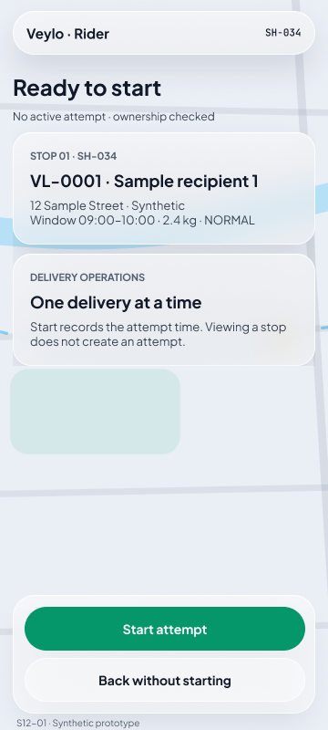

**S12-01-starting — Starting attempt**

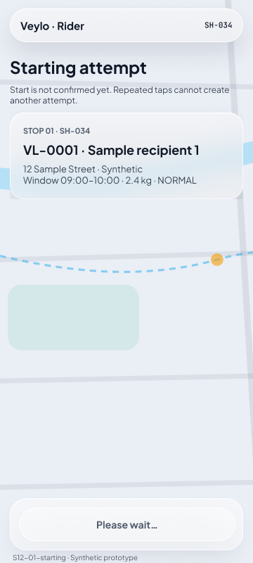

**S12-02-started — On the way**

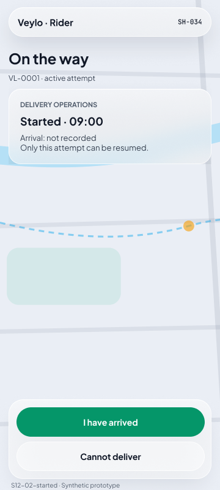

**S12-02-arriving — Recording arrival**

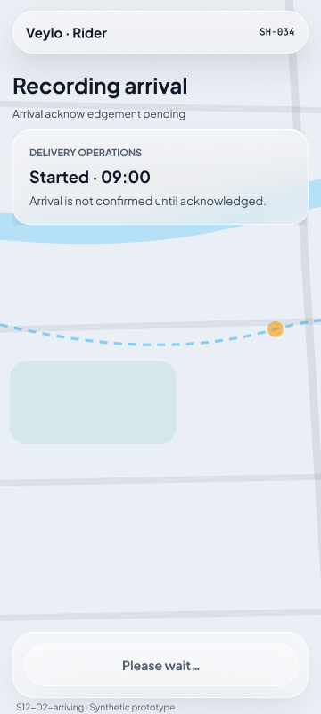

**S12-03-arrived — Record delivery outcome**

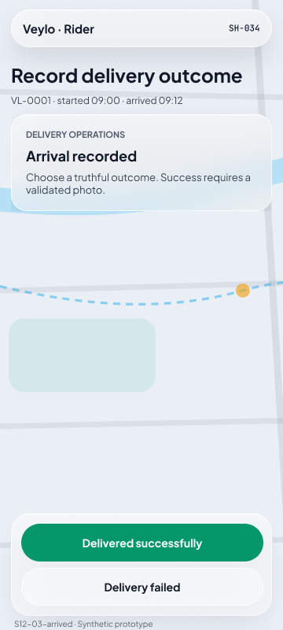

**S12-04-success — Photo proof of delivery**

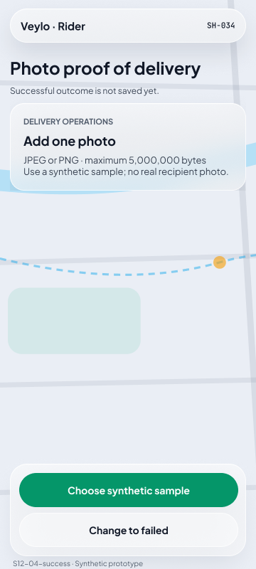

**S12-04-uploading — Uploading photo**

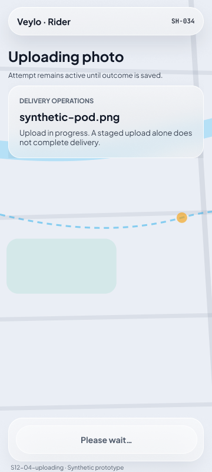

**S12-04-ready — Review successful outcome**

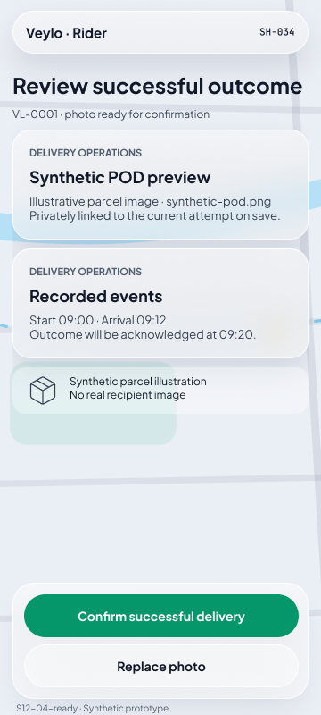

**S12-04-saving — Saving outcome**

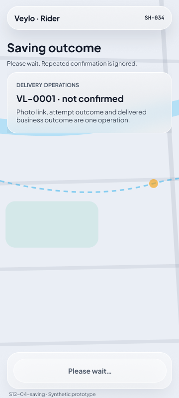

**S12-05-success — Delivery saved**

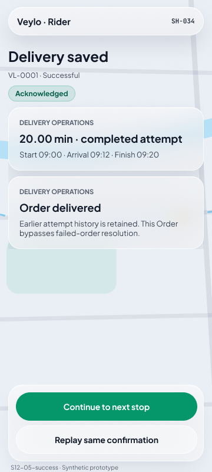

**S12-05-replayed — Already saved**

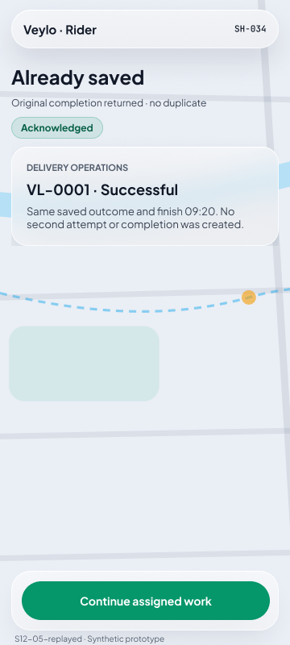

**S12-06-failure — Record failed attempt**

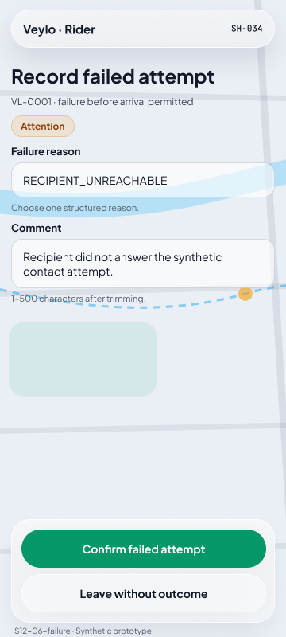

**S12-06-invalid — Correct failed outcome**

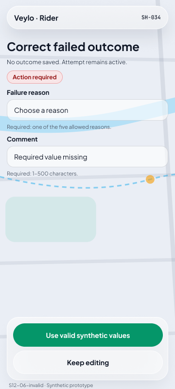

**S12-04-invalid — Success needs evidence**

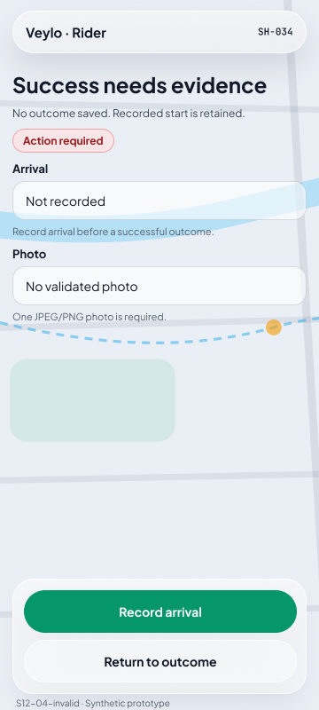

**S12-06-saving — Saving failed attempt**

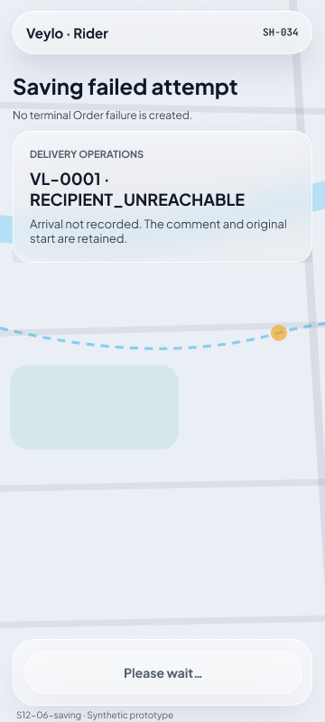

**S12-07-failed — Failed attempt saved**

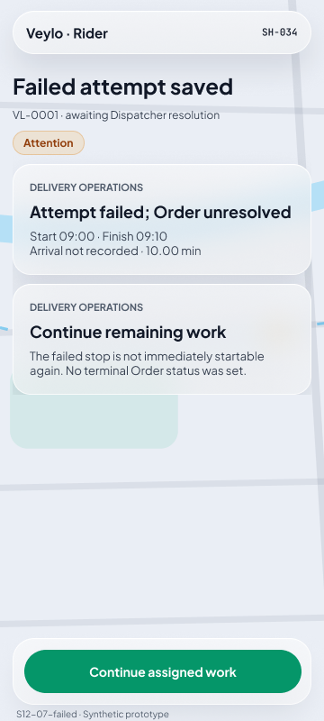

**S12-04-photo-invalid — Photo cannot be used**

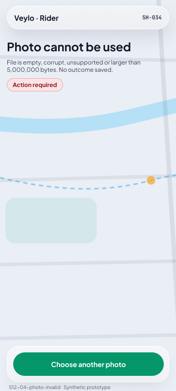

**S12-04-upload-error — Photo upload failed**

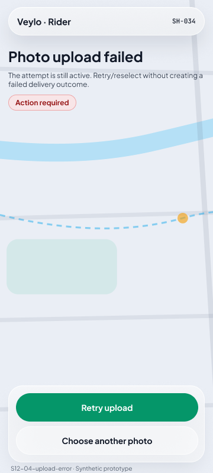

**S12-01-resume — Resume this attempt**

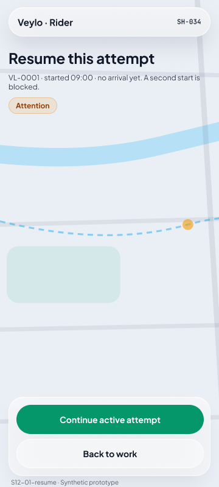

**S12-01-leave — Leave this form?**

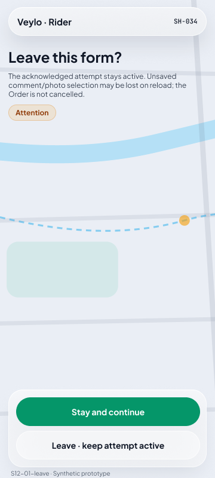

**S12-08-conflict — Action could not be applied**

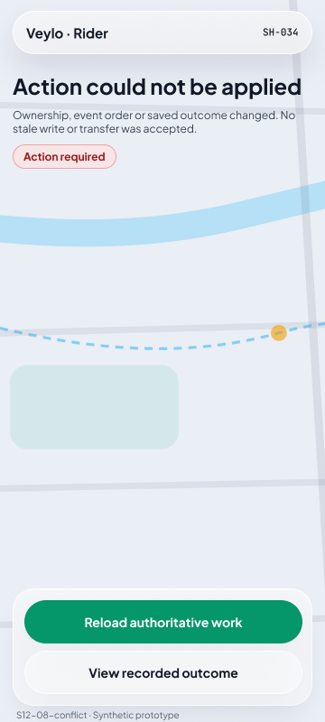

**S12-08-unconfirmed — Result not confirmed**

**S12-08-error — Save did not complete**

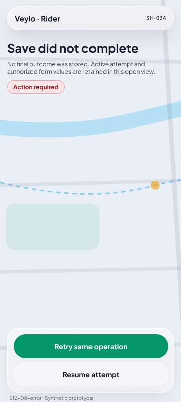

**S12-01-retry-blocked — Start blocked**

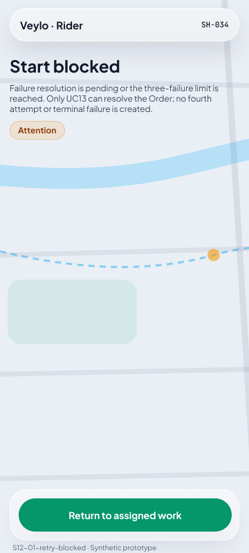

**S12-01-next — Start remaining delivery**

**S12-02-next — On the way**

**S12-03-next — Record remaining outcome**

**S12-06-next — Record failed attempt**

**S12-07-next — Failed attempt saved**

**S12-07-next-after-failure — Failed attempt saved**

**S12-07-selected-first — Selected stop outcome saved**

**Review record:** Assigned reviewer Nguyễn Thành Trung; actual review/date, replay/POD walkthrough and runtime validation **pending**. All policy choices above remain review proposals.

## 5. UC13 — Monitor Attempts and Resolve Failed Orders

Performed by: Trần Lê Hải. Reviewed by: Nguyễn Thành Trung (pending actual review). Edited by: Codex (AI-assisted drafting); human editor pending.

| Field              | Specification                                                                                                                                                                                                                                                                                           |
| ------------------ | ------------------------------------------------------------------------------------------------------------------------------------------------------------------------------------------------------------------------------------------------------------------------------------------------------- |
| ID / Name          | UC13 — Monitor Attempts and Resolve Failed Orders                                                                                                                                                                                                                                                      |
| Primary actor      | Hub Dispatcher                                                                                                                                                                                                                                                                                          |
| Secondary actors   | None; Rider events are prior operational inputs, not an external service invoked by this use case.                                                                                                                                                                                                      |
| Description / goal | Monitor hub execution, inspect preserved attempts/POD and decide whether an unresolved failed Order receives another planned opportunity or an explicit terminal unsuccessful resolution.                                                                                                               |
| Requirements       | FR-01-2, FR-04-5, FR-04-6, FR-08-1.                                                                                                                                                                                                                                                                     |
| Business rules     | D-F04-1, D-F04-7, D-F04-9–D-F04-12.                                                                                                                                                                                                                                                                    |
| Trigger            | Dispatcher opens Delivery Monitoring or selects a failed Order from its pending-resolution list.                                                                                                                                                                                                        |
| Preconditions      | Valid active Dispatcher session and authorized hub. Monitoring needs no completed shift. The basic resolution path additionally requires an unresolved latest failed attempt, no active/executable work left in its originating published shift, and fewer than three completed failures on that Order. |

**Basic flow — monitor, then authorize re-dispatch**

1. **B1 — Dispatcher/System:** Open Monitoring; authorize role/hub and load permitted shifts, per-stop progress, active/completed attempts and pending failures with a last-refreshed time. `[S13-01-loading, S13-01]`
2. **B2 — Dispatcher:** Select a shift/Order. **System:** Show the Order's overall outcome, assignment history and separate chronological attempts, responsible Riders, genuine start/arrival/finish times, failure reasons/comments and authorized successful POD. Successful Orders are displayed read-only outside failed-order resolution. `[S13-02]`
3. **B3 — System:** For a selected unresolved latest failure, recompute total completed failures across that Order's history and confirm the originating shift has no active attempt or executable stop remaining. Show why a decision is eligible or blocked. `[S13-03]`
4. **B4 — Dispatcher:** Chooses Re-dispatch and reviews the proposed new opportunity, retained history and required UC09/UC10 planning/publication checks. The basic case has one or two completed failures, no successful/terminal/cancelled Order outcome and no other live assignment/active attempt. `[S13-04-retry]`
5. **B5 — Dispatcher:** Confirms. **System:** Revalidates versions, ownership, shift exhaustion and retry count; atomically records one resolution/authorization for this failure, retires the failed assignment from executable work, and records actor/time/action and the linked failure. It creates no attempt, changes no earlier outcome and does not publish a new assignment. `[S13-04-saving]`
6. **B6 — System:** Shows Re-dispatch authorized — awaiting planning and offers UC09 to plan a new shift or UC10 to use an eligible published shift. Those UCs apply their rider, capacity, version and publication checks. Closing or failing the handoff preserves the existing authorization; returning reuses it. One authorization can produce only one live opportunity. `[S13-05-retry-authorized]`
7. **B7 — System:** On return, refreshes the resolution and assignment history. Show awaiting planning or the newly published opportunity. Only publication makes the new work visible in UC11; only its later UC12 start creates another attempt. Continue B2 for another failure or end. `[S13-05-retry-authorized, S13-01]`

**Alternative flows**

| ID / branch                                                | Steps, retained data and exit                                                                                                                                                                                                                                                                                                                                                                                                                                                                                                                                               | Screen/state IDs                                                |
| ---------------------------------------------------------- | --------------------------------------------------------------------------------------------------------------------------------------------------------------------------------------------------------------------------------------------------------------------------------------------------------------------------------------------------------------------------------------------------------------------------------------------------------------------------------------------------------------------------------------------------------------------------- | --------------------------------------------------------------- |
| A1 — No shifts/failures, from B1/B3                       | **A1.1** No published work matches, or no unresolved failures exist. **A1.2** Show a true empty state; successful/processed Orders remain read-only if present. **A1.3** Refresh B1, change permitted shift selection or end.                                                                                                                                                                                                                                                                                                                                               | S13-01-empty, S13-03-empty                                      |
| A2 — Work still executing, from B3/B5                     | **A2.1** The originating shift still has an active attempt or an executable assigned stop. **A2.2** Allow monitoring but disable both resolution choices and explain that the Rider must finish remaining work first. No failed Order is closed or requeued. **A2.3** Refresh B1/B3 after UC11/UC12 continue; do not bypass the workflow by starting retry early.                                                                                                                                                                                                           | S13-03-waiting                                                  |
| A3 — Retry limit reached, from B3/B4/B5                   | **A3.1** Three completed failed attempts already exist across all shifts. **A3.2** Disable Re-dispatch; show the count and retained attempts. Do not auto-fail the Order. **A3.3** Dispatcher may explicitly choose terminal resolution through A4, defer/end, or inspect history B2.                                                                                                                                                                                                                                                                                       | S13-03-limit                                                    |
| A4 — Terminal unsuccessful decision, from B4              | **A4.1** Dispatcher selects Close as terminal unsuccessful, either below the cap for a justified no-retry decision or at the cap. **A4.2** Enter a trimmed 5–300-character reason and confirm; recheck B5's authorization, versions, exhaustion and unresolved-failure conditions. Atomically retain the reason/actor/time, record the Order's proposed terminal unsuccessful business outcome and linked resolution, and retire executable work. **A4.3** Show the saved terminal receipt; return B1. Earlier attempts stay unchanged; no automatic reopening is offered. | S13-06-terminal, S13-06-saving, S13-07-terminal-saved           |
| A5 — Missing/invalid terminal reason, from A4/B5          | **A5.1** Reason is blank, <5 or >300 characters after trimming. **A5.2** Show inline guidance, retain the proposed choice and save no decision. **A5.3** Correct at A4 or dismiss through A6.                                                                                                                                                                                                                                                                                                                                                                               | S13-06-invalid                                                  |
| A6 — Dismiss/defer, from B4/B5 before submission or A4    | **A6.1** Dispatcher cancels confirmation or leaves before a decision is submitted. **A6.2** Keep the unresolved failure and all assignments/outcomes unchanged. If a request was already sent, reconcile through A10 first. **A6.3** Return B2/B3 or end; it is not an Order cancellation.                                                                                                                                                                                                                                                                                  | S13-04-retry, S13-06-terminal, S13-08-unconfirmed               |
| A7 — Already resolved/successful/cancelled, from B2/B3/B5 | **A7.1** Another operation already resolved the failure, delivered the Order or made it ineligible. **A7.2** Show the current authorized history/decision, disable stale choices and preserve it. A successful Order never enters the failure decision; an existing retry authorization is reused. **A7.3** Refresh B2 or continue B6 if already authorized; no duplicate/reversed decision.                                                                                                                                                                                | S13-02-readonly, S13-08-conflict, S13-05-retry-authorized       |
| A8 — Double confirm/concurrent change, from B5 or A4      | **A8.1** Same operation is replayed or another Dispatcher/assignment change wins. **A8.2** Replay identical saved decisions; reject incompatible/stale ones, with no extra authorization/terminal decision. **A8.3** Show the saved receipt or reload B2/B3; require a fresh preview for a still-unresolved failure.                                                                                                                                                                                                                                                        | S13-05-retry-authorized, S13-07-terminal-saved, S13-08-conflict |
| A9 — Planning handoff fails/dismissed, from B6/B7         | **A9.1** No eligible rider/shift, capacity blocks publication, or Dispatcher leaves planning. **A9.2** Preserve the committed retry authorization and old attempt history; show Awaiting planning with Reopen planning. Draft planning does not consume it; publication consumes the single opportunity. Removing an unstarted new assignment must release that opportunity for replanning through the same authorized handoff, not create another failure. **A9.3** Retry UC09/UC10 later through B6; no Rider work or attempt is fabricated.                              | S13-05-awaiting-planning                                        |
| A10 — Load/network/save result unknown, from B1–B7 or A4 | **A10.1** A read fails, a save fails definitively, or its acknowledgement is lost. **A10.2** Distinguish load error/stale view from Unconfirmed decision; preserve authorized inputs in the open view. Reconcile operation/current state before resend. **A10.3** Refresh B1/B2, retry a confirmed-unsaved operation with the same ID, or show its existing receipt; no optimistic terminal/retry status.                                                                                                                                                                   | S13-01-error, S13-01-stale, S13-08-unconfirmed                  |
| A11 — Authentication/authorization, from B1–B7           | **A11.1** Session expires, role becomes invalid or a resource is outside the trusted hub. **A11.2** Clear protected data and show sign-in/forbidden/not-found. **A11.3** End or re-enter B1 only after valid sign-in; no client hub override.                                                                                                                                                                                                                                                                                                                               | S13-01-auth, S13-01-forbidden, S13-01-unavailable               |
| A12 — No valid resolution context, from B2/B3             | **A12.1** Attempt/assignment lineage is missing or inconsistent, an apparent failure has no valid recorded outcome, or the latest unresolved failure cannot be identified. **A12.2** Show a data-quality warning; retain history, block resolution and do not guess an Order outcome. **A12.3** End/refresh after authorized correction outside this UC; report the defect for review.                                                                                                                                                                                      | S13-02-quality                                                  |

**Postconditions**

- **Monitoring success:** Authorized recorded progress/history is visible; inspecting it changes no business state.
- **Re-dispatch success:** One durable failure resolution authorizes one later opportunity, with previous attempts preserved. The old failed assignment is no longer executable; new work remains invisible to the Rider until UC09/UC10 publish it. No attempt or terminal unsuccessful outcome is produced by authorization.
- **Terminal success:** Explicit confirmed Dispatcher resolution records the proposed terminal unsuccessful Order outcome and reason once. The cap alone and the Rider's failed attempt never perform this transition.
- **Failure/minimum guarantee:** Rejection/dismissal retains committed history. A failed planning handoff preserves the committed authorization, while a failed decision save creates no partial authorization/resolution. Unknown decisions remain unconfirmed until reconciled.

**Special requirements:** N05/N06 authorized hub-only history/POD and synthetic data; N07 atomic/idempotent resolution with no duplicate opportunity; N18 actor/time/action and failure linkage; N16/N17 keyboard, visible focus and tested-browser targets. Monitoring means recorded events plus refresh time, not location telemetry. Started attempts lock UC10 reassignment until their terminal attempt outcome; UC13's resolution still waits for remaining work. Lifetime failure count crosses shifts even when monitoring filters hide older attempts; show that scope explicitly.

**Relationships / extension points:** Consumes UC12 history; retry handoff to UC09/UC10 and later UC11/UC12, with no mandatory UML include invented. UC19 is a separate read-only reporting goal; opening it does not resolve pending failures. Preserve the successful-Order bypass in Vision workflow 1.

**Decision Log**

| ID / decision                                      | Basis and rationale                                                                                                                                     | Confirmation / actual date                                                                          |
| -------------------------------------------------- | ------------------------------------------------------------------------------------------------------------------------------------------------------- | --------------------------------------------------------------------------------------------------- |
| DL13-1 — Resolve only after remaining work        | [BOOYAH-14](https://thaikiet291006.atlassian.net/browse/BOOYAH-14) and [Vision 2.2-review](https://drive.google.com/file/d/1vC5KwBkyKqXwPbQVq8lEtUQZlhlkWkXU/view) workflow 1 explicitly order Rider continuation before Dispatcher failed-order decisions. Monitoring remains available earlier. | Source clarification retained; shared shift-completion/exception handling review pending.           |
| DL13-2 — Three failed attempts, not three retries | D-F04-10 counts initial plus later completed failures across shifts. A blocked fourth start does not auto-close the Order.                              | Proposed; Kiệt/team cap confirmation and reviewer acceptance pending.                              |
| DL13-3 — Explicit terminal unsuccessful choice    | D-F04-11 specifies a concrete business effect/reason even below the cap; no new enum or reversed`CANCELLED` transition is assumed. Delivery lifecycle/schema remains outside the existing F02 OpenSpec contract.                      | Proposed; F02/F03/BOOYAH-13 naming, transitions and data compatibility pending.                     |
| DL13-4 — Durable single retry authorization       | D-F04-7/10 preserve intent when planning fails and prevent duplicate live work; UC09/UC10 still own assignments/publication.                            | Proposed; opportunity release/replanning and NEW-only pool integration require F03/OpenSpec review. |
| DL13-5 — Protect assigned/executed NEW work       | D-F04-12 exposes the UC08 NEW-only guard gap rather than applying a new guard to the team's F02 contract.                                               | Concrete cross-UC proposal awaiting approval; F02/OpenSpec left unchanged.                          |

**Screen Map — editable Figma frames and actual PNG evidence**

The [prototype handoff](prototypes/F04-F08/F04-F08-Prototype-Handoff.md), [screen/fixture/flow mapping](prototypes/F04-F08/screen-fixture-flow-map.json) and [verification report](../../test/f04-f08-delivery-reporting/Verification-Report.md) record the local evidence. Screen IDs and functional rules are unchanged; extra IDs below are presentation/context variants of the same flows. Native Figma is the editable design source.

The planning handoff is a local UC09/UC10 representation; no teammate file or real assignment is changed.

| Flow/step | Screen-state ID(s) | Purpose | Evidence |
| --- | --- | --- | --- |
| B1/B7 | S13-01-loading, S13-01 | Recorded progress and manual refresh. Actual PNG available. | `S13-01`: [Figma](https://www.figma.com/design/LBEaZQ3zEjnjBLhLoPb5pD/Veylo-%E2%80%93-BOOYAH-14-Prototypes?node-id=5-1324) · [PNG](prototypes/UC13/S13-01.png) `S13-01-loading`: [Figma](https://www.figma.com/design/LBEaZQ3zEjnjBLhLoPb5pD/Veylo-%E2%80%93-BOOYAH-14-Prototypes?node-id=5-1995) · [PNG](prototypes/UC13/S13-01-loading.png) |
| B2 | S13-02 | Separate Order/assignment/attempt history and private evidence. Actual PNG available. | `S13-02`: [Figma](https://www.figma.com/design/LBEaZQ3zEjnjBLhLoPb5pD/Veylo-%E2%80%93-BOOYAH-14-Prototypes?node-id=5-1404) · [PNG](prototypes/UC13/S13-02.png) |
| B3 | S13-03 | Eligible unresolved failure, lifetime count and decision choices. Actual PNG available. | `S13-03`: [Figma](https://www.figma.com/design/LBEaZQ3zEjnjBLhLoPb5pD/Veylo-%E2%80%93-BOOYAH-14-Prototypes?node-id=5-1484) · [PNG](prototypes/UC13/S13-03.png) |
| B4/B5, A6 | S13-04-retry, S13-04-saving | Retry confirmation and atomic saving. Actual PNG available. | `S13-04-retry`: [Figma](https://www.figma.com/design/LBEaZQ3zEjnjBLhLoPb5pD/Veylo-%E2%80%93-BOOYAH-14-Prototypes?node-id=5-1535) · [PNG](prototypes/UC13/S13-04-retry.png) `S13-04-saving`: [Figma](https://www.figma.com/design/LBEaZQ3zEjnjBLhLoPb5pD/Veylo-%E2%80%93-BOOYAH-14-Prototypes?node-id=5-1586) · [PNG](prototypes/UC13/S13-04-saving.png) |
| B6/B7, A7/A8 | S13-05-retry-authorized | Saved authorization and UC09/UC10 handoff. Actual PNG available. | `S13-05-retry-authorized`: [Figma](https://www.figma.com/design/LBEaZQ3zEjnjBLhLoPb5pD/Veylo-%E2%80%93-BOOYAH-14-Prototypes?node-id=5-1629) · [PNG](prototypes/UC13/S13-05-retry-authorized.png) |
| A1 | S13-01-empty, S13-03-empty | No published work or no unresolved failures. Actual PNG available. | `S13-01-empty`: [Figma](https://www.figma.com/design/LBEaZQ3zEjnjBLhLoPb5pD/Veylo-%E2%80%93-BOOYAH-14-Prototypes?node-id=5-2036) · [PNG](prototypes/UC13/S13-01-empty.png) `S13-03-empty`: [Figma](https://www.figma.com/design/LBEaZQ3zEjnjBLhLoPb5pD/Veylo-%E2%80%93-BOOYAH-14-Prototypes?node-id=5-2079) · [PNG](prototypes/UC13/S13-03-empty.png) |
| A2/A3 | S13-03-waiting, S13-03-limit | Remaining work/active attempt or retry-cap restriction. Actual PNG available. | `S13-03-limit`: [Figma](https://www.figma.com/design/LBEaZQ3zEjnjBLhLoPb5pD/Veylo-%E2%80%93-BOOYAH-14-Prototypes?node-id=5-2169) · [PNG](prototypes/UC13/S13-03-limit.png) `S13-03-waiting`: [Figma](https://www.figma.com/design/LBEaZQ3zEjnjBLhLoPb5pD/Veylo-%E2%80%93-BOOYAH-14-Prototypes?node-id=5-2124) · [PNG](prototypes/UC13/S13-03-waiting.png) |
| A4/A6/A8 | S13-06-terminal, S13-06-saving, S13-07-terminal-saved | Explicit terminal reason, save and receipt. Actual PNG available. | `S13-06-saving`: [Figma](https://www.figma.com/design/LBEaZQ3zEjnjBLhLoPb5pD/Veylo-%E2%80%93-BOOYAH-14-Prototypes?node-id=5-1848) · [PNG](prototypes/UC13/S13-06-saving.png) `S13-06-terminal`: [Figma](https://www.figma.com/design/LBEaZQ3zEjnjBLhLoPb5pD/Veylo-%E2%80%93-BOOYAH-14-Prototypes?node-id=5-1793) · [PNG](prototypes/UC13/S13-06-terminal.png) `S13-07-terminal-saved`: [Figma](https://www.figma.com/design/LBEaZQ3zEjnjBLhLoPb5pD/Veylo-%E2%80%93-BOOYAH-14-Prototypes?node-id=5-1891) · [PNG](prototypes/UC13/S13-07-terminal-saved.png) |
| A5 | S13-06-invalid | Terminal reason validation with no save. Actual PNG available. | `S13-06-invalid`: [Figma](https://www.figma.com/design/LBEaZQ3zEjnjBLhLoPb5pD/Veylo-%E2%80%93-BOOYAH-14-Prototypes?node-id=5-1944) · [PNG](prototypes/UC13/S13-06-invalid.png) |
| A7/A8 | S13-02-readonly, S13-08-conflict | Successful/resolved/cancelled work and stale-write recovery. Actual PNG available. | `S13-02-readonly`: [Figma](https://www.figma.com/design/LBEaZQ3zEjnjBLhLoPb5pD/Veylo-%E2%80%93-BOOYAH-14-Prototypes?node-id=5-2214) · [PNG](prototypes/UC13/S13-02-readonly.png) `S13-08-conflict`: [Figma](https://www.figma.com/design/LBEaZQ3zEjnjBLhLoPb5pD/Veylo-%E2%80%93-BOOYAH-14-Prototypes?node-id=5-2259) · [PNG](prototypes/UC13/S13-08-conflict.png) |
| A9 | S13-05-awaiting-planning | Durable authorization with unpublished/blocked planning. Actual PNG available. | `S13-05-awaiting-planning`: [Figma](https://www.figma.com/design/LBEaZQ3zEjnjBLhLoPb5pD/Veylo-%E2%80%93-BOOYAH-14-Prototypes?node-id=5-1740) · [PNG](prototypes/UC13/S13-05-awaiting-planning.png) |
| A10/A6 | S13-01-error, S13-01-stale, S13-08-unconfirmed | Load failure, stale view, unknown decision result. Actual PNG available. | `S13-01-error`: [Figma](https://www.figma.com/design/LBEaZQ3zEjnjBLhLoPb5pD/Veylo-%E2%80%93-BOOYAH-14-Prototypes?node-id=5-2304) · [PNG](prototypes/UC13/S13-01-error.png) `S13-01-stale`: [Figma](https://www.figma.com/design/LBEaZQ3zEjnjBLhLoPb5pD/Veylo-%E2%80%93-BOOYAH-14-Prototypes?node-id=5-2347) · [PNG](prototypes/UC13/S13-01-stale.png) `S13-08-unconfirmed`: [Figma](https://www.figma.com/design/LBEaZQ3zEjnjBLhLoPb5pD/Veylo-%E2%80%93-BOOYAH-14-Prototypes?node-id=5-2390) · [PNG](prototypes/UC13/S13-08-unconfirmed.png) |
| A11 | S13-01-auth, S13-01-forbidden, S13-01-unavailable | Shared Dispatcher access states, reused by UC19. Actual PNG available. | `S13-01-auth`: [Figma](https://www.figma.com/design/LBEaZQ3zEjnjBLhLoPb5pD/Veylo-%E2%80%93-BOOYAH-14-Prototypes?node-id=5-2435) · [PNG](prototypes/UC13/S13-01-auth.png) `S13-01-forbidden`: [Figma](https://www.figma.com/design/LBEaZQ3zEjnjBLhLoPb5pD/Veylo-%E2%80%93-BOOYAH-14-Prototypes?node-id=5-2478) · [PNG](prototypes/UC13/S13-01-forbidden.png) `S13-01-unavailable`: [Figma](https://www.figma.com/design/LBEaZQ3zEjnjBLhLoPb5pD/Veylo-%E2%80%93-BOOYAH-14-Prototypes?node-id=5-2521) · [PNG](prototypes/UC13/S13-01-unavailable.png) |
| A12 | S13-02-quality | Inconsistent lineage/outcome; resolution blocked. Actual PNG available. | `S13-02-quality`: [Figma](https://www.figma.com/design/LBEaZQ3zEjnjBLhLoPb5pD/Veylo-%E2%80%93-BOOYAH-14-Prototypes?node-id=5-2564) · [PNG](prototypes/UC13/S13-02-quality.png) |
| B6/A9 handoff | External S09-01–S09-07, S10-01–S10-07 | The cached [BOOYAH-21 specification](https://github.com/DankDaPancake/Veylo/blob/851f324b67bedb6b23f094aa5faebad6c73f197d/docs/analysis-and-design/use-cases/UC-F03-F05-Shifts.md) defines planning/reassignment screens; their new retry-context variant and walkthrough remain pending. | Local explanation/planning representation below; original owner file unchanged. |

**Additional context/presentation states**

| Screen-state ID | Purpose | Evidence |
| --- | --- | --- |
| `S13-05-planning` | Plan authorized opportunity | [Figma](https://www.figma.com/design/LBEaZQ3zEjnjBLhLoPb5pD/Veylo-%E2%80%93-BOOYAH-14-Prototypes?node-id=5-1682) · [PNG](prototypes/UC13/S13-05-planning.png) |

**Actual prototype screenshots**

**S13-01 — Delivery monitoring**

**S13-02 — Order and attempt history**

**S13-03 — Resolve failed Order**

**S13-04-retry — Confirm re-dispatch**

**S13-04-saving — Saving resolution**

**S13-05-retry-authorized — Re-dispatch authorized**

**S13-05-planning — Plan authorized opportunity**

**S13-05-awaiting-planning — Awaiting planning**

**S13-06-terminal — Close terminal unsuccessful**

**S13-06-saving — Saving terminal decision**

**S13-07-terminal-saved — Terminal decision saved**

**S13-06-invalid — Reason needs correction**

**S13-01-loading — Loading recorded progress**

**S13-01-empty — No published work**

**S13-03-empty — No unresolved failures**

**S13-03-waiting — Remaining work must finish**

**S13-03-limit — Retry limit reached**

**S13-02-readonly — Delivered Order · read-only**

**S13-08-conflict — Decision changed meanwhile**

**S13-01-error — Monitoring could not load**

**S13-01-stale — Progress is stale**

**S13-08-unconfirmed — Decision not confirmed**

**S13-01-auth — Sign in to continue**

**S13-01-forbidden — Dispatcher access required**

**S13-01-unavailable — Record unavailable**

**S13-02-quality — Resolution context is invalid**

**Review record:** Assigned reviewer Nguyễn Thành Trung; actual review/date, full next-stop→resolution→re-dispatch/terminal walkthrough and independent acceptance **pending**. No team decision has been recorded as newly approved.

## 6. UC19 — View Shift and Rider Reports

Performed by: Trần Lê Hải. Reviewed by: Nguyễn Thành Trung (pending actual review). Edited by: Codex (AI-assisted drafting); human editor pending.

| Field              | Specification                                                                                                                                                                                                                    |
| ------------------ | -------------------------------------------------------------------------------------------------------------------------------------------------------------------------------------------------------------------------------- |
| ID / Name          | UC19 — View Shift and Rider Reports                                                                                                                                                                                             |
| Primary actor      | Hub Dispatcher                                                                                                                                                                                                                   |
| Secondary actors   | None                                                                                                                                                                                                                             |
| Description / goal | Review shift progress and Rider results using explicitly scoped, reproducible Order/attempt counts, success rates, average attempt duration and failure causes.                                                                  |
| Requirements       | FR-01-2, FR-04-5, FR-08-1, FR-08-2, FR-08-3.                                                                                                                                                                                     |
| Business rules     | D-F04-1 and D-F08-1–D-F08-4; all metric/cohort details below are proposed.                                                                                                                                                      |
| Trigger            | Dispatcher opens Reports or follows a permitted shift/Rider report link.                                                                                                                                                         |
| Preconditions      | Valid active Dispatcher session and authorized hub; recorded published work for the normal nonempty path. Empty, incomplete, invalid and inaccessible cases are covered below. No Order must first be terminal to view progress. |

**Basic flow**

1. **B1 — Dispatcher/System:** Open Reports, authorize session/hub and show filters defaulted to today's Shift start date, all permitted shifts and Riders. A deep link supplies only revalidated permitted filters. `[S19-01]`
2. **B2 — Dispatcher:** Chooses inclusive From/To dates and optional Shift/Rider; selects Apply. **System:** Validates real `YYYY-MM-DD` dates, From ≤ To and authorized filter IDs. `[S19-01]`
3. **B3 — System:** Loads one consistent authorized snapshot with its as-of instant and the cohort/exclusion definitions below. Published/completed work is included; a draft is not published history. `[S19-01-loading]`
4. **B4 — System:** Shows counts, Order delivery/resolution rates, attempt success rate, active/pending counts, duration, failure causes and any quality warning. Every metric exposes its definition/unit; the date label says Shift start dates and the snapshot says As of. `[S19-02]`
5. **B5 — Dispatcher:** Inspects Shift/Rider breakdowns and an authorized detail view of contributing Orders/attempts and exclusions. Totals are recomputed from raw identities, not averaged/summed distinct-count rows. No recipient/POD contents appear in aggregate charts; detailed history is delegated to UC13. `[S19-03, S19-04]`
6. **B6 — Dispatcher:** Changes filters and returns to B2, selects Refresh to produce a new B3 snapshot, or closes the report. All actions are read-only. `[S19-01, S19-02]`

**Alternative flows**

| ID / branch                                                        | Steps, retained data and exit                                                                                                                                                                                                                                                                                                                                                                                      | Screen/state IDs                                  |
| ------------------------------------------------------------------ | ------------------------------------------------------------------------------------------------------------------------------------------------------------------------------------------------------------------------------------------------------------------------------------------------------------------------------------------------------------------------------------------------------------------ | ------------------------------------------------- |
| A1 — Invalid date/filter combination, from B2                     | **A1.1** Date is missing/malformed/nonexistent, From > To, or selected Shift/Rider cannot jointly match. **A1.2** Invalid dates show inline errors and no new query; a valid but nonmatching authorized combination returns the true empty state A2. Retain the last valid report separately labelled with its original filters. **A1.3** Correct B2 or end.                                                       | S19-01-invalid, S19-02-empty                      |
| A2 — No eligible data, from B3/B4                                 | **A2.1** No published/completed eligible work matches, including an authorized future range with no work. **A2.2** Show zero counts, N/A rates/duration and the actual filters; offer edit/clear filters. Never synthesize rows or confuse a server error with no data. **A2.3** Return B2 or end.                                                                                                                 | S19-02-empty                                      |
| A3 — Only active/unattempted work or unresolved failures, from B4 | **A3.1** The cohort has no completed attempts or still has unfinished/pending work. **A3.2** Show eligible Orders, active/pending counts and partial-data labels; attempt success and duration are N/A when their denominators are zero. Do not count active work as failure. **A3.3** Inspect B5 or refresh B6 later.                                                                                             | S19-02-partial                                    |
| A4 — Invalid/missing historical evidence, from B3–B5             | **A4.1** Missing event times, unknown reason, duplicate/conflicting identity/outcomes or invalid lineage occurs. **A4.2** Apply the precise exclusions below, show counts/reasons and retain valid contributions. No inferred outcome/time. **A4.3** Inspect exclusions at B5; report integrity defects for authorized correction outside this read-only UC.                                                       | S19-02-quality, S19-04                            |
| A5 — Load/refresh fails, from B3/B6                               | **A5.1** Network/server request fails. **A5.2** Without an earlier result show retryable error; with one, retain that authorized snapshot and its original filters/as-of time under a Stale — refresh failed banner. Never relabel stale data as current. **A5.3** Retry B3 or end.                                                                                                                               | S19-01-error, S19-02-stale                        |
| A6 — Authentication/authorization, from B1–B6                    | **A6.1** Session/role/hub access fails, including forged cross-hub Shift/Rider filters or direct links. **A6.2** Clear protected data and use shared sign-in/forbidden/not-found states. Filters cannot override scope. **A6.3** End, or sign in and re-enter B1 with revalidated filters.                                                                                                                         | S13-01-auth, S13-01-forbidden, S13-01-unavailable |
| A7 — Changes during report generation, from B3/B5/B6              | **A7.1** New events/resolutions/reassignments occur after snapshot T, or an older request returns after newer filters were applied. **A7.2** Keep all metrics on T; do not combine independently fetched times. Discard the superseded response. **A7.3** Refresh B6 for a new snapshot; clicking history opens current UC13 data explicitly labelled as current, not silently changing the report.                | S19-02, S19-02-stale, S19-03                      |
| A8 — Retry spans selected scopes, from B4/B5                      | **A8.1** An Order was attempted in several selected shifts/Riders, or succeeded only outside the selection. **A8.2** Deduplicate selected-work Order counts, retain all selected attempts, and label outside-scope overall outcomes separately; never credit another Rider's success to this selection. **A8.3** Inspect B5 or broaden filters B2; do not sum per-Rider distinct Orders to obtain the grand total. | S19-03, S19-04                                    |

**Proposed cohort and attribution contract — D-F08-1/2**

1. **Snapshot T:** Read one consistent authorized operational snapshot. Show local as-of time and `Asia/Ho_Chi_Minh`. Future/uncommitted events are not visible at T.
2. **Shift selection:** A Shift qualifies when its planned start is on/after From at local 00:00 and before the day after To at local 00:00. Combine optional Shift and Rider filters with AND. Attempt membership follows its originating Shift and actual executing Rider, even after reassignment. This is a **Shift start-date cohort**, not an event-completion date range: an attempt finishing after To still contributes if its Shift qualifies and the outcome is committed by T.
3. **Eligible work W:** Include assignment history in qualifying published/completed shifts: currently retained unattempted work plus historical work with an attempt in that assignment. Exclude draft-only work, stops removed/transferred out before any attempt in that assignment, and Orders cancelled before any start. Attribute unattempted work to its current published assignee; executed work to the recorded executing Rider. Preserve previously executed work when ownership later changes. A cancelled-after-start anomaly is flagged for review; it does not erase otherwise valid historical attempts. The system must retain enough assignment history for this proposal; current F02 schema does not provide it.
4. **Orders O:** Distinct Order IDs represented in W. The same Order in two selected retry shifts appears once in the grand cohort; each relevant Shift/Rider row may legitimately include it. Per-row distinct counts/rates are **not additive**. The grand report uses the union, with all conditions reapplied.
5. **Attempts A:** Distinct recorded attempts from W, belonging to the selected originating shifts/executing Riders and recorded by T. A completed attempt has one acknowledged successful/failed outcome; an active attempt has no terminal outcome. An identical replay contributes once. Orphan/cross-hub links, conflicting outcomes for one identity or multiple distinct successful completions of the same Order are integrity anomalies: quarantine the affected conflicting records, show the excluded IDs/counts to the authorized Dispatcher and require correction; do not guess a winner. Valid completed outcomes with bad/missing timestamps still count toward counts/rates but not valid duration. Missing failure reason contributes to Unknown, not silent exclusion.
6. **Selected-work outcomes:** Delivered count D uses Orders in O with a successful completed attempt in A. Terminal unsuccessful count F uses Orders in O whose current explicit UC13 terminal resolution links to their latest failed attempt in A, with no later successful outcome; D and F must be disjoint. Pending count P uses Orders whose latest overall failed attempt is in A and still lacks any UC13 resolution. A resolved retry authorization is not pending failure, even if planning has not finished. If an Order succeeds or is resolved only outside the selected work, show that overall outcome as context but do not credit it to D/F/P here.
7. **Denominators and labels:** O includes retained unattempted Orders and selected attempted Orders even if not finally resolved. Label the percentage **Orders delivered in selected work**, not a lifetime success probability. A valid cohort with zero successes has 0% Order delivery; an empty cohort has N/A. Only acknowledged completed attempts enter the attempt-rate denominator. All below rules are concrete draft choices awaiting review.

**Metric definitions — formula, unit and valid-event rules**

| Metric / visible label                         | Formula and unit                                                                                              | Inclusion/exclusion and interpretation                                                                                                                                                                                                                                                                                                                                                                  |
| ---------------------------------------------- | ------------------------------------------------------------------------------------------------------------- | ------------------------------------------------------------------------------------------------------------------------------------------------------------------------------------------------------------------------------------------------------------------------------------------------------------------------------------------------------------------------------------------------------- |
| M1 — Orders in selected work                  | `count(O)`; Orders                                                                                            | Distinct eligible W Orders; excludes cancelled-before-start and removed-before-attempt work. Includes eligible unattempted work.                                                                                                                                                                                                                                                                        |
| M2 — Orders delivered / terminal unsuccessful | `count(D)` / `count(F)`; Orders, separate counts                                                              | Selected-work successful Orders versus explicit terminal resolutions; not successful/failed attempt counts. No terminal failure inferred from a failed attempt or cap.                                                                                                                                                                                                                                  |
| M3 — Orders delivered in selected work        | `100 × count(D) / count(O)`; %                                                                               | N/A if O is empty; 0% if O is nonempty and D empty. One Order with two attempts is one Order.                                                                                                                                                                                                                                                                                                           |
| M4 — Orders resolved in selected work         | `100 × (count(D) + count(F)) / count(O)`; %                                                                  | Progress of delivered plus explicitly terminal unsuccessful Orders; N/A if O empty. Not the same as successful delivery. Outstanding/other-scope outcomes are not invented as selected-work completions.                                                                                                                                                                                                |
| M5 — Completed attempts                       | `count(C)`, where C is the completed subset of A; attempts                                                    | Includes acknowledged success/failure once; excludes active attempts and quarantined conflicting records.                                                                                                                                                                                                                                                                                               |
| M6 — Successful / failed attempts             | `count(S)` / `count(E)`, where S/E partition C; attempts                                                      | Each retry counts separately. A failed attempt remains failed even after a later success or terminal Order resolution.                                                                                                                                                                                                                                                                                  |
| M7 — Attempt success rate                     | `100 × count(S) / count(C)`; %                                                                               | N/A if C empty. Never use distinct Orders or active attempts in this denominator.                                                                                                                                                                                                                                                                                                                       |
| M8 — Active attempts                          | Count of A with acknowledged start and no terminal outcome; attempts                                          | Shown separately; no fabricated failure/zero duration. Invalid/missing-start nonterminal records are reported as quality anomalies, not silently treated as active.                                                                                                                                                                                                                                     |
| M9 — Orders awaiting failure resolution       | `count(P)`; Orders                                                                                            | Latest overall failure in selected work with no UC13 decision; earlier failures already authorized for retry do not count again.                                                                                                                                                                                                                                                                        |
| M10 — Average completed-attempt duration      | `sum((finished_at - started_at) / 60 seconds) / count(V)`; minutes, where V is the valid-duration subset of C | Start = server-acknowledged attempt initiation; end = server outcome commit. Valid normal sequence: start ≤ arrival ≤ finish ≤ T. A permitted early failed attempt may omit arrival and needs start ≤ finish ≤ T. Include travel/wait/upload latency. Exclude incomplete, missing/negative/out-of-order/future event times from V; not rider shift length or on-site service time. N/A if V empty. |
| M11 — Failure causes / shares                 | For each reason r,`count(E with reason r)` attempts; share `100 × that count / count(E)` %                   | Count completed failed attempts, not finally failed Orders. Unknown retains a missing/unrecognized legacy reason; all buckets including Unknown sum to E. With E empty show zero counts/N/A shares. Sort by count descending, tie by reason code.                                                                                                                                                       |
| M12 — Data-quality exclusions                 | `count(C - V)` duration exclusions; separate counts of quarantined attempts and malformed nonterminal records | Explain affected metric/record and why. Duration exclusions do not reduce valid outcome counts/rates. Do not hide data defects or silently fabricate replacement values. Count each affected identity once within each labelled category; categories may overlap and are not a grand total.                                                                                                             |

Percentages and mean duration display to two decimal places, using unrounded values for aggregates. Counts are integers. A report includes the cohort/date label, timezone, snapshot, active/pending counts and definition access; tooltips alone must be keyboard-accessible. Recompute each group's values with the same rules. This is a proposed aggregation contract, not evidence of a running backend.

**Synthetic review examples — proposed expected results, not backend test evidence**

- One Order fails once, then succeeds on a second selected attempt: Orders=1, delivered=1, Order delivery=100%; completed attempts=2, successful=1, attempt success=50%. The failed attempt remains in failure causes.
- Three selected Orders: A fails for RECIPIENT_UNREACHABLE (10 min), then succeeds (20 min); B fails for ACCESS_BLOCKED (15 min) and UC13 explicitly closes it terminal unsuccessful after remaining work; C has an active attempt only. Orders=3; delivered=1; terminal unsuccessful=1; Order delivery=33.33%; Order resolution=66.67%; completed attempts=3; successful=1; failed=2; attempt success=33.33%; active=1; pending failures=0; mean completed duration=15.00 min. Two failure causes each represent one attempt/50%. C contributes no finished duration or failed outcome.
- Selecting only A's first failed shift gives Orders=1, delivered-in-selected-work=0 and attempt success=0%, even if A later succeeds outside that selection. Show the later overall delivered outcome as context, not a success in this Shift/Rider row. Selecting both shifts deduplicates A for Orders and includes both attempts.
- A completed successful attempt with missing start time remains one successful completed attempt, but contributes no duration and adds one duration-exclusion warning. Empty selection gives zero counts/N/A rates and mean; eligible unattempted-only selection gives a nonzero Order count/0% Order delivery and N/A attempt success/mean.

**Postconditions**

- **Success:** One authorized, labelled read-only snapshot and its metric definitions/breakdowns are shown. No Order, attempt, assignment, resolution or report-source record changes.
- **Failure/minimum guarantee:** Invalid filters do not replace the last valid result; load errors do not masquerade as empty work. Unknown/incomplete/invalid events are handled as explicitly defined, with no fabricated outcome/time. Revoked access clears protected content; stale snapshots retain original filters/as-of time.

**Special requirements:** N03 inherited reporting target: p95 ≤2.0 seconds for the 1,000-Order synthetic baseline, with zero aggregation mismatches; PA5 verification with independent oracle and recorded timing boundary, not a passing claim here. N05/N06/N16/N17 cover hub authorization, no recipient/POD leakage in aggregate data, accessible definitions and browser checks. N18 audit history supplies trustworthy inputs; viewing a report never creates business resolution. No report export capability or additional role is introduced by a stakeholder label.

**Relationships / extension points:** Independent Dispatcher goal. UC13 may supply a navigation link to current authorized detail; report and detail timestamps are distinguished. No include/extend is required. UC19 cannot resolve a failed Order merely by displaying it.

**Decision Log**

| ID / decision                                            | Basis and rationale                                                                                                                                                                  | Confirmation / actual date                                                                         |
| -------------------------------------------------------- | ------------------------------------------------------------------------------------------------------------------------------------------------------------------------------------ | -------------------------------------------------------------------------------------------------- |
| DL19-1 — Shift start-date cohort, today default         | D-F08-1 chooses a reproducible Shift/Rider reporting period rather than mixing creation, delivery-window and finish dates. It deliberately differs from UC07's`window_start` filter. | Proposed; Kiệt/team/reviewer confirmation pending; no accepted filter rule claimed.               |
| DL19-2 — Distinct Orders versus individual attempts     | FR-08-2; D-F08-2 and M1–M9 prevent retry inflation and separate resolved progress from successful delivery. Selected-work credit prevents attribution of another Rider's success.   | Proposed formulas/cohort/removal/cancellation attribution pending confirmation.                    |
| DL19-3 — Server start to outcome commit                 | FR-08-3; D-F08-3 and M10 include travel/wait/upload rather than unrecorded shift work. Missing/invalid times affect duration only.                                                   | Proposed event boundary and duration exclusions pending confirmation.                              |
| DL19-4 — Unknown reasons and visible quality quarantine | D-F08-3/4 and M11/M12 retain legacy uncertainty and explain count exclusions; no silent correction.                                                                                  | Proposed quality policy pending confirmation and future historical-data capability.                |
| DL19-5 — Consistent snapshots and manual refresh        | D-F08-4 avoids mixing totals across times and unsupported “live” claims; stale result is labelled.                                                                                 | Proposed API/query design and final N03 timing evidence pending; no backend measurement performed. |

**Screen Map — editable Figma frames and actual PNG evidence**

The [prototype handoff](prototypes/F04-F08/F04-F08-Prototype-Handoff.md), [screen/fixture/flow mapping](prototypes/F04-F08/screen-fixture-flow-map.json) and [verification report](../../test/f04-f08-delivery-reporting/Verification-Report.md) record the local evidence. Screen IDs and functional rules are unchanged; extra IDs below are presentation/context variants of the same flows. Native Figma is the editable design source.

| Flow/step | Screen-state ID(s) | Purpose | Evidence |
| --- | --- | --- | --- |
| B1/B2/B6 | S19-01 | Hub-scoped date/Shift/Rider filters and Apply. Actual PNG available. | `S19-01`: [Figma](https://www.figma.com/design/LBEaZQ3zEjnjBLhLoPb5pD/Veylo-%E2%80%93-BOOYAH-14-Prototypes?node-id=5-2609) · [PNG](prototypes/UC19/S19-01.png) |
| B3 | S19-01-loading | Snapshot loading, definitions retained. Actual PNG available. | `S19-01-loading`: [Figma](https://www.figma.com/design/LBEaZQ3zEjnjBLhLoPb5pD/Veylo-%E2%80%93-BOOYAH-14-Prototypes?node-id=5-2719) · [PNG](prototypes/UC19/S19-01-loading.png) |
| B4/B6, A7 | S19-02 | Summary with as-of/cohort label and accessible M1–M12 definitions. Actual PNG available. | `S19-02`: [Figma](https://www.figma.com/design/LBEaZQ3zEjnjBLhLoPb5pD/Veylo-%E2%80%93-BOOYAH-14-Prototypes?node-id=5-2759) · [PNG](prototypes/UC19/S19-02.png) |
| B5, A7/A8 | S19-03 | Shift/Rider breakdown, nonadditive Order counts and history handoff. Actual PNG available. | `S19-03`: [Figma](https://www.figma.com/design/LBEaZQ3zEjnjBLhLoPb5pD/Veylo-%E2%80%93-BOOYAH-14-Prototypes?node-id=5-2904) · [PNG](prototypes/UC19/S19-03.png) |
| B5, A4/A8 | S19-04 | Contributions, outside-scope outcome context and quality-exclusion details. Actual PNG available. | `S19-04`: [Figma](https://www.figma.com/design/LBEaZQ3zEjnjBLhLoPb5pD/Veylo-%E2%80%93-BOOYAH-14-Prototypes?node-id=5-2992) · [PNG](prototypes/UC19/S19-04.png) |
| A1 | S19-01-invalid | Invalid dates; previous valid result keeps original filters. Actual PNG available. | `S19-01-invalid`: [Figma](https://www.figma.com/design/LBEaZQ3zEjnjBLhLoPb5pD/Veylo-%E2%80%93-BOOYAH-14-Prototypes?node-id=5-3149) · [PNG](prototypes/UC19/S19-01-invalid.png) |
| A1/A2 | S19-02-empty | True empty cohort, zero counts/N/A rates and mean. Actual PNG available. | `S19-02-empty`: [Figma](https://www.figma.com/design/LBEaZQ3zEjnjBLhLoPb5pD/Veylo-%E2%80%93-BOOYAH-14-Prototypes?node-id=5-3206) · [PNG](prototypes/UC19/S19-02-empty.png) |
| A3 | S19-02-partial | Unattempted/active/pending work; no inferred failures. Actual PNG available. | `S19-02-partial`: [Figma](https://www.figma.com/design/LBEaZQ3zEjnjBLhLoPb5pD/Veylo-%E2%80%93-BOOYAH-14-Prototypes?node-id=5-3261) · [PNG](prototypes/UC19/S19-02-partial.png) |
| A4 | S19-02-quality | Missing timestamps/unknown reasons/conflicting lineage warning. Actual PNG available. | `S19-02-quality`: [Figma](https://www.figma.com/design/LBEaZQ3zEjnjBLhLoPb5pD/Veylo-%E2%80%93-BOOYAH-14-Prototypes?node-id=5-3322) · [PNG](prototypes/UC19/S19-02-quality.png) |
| A5/A7 | S19-01-error, S19-02-stale | No result versus retained stale snapshot/failed refresh. Actual PNG available. | `S19-01-error`: [Figma](https://www.figma.com/design/LBEaZQ3zEjnjBLhLoPb5pD/Veylo-%E2%80%93-BOOYAH-14-Prototypes?node-id=5-3479) · [PNG](prototypes/UC19/S19-01-error.png) `S19-02-stale`: [Figma](https://www.figma.com/design/LBEaZQ3zEjnjBLhLoPb5pD/Veylo-%E2%80%93-BOOYAH-14-Prototypes?node-id=5-3525) · [PNG](prototypes/UC19/S19-02-stale.png) |
| A6 | Shared S13-01-auth, S13-01-forbidden, S13-01-unavailable | Reuse Dispatcher access states; Actual PNG available. | `S13-01-auth`: [Figma](https://www.figma.com/design/LBEaZQ3zEjnjBLhLoPb5pD/Veylo-%E2%80%93-BOOYAH-14-Prototypes?node-id=5-2435) · [PNG](prototypes/UC13/S13-01-auth.png) `S13-01-forbidden`: [Figma](https://www.figma.com/design/LBEaZQ3zEjnjBLhLoPb5pD/Veylo-%E2%80%93-BOOYAH-14-Prototypes?node-id=5-2478) · [PNG](prototypes/UC13/S13-01-forbidden.png) `S13-01-unavailable`: [Figma](https://www.figma.com/design/LBEaZQ3zEjnjBLhLoPb5pD/Veylo-%E2%80%93-BOOYAH-14-Prototypes?node-id=5-2521) · [PNG](prototypes/UC13/S13-01-unavailable.png) |

**Additional context/presentation states**

| Screen-state ID | Purpose | Evidence |
| --- | --- | --- |
| `S19-01-historical` | Include historical retry work | [Figma](https://www.figma.com/design/LBEaZQ3zEjnjBLhLoPb5pD/Veylo-%E2%80%93-BOOYAH-14-Prototypes?node-id=5-2669) · [PNG](prototypes/UC19/S19-01-historical.png) |
| `S19-02-today` | Today’s selected work | [Figma](https://www.figma.com/design/LBEaZQ3zEjnjBLhLoPb5pD/Veylo-%E2%80%93-BOOYAH-14-Prototypes?node-id=5-2839) · [PNG](prototypes/UC19/S19-02-today.png) |
| `S19-04-outside-scope` | Success outside selection | [Figma](https://www.figma.com/design/LBEaZQ3zEjnjBLhLoPb5pD/Veylo-%E2%80%93-BOOYAH-14-Prototypes?node-id=5-3084) · [PNG](prototypes/UC19/S19-04-outside-scope.png) |
| `S19-04-quality` | Quality exclusion details | [Figma](https://www.figma.com/design/LBEaZQ3zEjnjBLhLoPb5pD/Veylo-%E2%80%93-BOOYAH-14-Prototypes?node-id=5-3389) · [PNG](prototypes/UC19/S19-04-quality.png) |
| `S19-02-definitions-orders` | How these metrics are calculated | [Figma](https://www.figma.com/design/LBEaZQ3zEjnjBLhLoPb5pD/Veylo-%E2%80%93-BOOYAH-14-Prototypes?node-id=5-3588) · [PNG](prototypes/UC19/S19-02-definitions-orders.png) |
| `S19-02-definitions-attempts` | How these metrics are calculated | [Figma](https://www.figma.com/design/LBEaZQ3zEjnjBLhLoPb5pD/Veylo-%E2%80%93-BOOYAH-14-Prototypes?node-id=5-3656) · [PNG](prototypes/UC19/S19-02-definitions-attempts.png) |
| `S19-04-today` | Today’s contributions | [Figma](https://www.figma.com/design/LBEaZQ3zEjnjBLhLoPb5pD/Veylo-%E2%80%93-BOOYAH-14-Prototypes?node-id=9-2703) · [PNG](prototypes/UC19/S19-04-today.png) |

**Actual prototype screenshots**

**S19-01 — Shift and Rider reports**

**S19-01-historical — Include historical retry work**

**S19-01-loading — Generating one snapshot**

**S19-02 — Shift and Rider performance**

**S19-02-today — Today’s selected work**

**S19-03 — Shift and Rider breakdown**

**S19-04 — Contributions and exclusions**

**S19-04-outside-scope — Success outside selection**

**S19-01-invalid — Check date range**

**S19-02-empty — No eligible data**

**S19-02-partial — Work is still in progress**

**S19-02-quality — Data-quality exclusions**

**S19-04-quality — Quality exclusion details**

**S19-01-error — Report could not load**

**S19-02-stale — Stale · refresh failed**

**S19-02-definitions-orders — How these metrics are calculated**

**S19-02-definitions-attempts — How these metrics are calculated**

**S19-04-today — Today’s contributions**

**Review record:** Assigned reviewer Nguyễn Thành Trung; actual review/date, independent metric walkthrough and acceptance **pending**. Synthetic examples are specification oracles; they are not production results, a performance benchmark or human validation.
