# Delivery Execution and Reporting

**Performed by:** Codex (AI-assisted work for Trần Lê Hải). **Reviewed by:** Pending (Jira reviewer: Nguyễn Thành Trung). **Edited by:** Codex.

PA3 Section D · [BOOYAH-14](https://thaikiet291006.atlassian.net/browse/BOOYAH-14) · Review draft

This English specification documents synthetic rider and dispatcher flows. `Order` means the delivery request and its overall outcome. `DeliveryAttempt` means one execution record with its own ID, rider, shift, timestamps and result. Assignment means the order's work placement in a shift. An unsuccessful attempt can leave the order open. Re-dispatch keeps prior attempts and their attribution.

**Sources.** [BOOYAH-24 use-case model](https://thaikiet291006.atlassian.net/browse/BOOYAH-24) and [BOOYAH-26 Vision](https://thaikiet291006.atlassian.net/browse/BOOYAH-26) supplied local editions 0.2 and 2.0-review. The Jira-linked review editions 0.4 and 2.2-review were unavailable for comparison. [BOOYAH-14](https://thaikiet291006.atlassian.net/browse/BOOYAH-14) and [BOOYAH-21](https://thaikiet291006.atlassian.net/browse/BOOYAH-21) clarify EP11-A: show a returned suggestion automatically, and open its explanation on selection. [BOOYAH-15](https://thaikiet291006.atlassian.net/browse/BOOYAH-15) owns UC15 guide publication and access. [F02 contract](../../../openspec/changes/archive/2026-11-21-f02-order-intake/specs/order-intake/spec.md) owns Order intake, scoped access and NEW/CANCELLED behavior. [F03 contract](UC-F03-F05-Shifts.md) owns published assignments, sequence and changes subject to active-attempt locks. The [working kit and capture instructions](prototypes/delivery-execution-reporting/README.md) derive from Phạm Công Khánh's BOOYAH-25 PrototypeKit.

## UC11 — View Assigned Shift and Deliveries

**Performed by:** Codex (AI-assisted work for Trần Lê Hải). **Reviewed by:** Pending (Jira reviewer: Nguyễn Thành Trung). **Edited by:** Codex.

**Primary actor:** Rider. **Description:** View current assigned work and choose an eligible stop. **Trigger:** The rider opens assigned work. **Preconditions:** A valid rider session and hub scope are needed to view assigned work. Any visible shift is published and assigned to this rider.

**Basic flow**

| Step | FR / source | User action and system response | Screen evidence |
| --- | --- | --- | --- |
| 1 | FR-03-3, FR-04-1 | The rider opens assigned work. The system verifies session, hub and ownership and shows their published shift. | [S11-01-assigned-work](#s11-01-assigned-work) |
| 2 | FR-04-1, EP11-A | The system shows the published sequence and automatically shows a suggestion when available. The rider can open the suggested stop or select another eligible stop. Open Why this stop? to view the UC14 explanation. | [S11-01-assigned-work](#s11-01-assigned-work), [S11-01-suggestion-only](#s11-01-suggestion-only) |
| 3 | FR-04-1, EP11-B | The system shows selected stop details and automatically previews an available published same-hub guide. The rider may open its full guidance via UC15. | [S11-02-stop-details](#s11-02-stop-details) |
| 4 | FR-04-1, FR-04-2 | The rider chooses Start delivery. The system opens UC12 for this stop. UC11 itself creates no attempt. | [S11-02-stop-details](#s11-02-stop-details), [S12-01-start-attempt](#s12-01-start-attempt) |

**Alternative flows**

| Branch | FR / source | From step | Trigger and response | Continue at | Screen evidence |
| --- | --- | --- | --- | --- | --- |
| A1 | FR-04-1 | 1 | No shift is assigned. Show no published work and offer refresh. | 1 on refresh. | [S11-03-no-published-work](#s11-03-no-published-work) |
| A2 | FR-03-3, FR-04-1 | 1 | The shift remains a draft. Show the same no-published-work state and disclose no draft details. | 1 after publication and refresh. | [S11-03-no-published-work](#s11-03-no-published-work) |
| A3 | FR-04-1 | 1 or 3 | On expired session prompt sign-in. For a different rider or hub show access denied without assignment details. | End or 1 after authorized refresh. | [S11-04-sign-in](#s11-04-sign-in), [S11-04-access-denied](#s11-04-access-denied) |
| A4 | FR-04-1 | 1 | Work cannot load. Show a retryable error. | 1 on retry. | [S11-05-load-failed](#s11-05-load-failed) |
| A5 | FR-04-1 | 2 | No eligible stops remain. Show the end of assigned work. | End. | [S11-07-no-eligible-stops](#s11-07-no-eligible-stops) |
| A6 | FR-04-1, EP11-A | 2 | Suggestion unavailable. Keep the list usable; a selected stop can still have a guide. | 3 when a stop is selected. | [S11-01-no-suggestion](#s11-01-no-suggestion), [S11-02-guide-only](#s11-02-guide-only), [S11-02-neither-context](#s11-02-neither-context) |
| A7 | FR-04-1, EP11-B | 3 | No available or authorized guide. Hide guide content and retain delivery details and actions regardless of suggestion availability. | 4 or return to 2. | [S11-01-suggestion-only](#s11-01-suggestion-only), [S11-02-guide-unavailable](#s11-02-guide-unavailable), [S11-02-neither-context](#s11-02-neither-context) |
| A8 | FR-04-1, FR-04-2 | 3 or 4 | A selected stop was removed or transferred. Show it as unavailable and reload assignments. | 1 after refresh. | [S11-06-stop-unavailable](#s11-06-stop-unavailable), [S12-08-stale-assignment](#s12-08-stale-assignment) |

**Postconditions:** The rider knows the currently assigned work or why it is unavailable. Viewing or selecting a stop does not modify order, assignment or attempt. **Special requirements:** 360×800 rider layout, touch controls, no draft or cross-hub data. UC14 and UC15 evidence represents handoff and a synthetic explanation/guide only.

**Prototype evidence.** State links open the interactive preview at the corresponding frame. Captures, when available, appear alongside this use case.

**S11-01-assigned-work** · [Open prototype state](prototypes/delivery-execution-reporting/index.html?screen=S11-01-assigned-work&standalone=1)

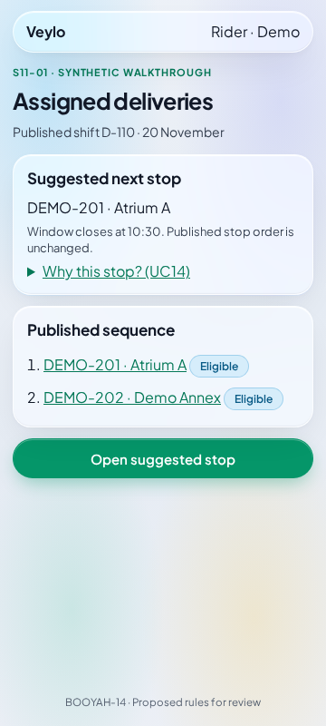

**S11-01-suggestion-only** · [Open prototype state](prototypes/delivery-execution-reporting/index.html?screen=S11-01-suggestion-only&standalone=1)

**S11-01-no-suggestion** · [Open prototype state](prototypes/delivery-execution-reporting/index.html?screen=S11-01-no-suggestion&standalone=1)

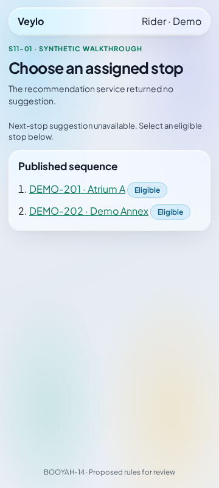

**S11-02-stop-details** · [Open prototype state](prototypes/delivery-execution-reporting/index.html?screen=S11-02-stop-details&standalone=1)

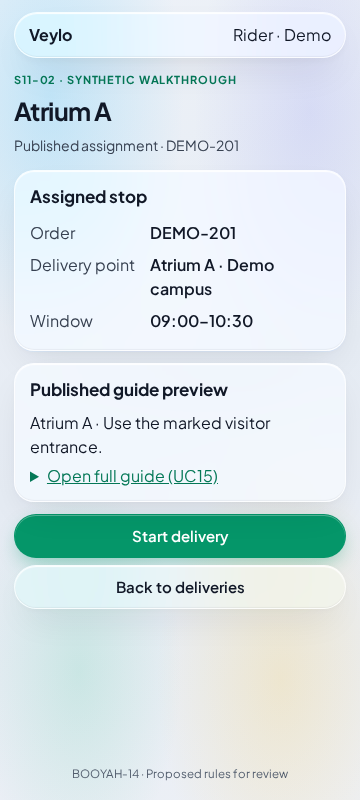

**S11-02-guide-only** · [Open prototype state](prototypes/delivery-execution-reporting/index.html?screen=S11-02-guide-only&standalone=1)

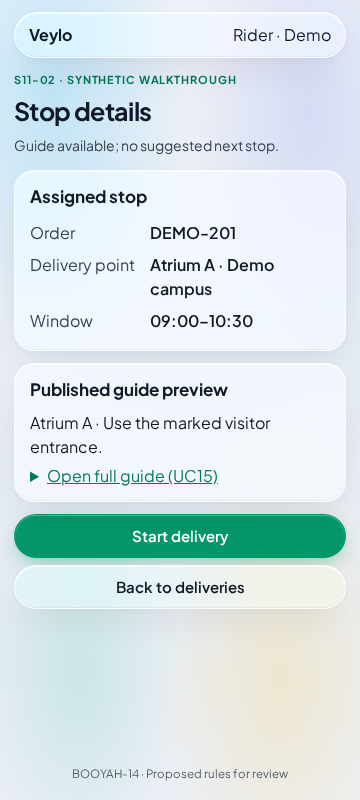

**S11-02-neither-context** · [Open prototype state](prototypes/delivery-execution-reporting/index.html?screen=S11-02-neither-context&standalone=1)

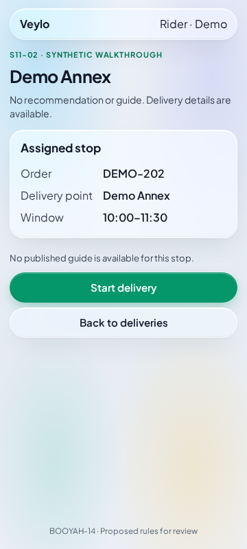

**S11-02-guide-unavailable** · [Open prototype state](prototypes/delivery-execution-reporting/index.html?screen=S11-02-guide-unavailable&standalone=1)

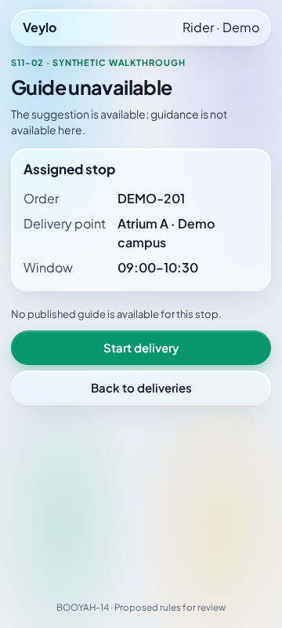

**S11-03-no-published-work** · [Open prototype state](prototypes/delivery-execution-reporting/index.html?screen=S11-03-no-published-work&standalone=1)

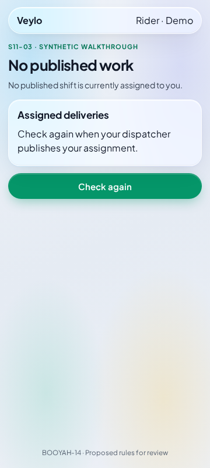

**S11-04-sign-in** · [Open prototype state](prototypes/delivery-execution-reporting/index.html?screen=S11-04-sign-in&standalone=1)

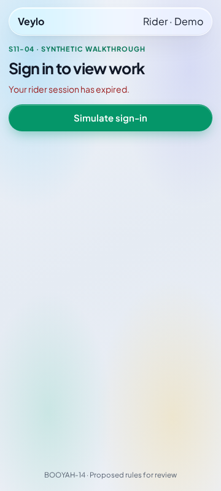

**S11-04-access-denied** · [Open prototype state](prototypes/delivery-execution-reporting/index.html?screen=S11-04-access-denied&standalone=1)

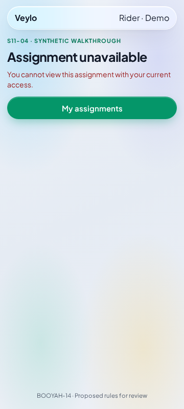

**S11-05-load-failed** · [Open prototype state](prototypes/delivery-execution-reporting/index.html?screen=S11-05-load-failed&standalone=1)

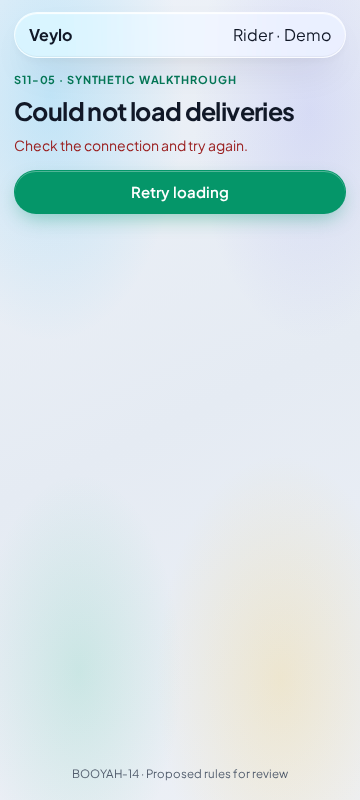

**S11-06-stop-unavailable** · [Open prototype state](prototypes/delivery-execution-reporting/index.html?screen=S11-06-stop-unavailable&standalone=1)

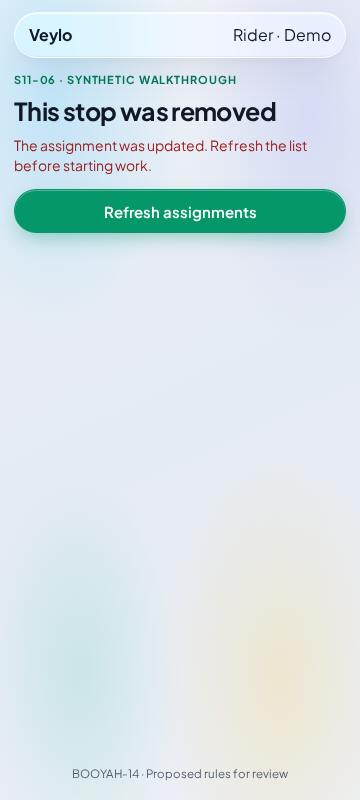

**S11-07-no-eligible-stops** · [Open prototype state](prototypes/delivery-execution-reporting/index.html?screen=S11-07-no-eligible-stops&standalone=1)

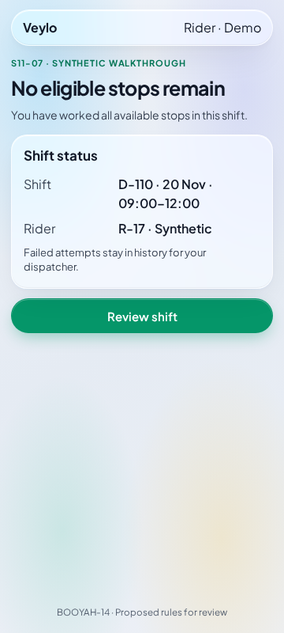

## UC12 — Record Delivery Attempt

**Performed by:** Codex (AI-assisted work for Trần Lê Hải). **Reviewed by:** Pending (Jira reviewer: Nguyễn Thành Trung). **Edited by:** Codex.

**Primary actor:** Rider. **Description:** Record one assigned delivery attempt and continue through the shift. **Trigger:** The rider selects an eligible stop from UC11. **Preconditions:** Valid rider session and current published assignment. Start must recheck eligibility. Under P01, an existing active attempt can be resumed but not duplicated.

**Basic flow**

| Step | FR / source | User action and system response | Screen evidence |
| --- | --- | --- | --- |
| 1 | FR-04-2, FR-04-5 | The rider confirms Start. Recheck the assignment and record a distinct attempt ID and Start timestamp. | [S12-01-start-attempt](#s12-01-start-attempt), [S12-02-started](#s12-02-started) |
| 2 | FR-04-2 | The rider confirms arrival. Record Arrived with its own timestamp and show the outcome choices. | [S12-03-arrived](#s12-03-arrived) |
| 3S | FR-04-3 | For success select a photo, inspect the preview and submit a successful outcome with accepted photo evidence. | [S12-04-photo-proof](#s12-04-photo-proof) |
| 3F | FR-04-4 | For failure choose a structured reason and enter the applicable comment, then submit the attempt outcome. | [S12-05-failure-form](#s12-05-failure-form) |
| 4 | FR-04-3/4/5, AC3 | Confirm the saved attempt outcome. A success marks the order delivered and bypasses failed-order resolution. A failure leaves it open for UC13 and preserves the attempt reason and comment. | [S12-06-success-saved](#s12-06-success-saved), [S12-06-failure-saved](#s12-06-failure-saved) |
| 5 | FR-04-1, AC3 | Continue to the next eligible assigned stop via UC11, and repeat until none remain. A failed stop does not auto-retry. | [S11-01-assigned-work](#s11-01-assigned-work), [S11-02-neither-context](#s11-02-neither-context), [S11-07-no-eligible-stops](#s11-07-no-eligible-stops) |

**Alternative flows**

| Branch | FR / source | From step | Trigger and response | Continue at | Screen evidence |
| --- | --- | --- | --- | --- | --- |
| A1 | FR-04-2, P04 | 1 | The stop was removed, transferred or cancelled before Start, or a competing change lost to an accepted Start. Reject the stale action or resume the existing attempt, respectively. | UC11 on refresh or resume at 2. | [S12-08-stale-assignment](#s12-08-stale-assignment), [S12-08-active-attempt-conflict](#s12-08-active-attempt-conflict) |
| A2 | FR-04-2/5, P01/P04 | 1 | A repeat Start or revisit finds an active attempt. Show the same ID and Start time. | 2. | [S12-02-resume-active](#s12-02-resume-active), [S12-10-duplicate-action](#s12-10-duplicate-action) |
| A3 | FR-04-2/4, P02 | 2 | Cannot confirm arrival due to incorrect or unlocatable address or unsafe access. Allow a reason and required comment; record no Arrived event. Other pre-arrival outcomes are blocked. | 3F, then 4; otherwise stay at 2. | [S12-02-pre-arrival-failure](#s12-02-pre-arrival-failure) |
| A4 | FR-04-3 | 3S | Photo absent or upload fails. Keep the attempt open and offer replacement or retry. | 3S. | [S12-04-photo-missing](#s12-04-photo-missing), [S12-09-upload-failed](#s12-09-upload-failed) |
| A5 | FR-04-3, P03 | 3S | Photo is oversized, unsupported or unreadable. Show the specific error before accepting outcome. | 3S after replacement. | [S12-09-photo-too-large](#s12-09-photo-too-large), [S12-09-photo-unsupported](#s12-09-photo-unsupported), [S12-09-photo-unreadable](#s12-09-photo-unreadable) |
| A6 | FR-04-4, P02 | 3F | Reason missing or required comment missing. Show the associated field error; preserve other entered data. | 3F. | [S12-05-reason-required](#s12-05-reason-required), [S12-05-comment-required](#s12-05-comment-required) |
| A7 | FR-04-5, P01/P02 | 2, 3S or 3F | Dismiss an outcome form to keep the attempt active, or explicitly confirm abort to preserve an Aborted record and re-enable a still-assigned stop. Dismissing abort confirmation keeps the attempt active. | 2 or UC11. | [S12-05-form-dismissed](#s12-05-form-dismissed), [S12-07-abort-confirmation](#s12-07-abort-confirmation), [S12-07-attempt-aborted](#s12-07-attempt-aborted), [S11-01-assigned-work](#s11-01-assigned-work) |
| A8 | FR-04-1, AC3 | 4 | The result is saved but there are no remaining eligible stops. | 5 then end. | [S11-07-no-eligible-stops](#s11-07-no-eligible-stops) |
| A9 | FR-04-2/5, P04 | 1, 2 or 4 | A duplicate action returns the same recorded start, arrival or outcome. No duplicate attempt or event is created. | Resume the corresponding step from the returned state. | [S12-10-duplicate-action](#s12-10-duplicate-action), [S12-02-resume-active](#s12-02-resume-active), [S12-03-arrived](#s12-03-arrived) |
| A10 | FR-04-2/5, P04 | 1, 2 or 4 | Before send, report unsent and allow retry. After send without acknowledgement, report unknown and recover the saved state before trying again. | Matching step after refresh/retry. | [S12-10-action-unsent](#s12-10-action-unsent), [S12-10-result-unknown](#s12-10-result-unknown), [S12-10-result-recovered](#s12-10-result-recovered) |
| A11 | FR-04-2/5 | 1–4 | Session expired or assignment access revoked. Hide work details and require sign-in or a return to authorized assignments. | End or return to UC11. | [S12-11-sign-in](#s12-11-sign-in), [S12-11-access-denied](#s12-11-access-denied) |

**Postconditions:** One confirmed attempt retains the accepted outcome and timestamps. Failed and Aborted remain separate from Order closure. Validation, cancellation of a form and uncertain acknowledgements do not imply success. **Special requirements:** Synthetic photo proof only. P01–P04 are draft review choices, including 5 MB JPEG/PNG, structured reasons, abort and result recovery.

**Prototype evidence.** State links open the interactive preview at the corresponding frame. Captures, when available, appear alongside this use case.

**S12-01-start-attempt** · [Open prototype state](prototypes/delivery-execution-reporting/index.html?screen=S12-01-start-attempt&standalone=1)

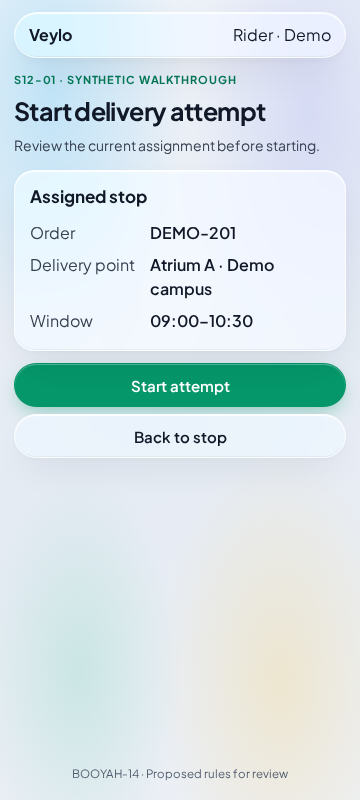

**S12-02-started** · [Open prototype state](prototypes/delivery-execution-reporting/index.html?screen=S12-02-started&standalone=1)

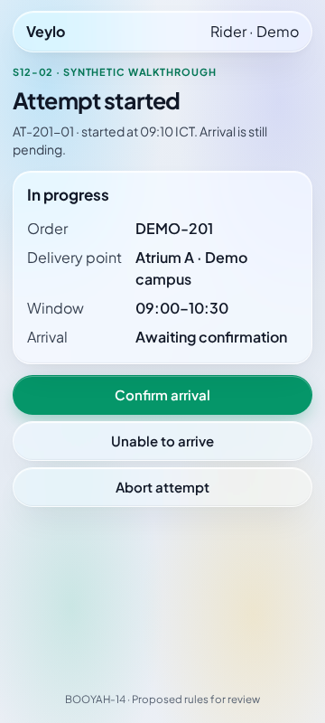

**S12-02-resume-active** · [Open prototype state](prototypes/delivery-execution-reporting/index.html?screen=S12-02-resume-active&standalone=1)

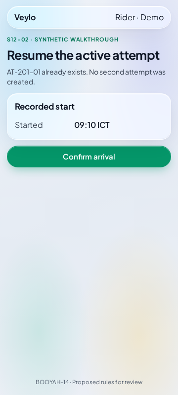

**S12-02-pre-arrival-failure** · [Open prototype state](prototypes/delivery-execution-reporting/index.html?screen=S12-02-pre-arrival-failure&standalone=1)

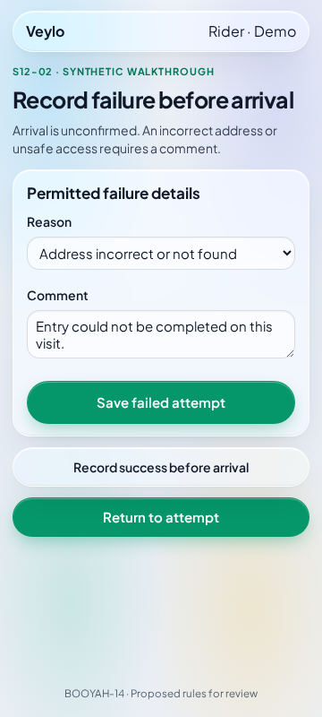

**S12-03-arrived** · [Open prototype state](prototypes/delivery-execution-reporting/index.html?screen=S12-03-arrived&standalone=1)

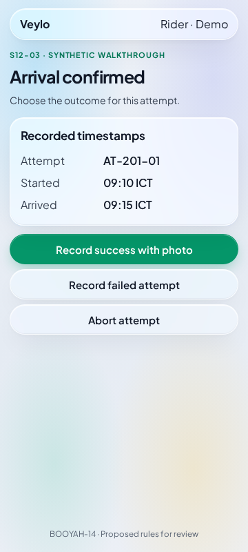

**S12-04-photo-proof** · [Open prototype state](prototypes/delivery-execution-reporting/index.html?screen=S12-04-photo-proof&standalone=1)

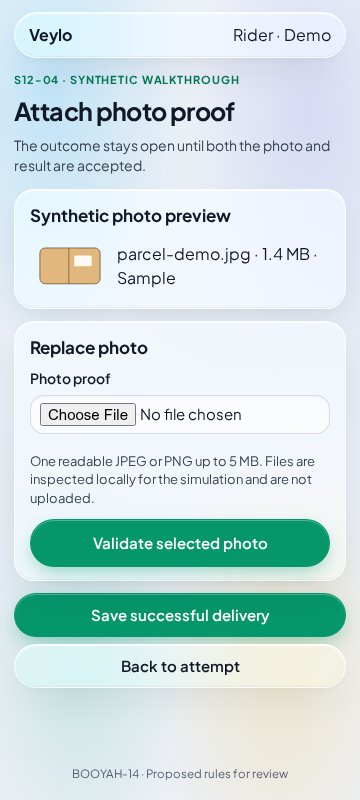

**S12-04-photo-missing** · [Open prototype state](prototypes/delivery-execution-reporting/index.html?screen=S12-04-photo-missing&standalone=1)

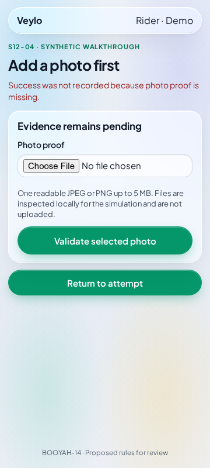

**S12-05-failure-form** · [Open prototype state](prototypes/delivery-execution-reporting/index.html?screen=S12-05-failure-form&standalone=1)

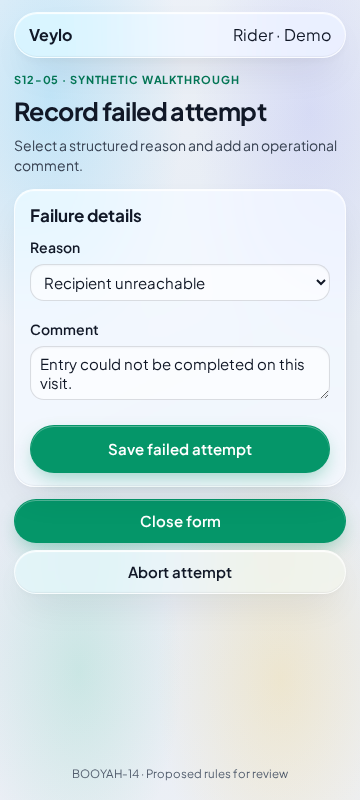

**S12-05-reason-required** · [Open prototype state](prototypes/delivery-execution-reporting/index.html?screen=S12-05-reason-required&standalone=1)

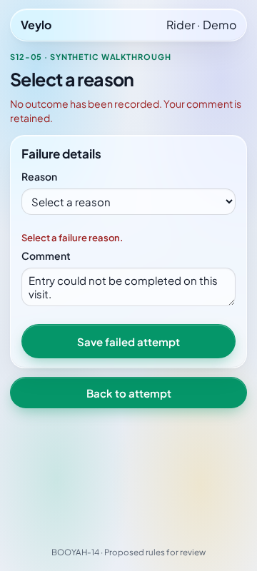

**S12-05-comment-required** · [Open prototype state](prototypes/delivery-execution-reporting/index.html?screen=S12-05-comment-required&standalone=1)

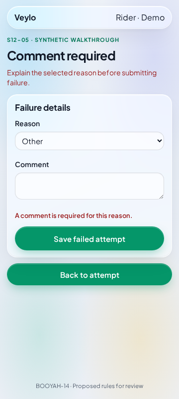

**S12-05-form-dismissed** · [Open prototype state](prototypes/delivery-execution-reporting/index.html?screen=S12-05-form-dismissed&standalone=1)

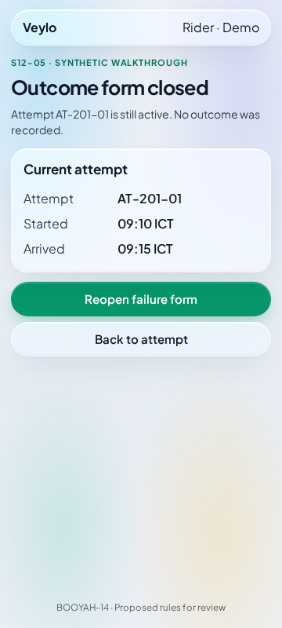

**S12-06-success-saved** · [Open prototype state](prototypes/delivery-execution-reporting/index.html?screen=S12-06-success-saved&standalone=1)

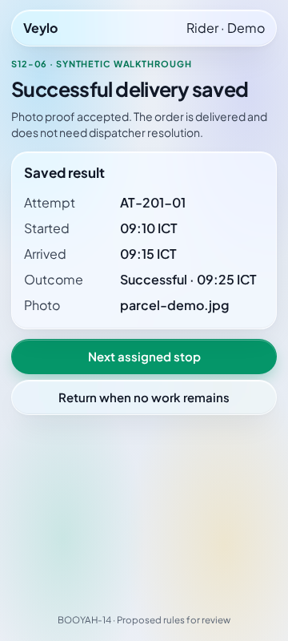

**S12-06-failure-saved** · [Open prototype state](prototypes/delivery-execution-reporting/index.html?screen=S12-06-failure-saved&standalone=1)

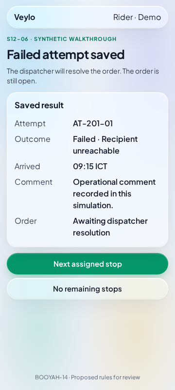

**S12-07-abort-confirmation** · [Open prototype state](prototypes/delivery-execution-reporting/index.html?screen=S12-07-abort-confirmation&standalone=1)

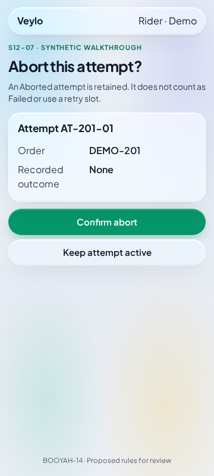

**S12-07-attempt-aborted** · [Open prototype state](prototypes/delivery-execution-reporting/index.html?screen=S12-07-attempt-aborted&standalone=1)

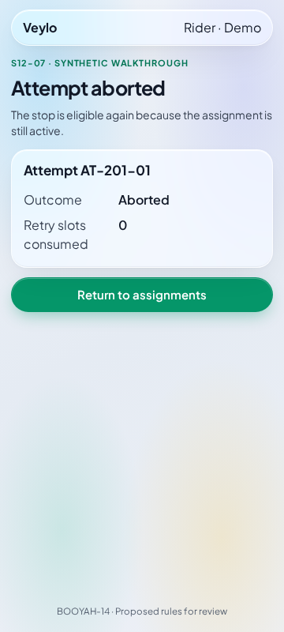

**S12-08-stale-assignment** · [Open prototype state](prototypes/delivery-execution-reporting/index.html?screen=S12-08-stale-assignment&standalone=1)

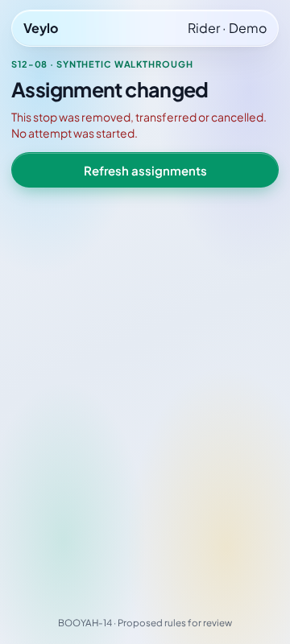

**S12-08-active-attempt-conflict** · [Open prototype state](prototypes/delivery-execution-reporting/index.html?screen=S12-08-active-attempt-conflict&standalone=1)

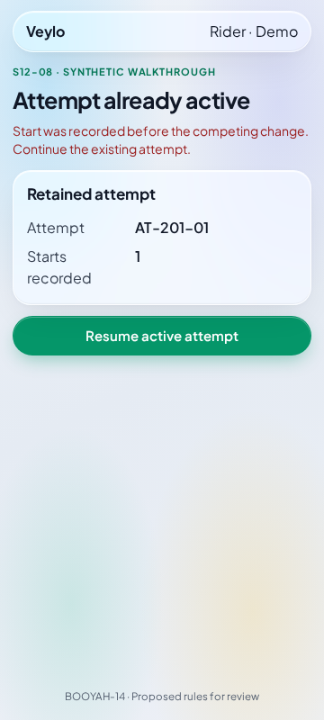

**S12-09-photo-too-large** · [Open prototype state](prototypes/delivery-execution-reporting/index.html?screen=S12-09-photo-too-large&standalone=1)

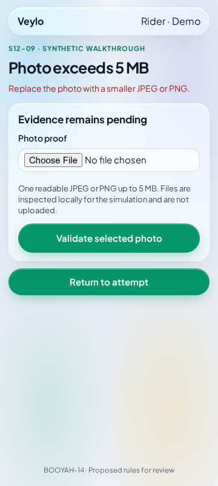

**S12-09-photo-unsupported** · [Open prototype state](prototypes/delivery-execution-reporting/index.html?screen=S12-09-photo-unsupported&standalone=1)

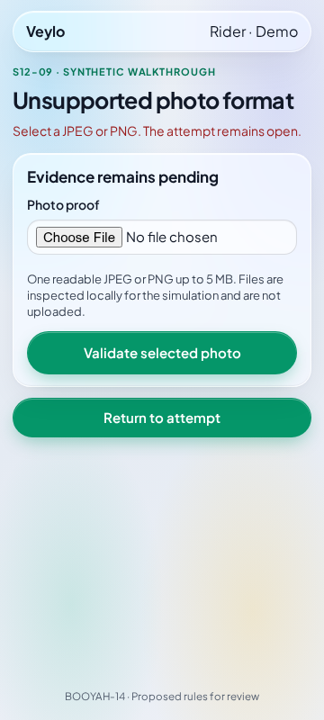

**S12-09-photo-unreadable** · [Open prototype state](prototypes/delivery-execution-reporting/index.html?screen=S12-09-photo-unreadable&standalone=1)

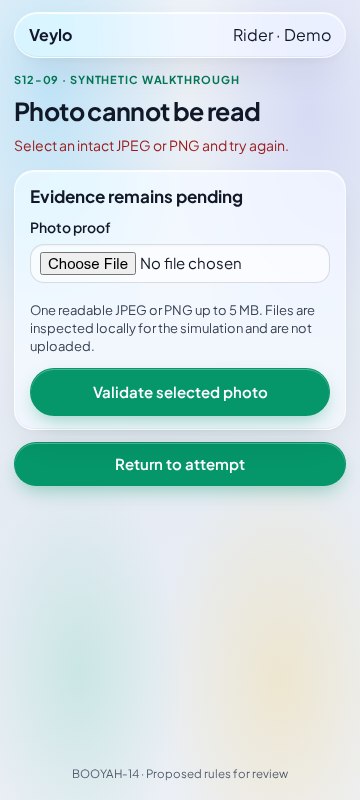

**S12-09-upload-failed** · [Open prototype state](prototypes/delivery-execution-reporting/index.html?screen=S12-09-upload-failed&standalone=1)

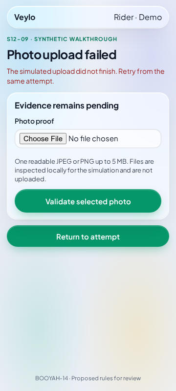

**S12-10-duplicate-action** · [Open prototype state](prototypes/delivery-execution-reporting/index.html?screen=S12-10-duplicate-action&standalone=1)

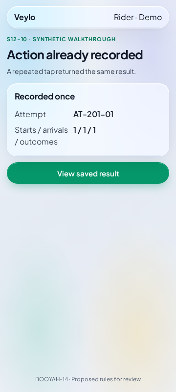

**S12-10-action-unsent** · [Open prototype state](prototypes/delivery-execution-reporting/index.html?screen=S12-10-action-unsent&standalone=1)

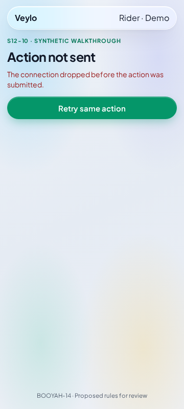

**S12-10-result-unknown** · [Open prototype state](prototypes/delivery-execution-reporting/index.html?screen=S12-10-result-unknown&standalone=1)

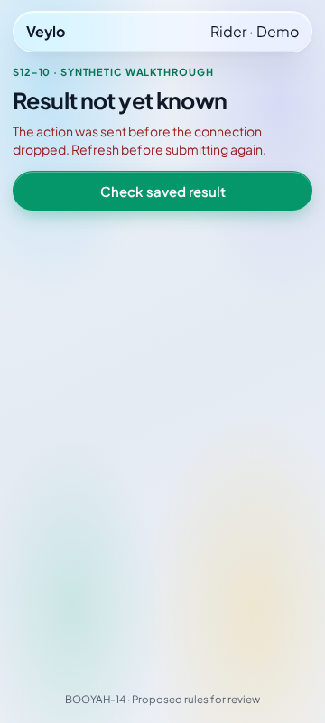

**S12-10-result-recovered** · [Open prototype state](prototypes/delivery-execution-reporting/index.html?screen=S12-10-result-recovered&standalone=1)

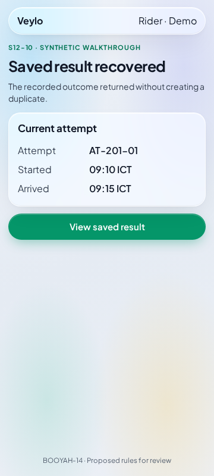

**S12-11-sign-in** · [Open prototype state](prototypes/delivery-execution-reporting/index.html?screen=S12-11-sign-in&standalone=1)

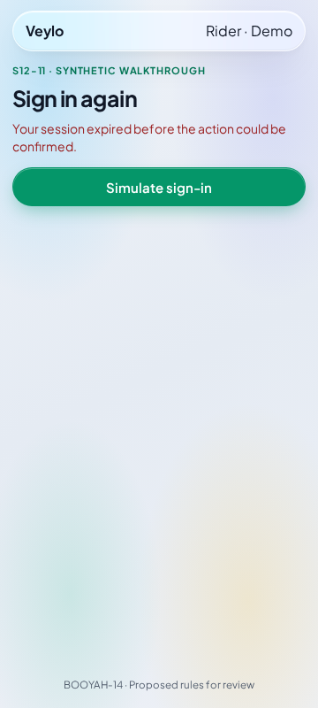

**S12-11-access-denied** · [Open prototype state](prototypes/delivery-execution-reporting/index.html?screen=S12-11-access-denied&standalone=1)

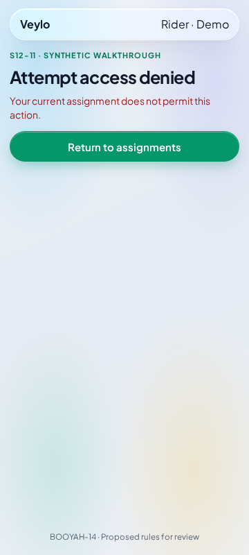

## UC13 — Monitor Attempts and Resolve Failed Orders

**Performed by:** Codex (AI-assisted work for Trần Lê Hải). **Reviewed by:** Pending (Jira reviewer: Nguyễn Thành Trung). **Edited by:** Codex.

**Primary actor:** Hub Dispatcher. **Description:** Inspect a shift and decide what to do with an unresolved failed order. **Trigger:** Dispatcher opens shift monitoring or an unresolved-failure row. **Preconditions:** Valid dispatcher session and authorized hub. Resolution requires an unresolved failure; P01 and F03 lock actions while an attempt is active.

**Basic flow**

| Step | FR / source | User action and system response | Screen evidence |
| --- | --- | --- | --- |
| 1 | FR-08-1, FR-04-6 | Open permitted shift monitoring and display progress, latest attempt and separate order outcome. | [S13-01-monitoring](#s13-01-monitoring), [S13-01-monitoring-min](#s13-01-monitoring-min) |
| 2 | FR-04-5/6, AC3 | Open an Order with a failed attempt and inspect the chronological attempt history. Delivered orders are visible in monitoring without a resolution action. | [S13-01-monitoring](#s13-01-monitoring), [S13-02-failed-order-history](#s13-02-failed-order-history) |
| 3R | FR-04-6, P05 | Choose re-dispatch; present destination shift, rider and F03 eligibility. Inspect and confirm the proposed handoff. | [S13-03-redispatch-confirmation](#s13-03-redispatch-confirmation) |
| 3T | FR-04-6, P05 | Choose terminal closure, enter a reason and explicitly confirm the decision. | [S13-05-terminal-confirmation](#s13-05-terminal-confirmation) |
| 4R | FR-04-5/6 | Revalidate and record one re-dispatch decision for the same Order. Keep prior attempts. F03 handles the new assignment and publication. The new rider's UC12 Start creates the next attempt. | [S13-04-redispatch-confirmed](#s13-04-redispatch-confirmed) |
| 4T | FR-04-5/6, AC3 | Revalidate and record one terminal decision and reason. Close the order while keeping every attempt. | [S13-04-terminal-confirmed](#s13-04-terminal-confirmed) |

**Alternative flows**

| Branch | FR / source | From step | Trigger and response | Continue at | Screen evidence |
| --- | --- | --- | --- | --- | --- |
| A1 | FR-04-6, FR-08-1 | 1 or 2 | Empty shift or no unresolved failures. Explain which list is empty. Delivered orders do not need resolution. | 1 when selecting another shift, or end. | [S13-06-empty-shift](#s13-06-empty-shift), [S13-06-empty-failure-queue](#s13-06-empty-failure-queue) |
| A2 | FR-08-1 | 1 | Monitoring fails to load. Show retry without recording an action. | 1. | [S13-07-load-failed](#s13-07-load-failed) |
| A3 | FR-04-6 | 1–4 | Expired session or out-of-scope hub/role. Show sign-in or access denied and withhold attempt details. | End or 1 after sign-in. | [S13-08-sign-in](#s13-08-sign-in), [S13-08-access-denied](#s13-08-access-denied) |
| A4 | FR-04-5/6, P01/P05 | 2 or 3R | Already resolved, active attempt or three distinct Failed attempts. Show recorded decision or lock. At the retry limit, leave the order open and make 3T available. | 1, 2 or 3T as applicable. | [S13-02-already-resolved](#s13-02-already-resolved), [S13-09-active-attempt-lock](#s13-09-active-attempt-lock), [S13-09-retry-limit](#s13-09-retry-limit) |
| A5 | FR-04-6, P05 | 3R or 3T | No F03-eligible rider/shift, or closure reason is missing. Show the constraint and retain current decision options. | 2 or correct 3T. | [S13-09-no-eligible-destination](#s13-09-no-eligible-destination), [S13-05-terminal-reason-required](#s13-05-terminal-reason-required) |
| A6 | FR-04-6 | 3R or 3T | Dismiss confirmation. No decision, assignment or history changes. | 2. | [S13-09-confirmation-dismissed](#s13-09-confirmation-dismissed) |
| A7 | FR-04-6, P04 | 4R or 4T | Another dispatcher resolved the failure or the rider started an active attempt before save. Reject the stale action and show the current decision or active lock. | 1 or 2. | [S13-10-concurrent-decision](#s13-10-concurrent-decision), [S13-09-active-attempt-lock](#s13-09-active-attempt-lock) |
| A8 | FR-04-5/6, P04 | 4R or 4T | An acknowledgement was lost. Refresh the current decision and recover an already saved result without duplicating it. | Matching 4R/4T result or 2 for another review. | [S13-10-result-unknown](#s13-10-result-unknown), [S13-10-result-recovered](#s13-10-result-recovered) |

**Postconditions:** A confirmed action updates the order decision while retaining attempt history. If re-dispatched, the next assignment must satisfy F03. A blocked/dismissed action does not close or reassign the order. **Special requirements:** 1440×900 dispatcher baseline with 1280×720 comparison. Keep F02 terminal vocabulary and F03 readmission for PR review.

**Prototype evidence.** State links open the interactive preview at the corresponding frame. Captures, when available, appear alongside this use case.

**S13-01-monitoring** · [Open prototype state](prototypes/delivery-execution-reporting/index.html?screen=S13-01-monitoring&standalone=1)

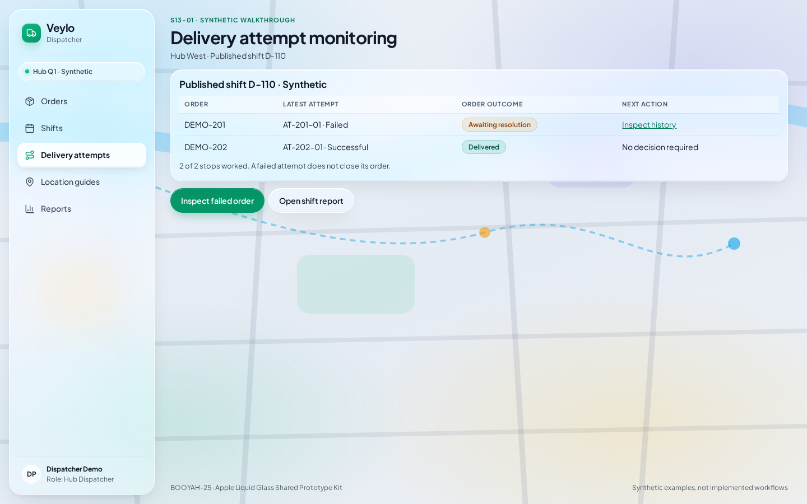

**S13-01-monitoring-min** · [Open prototype state](prototypes/delivery-execution-reporting/index.html?screen=S13-01-monitoring-min&standalone=1)

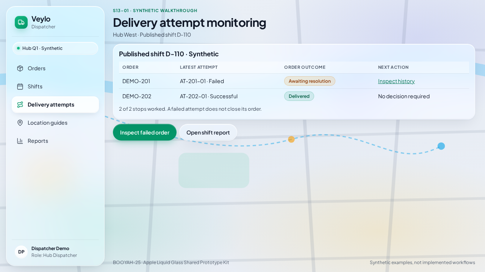

**S13-02-failed-order-history** · [Open prototype state](prototypes/delivery-execution-reporting/index.html?screen=S13-02-failed-order-history&standalone=1)

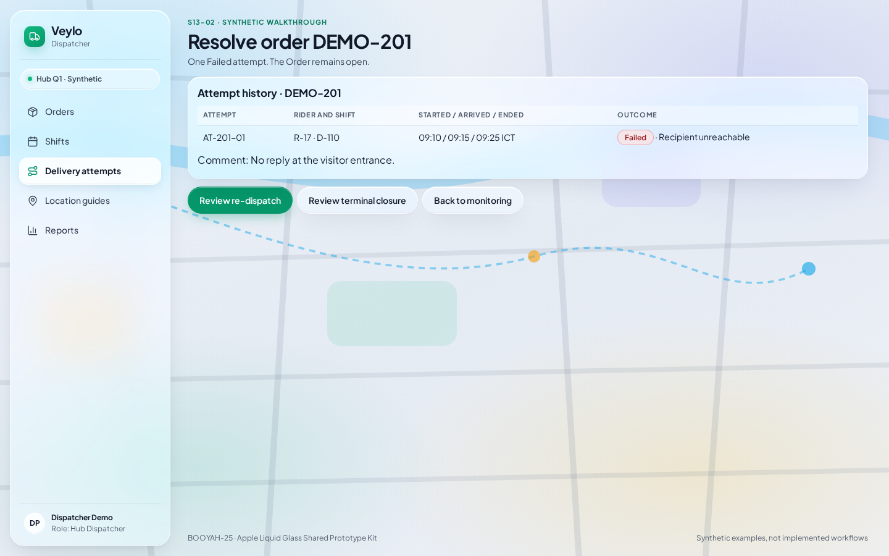

**S13-02-already-resolved** · [Open prototype state](prototypes/delivery-execution-reporting/index.html?screen=S13-02-already-resolved&standalone=1)

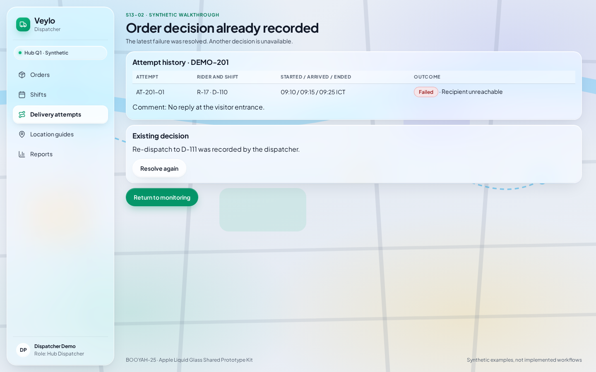

**S13-03-redispatch-confirmation** · [Open prototype state](prototypes/delivery-execution-reporting/index.html?screen=S13-03-redispatch-confirmation&standalone=1)

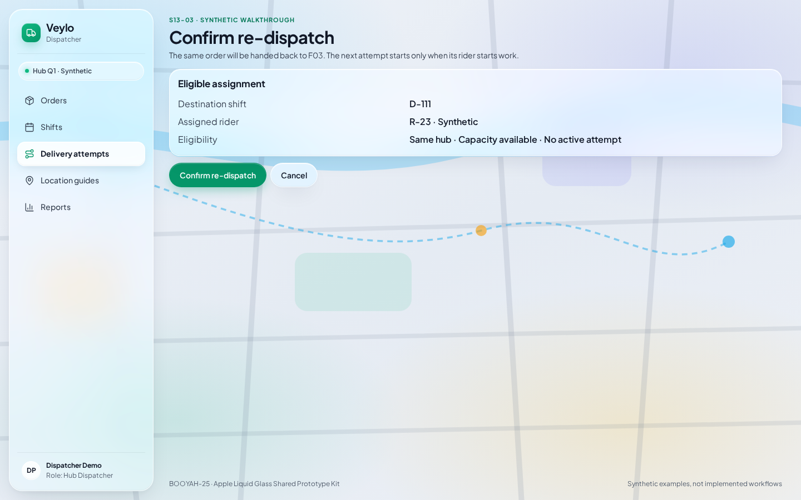

**S13-04-redispatch-confirmed** · [Open prototype state](prototypes/delivery-execution-reporting/index.html?screen=S13-04-redispatch-confirmed&standalone=1)

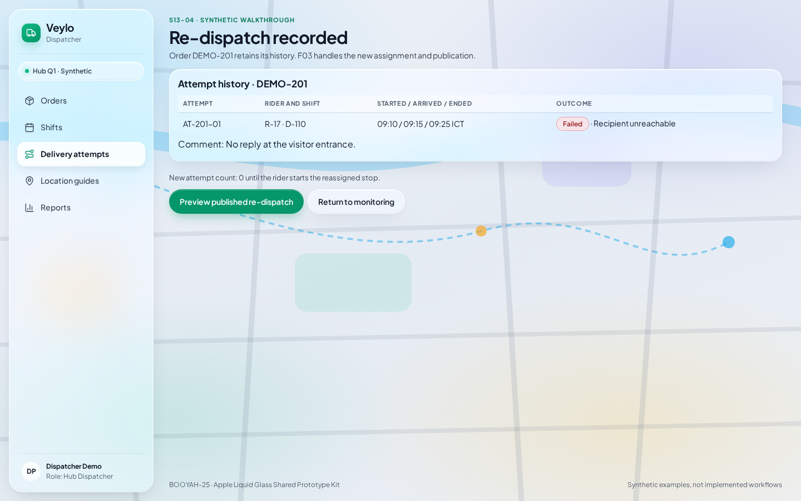

**S13-04-terminal-confirmed** · [Open prototype state](prototypes/delivery-execution-reporting/index.html?screen=S13-04-terminal-confirmed&standalone=1)

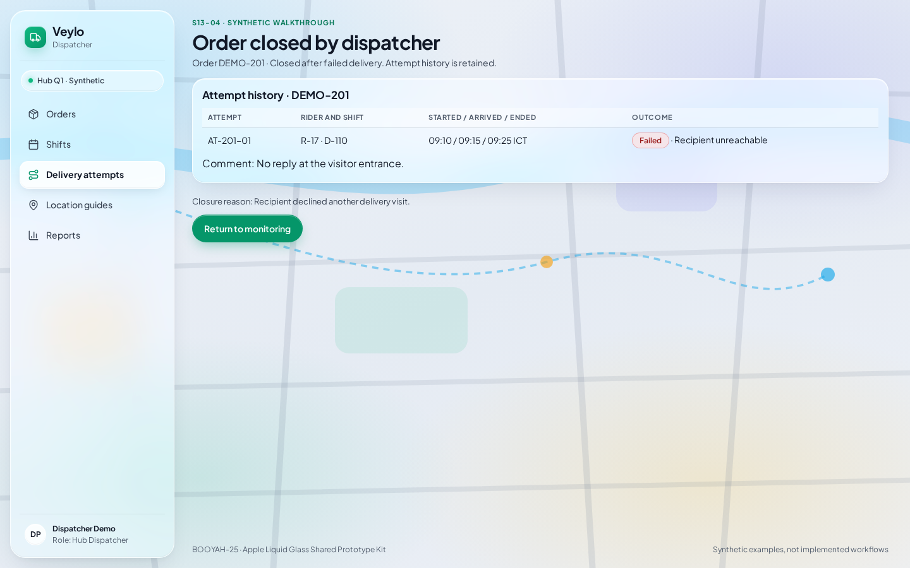

**S13-05-terminal-confirmation** · [Open prototype state](prototypes/delivery-execution-reporting/index.html?screen=S13-05-terminal-confirmation&standalone=1)

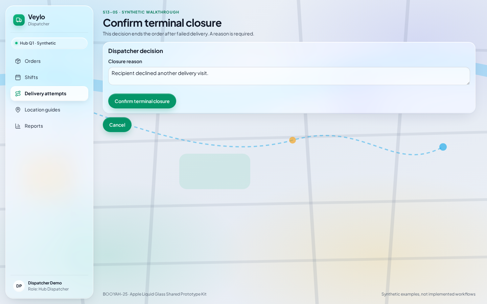

**S13-05-terminal-reason-required** · [Open prototype state](prototypes/delivery-execution-reporting/index.html?screen=S13-05-terminal-reason-required&standalone=1)

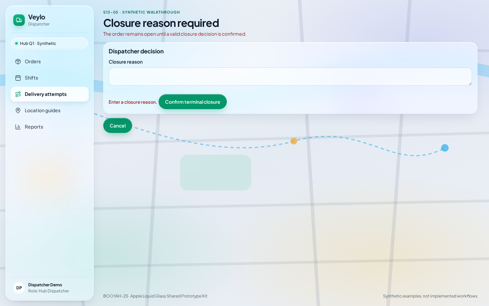

**S13-06-empty-shift** · [Open prototype state](prototypes/delivery-execution-reporting/index.html?screen=S13-06-empty-shift&standalone=1)

**S13-06-empty-failure-queue** · [Open prototype state](prototypes/delivery-execution-reporting/index.html?screen=S13-06-empty-failure-queue&standalone=1)

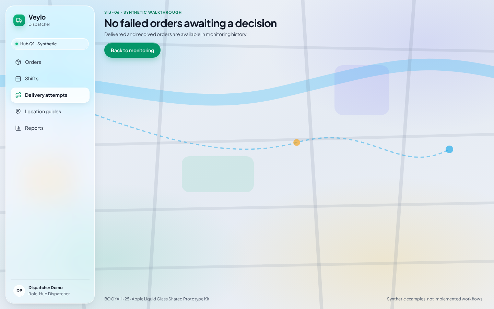

**S13-07-load-failed** · [Open prototype state](prototypes/delivery-execution-reporting/index.html?screen=S13-07-load-failed&standalone=1)

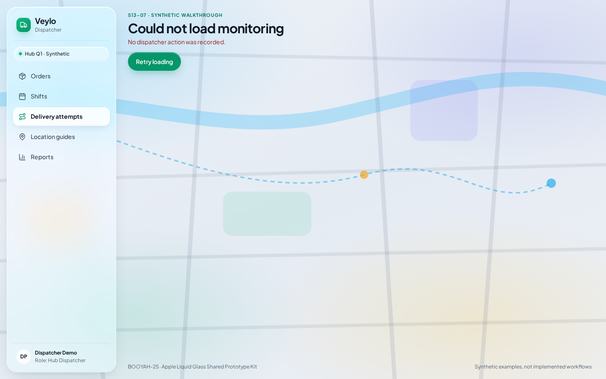

**S13-08-sign-in** · [Open prototype state](prototypes/delivery-execution-reporting/index.html?screen=S13-08-sign-in&standalone=1)

**S13-08-access-denied** · [Open prototype state](prototypes/delivery-execution-reporting/index.html?screen=S13-08-access-denied&standalone=1)

**S13-09-active-attempt-lock** · [Open prototype state](prototypes/delivery-execution-reporting/index.html?screen=S13-09-active-attempt-lock&standalone=1)

**S13-09-no-eligible-destination** · [Open prototype state](prototypes/delivery-execution-reporting/index.html?screen=S13-09-no-eligible-destination&standalone=1)

**S13-09-retry-limit** · [Open prototype state](prototypes/delivery-execution-reporting/index.html?screen=S13-09-retry-limit&standalone=1)

**S13-09-confirmation-dismissed** · [Open prototype state](prototypes/delivery-execution-reporting/index.html?screen=S13-09-confirmation-dismissed&standalone=1)

**S13-10-concurrent-decision** · [Open prototype state](prototypes/delivery-execution-reporting/index.html?screen=S13-10-concurrent-decision&standalone=1)

**S13-10-result-unknown** · [Open prototype state](prototypes/delivery-execution-reporting/index.html?screen=S13-10-result-unknown&standalone=1)

**S13-10-result-recovered** · [Open prototype state](prototypes/delivery-execution-reporting/index.html?screen=S13-10-result-recovered&standalone=1)

## UC19 — View Shift and Rider Reports

**Performed by:** Codex (AI-assisted work for Trần Lê Hải). **Reviewed by:** Pending (Jira reviewer: Nguyễn Thành Trung). **Edited by:** Codex.

**Primary actor:** Hub Dispatcher. **Description:** Review recorded performance and progress with separate Order and DeliveryAttempt calculations. **Trigger:** Dispatcher opens Reports or follows the link from monitoring. **Preconditions:** Valid dispatcher session and authorized reporting hub. Results depend on the availability and completeness of recorded events.

**Basic flow**

| Step | FR / source | User action and system response | Screen evidence |
| --- | --- | --- | --- |
| 1 | FR-08-1 | Select an inclusive hub-local date range and optional permitted shift/rider. Validate the filters and display the selected scope. | [S19-01-report-filters](#s19-01-report-filters) |
| 2 | FR-04-5, FR-08-1/2 | Review shift/rider progress, order success and closure, and attempt counts and rate. Keep the order and attempt cohorts distinct. Reapply filters to refresh results. | [S19-02-report-results](#s19-02-report-results), [S19-02-report-results-min](#s19-02-report-results-min), [S19-08-cross-shift-retry](#s19-08-cross-shift-retry) |
| 3 | FR-08-3, AC4 | Review average duration, frequent failure reasons and metric definitions, including units and inclusion/exclusion. | [S19-08-metric-definitions](#s19-08-metric-definitions), [S19-02-report-results](#s19-02-report-results) |

**Alternative flows**

| Branch | FR / source | From step | Trigger and response | Continue at | Screen evidence |
| --- | --- | --- | --- | --- | --- |
| A1 | FR-08-1 | 1 | Missing date or invalid/inverted range. Show validation and preserve editable filter inputs. | 1. | [S19-03-invalid-range](#s19-03-invalid-range) |
| A2 | FR-08-1 | 1 or 2 | Session expired or scope not permitted. Show sign-in or denied with no unauthorized results. | End or 1 after recovery. | [S19-04-sign-in](#s19-04-sign-in), [S19-04-access-denied](#s19-04-access-denied) |
| A3 | FR-08-1/2 | 2 | No matching data. Show an explicit empty result and dashes for undefined rates. | 1 or end. | [S19-05-no-data](#s19-05-no-data) |
| A4 | FR-08-2, P06 | 2 | Only incomplete/Aborted attempts. Show separate counts and exclude them from attempt success rate. | 2 or 1. | [S19-06-incomplete-attempts](#s19-06-incomplete-attempts) |
| A5 | FR-08-1 | 2 | Report fails to load. Preserve scope and offer retry. | 2 on retry. | [S19-07-load-failed](#s19-07-load-failed) |
| A6 | FR-08-3, P06 | 3 | A duration is missing or reversed. Exclude it from the average. Keep a valid in-window outcome in rates and flag unattributable outcomes separately. | 3. | [S19-06-invalid-timestamps](#s19-06-invalid-timestamps) |
| A7 | FR-08-2/3, P06 | 2 or 3 | Zero denominator or no duration sample. Display a dash with an explanation. | 2 or 3. | [S19-08-zero-denominator](#s19-08-zero-denominator) |
| A8 | FR-08-3, P06 | 3 | No failures or no coded reasons. Explain the empty ranking and count missing reasons separately. | 3. | [S19-08-no-failures](#s19-08-no-failures), [S19-08-missing-reasons](#s19-08-missing-reasons) |
| A9 | FR-08-3, P06 | 3 | Known reasons tie. Keep both with the same numeric count. | 3. | [S19-08-tied-reasons](#s19-08-tied-reasons) |

**Postconditions:** Report results update for the validated scope. Shift, assignment, Order and attempt records are unchanged. **Special requirements:** Display date/time zone and metric definitions without hover; make missing data distinguishable from measured zero. P06 is Proposed / Pending PR Review.

**P06 metric definitions.** Range starts at local midnight on the first day and excludes midnight after the last day. Order attribution uses first valid Start and outcome at cutoff. Attempt attribution uses valid outcome time and actual executing shift/rider.

| Metric | Formula and included events | Unit and exclusions |
| --- | --- | --- |
| Shift progress | Distinct assigned stops with a Successful or Failed attempt in the shift by cutoff ÷ assigned stops by cutoff, for shifts overlapping the range. | Stops and %. Exclude stops withdrawn before Start. Count Failed as worked; a later shift does not add to earlier shift's stops. |
| Order success | Delivered by cutoff ÷ distinct orders with first valid Start in range and scoped shift/rider. | Orders and %. Include open orders. An order delivered in another shift by cutoff still counts in its first-start cohort. |
| Order closure | (Delivered + terminal failure at cutoff) ÷ the same cohort. | Orders and %. Open orders remain in the denominator. |
| Attempt success | Successful ÷ (Successful + Failed) for outcomes in the selected window and executing scope. | Attempts and %. Deduplicate by attempt ID, display Active and Aborted separately, and exclude both from the rate. |
| Average duration | Sum of nonnegative (outcome time minus Start time) ÷ valid final attempt durations. | Minutes per attempt. Exclude incomplete, missing or reversed intervals. Missing outcome time cannot be assigned to the window. |
| Failure causes | Count distinct in-scope Failed attempts by coded reason and sort by count, retaining ties. | Attempts. Report uncoded reasons separately. |

**Prototype evidence.** State links open the interactive preview at the corresponding frame. Captures, when available, appear alongside this use case.

**S19-01-report-filters** · [Open prototype state](prototypes/delivery-execution-reporting/index.html?screen=S19-01-report-filters&standalone=1)

**S19-02-report-results** · [Open prototype state](prototypes/delivery-execution-reporting/index.html?screen=S19-02-report-results&standalone=1)

**S19-02-report-results-min** · [Open prototype state](prototypes/delivery-execution-reporting/index.html?screen=S19-02-report-results-min&standalone=1)

**S19-03-invalid-range** · [Open prototype state](prototypes/delivery-execution-reporting/index.html?screen=S19-03-invalid-range&standalone=1)

**S19-04-sign-in** · [Open prototype state](prototypes/delivery-execution-reporting/index.html?screen=S19-04-sign-in&standalone=1)

**S19-04-access-denied** · [Open prototype state](prototypes/delivery-execution-reporting/index.html?screen=S19-04-access-denied&standalone=1)

**S19-05-no-data** · [Open prototype state](prototypes/delivery-execution-reporting/index.html?screen=S19-05-no-data&standalone=1)

**S19-06-incomplete-attempts** · [Open prototype state](prototypes/delivery-execution-reporting/index.html?screen=S19-06-incomplete-attempts&standalone=1)

**S19-06-invalid-timestamps** · [Open prototype state](prototypes/delivery-execution-reporting/index.html?screen=S19-06-invalid-timestamps&standalone=1)

**S19-07-load-failed** · [Open prototype state](prototypes/delivery-execution-reporting/index.html?screen=S19-07-load-failed&standalone=1)

**S19-08-metric-definitions** · [Open prototype state](prototypes/delivery-execution-reporting/index.html?screen=S19-08-metric-definitions&standalone=1)

**S19-08-cross-shift-retry** · [Open prototype state](prototypes/delivery-execution-reporting/index.html?screen=S19-08-cross-shift-retry&standalone=1)

**S19-08-zero-denominator** · [Open prototype state](prototypes/delivery-execution-reporting/index.html?screen=S19-08-zero-denominator&standalone=1)

**S19-08-no-failures** · [Open prototype state](prototypes/delivery-execution-reporting/index.html?screen=S19-08-no-failures&standalone=1)

**S19-08-missing-reasons** · [Open prototype state](prototypes/delivery-execution-reporting/index.html?screen=S19-08-missing-reasons&standalone=1)

**S19-08-tied-reasons** · [Open prototype state](prototypes/delivery-execution-reporting/index.html?screen=S19-08-tied-reasons&standalone=1)

## Decision Log

**Performed by:** Codex (AI-assisted work for Trần Lê Hải). **Reviewed by:** Pending (Jira reviewer: Nguyễn Thành Trung). **Edited by:** Codex.

Each entry is **Proposed / Pending PR Review**. Confirmer, confirmation date and review evidence are pending. Scenario results demonstrate the draft rules; they do not indicate approval.

| ID | Draft decision and rationale | Synthetic example | Affected flows / screens |
| --- | --- | --- | --- |
| P01 | One active attempt per order. Record Started and Arrived separately. Successful, Failed and Aborted describe attempts. Keep the order open on failure. This preserves history and prevents premature closure. | AT-201-01 is resumed rather than duplicated; a Failed attempt leaves DEMO-201 awaiting dispatcher action. | UC12 1–5, A2/A7; UC13 2, A4. S12-02, S12-06, S12-07, S13-02/09. |
| P02 | Use unreachable, refused, wrong/unlocatable address, unsafe access and Other. Require comment for Other and pre-arrival failure. Permit pre-arrival failure only for address or unsafe access. Preserve active state after form dismissal; explicit abort retains history. | Unsafe access can be saved with a comment and no Arrived event. Exit alone keeps Started/Arrived. | UC12 3F, A3/A6/A7. S12-02, S12-05/07. |
| P03 | One readable JPEG or PNG up to 5 MB. Preview, replace and retry. Require accepted photo and outcome before success confirmation. | A 1.4 MB synthetic photo is accepted; an oversized file leaves the attempt open. | UC12 3S, A4/A5. S12-04/09. |
| P04 | Recover lost acknowledgement distinctly from unsent work. Retries converge on one result; revalidate against assignment and concurrent decisions. | If Start was accepted before removal, return an active-attempt lock. If removal happened first, reject the stale Start. | UC12 A1/A2/A9/A10 and UC13 A7/A8. S12-08/10, S13-09/10. |
| P05 | At most three distinct Failed attempts, excluding Aborted, active and duplicates. A dispatcher may close earlier with reason; at the limit explicit closure is still needed. Keep order identity across re-dispatch. | Three failures disable Re-dispatch while keeping the Order open pending the terminal confirmation. | UC13 3R/3T, A4/A5. S13-03/05/09. |
| P06 | Scope order cohorts by first valid Start; scope final attempts by executing rider and outcome time. Use a half-open hub-local window and explicit data quality rules. | One delivery across two Order IDs and three final attempts yields 50% order success and 33.3% attempt success. | UC19 1–3 and A3–A9. S19-01/02/05/06/08. |

**Cross-owner decisions:** Reconcile whether F02 can edit or cancel a NEW order after attempt activity, exact future terminal labels, and how F03 admits re-dispatched orders and releases the prior assignment. These questions stay open during this review. After confirmation, update this log, glossary terminology, affected flows, examples and screenshots together.

## Verification and handoff

**Performed by:** Codex (AI-assisted work for Trần Lê Hải). **Reviewed by:** Pending (Jira reviewer: Nguyễn Thành Trung). **Edited by:** Codex.

[Synthetic metric checks and reproduction](prototypes/delivery-execution-reporting/README.md#verification) · [OpenSpec task status](../../../openspec/changes/archive/2026-11-21-booyah-14-delivery-execution-reporting/tasks.md)

| Jira criterion | Available evidence and limit |
| --- | --- |
| AC1 | Each of the four UCs specifies actors, description, trigger, preconditions, main and alternate branches with resume/end points, postconditions and special requirements. Human review pending. |
| AC2 | Every documented step or branch points to named screen variants. 77/77 PNGs embedded. Reviewer walkthrough pending. |
| AC3 | UC12 steps 4–5 and UC13 alternatives keep failed attempts separate from Order closure. Successful orders bypass resolution and the rider has an explicit continuation or end. |
| AC4 | UC19 defines units, formulas and event inclusion. The interactive report reads synthetic events, and independent arithmetic checks are recorded with the reproduction instructions. |
| AC5 | Pending human PR review. P01–P06 and F02/F03 interactions remain proposed. No confirmation is recorded. |
