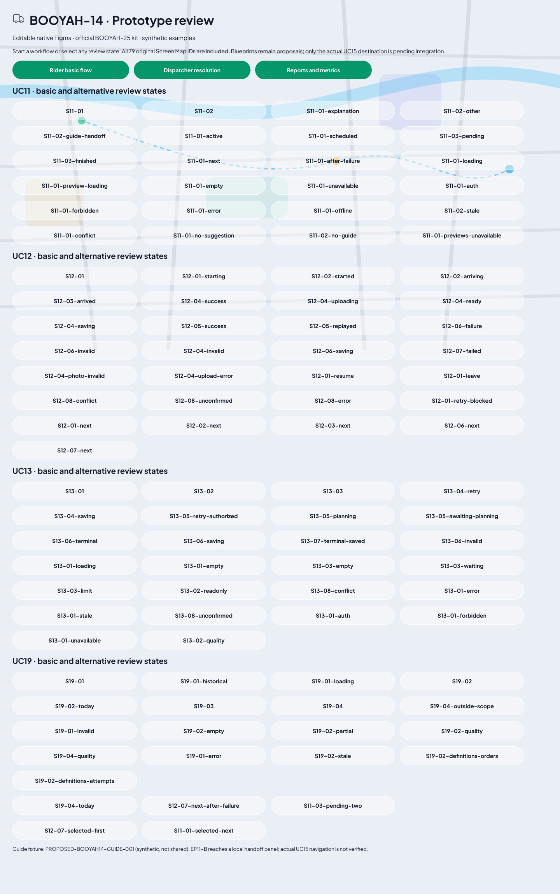

# BOOYAH-14 — Editable Prototype Handoff
Performed by: Trần Lê Hải. Reviewed by: Nguyễn Thành Trung (pending actual review). Edited by: Codex (AI-assisted prototype work); human editor pending.

**Prepared 19 November 2026.** [Figma Design file](https://www.figma.com/design/LBEaZQ3zEjnjBLhLoPb5pD/Veylo-%E2%80%93-BOOYAH-14-Prototypes) · [Review launcher](https://www.figma.com/design/LBEaZQ3zEjnjBLhLoPb5pD/Veylo-%E2%80%93-BOOYAH-14-Prototypes?node-id=5-3724). The file contains **103 native frames** covering all **79 original Screen Map IDs**, plus shared/context variants and the review launcher. All 103 actual Figma PNGs are linked in the screen map below; UC images are under sibling `../UC11/`, `../UC12/`, `../UC13/`, `../UC19/` directories and the launcher is under `review/`. The source kit and teammate files were preserved.

**PDF navigation:** HTTPS links remain clickable. Relative file links work in this Markdown source and appear as plain reference labels in the PDF; all screenshots remain embedded.

## Workflow entry points
Performed by: Trần Lê Hải. Reviewed by: Nguyễn Thành Trung (pending actual review). Edited by: Codex (AI-assisted prototype work); human editor pending.

| Workflow | Figma frame | Local evidence |
| --- | --- | --- |
| Review all cases | [Open](https://www.figma.com/design/LBEaZQ3zEjnjBLhLoPb5pD/Veylo-%E2%80%93-BOOYAH-14-Prototypes?node-id=5-3724) | [PNG](review/B14-INDEX.png) |
| UC11 → UC12 Rider execution | [Open](https://www.figma.com/design/LBEaZQ3zEjnjBLhLoPb5pD/Veylo-%E2%80%93-BOOYAH-14-Prototypes?node-id=4-2) | [PNG](../UC11/S11-01.png) |
| UC13 Dispatcher resolution | [Open](https://www.figma.com/design/LBEaZQ3zEjnjBLhLoPb5pD/Veylo-%E2%80%93-BOOYAH-14-Prototypes?node-id=5-1324) | [PNG](../UC13/S13-01.png) |
| UC19 Reports | [Open](https://www.figma.com/design/LBEaZQ3zEjnjBLhLoPb5pD/Veylo-%E2%80%93-BOOYAH-14-Prototypes?node-id=5-2609) | [PNG](../UC19/S19-01.png) |

## Coverage and interaction model
Performed by: Trần Lê Hải. Reviewed by: Nguyễn Thành Trung (pending actual review). Edited by: Codex (AI-assisted prototype work); human editor pending.

The [recorded verification](../../../../test/f04-f08-delivery-reporting/prototype/prototype-verification.json) checks 354 reaction nodes, four flow starts, all-screen reachability, 28 basic steps and 43 alternative-flow specifications. Five scripted paths evaluate the actual read-back reaction graph, including first-stop failure and manual stop choice. UC11 A5 is locally represented through EP11-B; actual UC15 navigation remains pending. The [flow map](flow-to-figma-map.json) identifies every basic/alternative step and its frame IDs.

Figma reactions demonstrate selected synthetic states. Photo/camera selection, uploads, sign-in, authorization, API persistence, concurrency, report queries and downloads are storyboarded; no live backend, real credential entry, GPS, real recipient/POD evidence or performance benchmark is claimed. A 1.2-second transition is presentation timing. Milestone timestamps are fixed scene examples, not a running clock. Independent reviewer acceptance remains pending.

## Kit and editability
Performed by: Trần Lê Hải. Reviewed by: Nguyễn Thành Trung (pending actual review). Edited by: Codex (AI-assisted prototype work); human editor pending.

The exact source kit `Công Khánh - PA3 - ProtoypeKit-20261119T103921Z-1-001`, documented in the [kit source inventory](../../../../test/f04-f08-delivery-reporting/prototype/kit-source-inventory.json) supplies the neutral crystal-glass surfaces, emerald capsules, Plus Jakarta Sans / JetBrains Mono fonts, SVG urban backdrop, controls and state patterns. The new file uses kit-derived component instances, 34 light/dark color tokens, five radius tokens and native vectors/text. The selected screens use the Light theme. CSS backdrop saturation is represented by native Figma glass/blur/shadow styling rather than claiming browser-renderer equivalence. No full-UI raster fill exists. The original empty Page 1 remains unchanged. The exact draft kit source path and SHA-256 inventory are recorded as provenance, not as a required ignored-folder link. In cached `origin/dev`, `tokens.css` and `assets/fonts/fonts.css` match that kit, while `kit.css`, `index.html` and `export.mjs` differ. No different kit version was substituted and no version equivalence is claimed.

## Fixtures and BOOYAH-15 coordination
Performed by: Trần Lê Hải. Reviewed by: Nguyễn Thành Trung (pending actual review). Edited by: Codex (AI-assisted prototype work); human editor pending.

[Synthetic Order/Shift/attempt scenarios](../../../../test/f04-f08-delivery-reporting/fixtures/synthetic-fixtures.json) keep Order outcomes separate from attempt outcomes and separate named alternative snapshots. [Proposed Location Guide fixture](../../../../test/f04-f08-delivery-reporting/fixtures/proposed-location-guide.json) is a new, clearly labelled coordination proposal, not an existing shared fixture or a claimed human approval. See [UC11–UC15 handoff](UC11-UC15-Handoff.md).

## Complete screen / fixture / Figma map
Performed by: Trần Lê Hải. Reviewed by: Nguyễn Thành Trung (pending actual review). Edited by: Codex (AI-assisted prototype work); human editor pending.

Machine-readable [JSON](screen-fixture-flow-map.json) and [CSV](screen-fixture-flow-map.csv) also map each frame to its applicable flow IDs, PNG hash and fixture.

| Screen ID | UC | Figma | PNG / fixture |
| --- | --- | --- | --- |
| `S11-01` | UC11 | [Frame](https://www.figma.com/design/LBEaZQ3zEjnjBLhLoPb5pD/Veylo-%E2%80%93-BOOYAH-14-Prototypes?node-id=4-2) | [PNG](../UC11/S11-01.png) · [fixture](../../../../test/f04-f08-delivery-reporting/fixtures/synthetic-fixtures.json) |
| `S11-02` | UC11 | [Frame](https://www.figma.com/design/LBEaZQ3zEjnjBLhLoPb5pD/Veylo-%E2%80%93-BOOYAH-14-Prototypes?node-id=4-39) | [PNG](../UC11/S11-02.png) · [fixture](../../../../test/f04-f08-delivery-reporting/fixtures/proposed-location-guide.json) |
| `S11-01-explanation` | UC11 | [Frame](https://www.figma.com/design/LBEaZQ3zEjnjBLhLoPb5pD/Veylo-%E2%80%93-BOOYAH-14-Prototypes?node-id=4-76) | [PNG](../UC11/S11-01-explanation.png) · [fixture](../../../../test/f04-f08-delivery-reporting/fixtures/synthetic-fixtures.json) |
| `S11-02-other` | UC11 | [Frame](https://www.figma.com/design/LBEaZQ3zEjnjBLhLoPb5pD/Veylo-%E2%80%93-BOOYAH-14-Prototypes?node-id=4-109) | [PNG](../UC11/S11-02-other.png) · [fixture](../../../../test/f04-f08-delivery-reporting/fixtures/synthetic-fixtures.json) |
| `S11-02-guide-handoff` | UC11 | [Frame](https://www.figma.com/design/LBEaZQ3zEjnjBLhLoPb5pD/Veylo-%E2%80%93-BOOYAH-14-Prototypes?node-id=4-142) | [PNG](../UC11/S11-02-guide-handoff.png) · [fixture](../../../../test/f04-f08-delivery-reporting/fixtures/proposed-location-guide.json) |
| `S11-01-active` | UC11 | [Frame](https://www.figma.com/design/LBEaZQ3zEjnjBLhLoPb5pD/Veylo-%E2%80%93-BOOYAH-14-Prototypes?node-id=4-175) | [PNG](../UC11/S11-01-active.png) · [fixture](../../../../test/f04-f08-delivery-reporting/fixtures/synthetic-fixtures.json) |
| `S11-01-scheduled` | UC11 | [Frame](https://www.figma.com/design/LBEaZQ3zEjnjBLhLoPb5pD/Veylo-%E2%80%93-BOOYAH-14-Prototypes?node-id=4-210) | [PNG](../UC11/S11-01-scheduled.png) · [fixture](../../../../test/f04-f08-delivery-reporting/fixtures/synthetic-fixtures.json) |
| `S11-03-pending` | UC11 | [Frame](https://www.figma.com/design/LBEaZQ3zEjnjBLhLoPb5pD/Veylo-%E2%80%93-BOOYAH-14-Prototypes?node-id=4-239) | [PNG](../UC11/S11-03-pending.png) · [fixture](../../../../test/f04-f08-delivery-reporting/fixtures/synthetic-fixtures.json) |
| `S11-03-finished` | UC11 | [Frame](https://www.figma.com/design/LBEaZQ3zEjnjBLhLoPb5pD/Veylo-%E2%80%93-BOOYAH-14-Prototypes?node-id=4-272) | [PNG](../UC11/S11-03-finished.png) · [fixture](../../../../test/f04-f08-delivery-reporting/fixtures/synthetic-fixtures.json) |
| `S11-01-next` | UC11 | [Frame](https://www.figma.com/design/LBEaZQ3zEjnjBLhLoPb5pD/Veylo-%E2%80%93-BOOYAH-14-Prototypes?node-id=4-301) | [PNG](../UC11/S11-01-next.png) · [fixture](../../../../test/f04-f08-delivery-reporting/fixtures/synthetic-fixtures.json) |
| `S11-01-after-failure` | UC11 | [Frame](https://www.figma.com/design/LBEaZQ3zEjnjBLhLoPb5pD/Veylo-%E2%80%93-BOOYAH-14-Prototypes?node-id=4-332) | [PNG](../UC11/S11-01-after-failure.png) · [fixture](../../../../test/f04-f08-delivery-reporting/fixtures/synthetic-fixtures.json) |
| `S11-01-loading` | UC11 | [Frame](https://www.figma.com/design/LBEaZQ3zEjnjBLhLoPb5pD/Veylo-%E2%80%93-BOOYAH-14-Prototypes?node-id=4-367) | [PNG](../UC11/S11-01-loading.png) · [fixture](../../../../test/f04-f08-delivery-reporting/fixtures/synthetic-fixtures.json) |
| `S11-01-preview-loading` | UC11 | [Frame](https://www.figma.com/design/LBEaZQ3zEjnjBLhLoPb5pD/Veylo-%E2%80%93-BOOYAH-14-Prototypes?node-id=4-390) | [PNG](../UC11/S11-01-preview-loading.png) · [fixture](../../../../test/f04-f08-delivery-reporting/fixtures/synthetic-fixtures.json) |
| `S11-01-empty` | UC11 | [Frame](https://www.figma.com/design/LBEaZQ3zEjnjBLhLoPb5pD/Veylo-%E2%80%93-BOOYAH-14-Prototypes?node-id=4-423) | [PNG](../UC11/S11-01-empty.png) · [fixture](../../../../test/f04-f08-delivery-reporting/fixtures/synthetic-fixtures.json) |
| `S11-01-unavailable` | UC11 | [Frame](https://www.figma.com/design/LBEaZQ3zEjnjBLhLoPb5pD/Veylo-%E2%80%93-BOOYAH-14-Prototypes?node-id=4-446) | [PNG](../UC11/S11-01-unavailable.png) · [fixture](../../../../test/f04-f08-delivery-reporting/fixtures/synthetic-fixtures.json) |
| `S11-01-auth` | UC11 | [Frame](https://www.figma.com/design/LBEaZQ3zEjnjBLhLoPb5pD/Veylo-%E2%80%93-BOOYAH-14-Prototypes?node-id=4-469) | [PNG](../UC11/S11-01-auth.png) · [fixture](../../../../test/f04-f08-delivery-reporting/fixtures/synthetic-fixtures.json) |
| `S11-01-forbidden` | UC11 | [Frame](https://www.figma.com/design/LBEaZQ3zEjnjBLhLoPb5pD/Veylo-%E2%80%93-BOOYAH-14-Prototypes?node-id=4-494) | [PNG](../UC11/S11-01-forbidden.png) · [fixture](../../../../test/f04-f08-delivery-reporting/fixtures/synthetic-fixtures.json) |
| `S11-01-error` | UC11 | [Frame](https://www.figma.com/design/LBEaZQ3zEjnjBLhLoPb5pD/Veylo-%E2%80%93-BOOYAH-14-Prototypes?node-id=4-519) | [PNG](../UC11/S11-01-error.png) · [fixture](../../../../test/f04-f08-delivery-reporting/fixtures/synthetic-fixtures.json) |
| `S11-01-offline` | UC11 | [Frame](https://www.figma.com/design/LBEaZQ3zEjnjBLhLoPb5pD/Veylo-%E2%80%93-BOOYAH-14-Prototypes?node-id=4-544) | [PNG](../UC11/S11-01-offline.png) · [fixture](../../../../test/f04-f08-delivery-reporting/fixtures/synthetic-fixtures.json) |
| `S11-02-stale` | UC11 | [Frame](https://www.figma.com/design/LBEaZQ3zEjnjBLhLoPb5pD/Veylo-%E2%80%93-BOOYAH-14-Prototypes?node-id=4-569) | [PNG](../UC11/S11-02-stale.png) · [fixture](../../../../test/f04-f08-delivery-reporting/fixtures/synthetic-fixtures.json) |
| `S11-01-conflict` | UC11 | [Frame](https://www.figma.com/design/LBEaZQ3zEjnjBLhLoPb5pD/Veylo-%E2%80%93-BOOYAH-14-Prototypes?node-id=4-594) | [PNG](../UC11/S11-01-conflict.png) · [fixture](../../../../test/f04-f08-delivery-reporting/fixtures/synthetic-fixtures.json) |
| `S11-01-no-suggestion` | UC11 | [Frame](https://www.figma.com/design/LBEaZQ3zEjnjBLhLoPb5pD/Veylo-%E2%80%93-BOOYAH-14-Prototypes?node-id=4-621) | [PNG](../UC11/S11-01-no-suggestion.png) · [fixture](../../../../test/f04-f08-delivery-reporting/fixtures/synthetic-fixtures.json) |
| `S11-02-no-guide` | UC11 | [Frame](https://www.figma.com/design/LBEaZQ3zEjnjBLhLoPb5pD/Veylo-%E2%80%93-BOOYAH-14-Prototypes?node-id=4-654) | [PNG](../UC11/S11-02-no-guide.png) · [fixture](../../../../test/f04-f08-delivery-reporting/fixtures/synthetic-fixtures.json) |
| `S11-01-previews-unavailable` | UC11 | [Frame](https://www.figma.com/design/LBEaZQ3zEjnjBLhLoPb5pD/Veylo-%E2%80%93-BOOYAH-14-Prototypes?node-id=4-687) | [PNG](../UC11/S11-01-previews-unavailable.png) · [fixture](../../../../test/f04-f08-delivery-reporting/fixtures/synthetic-fixtures.json) |
| `S12-01` | UC12 | [Frame](https://www.figma.com/design/LBEaZQ3zEjnjBLhLoPb5pD/Veylo-%E2%80%93-BOOYAH-14-Prototypes?node-id=5-452) | [PNG](../UC12/S12-01.png) · [fixture](../../../../test/f04-f08-delivery-reporting/fixtures/synthetic-fixtures.json) |
| `S12-01-starting` | UC12 | [Frame](https://www.figma.com/design/LBEaZQ3zEjnjBLhLoPb5pD/Veylo-%E2%80%93-BOOYAH-14-Prototypes?node-id=5-485) | [PNG](../UC12/S12-01-starting.png) · [fixture](../../../../test/f04-f08-delivery-reporting/fixtures/synthetic-fixtures.json) |
| `S12-02-started` | UC12 | [Frame](https://www.figma.com/design/LBEaZQ3zEjnjBLhLoPb5pD/Veylo-%E2%80%93-BOOYAH-14-Prototypes?node-id=5-512) | [PNG](../UC12/S12-02-started.png) · [fixture](../../../../test/f04-f08-delivery-reporting/fixtures/synthetic-fixtures.json) |
| `S12-02-arriving` | UC12 | [Frame](https://www.figma.com/design/LBEaZQ3zEjnjBLhLoPb5pD/Veylo-%E2%80%93-BOOYAH-14-Prototypes?node-id=5-541) | [PNG](../UC12/S12-02-arriving.png) · [fixture](../../../../test/f04-f08-delivery-reporting/fixtures/synthetic-fixtures.json) |
| `S12-03-arrived` | UC12 | [Frame](https://www.figma.com/design/LBEaZQ3zEjnjBLhLoPb5pD/Veylo-%E2%80%93-BOOYAH-14-Prototypes?node-id=5-568) | [PNG](../UC12/S12-03-arrived.png) · [fixture](../../../../test/f04-f08-delivery-reporting/fixtures/synthetic-fixtures.json) |
| `S12-04-success` | UC12 | [Frame](https://www.figma.com/design/LBEaZQ3zEjnjBLhLoPb5pD/Veylo-%E2%80%93-BOOYAH-14-Prototypes?node-id=5-597) | [PNG](../UC12/S12-04-success.png) · [fixture](../../../../test/f04-f08-delivery-reporting/fixtures/synthetic-fixtures.json) |
| `S12-04-uploading` | UC12 | [Frame](https://www.figma.com/design/LBEaZQ3zEjnjBLhLoPb5pD/Veylo-%E2%80%93-BOOYAH-14-Prototypes?node-id=5-626) | [PNG](../UC12/S12-04-uploading.png) · [fixture](../../../../test/f04-f08-delivery-reporting/fixtures/synthetic-fixtures.json) |
| `S12-04-ready` | UC12 | [Frame](https://www.figma.com/design/LBEaZQ3zEjnjBLhLoPb5pD/Veylo-%E2%80%93-BOOYAH-14-Prototypes?node-id=5-653) | [PNG](../UC12/S12-04-ready.png) · [fixture](../../../../test/f04-f08-delivery-reporting/fixtures/synthetic-fixtures.json) |
| `S12-04-saving` | UC12 | [Frame](https://www.figma.com/design/LBEaZQ3zEjnjBLhLoPb5pD/Veylo-%E2%80%93-BOOYAH-14-Prototypes?node-id=5-693) | [PNG](../UC12/S12-04-saving.png) · [fixture](../../../../test/f04-f08-delivery-reporting/fixtures/synthetic-fixtures.json) |
| `S12-05-success` | UC12 | [Frame](https://www.figma.com/design/LBEaZQ3zEjnjBLhLoPb5pD/Veylo-%E2%80%93-BOOYAH-14-Prototypes?node-id=5-720) | [PNG](../UC12/S12-05-success.png) · [fixture](../../../../test/f04-f08-delivery-reporting/fixtures/synthetic-fixtures.json) |
| `S12-05-replayed` | UC12 | [Frame](https://www.figma.com/design/LBEaZQ3zEjnjBLhLoPb5pD/Veylo-%E2%80%93-BOOYAH-14-Prototypes?node-id=5-755) | [PNG](../UC12/S12-05-replayed.png) · [fixture](../../../../test/f04-f08-delivery-reporting/fixtures/synthetic-fixtures.json) |
| `S12-06-failure` | UC12 | [Frame](https://www.figma.com/design/LBEaZQ3zEjnjBLhLoPb5pD/Veylo-%E2%80%93-BOOYAH-14-Prototypes?node-id=5-784) | [PNG](../UC12/S12-06-failure.png) · [fixture](../../../../test/f04-f08-delivery-reporting/fixtures/synthetic-fixtures.json) |
| `S12-06-invalid` | UC12 | [Frame](https://www.figma.com/design/LBEaZQ3zEjnjBLhLoPb5pD/Veylo-%E2%80%93-BOOYAH-14-Prototypes?node-id=5-821) | [PNG](../UC12/S12-06-invalid.png) · [fixture](../../../../test/f04-f08-delivery-reporting/fixtures/synthetic-fixtures.json) |
| `S12-04-invalid` | UC12 | [Frame](https://www.figma.com/design/LBEaZQ3zEjnjBLhLoPb5pD/Veylo-%E2%80%93-BOOYAH-14-Prototypes?node-id=5-858) | [PNG](../UC12/S12-04-invalid.png) · [fixture](../../../../test/f04-f08-delivery-reporting/fixtures/synthetic-fixtures.json) |
| `S12-06-saving` | UC12 | [Frame](https://www.figma.com/design/LBEaZQ3zEjnjBLhLoPb5pD/Veylo-%E2%80%93-BOOYAH-14-Prototypes?node-id=5-895) | [PNG](../UC12/S12-06-saving.png) · [fixture](../../../../test/f04-f08-delivery-reporting/fixtures/synthetic-fixtures.json) |
| `S12-07-failed` | UC12 | [Frame](https://www.figma.com/design/LBEaZQ3zEjnjBLhLoPb5pD/Veylo-%E2%80%93-BOOYAH-14-Prototypes?node-id=5-922) | [PNG](../UC12/S12-07-failed.png) · [fixture](../../../../test/f04-f08-delivery-reporting/fixtures/synthetic-fixtures.json) |
| `S12-04-photo-invalid` | UC12 | [Frame](https://www.figma.com/design/LBEaZQ3zEjnjBLhLoPb5pD/Veylo-%E2%80%93-BOOYAH-14-Prototypes?node-id=5-955) | [PNG](../UC12/S12-04-photo-invalid.png) · [fixture](../../../../test/f04-f08-delivery-reporting/fixtures/synthetic-fixtures.json) |
| `S12-04-upload-error` | UC12 | [Frame](https://www.figma.com/design/LBEaZQ3zEjnjBLhLoPb5pD/Veylo-%E2%80%93-BOOYAH-14-Prototypes?node-id=5-980) | [PNG](../UC12/S12-04-upload-error.png) · [fixture](../../../../test/f04-f08-delivery-reporting/fixtures/synthetic-fixtures.json) |
| `S12-01-resume` | UC12 | [Frame](https://www.figma.com/design/LBEaZQ3zEjnjBLhLoPb5pD/Veylo-%E2%80%93-BOOYAH-14-Prototypes?node-id=5-1007) | [PNG](../UC12/S12-01-resume.png) · [fixture](../../../../test/f04-f08-delivery-reporting/fixtures/synthetic-fixtures.json) |
| `S12-01-leave` | UC12 | [Frame](https://www.figma.com/design/LBEaZQ3zEjnjBLhLoPb5pD/Veylo-%E2%80%93-BOOYAH-14-Prototypes?node-id=5-1034) | [PNG](../UC12/S12-01-leave.png) · [fixture](../../../../test/f04-f08-delivery-reporting/fixtures/synthetic-fixtures.json) |
| `S12-08-conflict` | UC12 | [Frame](https://www.figma.com/design/LBEaZQ3zEjnjBLhLoPb5pD/Veylo-%E2%80%93-BOOYAH-14-Prototypes?node-id=5-1061) | [PNG](../UC12/S12-08-conflict.png) · [fixture](../../../../test/f04-f08-delivery-reporting/fixtures/synthetic-fixtures.json) |
| `S12-08-unconfirmed` | UC12 | [Frame](https://www.figma.com/design/LBEaZQ3zEjnjBLhLoPb5pD/Veylo-%E2%80%93-BOOYAH-14-Prototypes?node-id=5-1088) | [PNG](../UC12/S12-08-unconfirmed.png) · [fixture](../../../../test/f04-f08-delivery-reporting/fixtures/synthetic-fixtures.json) |
| `S12-08-error` | UC12 | [Frame](https://www.figma.com/design/LBEaZQ3zEjnjBLhLoPb5pD/Veylo-%E2%80%93-BOOYAH-14-Prototypes?node-id=5-1115) | [PNG](../UC12/S12-08-error.png) · [fixture](../../../../test/f04-f08-delivery-reporting/fixtures/synthetic-fixtures.json) |
| `S12-01-retry-blocked` | UC12 | [Frame](https://www.figma.com/design/LBEaZQ3zEjnjBLhLoPb5pD/Veylo-%E2%80%93-BOOYAH-14-Prototypes?node-id=5-1142) | [PNG](../UC12/S12-01-retry-blocked.png) · [fixture](../../../../test/f04-f08-delivery-reporting/fixtures/synthetic-fixtures.json) |
| `S12-01-next` | UC12 | [Frame](https://www.figma.com/design/LBEaZQ3zEjnjBLhLoPb5pD/Veylo-%E2%80%93-BOOYAH-14-Prototypes?node-id=5-1167) | [PNG](../UC12/S12-01-next.png) · [fixture](../../../../test/f04-f08-delivery-reporting/fixtures/synthetic-fixtures.json) |
| `S12-02-next` | UC12 | [Frame](https://www.figma.com/design/LBEaZQ3zEjnjBLhLoPb5pD/Veylo-%E2%80%93-BOOYAH-14-Prototypes?node-id=5-1198) | [PNG](../UC12/S12-02-next.png) · [fixture](../../../../test/f04-f08-delivery-reporting/fixtures/synthetic-fixtures.json) |
| `S12-03-next` | UC12 | [Frame](https://www.figma.com/design/LBEaZQ3zEjnjBLhLoPb5pD/Veylo-%E2%80%93-BOOYAH-14-Prototypes?node-id=5-1227) | [PNG](../UC12/S12-03-next.png) · [fixture](../../../../test/f04-f08-delivery-reporting/fixtures/synthetic-fixtures.json) |
| `S12-06-next` | UC12 | [Frame](https://www.figma.com/design/LBEaZQ3zEjnjBLhLoPb5pD/Veylo-%E2%80%93-BOOYAH-14-Prototypes?node-id=5-1254) | [PNG](../UC12/S12-06-next.png) · [fixture](../../../../test/f04-f08-delivery-reporting/fixtures/synthetic-fixtures.json) |
| `S12-07-next` | UC12 | [Frame](https://www.figma.com/design/LBEaZQ3zEjnjBLhLoPb5pD/Veylo-%E2%80%93-BOOYAH-14-Prototypes?node-id=5-1291) | [PNG](../UC12/S12-07-next.png) · [fixture](../../../../test/f04-f08-delivery-reporting/fixtures/synthetic-fixtures.json) |
| `S13-01` | UC13 | [Frame](https://www.figma.com/design/LBEaZQ3zEjnjBLhLoPb5pD/Veylo-%E2%80%93-BOOYAH-14-Prototypes?node-id=5-1324) | [PNG](../UC13/S13-01.png) · [fixture](../../../../test/f04-f08-delivery-reporting/fixtures/synthetic-fixtures.json) |
| `S13-02` | UC13 | [Frame](https://www.figma.com/design/LBEaZQ3zEjnjBLhLoPb5pD/Veylo-%E2%80%93-BOOYAH-14-Prototypes?node-id=5-1404) | [PNG](../UC13/S13-02.png) · [fixture](../../../../test/f04-f08-delivery-reporting/fixtures/synthetic-fixtures.json) |
| `S13-03` | UC13 | [Frame](https://www.figma.com/design/LBEaZQ3zEjnjBLhLoPb5pD/Veylo-%E2%80%93-BOOYAH-14-Prototypes?node-id=5-1484) | [PNG](../UC13/S13-03.png) · [fixture](../../../../test/f04-f08-delivery-reporting/fixtures/synthetic-fixtures.json) |
| `S13-04-retry` | UC13 | [Frame](https://www.figma.com/design/LBEaZQ3zEjnjBLhLoPb5pD/Veylo-%E2%80%93-BOOYAH-14-Prototypes?node-id=5-1535) | [PNG](../UC13/S13-04-retry.png) · [fixture](../../../../test/f04-f08-delivery-reporting/fixtures/synthetic-fixtures.json) |
| `S13-04-saving` | UC13 | [Frame](https://www.figma.com/design/LBEaZQ3zEjnjBLhLoPb5pD/Veylo-%E2%80%93-BOOYAH-14-Prototypes?node-id=5-1586) | [PNG](../UC13/S13-04-saving.png) · [fixture](../../../../test/f04-f08-delivery-reporting/fixtures/synthetic-fixtures.json) |
| `S13-05-retry-authorized` | UC13 | [Frame](https://www.figma.com/design/LBEaZQ3zEjnjBLhLoPb5pD/Veylo-%E2%80%93-BOOYAH-14-Prototypes?node-id=5-1629) | [PNG](../UC13/S13-05-retry-authorized.png) · [fixture](../../../../test/f04-f08-delivery-reporting/fixtures/synthetic-fixtures.json) |
| `S13-05-planning` | UC13 | [Frame](https://www.figma.com/design/LBEaZQ3zEjnjBLhLoPb5pD/Veylo-%E2%80%93-BOOYAH-14-Prototypes?node-id=5-1682) | [PNG](../UC13/S13-05-planning.png) · [fixture](../../../../test/f04-f08-delivery-reporting/fixtures/synthetic-fixtures.json) |
| `S13-05-awaiting-planning` | UC13 | [Frame](https://www.figma.com/design/LBEaZQ3zEjnjBLhLoPb5pD/Veylo-%E2%80%93-BOOYAH-14-Prototypes?node-id=5-1740) | [PNG](../UC13/S13-05-awaiting-planning.png) · [fixture](../../../../test/f04-f08-delivery-reporting/fixtures/synthetic-fixtures.json) |
| `S13-06-terminal` | UC13 | [Frame](https://www.figma.com/design/LBEaZQ3zEjnjBLhLoPb5pD/Veylo-%E2%80%93-BOOYAH-14-Prototypes?node-id=5-1793) | [PNG](../UC13/S13-06-terminal.png) · [fixture](../../../../test/f04-f08-delivery-reporting/fixtures/synthetic-fixtures.json) |
| `S13-06-saving` | UC13 | [Frame](https://www.figma.com/design/LBEaZQ3zEjnjBLhLoPb5pD/Veylo-%E2%80%93-BOOYAH-14-Prototypes?node-id=5-1848) | [PNG](../UC13/S13-06-saving.png) · [fixture](../../../../test/f04-f08-delivery-reporting/fixtures/synthetic-fixtures.json) |
| `S13-07-terminal-saved` | UC13 | [Frame](https://www.figma.com/design/LBEaZQ3zEjnjBLhLoPb5pD/Veylo-%E2%80%93-BOOYAH-14-Prototypes?node-id=5-1891) | [PNG](../UC13/S13-07-terminal-saved.png) · [fixture](../../../../test/f04-f08-delivery-reporting/fixtures/synthetic-fixtures.json) |
| `S13-06-invalid` | UC13 | [Frame](https://www.figma.com/design/LBEaZQ3zEjnjBLhLoPb5pD/Veylo-%E2%80%93-BOOYAH-14-Prototypes?node-id=5-1944) | [PNG](../UC13/S13-06-invalid.png) · [fixture](../../../../test/f04-f08-delivery-reporting/fixtures/synthetic-fixtures.json) |
| `S13-01-loading` | UC13 | [Frame](https://www.figma.com/design/LBEaZQ3zEjnjBLhLoPb5pD/Veylo-%E2%80%93-BOOYAH-14-Prototypes?node-id=5-1995) | [PNG](../UC13/S13-01-loading.png) · [fixture](../../../../test/f04-f08-delivery-reporting/fixtures/synthetic-fixtures.json) |
| `S13-01-empty` | UC13 | [Frame](https://www.figma.com/design/LBEaZQ3zEjnjBLhLoPb5pD/Veylo-%E2%80%93-BOOYAH-14-Prototypes?node-id=5-2036) | [PNG](../UC13/S13-01-empty.png) · [fixture](../../../../test/f04-f08-delivery-reporting/fixtures/synthetic-fixtures.json) |
| `S13-03-empty` | UC13 | [Frame](https://www.figma.com/design/LBEaZQ3zEjnjBLhLoPb5pD/Veylo-%E2%80%93-BOOYAH-14-Prototypes?node-id=5-2079) | [PNG](../UC13/S13-03-empty.png) · [fixture](../../../../test/f04-f08-delivery-reporting/fixtures/synthetic-fixtures.json) |
| `S13-03-waiting` | UC13 | [Frame](https://www.figma.com/design/LBEaZQ3zEjnjBLhLoPb5pD/Veylo-%E2%80%93-BOOYAH-14-Prototypes?node-id=5-2124) | [PNG](../UC13/S13-03-waiting.png) · [fixture](../../../../test/f04-f08-delivery-reporting/fixtures/synthetic-fixtures.json) |
| `S13-03-limit` | UC13 | [Frame](https://www.figma.com/design/LBEaZQ3zEjnjBLhLoPb5pD/Veylo-%E2%80%93-BOOYAH-14-Prototypes?node-id=5-2169) | [PNG](../UC13/S13-03-limit.png) · [fixture](../../../../test/f04-f08-delivery-reporting/fixtures/synthetic-fixtures.json) |
| `S13-02-readonly` | UC13 | [Frame](https://www.figma.com/design/LBEaZQ3zEjnjBLhLoPb5pD/Veylo-%E2%80%93-BOOYAH-14-Prototypes?node-id=5-2214) | [PNG](../UC13/S13-02-readonly.png) · [fixture](../../../../test/f04-f08-delivery-reporting/fixtures/synthetic-fixtures.json) |
| `S13-08-conflict` | UC13 | [Frame](https://www.figma.com/design/LBEaZQ3zEjnjBLhLoPb5pD/Veylo-%E2%80%93-BOOYAH-14-Prototypes?node-id=5-2259) | [PNG](../UC13/S13-08-conflict.png) · [fixture](../../../../test/f04-f08-delivery-reporting/fixtures/synthetic-fixtures.json) |
| `S13-01-error` | UC13 | [Frame](https://www.figma.com/design/LBEaZQ3zEjnjBLhLoPb5pD/Veylo-%E2%80%93-BOOYAH-14-Prototypes?node-id=5-2304) | [PNG](../UC13/S13-01-error.png) · [fixture](../../../../test/f04-f08-delivery-reporting/fixtures/synthetic-fixtures.json) |
| `S13-01-stale` | UC13 | [Frame](https://www.figma.com/design/LBEaZQ3zEjnjBLhLoPb5pD/Veylo-%E2%80%93-BOOYAH-14-Prototypes?node-id=5-2347) | [PNG](../UC13/S13-01-stale.png) · [fixture](../../../../test/f04-f08-delivery-reporting/fixtures/synthetic-fixtures.json) |
| `S13-08-unconfirmed` | UC13 | [Frame](https://www.figma.com/design/LBEaZQ3zEjnjBLhLoPb5pD/Veylo-%E2%80%93-BOOYAH-14-Prototypes?node-id=5-2390) | [PNG](../UC13/S13-08-unconfirmed.png) · [fixture](../../../../test/f04-f08-delivery-reporting/fixtures/synthetic-fixtures.json) |
| `S13-01-auth` | UC13 | [Frame](https://www.figma.com/design/LBEaZQ3zEjnjBLhLoPb5pD/Veylo-%E2%80%93-BOOYAH-14-Prototypes?node-id=5-2435) | [PNG](../UC13/S13-01-auth.png) · [fixture](../../../../test/f04-f08-delivery-reporting/fixtures/synthetic-fixtures.json) |
| `S13-01-forbidden` | UC13 | [Frame](https://www.figma.com/design/LBEaZQ3zEjnjBLhLoPb5pD/Veylo-%E2%80%93-BOOYAH-14-Prototypes?node-id=5-2478) | [PNG](../UC13/S13-01-forbidden.png) · [fixture](../../../../test/f04-f08-delivery-reporting/fixtures/synthetic-fixtures.json) |
| `S13-01-unavailable` | UC13 | [Frame](https://www.figma.com/design/LBEaZQ3zEjnjBLhLoPb5pD/Veylo-%E2%80%93-BOOYAH-14-Prototypes?node-id=5-2521) | [PNG](../UC13/S13-01-unavailable.png) · [fixture](../../../../test/f04-f08-delivery-reporting/fixtures/synthetic-fixtures.json) |
| `S13-02-quality` | UC13 | [Frame](https://www.figma.com/design/LBEaZQ3zEjnjBLhLoPb5pD/Veylo-%E2%80%93-BOOYAH-14-Prototypes?node-id=5-2564) | [PNG](../UC13/S13-02-quality.png) · [fixture](../../../../test/f04-f08-delivery-reporting/fixtures/synthetic-fixtures.json) |
| `S19-01` | UC19 | [Frame](https://www.figma.com/design/LBEaZQ3zEjnjBLhLoPb5pD/Veylo-%E2%80%93-BOOYAH-14-Prototypes?node-id=5-2609) | [PNG](../UC19/S19-01.png) · [fixture](../../../../test/f04-f08-delivery-reporting/fixtures/synthetic-fixtures.json) |
| `S19-01-historical` | UC19 | [Frame](https://www.figma.com/design/LBEaZQ3zEjnjBLhLoPb5pD/Veylo-%E2%80%93-BOOYAH-14-Prototypes?node-id=5-2669) | [PNG](../UC19/S19-01-historical.png) · [fixture](../../../../test/f04-f08-delivery-reporting/fixtures/synthetic-fixtures.json) |
| `S19-01-loading` | UC19 | [Frame](https://www.figma.com/design/LBEaZQ3zEjnjBLhLoPb5pD/Veylo-%E2%80%93-BOOYAH-14-Prototypes?node-id=5-2719) | [PNG](../UC19/S19-01-loading.png) · [fixture](../../../../test/f04-f08-delivery-reporting/fixtures/synthetic-fixtures.json) |
| `S19-02` | UC19 | [Frame](https://www.figma.com/design/LBEaZQ3zEjnjBLhLoPb5pD/Veylo-%E2%80%93-BOOYAH-14-Prototypes?node-id=5-2759) | [PNG](../UC19/S19-02.png) · [fixture](../../../../test/f04-f08-delivery-reporting/fixtures/synthetic-fixtures.json) |
| `S19-02-today` | UC19 | [Frame](https://www.figma.com/design/LBEaZQ3zEjnjBLhLoPb5pD/Veylo-%E2%80%93-BOOYAH-14-Prototypes?node-id=5-2839) | [PNG](../UC19/S19-02-today.png) · [fixture](../../../../test/f04-f08-delivery-reporting/fixtures/synthetic-fixtures.json) |
| `S19-03` | UC19 | [Frame](https://www.figma.com/design/LBEaZQ3zEjnjBLhLoPb5pD/Veylo-%E2%80%93-BOOYAH-14-Prototypes?node-id=5-2904) | [PNG](../UC19/S19-03.png) · [fixture](../../../../test/f04-f08-delivery-reporting/fixtures/synthetic-fixtures.json) |
| `S19-04` | UC19 | [Frame](https://www.figma.com/design/LBEaZQ3zEjnjBLhLoPb5pD/Veylo-%E2%80%93-BOOYAH-14-Prototypes?node-id=5-2992) | [PNG](../UC19/S19-04.png) · [fixture](../../../../test/f04-f08-delivery-reporting/fixtures/synthetic-fixtures.json) |
| `S19-04-outside-scope` | UC19 | [Frame](https://www.figma.com/design/LBEaZQ3zEjnjBLhLoPb5pD/Veylo-%E2%80%93-BOOYAH-14-Prototypes?node-id=5-3084) | [PNG](../UC19/S19-04-outside-scope.png) · [fixture](../../../../test/f04-f08-delivery-reporting/fixtures/synthetic-fixtures.json) |
| `S19-01-invalid` | UC19 | [Frame](https://www.figma.com/design/LBEaZQ3zEjnjBLhLoPb5pD/Veylo-%E2%80%93-BOOYAH-14-Prototypes?node-id=5-3149) | [PNG](../UC19/S19-01-invalid.png) · [fixture](../../../../test/f04-f08-delivery-reporting/fixtures/synthetic-fixtures.json) |
| `S19-02-empty` | UC19 | [Frame](https://www.figma.com/design/LBEaZQ3zEjnjBLhLoPb5pD/Veylo-%E2%80%93-BOOYAH-14-Prototypes?node-id=5-3206) | [PNG](../UC19/S19-02-empty.png) · [fixture](../../../../test/f04-f08-delivery-reporting/fixtures/synthetic-fixtures.json) |
| `S19-02-partial` | UC19 | [Frame](https://www.figma.com/design/LBEaZQ3zEjnjBLhLoPb5pD/Veylo-%E2%80%93-BOOYAH-14-Prototypes?node-id=5-3261) | [PNG](../UC19/S19-02-partial.png) · [fixture](../../../../test/f04-f08-delivery-reporting/fixtures/synthetic-fixtures.json) |
| `S19-02-quality` | UC19 | [Frame](https://www.figma.com/design/LBEaZQ3zEjnjBLhLoPb5pD/Veylo-%E2%80%93-BOOYAH-14-Prototypes?node-id=5-3322) | [PNG](../UC19/S19-02-quality.png) · [fixture](../../../../test/f04-f08-delivery-reporting/fixtures/synthetic-fixtures.json) |
| `S19-04-quality` | UC19 | [Frame](https://www.figma.com/design/LBEaZQ3zEjnjBLhLoPb5pD/Veylo-%E2%80%93-BOOYAH-14-Prototypes?node-id=5-3389) | [PNG](../UC19/S19-04-quality.png) · [fixture](../../../../test/f04-f08-delivery-reporting/fixtures/synthetic-fixtures.json) |
| `S19-01-error` | UC19 | [Frame](https://www.figma.com/design/LBEaZQ3zEjnjBLhLoPb5pD/Veylo-%E2%80%93-BOOYAH-14-Prototypes?node-id=5-3479) | [PNG](../UC19/S19-01-error.png) · [fixture](../../../../test/f04-f08-delivery-reporting/fixtures/synthetic-fixtures.json) |
| `S19-02-stale` | UC19 | [Frame](https://www.figma.com/design/LBEaZQ3zEjnjBLhLoPb5pD/Veylo-%E2%80%93-BOOYAH-14-Prototypes?node-id=5-3525) | [PNG](../UC19/S19-02-stale.png) · [fixture](../../../../test/f04-f08-delivery-reporting/fixtures/synthetic-fixtures.json) |
| `S19-02-definitions-orders` | UC19 | [Frame](https://www.figma.com/design/LBEaZQ3zEjnjBLhLoPb5pD/Veylo-%E2%80%93-BOOYAH-14-Prototypes?node-id=5-3588) | [PNG](../UC19/S19-02-definitions-orders.png) · [fixture](../../../../test/f04-f08-delivery-reporting/fixtures/synthetic-fixtures.json) |
| `S19-02-definitions-attempts` | UC19 | [Frame](https://www.figma.com/design/LBEaZQ3zEjnjBLhLoPb5pD/Veylo-%E2%80%93-BOOYAH-14-Prototypes?node-id=5-3656) | [PNG](../UC19/S19-02-definitions-attempts.png) · [fixture](../../../../test/f04-f08-delivery-reporting/fixtures/synthetic-fixtures.json) |
| `B14-INDEX` | REVIEW | [Frame](https://www.figma.com/design/LBEaZQ3zEjnjBLhLoPb5pD/Veylo-%E2%80%93-BOOYAH-14-Prototypes?node-id=5-3724) | [PNG](review/B14-INDEX.png) · [fixture](../../../../test/f04-f08-delivery-reporting/fixtures/synthetic-fixtures.json) |
| `S11-01-refresh` | UC11 | [Frame](https://www.figma.com/design/LBEaZQ3zEjnjBLhLoPb5pD/Veylo-%E2%80%93-BOOYAH-14-Prototypes?node-id=8-2818) | [PNG](../UC11/S11-01-refresh.png) · [fixture](../../../../test/f04-f08-delivery-reporting/fixtures/synthetic-fixtures.json) |
| `S19-04-today` | UC19 | [Frame](https://www.figma.com/design/LBEaZQ3zEjnjBLhLoPb5pD/Veylo-%E2%80%93-BOOYAH-14-Prototypes?node-id=9-2703) | [PNG](../UC19/S19-04-today.png) · [fixture](../../../../test/f04-f08-delivery-reporting/fixtures/synthetic-fixtures.json) |
| `S12-07-next-after-failure` | UC12 | [Frame](https://www.figma.com/design/LBEaZQ3zEjnjBLhLoPb5pD/Veylo-%E2%80%93-BOOYAH-14-Prototypes?node-id=10-2740) | [PNG](../UC12/S12-07-next-after-failure.png) · [fixture](../../../../test/f04-f08-delivery-reporting/fixtures/synthetic-fixtures.json) |
| `S11-03-pending-two` | UC11 | [Frame](https://www.figma.com/design/LBEaZQ3zEjnjBLhLoPb5pD/Veylo-%E2%80%93-BOOYAH-14-Prototypes?node-id=10-2773) | [PNG](../UC11/S11-03-pending-two.png) · [fixture](../../../../test/f04-f08-delivery-reporting/fixtures/synthetic-fixtures.json) |
| `S12-07-selected-first` | UC12 | [Frame](https://www.figma.com/design/LBEaZQ3zEjnjBLhLoPb5pD/Veylo-%E2%80%93-BOOYAH-14-Prototypes?node-id=16-2785) | [PNG](../UC12/S12-07-selected-first.png) · [fixture](../../../../test/f04-f08-delivery-reporting/fixtures/synthetic-fixtures.json) |
| `S11-01-selected-next` | UC11 | [Frame](https://www.figma.com/design/LBEaZQ3zEjnjBLhLoPb5pD/Veylo-%E2%80%93-BOOYAH-14-Prototypes?node-id=16-2818) | [PNG](../UC11/S11-01-selected-next.png) · [fixture](../../../../test/f04-f08-delivery-reporting/fixtures/synthetic-fixtures.json) |

## Review launcher screenshot
Performed by: Trần Lê Hải. Reviewed by: Nguyễn Thành Trung (pending actual review). Edited by: Codex (AI-assisted prototype work); human editor pending.

**B14-INDEX — BOOYAH-14 · Prototype review**

## Recorded authoring and verification
Performed by: Trần Lê Hải. Reviewed by: Nguyễn Thành Trung (pending actual review). Edited by: Codex (AI-assisted prototype work); human editor pending.

The original native Figma authoring scripts and intermediate evidence remain unchanged in the draft source; they are intentionally excluded from this official integration. Final recorded reaction graphs, structure and PNG checks are in the [verification evidence](../../../../test/f04-f08-delivery-reporting/prototype/prototype-verification.json). Their Figma node IDs describe the existing Design file, not a deployment into a fresh file.

Run the relocated [prototype verifier](../../../../test/f04-f08-delivery-reporting/verify_prototype.py), [PDF exporter](../../../../test/f04-f08-delivery-reporting/export_documents.py) and [document verifier](../../../../test/f04-f08-delivery-reporting/verify_documents.py) using the commands in the [verification report](../../../../test/f04-f08-delivery-reporting/Verification-Report.md). JSON/CSV artifact paths are relative to the repository root; Markdown links are relative to their containing document. Historical repair paths remain labelled as provenance in the baseline. These tools do not call Figma or modify PNGs, fixtures or kit files. No commit, push, PR or Jira mutation was performed. Independent human review, proposed Business Rule decisions and the actual UC15 destination remain pending.
