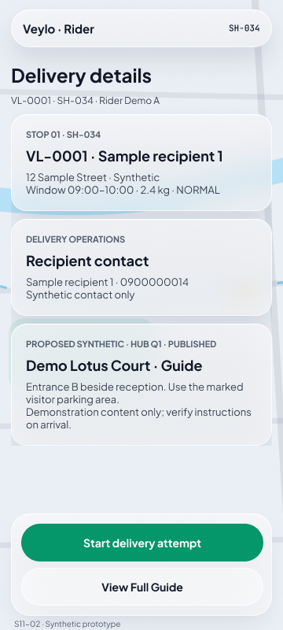

# UC11–UC15 Handoff — Proposed Synthetic Location Guide
Performed by: Trần Lê Hải. Reviewed by: Nguyễn Thành Trung (pending actual review). Edited by: Codex (AI-assisted prototype work); human editor pending.

**Integration state: pending BOOYAH-15.** The UC11 preview and entry interaction exist; the actual shared fixture and UC15 Full Guide destination are not connected or verified.

**PDF navigation:** HTTPS links remain clickable. Relative file links work in this Markdown source and appear as plain reference labels in the PDF; the S11-02 screenshot remains embedded.

## Coordination fixture
Performed by: Trần Lê Hải. Reviewed by: Nguyễn Thành Trung (pending actual review). Edited by: Codex (AI-assisted prototype work); human editor pending.

| Field | Proposed synthetic value |
| --- | --- |
| Fixture file | [proposed-location-guide.json](../../../../test/f04-f08-delivery-reporting/fixtures/proposed-location-guide.json) |
| Fixture ID | `PROPOSED-BOOYAH14-GUIDE-001` — not an existing shared fixture ID |
| Hub | `PROPOSED-BOOYAH14-HUB-Q1` / Hub Q1 |
| Location | `PROPOSED-BOOYAH14-LOCATION-001` / Demo Lotus Court (synthetic), 12 Sample Street · Synthetic |
| Publication status | `PUBLISHED` **test state**, with no actual publication/reviewer approval claimed |
| Guide content | Entrance B beside reception; marked visitor parking; verify instructions on arrival. All are fictional demonstration facts. |
| Context | VL-0001, Rider Demo A, SH-034; active same-hub Rider audience |
| Exclusions | No recipient detail, access code, raw note/draft, Order record or POD photo in the shared guide content |

## S11-02 and EP11-B evidence
Performed by: Trần Lê Hải. Reviewed by: Nguyễn Thành Trung (pending actual review). Edited by: Codex (AI-assisted prototype work); human editor pending.

- [S11-02 editable Figma frame](https://www.figma.com/design/LBEaZQ3zEjnjBLhLoPb5pD/Veylo-%E2%80%93-BOOYAH-14-Prototypes?node-id=4-39) — node `4:39`.
- [Actual S11-02 PNG](../UC11/S11-02.png).
- EP11-B control: **View Full Guide**, node `4:73`.
- Current local interaction: `ON_CLICK → NAVIGATE → S11-02-guide-handoff`, node `4:142` ([Figma](https://www.figma.com/design/LBEaZQ3zEjnjBLhLoPb5pD/Veylo-%E2%80%93-BOOYAH-14-Prototypes?node-id=4-142), [PNG](../UC11/S11-02-guide-handoff.png)).
- The local panel returns to S11-02. It is **not** a UC15 Full Guide frame or evidence of cross-UC integration.

**S11-02 — Delivery details**

## Remaining BOOYAH-15 integration items
Performed by: Trần Lê Hải. Reviewed by: Nguyễn Thành Trung (pending actual review). Edited by: Codex (AI-assisted prototype work); human editor pending.

1. Reconcile the proposed fixture with Trung’s actual shared fixture IDs, hub/location/publication fields and approved guide content; replace only the BOOYAH-14 reference after coordination.
2. Obtain the actual authorized UC15 Full Guide frame/destination and connect EP11-B to it, preserving return context and without modifying Trung’s prototype unless separately authorized.
3. Walk the real preview → Full Guide → return path and publication/hub/no-guide/stale cases jointly; record actual results. **None of these actual cross-UC checks is currently verified.**
