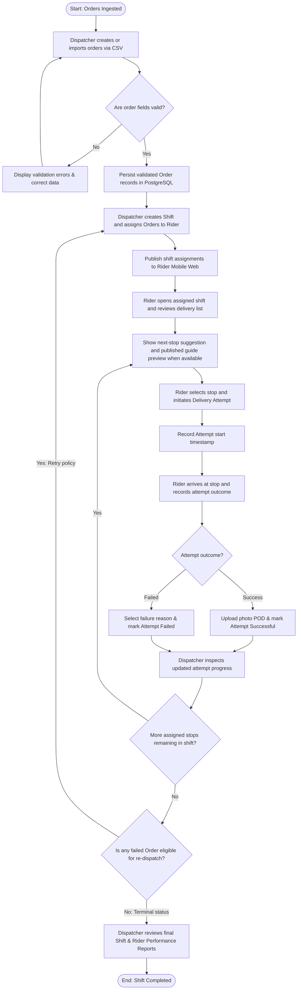
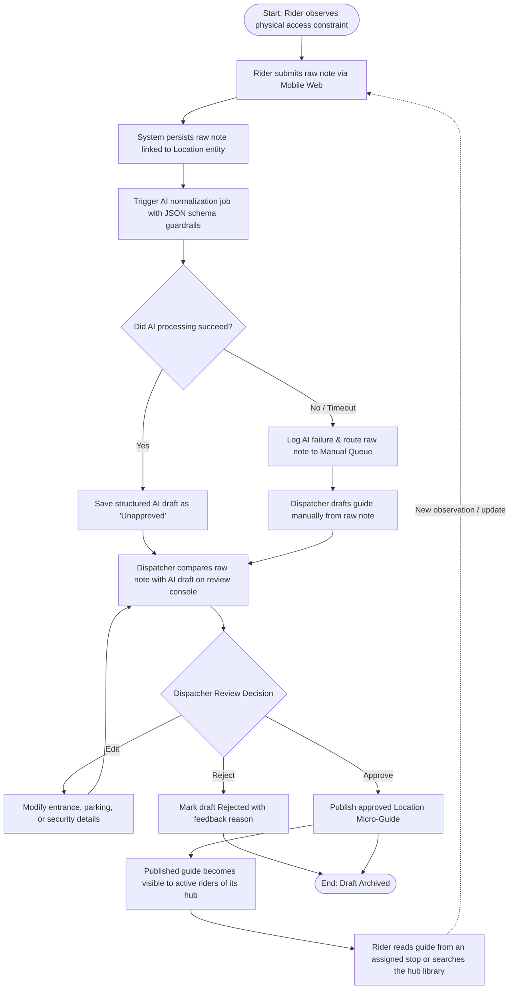

## 1. Introduction
Performed by: Trần Lê Hải. Reviewed by: Lý Huỳnh Minh Đăng. Edited by: Phạm Công Khánh.

This document defines the product vision for **Veylo**, a responsive web application engineered to streamline last-mile delivery operations and preserve crowdsourced location intelligence for small urban delivery hubs in Vietnam. Veylo integrates order intake, shift planning, rider delivery execution, and location knowledge management into a cohesive, zero-budget operational platform. An AI-assisted feature extracts structured access information from informal Vietnamese rider notes, while maintaining strict dispatcher approval before publication. This document establishes the foundational problem statement, stakeholder profiles, product features, workflow models, and quantifiable quality criteria guiding development from specification to final deployment.

### 1.1 References
Performed by: Trần Lê Hải. Reviewed by: Lý Huỳnh Minh Đăng. Edited by: Phạm Công Khánh.

| Reference | Document Title | Description & Relevance |
| :---: | :--- | :--- |
| **[1]** | **PA1-Group09.pdf** — Project Proposal and Team Contract | Established Veylo project scope, three operational subsystems, eight functional groups, and comparative surveys of Giao Hàng Nhanh (GHN) and Routific. |
| **[2]** | **PA2-2026.pdf** — Project Assignment 2 Guidelines | Course requirements for Section B: Vision Document, positioning tables, 3–5 sentence feature descriptions, Mermaid workflow diagrams, and quantifiable NFRs. |
| **[3]** | **rup_vision_sp.docx** — Vision Document Template (Small Project) | Standard Rational Unified Process (RUP) structural template for small software engineering projects. |
| **[4]** | **Veylo Engineering Constitution** (`constitution.md`, repository root) | Repository engineering rules enforcing the TypeScript + Next.js 16 + PostgreSQL + Prisma ORM stack and OpenSpec specification-driven development. |

---

## 2. Positioning
Performed by: Lý Huỳnh Minh Đăng. Reviewed by: Phạm Công Khánh. Edited by: Codex (AI-assisted).

### 2.1 Problem Statement
Performed by: Lý Huỳnh Minh Đăng. Reviewed by: Phạm Công Khánh. Edited by: Codex (AI-assisted).

Small delivery hubs need a shared record of orders, assignments and delivery attempts. Riders also need access to practical location notes, such as entrances and parking instructions, when they approach a stop. The team hypothesizes that information spread across chats, spreadsheets and map pins can be hard to retrieve during a shift. The project has no measured time-saving baseline.

### 2.2 Product Position Statement
Performed by: Lý Huỳnh Minh Đăng. Reviewed by: Phạm Công Khánh. Edited by: Codex (AI-assisted).

Veylo is a responsive web application for dispatchers and riders at small delivery hubs. It combines scoped order intake, shift assignment, attempt recording and location guides. AI may help prepare a draft from a rider's note. A dispatcher reviews the draft before it can become published guidance.

## 3. Stakeholders, users and alternatives
Performed by: Lý Huỳnh Minh Đăng. Reviewed by: Phạm Công Khánh. Edited by: Codex (AI-assisted).

### 3.1 Stakeholder Summary
Performed by: Lý Huỳnh Minh Đăng. Reviewed by: Phạm Công Khánh. Edited by: Codex (AI-assisted).

Hub Management sponsors and oversees hub operations. System Administrator is an application actor with administrative responsibilities defined by F01. Hub Dispatcher and Delivery Rider are the operational actors. Parcel recipients are affected by delivery outcomes and are stakeholders. They have no direct interaction in the proposed use-case model. Group 09 develops and documents the application. Course staff evaluate its engineering artifacts and demonstration.

### 3.2 User Summary
Performed by: Lý Huỳnh Minh Đăng. Reviewed by: Phạm Công Khánh. Edited by: Codex (AI-assisted).

System Administrator, Hub Dispatcher and Delivery Rider are the three concrete roles. Staff User is abstract and represents common sign-in participation.

### 3.3 User Environment
Performed by: Lý Huỳnh Minh Đăng. Reviewed by: Phạm Công Khánh. Edited by: Codex (AI-assisted).

| Actor | Device and setting | Connectivity, language and session |
| --- | --- | --- |
| System Administrator | Desktop or laptop in an office, using a modern desktop browser and the shared desktop prototype frame. | Typical office connectivity. Administrative pages require an authenticated, authorized session. Use the team's confirmed interface locale. |
| Hub Dispatcher | Desktop or laptop in the hub, using a modern desktop browser with space for forms and lists. | Normally on hub Wi-Fi or wired internet. Demo order data uses synthetic Vietnamese names and addresses. Reauthentication is required when a session expires. |
| Delivery Rider | Smartphone browser used while stopped, potentially outdoors in bright light. Use the shared mobile prototype frame. | Mobile data with possible gaps. Vietnamese notes and addresses remain readable. An interrupted request needs clear feedback. Session expiry requires reauthentication. |

The shared [prototype kit](../../analysis-and-design/use-cases/prototypes/kit/index.html) uses a 1440 × 900 desktop frame, with a 1280 × 720 minimum baseline, for Administrator and Dispatcher. The Rider mobile frame is 360 × 800. The F02 Dispatcher UI uses English under G4. N17 targets Chrome, Firefox and Edge on desktop, and Android Chrome and Mobile Safari for rider views. Record actual browser versions when testing. N04 sets the rider baseline at 360 CSS px and targets at least 44 × 44 CSS px. N16 covers contrast and keyboard access to core actions. The BOOYAH-24 catalog models Staff User as an abstract sign-in actor shared by Administrator, Dispatcher and Rider.

Sources: [Vision 2.2-review](https://drive.google.com/file/d/1FGJ7CS2HvPsV1oz2lmePL8cSHBYwjGKH/view) and [BOOYAH-24 UseCaseModel](https://drive.google.com/file/d/1BJBcPWMsFNr-2qnKkTXYu7afLKCuFiAV/view).

### 3.4 Summary of Key Stakeholder and User Needs
Performed by: Trần Lê Hải (baseline). Reviewed by: Phạm Công Khánh (BOOYAH-27 revision). Edited by: Codex (wording alignment).

| Role / Stakeholder | Core Operational Need | Solution Feature in Veylo |
| :--- | :--- | :--- |
| **Dispatcher** | Efficiently batch and assign daily delivery orders without manual spreadsheet chaos. | Automated order ingestion (CSV/manual), shift creation, and rider assignment (F02, F03). |
| **Dispatcher** | Verify why delivery attempts fail and identify operational bottlenecks. | Detailed delivery attempt histories with distinct failure reasons and duration metrics (F04, F08). |
| **Dispatcher** | Maintain reliable hub knowledge without manually writing documentation from scratch. | AI-assisted draft generation that extracts key facts from rider notes for dispatcher review (F06, F07). |
| **Rider** | Quickly find building entrances, parking spots, and security rules at unfamiliar destinations. | Mobile access to verified location micro-guides attached to delivery addresses (F06). |
| **Rider** | Know which parcel to deliver next without complex manual sorting. | Contextual rule-based next-stop recommendation with transparent explanations (F05). |
| **Rider** | Log delivery attempts and submit quick field tips without extensive typing. | Touch-friendly sequential stop interface, photo POD upload, and informal raw note submission (F04, F06). |

### 3.5 Alternatives and Competition
Performed by: Lý Huỳnh Minh Đăng. Reviewed by: Phạm Công Khánh. Edited by: Codex (AI-assisted).

| Alternative | What it does | Veylo comparison and trace |
| --- | --- | --- |
| Chat, spreadsheets and map pins | Team hypothesis recorded for the 19 November 2026 review draft. A dispatcher shares lists and riders use chat and pins for updates and directions. | A shared order and assignment record connects intake and shift planning (FR-02-1, FR-03-1). Reviewed guidance links a location to the delivery workflow (FR-06-1, FR-06-4). |
| GHN web portal | GHN documents manual order creation and Excel bulk entry for shops sending parcels through GHN. | Veylo's focus is coordinating the hub's own dispatcher/rider workflow and preserving attempt history (FR-02-1, FR-03-1, FR-04-5). [GHN help, accessed 2026-11-19](https://ghn.vn/blogs/app-va-web-ghn/huong-dan-tao-don-bang-web-ghn-ghn-express) |
| Routific | Routific documents dispatcher route publication and driver completion of stops using its mobile app. | Veylo proposes binding Vietnamese rider observations to location guides via dispatcher review and optional AI draft preparation (FR-06-2, FR-06-3, FR-07-1). [Routific help, accessed 2026-11-19](https://help.routific.com/en/articles/51-teammate-roles-and-permissions) |

## 4. Product Overview
Performed by: Lý Huỳnh Minh Đăng. Reviewed by: Phạm Công Khánh. Edited by: Codex (AI-assisted).

### 4.1 Product Perspective
Performed by: Lý Huỳnh Minh Đăng. Reviewed by: Phạm Công Khánh. Edited by: Codex (AI-assisted).

Veylo brings together staff access and administration, order intake, shift planning, delivery attempts, next-order suggestions, location guides, AI-assisted note drafting and shift reporting. PA3 implements F02 order intake and the supporting sign-in and authorization needed for its demo. Vision 2.2 scopes product operations to one hub. Additional hubs are synthetic authorization fixtures (FR-06-4). The F02 design uses synthetic order data and restricts order access to Dispatchers within their assigned hub.

### 4.2 Assumptions and Dependencies
Performed by: Lý Huỳnh Minh Đăng. Reviewed by: Phạm Công Khánh. Edited by: Codex (AI-assisted).

Location guide quality depends on rider observations and dispatcher review. Notes remain usable for manual review if AI drafting is unavailable. Map tiles and language model access are external dependencies for later capabilities. Their availability and costs must be evaluated against the project budget.

---

## 5. Product Features
Performed by: Lý Huỳnh Minh Đăng. Reviewed by: Trần Lê Hải. Edited by: Phạm Công Khánh.

The Veylo MVP refines the eight functional groups established in PA1 into concrete, verified capabilities. Each feature is described below in a comprehensive 3–5 sentence paragraph detailing functionality, operational necessity, and primary beneficiaries.

### 5.1 Functional Group Descriptions

#### F01 — Account and Access Management
Veylo provides secure authentication and role-based access control (RBAC) across three distinct user roles: System Administrators, Hub Dispatchers, and Delivery Riders. The system enforces server-side authorization boundaries, ensuring riders only access their assigned deliveries while reserving shift creation and guide publication privileges exclusively for dispatchers. This capability is essential to protect operational customer information, maintain administrative accountability, and establish strict publication authority. Both hub management and operational personnel benefit from clear role demarcation and secure access.

#### F02 — Order Intake and Management
This feature enables hub dispatchers to manually input single delivery orders or batch-import multiple orders from structured CSV files into the central database. The system automatically validates mandatory attributes—including destination addresses, delivery time windows, parcel weights, and recipient contact details—highlighting formatting errors for instant correction prior to shift planning. Structured order intake eliminates erratic paper manifests and inconsistent spreadsheet entries, ensuring reliable delivery data downstream. Dispatchers benefit from streamlined planning, while riders receive complete and actionable delivery details.

#### F03 — Shift Planning and Assignment
Hub dispatchers use this module to organize validated orders into delivery shifts and assign them to active couriers based on capacity and zone proximity. The dispatch console displays an interactive list and route overview, allowing dispatchers to rebalance workloads and adjust stop sequences before publishing shifts to couriers. Centralized shift planning prevents courier overloading and provides an unambiguous operational baseline for daily deliveries. Dispatchers gain complete oversight of daily workload distribution, and riders receive a transparent, organized task list upon clocking in.

#### F04 — Delivery Attempt Execution and Recording
Delivery riders execute assigned deliveries through a touch-optimized mobile interface, recording attempt initiation, arrival confirmation, and delivery outcomes. For successful deliveries, riders upload photographic proof-of-delivery (POD); for failed attempts, they select a structured failure reason (e.g., recipient unreachable, incorrect address) and record detailed comments. Preserving each delivery attempt as an independent record linked to its parent order maintains complete audit traceability without corrupting overall order status. This feature protects riders by documenting legitimate delivery obstacles and empowers dispatchers to resolve customer inquiries accurately.

#### F05 — Rule-Based Next-Order Recommendation
This module evaluates assigned, unfulfilled deliveries and suggests the next optimal delivery stop to the rider using deterministic, explainable heuristic rules. The recommendation engine analyzes delivery time-window urgency, parcel priority, and physical proximity without relying on opaque, unpredictable machine learning algorithms. Each recommendation includes a clear textual explanation (e.g., "Urgent delivery window ending in 30 minutes") so couriers understand the reasoning behind the suggestion. Riders benefit from reduced decision fatigue on the road, while hubs achieve higher on-time delivery rates.

#### F06 — Location Guides and Knowledge Review
This feature provides a searchable repository of urban location micro-guides containing practical physical access instructions, building entrance locations, parking spots, and security desk procedures. Riders can consult existing guides prior to arriving at unfamiliar destinations and submit new raw observations directly from the field. Hub dispatchers review submitted content, edit details for accuracy, and officially approve guides before they become visible to other couriers. Couriers save valuable delivery time navigating complex urban buildings, and dispatchers systematically build durable institutional hub knowledge.

#### F07 — AI-Assisted Raw-Note Normalization
Integrated with modern language model APIs, this feature extracts factual access parameters from informal, shorthand Vietnamese courier notes and formats them into structured draft micro-guides. The normalization pipeline identifies specific building nuances, parking tips, and entrance instructions while flagging ambiguous or incomplete statements for human review. If the AI service times out or encounters network errors, the system gracefully falls back to preserve the original raw note for manual drafting. Dispatchers benefit from dramatically reduced documentation effort, and riders gain clear, standardized delivery instructions.

#### F08 — Shift and Rider Reporting
Dispatchers utilize this reporting dashboard to monitor real-time shift progress, overall delivery success rates, and individual courier performance metrics. The analytics engine calculates average attempt durations, identifies frequent failure causes, and distinguishes order completion rates from attempt counts to avoid metric distortion during retries. Access to timely operational data enables management to spot recurring logistical bottlenecks and recognize high-performing couriers. Hub management and dispatchers benefit from actionable operational insights that support continuous process improvement.

---

### 5.2 Mermaid Workflow Diagrams
Performed by: Lý Huỳnh Minh Đăng. Reviewed by: Trần Lê Hải. Edited by: Phạm Công Khánh.

#### Workflow 1: Order Dispatch and Delivery Execution Workflow

This workflow illustrates the end-to-end lifecycle of an order from initial intake through shift assignment, mobile field execution, attempt recording, and final reporting.

UC11 shows the available previews when the rider opens a published shift. The rider may open UC14 for the recommendation explanation or UC15 for the full guide. The shift list remains usable if either preview is unavailable.

After each recorded attempt the rider continues with the next assigned stop until no stops remain. Only then does the dispatcher resolve failed orders through re-dispatch or a terminal decision under FR-04-6. Successful orders do not pass through the re-dispatch decision.

#### Workflow 2: AI-Assisted Location Knowledge Management Workflow

This workflow depicts how an in-field rider observation is captured, normalized via the AI pipeline, reviewed by the dispatcher, and published as a reusable micro-guide.

---

### 5.3 Numbered functional requirements (BOOYAH-26)
Performed by: pending (BOOYAH-26 revision). Numbering and source alignment approved by Kiệt; independent review pending.

The following IDs refine the existing eight groups. They are review-draft requirements, not evidence of implementation or peer acceptance. Source clauses retain baseline versus task-refinement provenance. Detailed policies listed in Changes.md remain unresolved.

Abbreviations used in the source lines: **V1** = Vision v1.6 (7 November 2026); **T06–T10** = owner tasks BOOYAH-22, BOOYAH-20, BOOYAH-21, BOOYAH-14 and BOOYAH-15 respectively; **SRC-xx-yy** = the source-clause identifier used in the use-case model coverage matrix.

#### F01 requirements

**FR-01-1 — Staff User**. The system SHALL authenticate active staff accounts for the Administrator, Dispatcher and Rider roles.

Source: SRC-01-01 / V1 §5.1 F01 (Baseline). UC: UC01. Delivery: PA3 minimum access; full administration later.

**FR-01-2 — Staff User**. The system SHALL enforce server-side role and resource authorization, restricting riders to assigned deliveries and shift planning and guide publication to dispatchers.

Source: SRC-01-02 / V1 §5.1 F01 (Baseline; cross-cutting). UC: UC01, UC02, UC03, UC04, UC05, UC06, UC07, UC08, UC09, UC10, UC11, UC12, UC13, UC14, UC15, UC16, UC18, UC19. Delivery: PA3 minimum access; full administration later.

**FR-01-3 — Administrator**. The system SHALL allow an authorized administrator to maintain staff accounts and role/hub assignments within the agreed account policy.

Source: SRC-01-03 / V1 §3.2, §4.1; T06 (Baseline; policy pending). UC: UC02. Delivery: PA3 minimum access; full administration later.

**FR-01-4 — Administrator**. The system SHALL allow an authorized administrator to configure the operating hub and service-area information.

Source: SRC-01-04 / V1 §3.2, §4.1; T06 (Baseline; breadth pending). UC: UC03. Delivery: PA3 minimum access; full administration later.

**FR-01-5 — Administrator**. The system SHALL allow an authorized administrator to inspect operational audit logs.

Source: SRC-01-05 / V1 §3.2, §4.1; T06 (Baseline). UC: UC04. Delivery: PA3 minimum access; full administration later.

#### F02 requirements

**FR-02-1 — Dispatcher**. The system SHALL allow a dispatcher to create a single delivery order manually.

Source: SRC-02-01 / V1 §5.1 F02 (Baseline). UC: UC05. Delivery: PA3.

**FR-02-2 — Dispatcher**. The system SHALL allow a dispatcher to import multiple delivery orders from a structured CSV file.

Source: SRC-02-02 / V1 §5.1 F02 (Baseline). UC: UC06. Delivery: PA3.

**FR-02-3 — Dispatcher**. The system SHALL validate required destination address, delivery window, parcel weight and recipient contact fields and display errors before invalid data enters shift planning.

Source: SRC-02-03 / V1 §5.1 F02 (Baseline; limits pending). UC: UC05, UC06, UC08. Delivery: PA3.

**FR-02-4 — Dispatcher**. The system SHALL allow a dispatcher to search and list permitted orders and inspect their details.

Source: SRC-02-04 / T07; V1 workflow 1 (Task proposal / refinement). UC: UC07. Delivery: PA3.

**FR-02-5 — Dispatcher**. The system SHALL allow a dispatcher to update or cancel an order subject to the agreed state and permission rules.

Source: SRC-02-05 / T07 (Task proposal / refinement). UC: UC08. Delivery: PA3.

#### F03 requirements

**FR-03-1 — Dispatcher**. The system SHALL allow a dispatcher to organize validated orders into shifts and assign active riders using capacity and service-area context.

Source: SRC-03-01 / V1 §5.1 F03 (Baseline). UC: UC09. Delivery: Later implementation; PA3 model/prototype.

**FR-03-2 — Dispatcher**. The system SHALL provide an interactive list and route overview for rebalancing workloads and changing stop order before shift publication.

Source: SRC-03-02 / V1 §5.1 F03 (Baseline). UC: UC09. Delivery: Later implementation; PA3 model/prototype.

**FR-03-3 — Dispatcher / Rider**. The system SHALL make a published shift and its assigned delivery work available to the assigned rider.

Source: SRC-03-03 / V1 §5.1 F03; workflow 1 (Baseline). UC: UC09, UC11. Delivery: Later implementation; PA3 model/prototype.

**FR-03-4 — Dispatcher**. The system SHALL allow a dispatcher to revise a published assignment subject to the agreed active-attempt and shift rules.

Source: SRC-03-04 / T08 (Task proposal / refinement). UC: UC10. Delivery: Later implementation; PA3 model/prototype.

#### F04 requirements

**FR-04-1 — Rider**. The system SHALL show the rider their assigned published shift, delivery list and stop details, including the next-stop suggestion and published guide preview when available, as soon as the rider opens the shift.

Source: SRC-04-01 / V1 §4.1; workflow 1 (Baseline). UC: UC11. Delivery: Later implementation; PA3 model/prototype.

**FR-04-2 — Rider**. The system SHALL record delivery-attempt initiation and arrival confirmation with timestamps.

Source: SRC-04-02 / V1 §5.1 F04 (Baseline). UC: UC12. Delivery: Later implementation; PA3 model/prototype.

**FR-04-3 — Rider**. The system SHALL allow a rider to record a successful delivery attempt with photographic proof of delivery.

Source: SRC-04-03 / V1 §5.1 F04 (Baseline). UC: UC12. Delivery: Later implementation; PA3 model/prototype.

**FR-04-4 — Rider**. The system SHALL allow a rider to record a failed attempt with a structured failure reason and comments.

Source: SRC-04-04 / V1 §5.1 F04 (Baseline). UC: UC12. Delivery: Later implementation; PA3 model/prototype.

**FR-04-5 — Rider / Dispatcher**. The system SHALL preserve each delivery attempt as a separate record linked to its parent order for audit and reporting.

Source: SRC-04-05 / V1 §5.1 F04 (Baseline). UC: UC12, UC13, UC19. Delivery: Later implementation; PA3 model/prototype.

**FR-04-6 — Dispatcher**. The system SHALL allow a dispatcher to monitor attempts and resolve failed orders through re-dispatch or an agreed terminal decision.

Source: SRC-04-06 / V1 workflow 1; T09 (Baseline; transition rules pending). UC: UC13. Delivery: Later implementation; PA3 model/prototype.

#### F05 requirements

**FR-05-1 — Rider**. The system SHALL suggest an assigned, unfulfilled delivery using deterministic rules based on time-window urgency, parcel priority and proximity.

Source: SRC-05-01 / V1 §5.1 F05 (Baseline; ranking rules pending). UC: UC11, UC14. Delivery: Later implementation; PA3 model/prototype.

**FR-05-2 — Rider**. The system SHALL explain a next-stop suggestion in understandable text while allowing the rider to select a different eligible stop.

Source: SRC-05-02 / V1 §5.1 F05; T08 (Baseline / task refinement). UC: UC14. Delivery: Later implementation; PA3 model/prototype.

#### F06 requirements

**FR-06-1 — Rider**. The system SHALL allow active riders to search and read published location guides for their own hub, including locations outside their current shift. Guides may cover entrances, parking and reception or security procedures.

Source: SRC-06-01 / V1 §5.1 F06 (Baseline). UC: UC15. Delivery: Later implementation; PA3 model/prototype.

**FR-06-2 — Rider**. The system SHALL persist a rider raw field note linked to its location before any AI normalization is attempted.

Source: SRC-06-02 / V1 §5.1 F06; workflow 2 (Baseline). UC: UC16. Delivery: Later implementation; PA3 model/prototype.

**FR-06-3 — Dispatcher**. The system SHALL allow a dispatcher to compare a guide draft with source notes, edit it and explicitly approve or reject it.

Source: SRC-06-03 / V1 §5.1 F06; workflow 2 (Baseline). UC: UC18. Delivery: Later implementation; PA3 model/prototype.

**FR-06-4 — Dispatcher / Rider**. The system SHALL restrict rider access to approved, published location guidance from the rider’s own hub in shift previews, search and direct links. Shared guides exclude raw notes, drafts, recipient details, access codes, order records and proof-of-delivery photos. Delivery data remains subject to the assignment boundary in FR-01-2. The product scope remains one operating hub; other hubs appear only as authorization test fixtures.

Source: SRC-06-04 / V1 §5.1 F06; workflow 2 (Baseline; hub audience clarified 19 November). UC: UC11, UC15, UC18. Delivery: Later implementation; PA3 model/prototype.

#### F07 requirements

**FR-07-1 — Dispatcher**. The system SHALL prepare a structured guide draft from a Vietnamese source note using AI without inventing location facts.

Source: SRC-07-01 / V1 §5.1 F07; workflow 2 (Baseline; internal preparation). UC: UC18. Delivery: Later implementation; PA3 model/prototype.

**FR-07-2 — Dispatcher**. The system SHALL flag ambiguous or incomplete source context in the draft for human review.

Source: SRC-07-02 / V1 §5.1 F07 (Baseline). UC: UC18. Delivery: Later implementation; PA3 model/prototype.

**FR-07-3 — Dispatcher / Rider**. The system SHALL preserve the raw note and support manual drafting when AI processing fails or times out.

Source: SRC-07-03 / V1 §5.1 F07; workflow 2 (Baseline). UC: UC16, UC18. Delivery: Later implementation; PA3 model/prototype.

#### F08 requirements

**FR-08-1 — Dispatcher**. The system SHALL display shift progress and rider performance based on recorded operational events.

Source: SRC-08-01 / V1 §5.1 F08 (Baseline). UC: UC13, UC19. Delivery: Later implementation; PA3 model/prototype.

**FR-08-2 — Dispatcher**. The system SHALL distinguish order completion rates from delivery-attempt counts and rates in reports.

Source: SRC-08-02 / V1 §5.1 F08 (Baseline; formulas pending). UC: UC19. Delivery: Later implementation; PA3 model/prototype.

**FR-08-3 — Dispatcher**. The system SHALL report average attempt duration and frequent failure causes using the agreed event and aggregation definitions.

Source: SRC-08-03 / V1 §5.1 F08 (Baseline; event rules pending). UC: UC19. Delivery: Later implementation; PA3 model/prototype.

---

## 6. Non-Functional Requirements (NFRs)
Performed by: Lý Huỳnh Minh Đăng. Reviewed by: Trần Lê Hải. Edited by: Phạm Công Khánh.

The following quality attributes define measurable, testable constraints governing system architecture, performance, security, and usability. All requirements are evaluated against an initial demonstration baseline ($E_1$: standard 4-core, 8 GiB RAM machine; $D_1$: 1,000 synthetic orders, 2,000 delivery attempts, 100 locations; $D_2$: 40 synthetic Vietnamese delivery notes).

| ID | Quality Category | Quantifiable Requirement Specification | Verification Method |
| :---: | :--- | :--- | :--- |
| **N01** | **Web Performance** | 95th percentile ($p_{95}$) page load time for usable order list and detail views shall be $\le 2.0$ seconds; cold page load shall be $\le 4.0$ seconds on local broadband. | Automated browser performance profiling across 30 repeated load cycles. |
| **N02** | **Recommendation Latency** | The rule-based next-stop engine (F05) shall return evaluated rankings for 100 assigned orders in $\le 500$ ms at $p_{95}$. | Benchmark test executing deterministic rule fixtures against simulated order arrays. |
| **N03** | **Reporting Response** | Generation of shift summary and courier performance reports for 1,000 orders shall complete in $\le 2.0$ seconds at $p_{95}$ with zero count mismatches. | SQL query timing and automated oracle aggregation reconciliation tests. |
| **N04** | **Mobile Usability** | Rider mobile web views shall have zero horizontal scrolling on a 360 CSS-pixel viewport. All interactive touch targets (buttons, stop cards) shall be $\ge 44 \times 44$ CSS pixels. | Automated Cypress layout viewport assertions and manual touch-target inspection. |
| **N05** | **RBAC Authorization** | 100% of unauthorized API requests (e.g., rider attempting shift creation or guide approval) shall be rejected with HTTP 403 Forbidden across $\ge 24$ negative test scenarios. | Automated API test suite executing negative permission matrix across all endpoints. |
| **N06** | **Data Protection & Privacy** | Zero real customer personal data and zero API secrets shall exist in repository sources, fixtures, application logs, or AI prompt payloads. | Automated secret scanner (`git-secrets`) and synthetic data fixture audit prior to build release. |
| **N07** | **Data Integrity** | Zero duplicate logical completions and zero dropped raw notes across 100 concurrent submissions. Delivery attempts must maintain immutable relational integrity with orders. | Automated concurrency test injecting 50 parallel note writes and 50 attempt replays. |
| **N08** | **System Availability** | Core application shall achieve $\ge 99\%$ request success rate during a 30-minute demonstration. In-field manual workflows shall remain usable within $\le 10$ seconds of an AI failure. | Simulated continuous test session with fault injection disabling external AI APIs. |
| **N09** | **AI Factual Fidelity** | AI-generated guide drafts shall contain zero fabricated location facts not present in the rider source note; omission rate of stated access facts shall be $\le 10\%$. | Dual-reviewer scoring of 40 synthetic Vietnamese notes against normalized drafts. |
| **N10** | **AI Uncertainty Handling** | 100% of ambiguous or missing context elements in raw rider notes shall be flagged with uncertainty qualifiers rather than hallucinated facts. | Benchmark evaluation against 40 ambiguous note fixtures with reference ground-truth flags. |
| **N11** | **AI Drafting Efficiency** | Dispatchers using AI drafts shall achieve a median active review/editing time $\le 60$ seconds, representing a $\ge 20\%$ time saving compared to manual drafting. | Timed counterbalanced user study comparing manual drafting versus AI draft review. |
| **N12** | **AI Response Budget** | The AI normalization pipeline shall return a completed draft in $\le 15.0$ seconds at $p_{95}$, with an enforced timeout threshold of 20.0 seconds triggering manual fallback. | Monotonic timer logging of 40 consecutive normalization requests. |
| **N13** | **Publication Safety** | Zero unapproved or rejected guide drafts shall be visible to delivery riders across 20 adversarial edge-case scenarios (forged approvals, stale drafts, bypassed review). | Automated integration test verifying database publication status flags and rider view queries. |
| **N14** | **Zero-Budget Infrastructure** | Incremental third-party service expenditures shall equal 0 VND. 100% of core delivery and review workflows shall function with mock AI/OSM dependencies enabled. | Financial audit confirming zero paid subscriptions and isolated offline demo verification. |
| **N15** | **Setup Reproducibility** | Fresh setup from a cloned repository to a running local application with seeded synthetic data shall take $\le 30$ minutes following documented instructions. | Independent walkthrough conducted by a secondary team member on a clean workstation. |
| **N16** | **Standards Compliance** | Text elements shall achieve WCAG 2.2 Level AA contrast ratios ($\ge 4.5:1$ for standard text, $\ge 3:1$ for large headings). 100% of core actions shall be keyboard navigable. | Automated axe-core accessibility scanner and manual keyboard-only navigation audit. |
| **N17** | **Browser Compatibility** | Zero blocking JavaScript or layout errors across Google Chrome, Mozilla Firefox, Microsoft Edge (Desktop), and Android Chrome / Mobile Safari (Mobile). | Cross-browser compatibility matrix testing on current stable releases. |
| **N18** | **Audit Traceability** | 100% of guide publications, shift reassignments, and delivery attempt logs shall retain immutable user ID, timestamp, and action type records. | Automated database audit log assertion on all mutating administrative operations. |

### 6.1 Measurement conditions and delivery checkpoints
Performed by: pending (BOOYAH-26 revision). Independent review pending.

All 18 thresholds and original verification methods above are preserved verbatim from v1.6. Checkpoints indicate when evidence can exist; they do not relax a target or record a passing test. E1/D1/D2 retain their source definitions.

**N01 — PA3 F02; repeat after integration.** E1/D1; record browser, commit, network and cold/warm cache. Usable means list/detail data and core actions available; measure 30 cycles and report percentile definition.

**N02 — PA4 F05.** E1; fixed 100-order fixtures with deterministic ranking oracle; measure engine wall-clock time, excluding unrelated UI.

**N03 — PA5 F08.** E1/D1; compare all totals to an independent aggregation oracle; include retries and boundary dates; report query/API timing boundary.

**N04 — PA3 prototype; PA4 rider runtime.** 360 CSS px at 100% zoom; inspect each rider view, focus state and long content; CSS pixels rather than screenshot pixels.

**N05 — PA3 F02 subset; full matrix when endpoints exist.** At least 24 authenticated-but-forbidden role/resource cases across final endpoints. Missing/expired authentication is separately tested as 401; it is not counted as a 403 case.

**N06 — Every phase.** Scan tracked/untracked deliverables, fixtures, logs and actual prompt payloads before sharing; synthetic people/locations only.

**N07 — PA4/PA5 after note and attempt features.** 50 simultaneous note writes and 50 replayed attempt submissions against isolated PostgreSQL; reconcile accepted unique notes/completions and parent links after completion.

**N08 — PA5 integrated demo.** 30-minute session on recorded environment and request mix; count core-request successes/total. Inject AI timeout/network failure and time return to usable manual workflow.

**N09 — PA5 real AI evaluation.** D2: 40 synthetic Vietnamese notes; two independent reviewers label source facts and omissions. Mock output is not evidence of AI capability.

**N10 — PA5 real AI evaluation.** 40 ambiguous fixtures with human reference flags; count correctly flagged ambiguity/missing-context elements against all expected elements.

**N11 — PA5 human study.** Same tasks counterbalanced between manual and AI-assisted review; record participant count, active time and paired comparison. No invented participant data.

**N12 — PA5 real AI integration.** 40 consecutive requests with monotonic end-to-end timers; report provider/model/network and timeouts separately. Paid requests require separate approval; 0 VND budget remains.

**N13 — PA4/PA5 guide integration.** 20 adversarial authorization/publication cases including forged approval, rejected/stale draft and direct rider requests; verify API and UI exposure.

**N14 — Every phase; full offline demo PA5.** Record actual free service usage. Disable external AI/map access and exercise core manual workflows with deterministic mocks; this does not pass N09–N12.

**N15 — PA3 after BOOYAH-19 supplies schema/seed.** Independent member starts from clean clone, follows pinned versions and reaches running app plus synthetic seed within 30 minutes. Foundation smoke alone is not this test.

**N16 — PA3 F02; expand with every feature.** Check text/background pairs including errors/disabled context and every core action using keyboard only; run axe-core on implemented pages.

**N17 — PA3 desktop F02; full rider matrix PA4/PA5.** Record exact current stable versions and physical/emulated device coverage. Desktop Chromium automation alone does not establish Firefox or Mobile Safari compatibility.

**N18 — PA4/PA5 after relevant mutations exist.** For every publication, reassignment and attempt action, assert actor ID, timestamp, action and protected history. Authentication identity comes from the session, not client input.

### 6.2 Revision and acceptance

BOOYAH-26 revision 2.2-review, 19 November 2026, based on v1.6. Independent review of these changes is pending. The attribution in earlier sections applies to the v1.6 baseline. Sections 5.3, 6.1 and 6.2 are pending review. See [the change record](https://drive.google.com/file/d/1XEPEiGuyVp5pO64I4s3JhaNHUiyusWI0/view) and [the use-case model](https://drive.google.com/file/d/1BJBcPWMsFNr-2qnKkTXYu7afLKCuFiAV/view). Revision 2.2 corrects reference [4] and edits §2.1, §3.1, §3.5 and §4.2 as listed in the change record. It also extends workflow 1 with a loop over the remaining stops. Other historical claims in sections 1–4 have not been revalidated.
